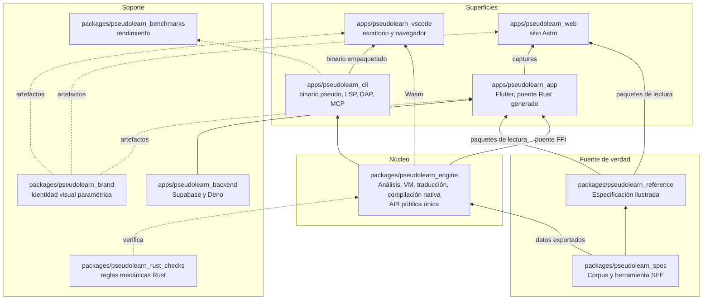
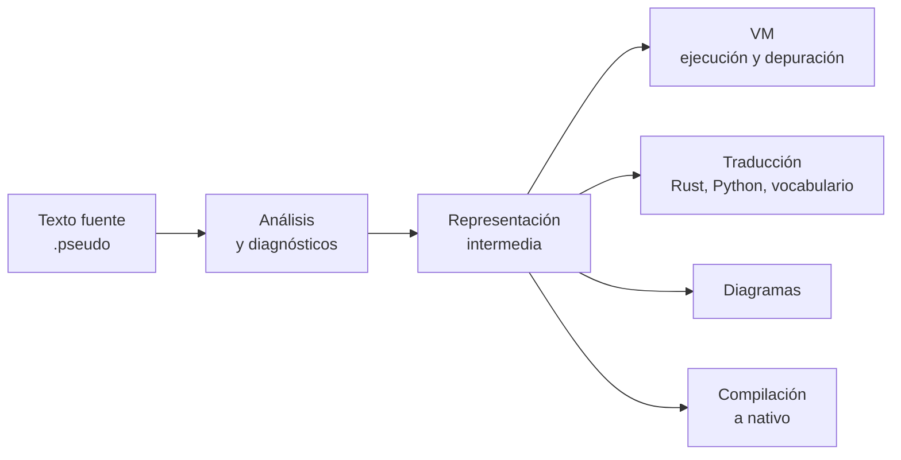

<div align="center">

# PseudoLearn

**Un lenguaje de programación para aprender a pensar como programador.**
Escríbelo en VS Code, ejecútalo en la app, compílalo a nativo.


</div>

---

## Qué es PseudoLearn

PseudoLearn nació como una app para practicar pseudocódigo y hoy es un **lenguaje de programación completo**,
con especificación propia, motor determinista y herramientas de primer nivel. Conserva la claridad del
pseudocódigo —se lee casi como una frase— pero se analiza, se ejecuta, se depura, se traduce y se compila a un
ejecutable nativo como cualquier lenguaje serio.

- **Dos vocabularios, un solo lenguaje.** El mismo programa se escribe en español (`Algoritmo`, `Escribir`, `Leer`) o
  en inglés (`subroutine`, `write`, `switch`) y se traduce de uno a otro sin perder significado.
- **Pensado para aprender.** Diagnósticos claros mientras escribes, ejecución paso a paso, diagramas generados desde
  el código y una ruta de aprendizaje guiada.
- **Pensado para usar.** Tipos de resultado (`result<T, E>`), `switch` exhaustivo, módulos, proyectos con varios
  archivos, acceso a red y archivos por capacidades explícitas, y compilación a nativo.
- **Una sola verdad.** Un corpus de especificaciones ejecutables define el comportamiento observable; todas las
  superficies consumen el mismo núcleo, así que lo que ves en el editor es lo que ejecuta la app.

```
Algoritmo Saludo
  Definir nombre Como Cadena;
  Escribir "Como te llamas?";
  Leer nombre;
  Escribir "Hola " + nombre;
FinAlgoritmo
```

## Dónde usarlo

| Superficie                                           | Qué ofrece                                                                                                                                                                                                                              | Estado                                                                                                       |
|------------------------------------------------------|-----------------------------------------------------------------------------------------------------------------------------------------------------------------------------------------------------------------------------------------|--------------------------------------------------------------------------------------------------------------|
| **Extensión de VS Code** (`apps/pseudolearn_vscode`) | Resaltado, errores en vivo, navegación, renombrado, ayuda en el cursor, ejecución con entrada por teclado, depuración, traducción de vocabulario y herramientas para asistentes de código. También en VS Code para la Web mediante Wasm | Versión previa de uso privado; se instala desde un VSIX en macOS con Apple silicon                           |
| **App PseudoLearn** (`apps/pseudolearn_app`)         | Editor con diagnósticos, ejecución paso a paso, ordinograma, estructograma y diagramas de clases, código equivalente, ruta de aprendizaje, cuenta con sincronización y el agente Nodo                                                   | Cliente Flutter para iOS, macOS y Windows; la validación de plataformas se limita inicialmente a macOS e iOS |
| **CLI `pseudo`** (`apps/pseudolearn_cli`)            | `comprobar`, `ejecutar`, `compilar`, `formatear`, `traducir`, `ri`, `bloquear`, `preferencias` y servidores LSP, DAP y MCP                                                                                                              | Base de las demás superficies de escritorio                                                                  |
| **Sitio web** (`apps/pseudolearn_web`)               | Presentación pública del producto                                                                                                                                                                                                       | Astro                                                                                                        |

## Arquitectura global

Todo parte del corpus. El motor Rust lo consume como datos generados y expone una única API pública; la CLI, la app,
la extensión y el navegador son clientes de esa misma API, nunca reimplementaciones.



La arquitectura interna no es común: el motor usa crates por capa, Flutter usa puertos de dominio y adaptadores, la web
aplica Feature-Sliced Design y el backend separa dominio, aplicación e infraestructura. Cada miembro documenta la suya.

### Flujo de un programa



## Tecnologías


## Mapa del monorepo

`packages/` contiene componentes reutilizables que no se despliegan; `apps/` contiene productos que se entregan a una
persona. La clasificación depende de la responsabilidad y no del lenguaje.

| Miembro                            | Responsabilidad                                                                                         | Cadena                         |
|------------------------------------|---------------------------------------------------------------------------------------------------------|--------------------------------|
| `packages/pseudolearn_engine`      | Núcleo Rust, VM, backend nativo y servicio de lenguaje                                                  | Cargo y rustup                 |
| `packages/pseudolearn_spec`        | Corpus y herramienta SEE                                                                                | Cargo y rustup                 |
| `packages/pseudolearn_rust_checks` | Reglas mecánicas Rust y casos negativos                                                                 | Cargo y rustup                 |
| `packages/pseudolearn_reference`   | Compilador y verificadores de la especificación ilustrada; genera los paquetes que leen la app y la web | Cargo y rustup                 |
| `packages/pseudolearn_benchmarks`  | Recolectores, estadísticas y evidencia de rendimiento                                                   | Dart; experimento Rust anidado |
| `packages/pseudolearn_brand`       | Generación paramétrica de identidad visual                                                              | Python y fonttools             |
| `apps/pseudolearn_app`             | Cliente Flutter con puente Rust generado                                                                | Flutter, Dart y Cargo          |
| `apps/pseudolearn_cli`             | Órdenes de usuario y adaptadores de conformidad                                                         | Cargo y rustup                 |
| `apps/pseudolearn_backend`         | Backend Supabase                                                                                        | Deno y CLI de Supabase         |
| `apps/pseudolearn_web`             | Sitio web Astro                                                                                         | Node y pnpm                    |
| `apps/pseudolearn_vscode`          | Extensión local de escritorio para VS Code                                                              | Node 22.23.3 y pnpm 12.8.1     |

El sujeto histórico `reference` está retirado y no tiene relación con `packages/pseudolearn_reference`, que es el libro
de la especificación. Su manifiesto y sus resultados pertenecen al sistema de especificaciones; el repositorio no
instala ni ejecuta una segunda implementación del núcleo. Los presupuestos AOT incumplidos y las validaciones de
plataforma sin evidencia permanecen declarados en sus miembros.

## Empezar

Cada miembro usa exclusivamente su cadena de herramientas; no hay workspace Cargo raíz ni orquestador global. Las
versiones exactas y los comandos completos viven en el README de cada miembro, sección «Cómo se verifica».

| Quiero                                  | Desde                             | Comando base                                                                                                                                       |
|-----------------------------------------|-----------------------------------|----------------------------------------------------------------------------------------------------------------------------------------------------|
| Verificar el núcleo, la CLI o el corpus | el miembro Rust                   | `cargo xtask verify`                                                                                                                               |
| Probar la app                           | `apps/pseudolearn_app`            | `flutter pub get` y `flutter test`, tras compilar la biblioteca local con `cargo build --release --locked --lib --manifest-path native/Cargo.toml` |
| Verificar la extensión                  | `apps/pseudolearn_vscode`         | `pnpm install --frozen-lockfile`, `pnpm test`, `pnpm build` y `pnpm package`                                                                       |
| Verificar el sitio                      | `apps/pseudolearn_web`            | `pnpm install --frozen-lockfile` y `pnpm check:all`                                                                                                |
| Verificar el backend                    | `apps/pseudolearn_backend`        | `deno task verify`                                                                                                                                 |
| Verificar la marca                      | `packages/pseudolearn_brand`      | `python3 -m pseudolearn_brand check`                                                                                                               |
| Verificar las métricas                  | `packages/pseudolearn_benchmarks` | `dart pub get`, `dart test` y `dart run tool/check.dart`                                                                                           |

Los secretos de despliegue se configuran en los canales de publicación; no son requisitos de tests unitarios. Ninguna
comprobación local autoriza por sí misma un despliegue productivo.

## Decisiones de diseño y fundamentos técnicos

**Miembros definidos por papel.** El problema de agrupar por lenguaje es que una biblioteca Python o Rust terminaría
fuera del mapa de componentes reutilizables. `packages/` expresa reutilización sin despliegue y `apps/` expresa entrega.
Se descarta crear una carpeta raíz por excepción o reescribir herramientas de geometría para uniformar lenguajes.

**Verificación nativa por miembro.** Las cadenas tienen gestores y verificadores distintos. Se usan sus comandos
documentados sin un orquestador externo. Se descartan un workspace Cargo raíz y un `pubspec.yaml` raíz porque
impondrían acoplamiento entre miembros con ciclos de distribución distintos.

**API única del lenguaje.** Flutter, CLI, extensión y Wasm consumen el mismo núcleo Rust y los datos generados del
corpus. Se descartan analizadores o tablas normativas duplicados en consumidores. Probar varias fronteras del mismo
núcleo aporta cobertura de integración, no un oráculo independiente.

**Artefactos generados.** Solo se versionan salidas consumidas por otro build, como enlaces del puente y artefactos de
marca declarados. El generador y su comprobación son los dueños; editar una copia manualmente destruiría la
correspondencia entre fuente y producto.

**Dependencias y locks.** Las aplicaciones conservan sus locks. Las bibliotecas Dart no los versionan. Cada workspace
Rust conserva su grafo y verifica licencias, fuentes y dependencias con cargo-deny.

**Comportamiento didáctico en el corpus.** Los perfiles de sintaxis y el idioma de interfaz son ejes independientes.
Las superficies de la app se sincronizan mediante identidades del programa, no mediante números de línea.

## Verificación y calidad

La verificación habitual es local. `verify-monorepo.yml` se ejecuta únicamente por despacho manual y su trabajo
`native-target` compila y ejecuta los programas de aceptación de `pseudo compilar` en Linux x64, macOS x86_64,
macOS arm64 y Windows x64; con la entrada `native_targets_only` se ejecuta solo ese trabajo. Los workflows productivos
conservan sus disparadores propios. Los resultados de un sistema operativo no certifican otro.

SEE verifica corpus, anclajes, exportaciones, conformidad, propiedades y referencias documentales, y su puerta local
rechaza dependencias operativas del núcleo retirado. Las suites reflejan sus capas y cubren caminos felices, fallos y
límites; cada verificador mecánico incluye una violación deliberada que debe rechazar. Un resultado de rendimiento
desfavorable no se convierte en exención ni se sustituye por otro estimador.

## Contribuir

La guía para contribuir está en [`CONTRIBUTING.md`](CONTRIBUTING.md): qué se acepta, las reglas que sorprenden, cómo
verificar cada miembro y el formato de commits. La participación se rige por el
[código de conducta](CODE_OF_CONDUCT.md). Las reglas transversales con sus identificadores viven en
[`AGENTS.md`](AGENTS.md).

## Licencia

Apache-2.0 para todo el monorepo, incluido el corpus de especificaciones, con titularidad de César Antonio Gutiérrez
Contreras desde 2026. Cada miembro lleva una copia de `LICENSE` y un `NOTICE` que quien redistribuya un miembro por
separado debe conservar; la extensión de VS Code usa `LICENSE.md` por la convención del empaquetador. Apache-2.0 se
eligió sobre MIT por el archivo `NOTICE`, que propaga la atribución, y por su concesión expresa de patentes; sobre CC-BY
para el corpus porque no está aprobada por la OSI y podría objetarse al firmar binarios que lo empaquetan. Se descarta
el
copyleft porque no se pretende restringir derivados cerrados, solo conservar la atribución. Los crates Rust no declaran
`license` porque ninguno se publica (`publish = false`). Las dependencias y fuentes tipográficas conservan sus licencias
propias.

## Fuentes consultadas

La separación entre componentes reutilizables y aplicaciones adopta la convención de monorepos Dart/Flutter y la aplica
también a Rust y Python, sin adoptar un orquestador Dart para miembros que no comparten su gestor de paquetes. Las
referencias externas específicas se registran en los README de cada miembro.
