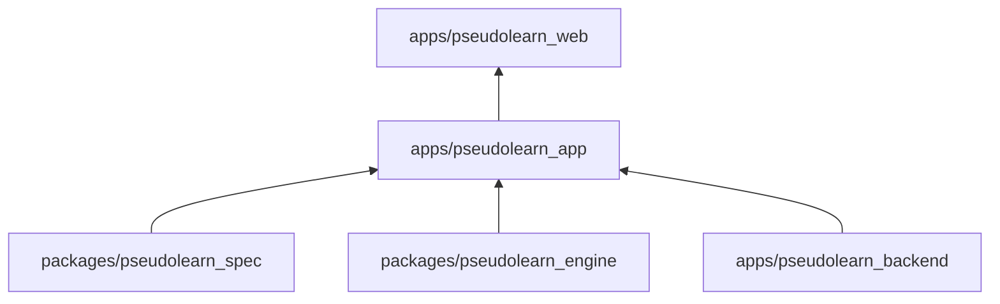
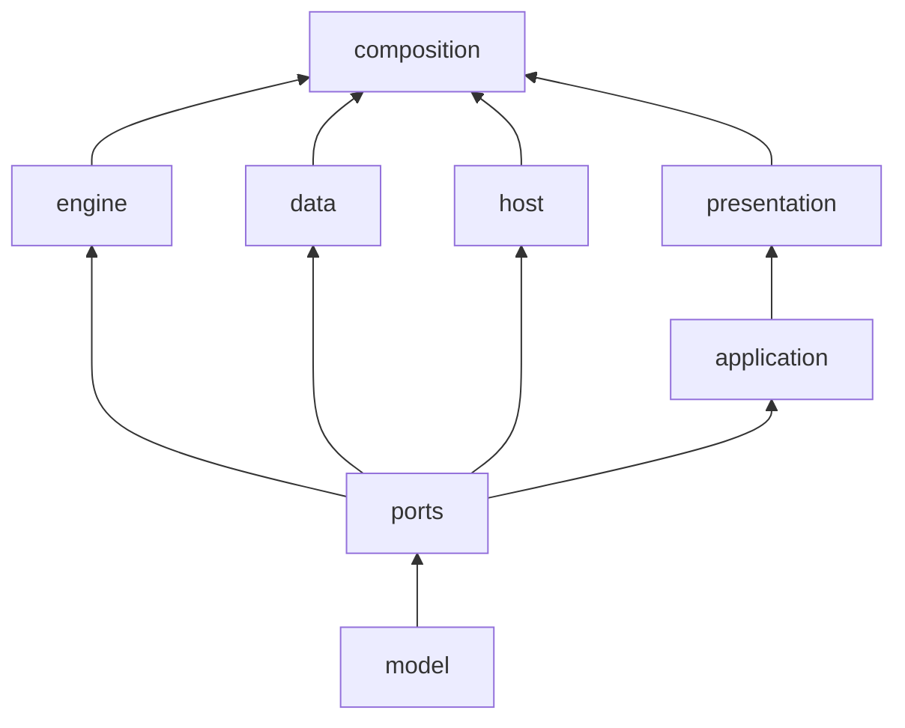
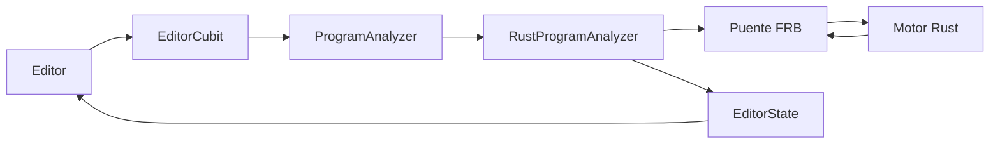

# pseudolearn_app

Aplicación Flutter de PseudoLearn: un editor de pseudocódigo con diagnósticos, ejecución paso a paso, diagramas
(ordinograma, estructograma y clases), código equivalente, ruta de aprendizaje, cuenta con sincronización y el agente
Nodo. Analiza y ejecuta programas llamando al motor Rust a través de un puente generado.

**No hace:** no define el lenguaje ni lo interpreta en Dart (el motor y el corpus son dueños de eso), no tiene backend
propio (usa el de `apps/pseudolearn_backend`) y no cuenta con carpeta `web/`: solo existen `ios/`, `macos/` y
`windows/`.

## Dónde encaja

- `pseudolearn_engine`: el crate `native/` depende de `pseudolearn_host` y `pseudolearn_api` por ruta.
- `pseudolearn_spec`: `tool/prepare_generated.sh` ejecuta `see export` para generar los activos del corpus.
- `pseudolearn_backend`: la app llama a `delete-account`, `agent-responses` y `agent-credits` en tiempo de ejecución.
- `pseudolearn_web`: `tool/generate_product_shot.dart` escribe las capturas en `../pseudolearn_web/src/assets/product`:
  editor con diagramas, Tareas (con `tool/product/tasks_demo_*.pseudo` y sesión observable), primera lección y ruta, en
  claro y oscuro, `es` y `en`. Cada escena limpia la caché de `rootBundle` porque una carga pendiente de la escena
  anterior
  deja la siguiente sin datos.
- `pseudolearn_store_media`: `tool/generate_store_plates.dart` graba **placas**, secuencias de fotogramas de la UI
  real con el motor nativo real, en `build/store-plates/<escena>/<idioma>/`, junto con un `timeline.json` con los
  rectángulos de interés y los hitos (instrucción, nodo de diagrama, mensaje de Nodo, final). El motor de tienda
  compone y codifica a partir de ellas; la app no compone nada. `PlateRecorder` avanza el reloj de prueba un
  fotograma exacto por captura, así que la grabación es determinista y no depende de un simulador. El formato está
  fijado por `tool/store_plates/plate_timeline_test.dart` contra el mismo archivo de contrato que prueba el motor.
  Además de la calibración, graba una placa fija por **capítulo** de las capturas (`chapter-idea`, `chapter-run`,
  `chapter-trace`, `chapter-nodo`, `chapter-code`, `chapter-route`), por dispositivo, tema e idioma, en
  `build/store-plates/<capítulo>/<dispositivo>/<tema>/<idioma>/`. Los dispositivos (tamaño lógico y escala) se leen de
  `packages/pseudolearn_store_media/catalog/slots.json`, que es su única fuente. Cada escena comprueba lo que muestra
  antes de grabar: programa en pausa a mitad de ejecución, tabla con filas, código equivalente no vacío, ruta cargada
  y, en `chapter-nodo`, la etiqueta «IA» de Nodo y el código de su respuesta **verificado por el analizador real**. La
  respuesta de Nodo sale de `FakeAgentModelGateway` con un guion (`tool/store_plates/nodo_script.dart`), con sesión,
  créditos y consentimiento simulados; el resto de la UI y el análisis son los reales. `--dart-define` con
  `STORE_PLATE_DEVICES`, `STORE_PLATE_CHAPTERS` y `STORE_PLATE_THEMES` (listas separadas por comas) acota la grabación.
  Cada placa de capítulo guarda en su `timeline.json` los rectángulos de las piezas que el motor resalta (`editor`,
  `diagram`, `output`, `trace`, `question`, `answer`, `verified-code`, `export`, `lesson`). `chapter-code` muestra la
  exportación a Rust, porque la de Python abre con funciones auxiliares de lectura que no cuentan nada. Antes de grabar,
  el generador comprueba con el analizador real que el código que la historia de capturas muestra
  (`packages/pseudolearn_store_media/stories/app-store-screenshots.json`) es un programa válido en `es` y en `en`.
  En el dispositivo `windows-desktop` (capturas de Microsoft Store) se graban además tres escenas de escritorio
  (`tool/store_plates/desktop_scenes.dart`): `desk-run`, `desk-trace` y `desk-code` abren la demo guiada con el modo
  «Acompañar» activado, de modo que el editor queda al lado del ordinograma, de la prueba de escritorio o del código
  equivalente, y se detienen en el paso 5. Es UI que solo existe en la clase expandida; en pasos posteriores la tabla
  se desplaza y la fila en curso baja al tercio inferior, que Microsoft reserva para superposiciones. Solo se graban en
  ese dispositivo porque en un teléfono «Acompañar» apila los paneles y no aporta nada a las capturas de Apple.
- `pseudolearn_store_media` (tráiler de Microsoft Store): `tool/generate_trailer_plates.dart` graba una **placa
  animada**, `trailer-run` (`tool/store_plates/trailer_scene.dart`): abre la demo guiada en el ordinograma y después
  avanza paso a paso como una persona, tocando sin esperar a que la UI se asiente, mientras `PlateRecorder` captura
  fotograma a fotograma. Así se graban las animaciones que la app hace de verdad, y ninguna inventada. Cada toque se
  marca como evento `tap` con su punto en píxeles. Un fotograma idéntico al anterior no se vuelve a escribir: su
  entrada de `timeline.json` repite el archivo. El dispositivo es el que declara la ranura `trailer` del catálogo del
  motor (`windows-trailer`, 1280 × 720 pt × 1,5 = 1920 × 1080). La placa va a
  `build/trailer-plates/trailer-run/<dispositivo>/<tema>/<idioma>/`; el motor la usa en los últimos segundos del
  tráiler. `tool/store_plates/plate_stage.dart` reúne la preparación que comparten los dos generadores. El grabador
  recorta cada rectángulo de interés a la placa y omite el que queda fuera, porque el contrato solo admite rectángulos
  dentro de la placa.
- La composición antigua de capturas en Flutter (`tool/generate_store_material.dart` y sus piezas de `tool/product/`)
  se retiró: el motor de tienda produce ahora todas las capturas de App Store, y la app solo graba placas. Con ella se
  fueron los objetivos de Google Play, donde la app no está publicada.

## Arquitectura

Se omiten las aristas desde `model` hacia todas las demás capas y las de `composition` hacia `ports` y `application`.
Las flechas van de la dependencia a quien la usa.

| Capa           | Carpeta            | Qué hace                                                                    |
|:---------------|:-------------------|:----------------------------------------------------------------------------|
| `model`        | `lib/domain/model` | Datos inmutables y funciones puras del dominio                              |
| `ports`        | `lib/domain/ports` | Interfaces que la app necesita del exterior                                 |
| `engine`       | `lib/engine`       | Adapta el puente Rust a los puertos y calcula la geometría de los diagramas |
| `data`         | `lib/data`         | Archivos `.pseudo`, SQLite, Supabase, plataforma, activos y compras         |
| `host`         | `lib/host`         | Carpeta de trabajo real de la ejecución de cada documento                   |
| `application`  | `lib/application`  | Cubits de estado de vista y casos de uso en Dart puro                       |
| `presentation` | `lib/presentation` | Widgets, pintores, tema, localización y navegación con `go_router`          |
| `composition`  | `lib/composition`  | Ensamblado estático de dependencias en el arranque, sin condicionales       |

El puente vive en `native/` (crate `pseudolearn_bridge`) y genera `lib/engine/bridge/` con
`flutter_rust_bridge`; `hook/build.dart` lo compila como activo nativo.

## Flujo principal

Flujo de una edición, no de dependencias:

## Reglas que conviene saber

- Una capa solo importa de las que lista `may_import` en `architecture.yaml`; dentro de `lib/` los imports son
  relativos.
- Solo `engine` conoce el transporte del motor; `presentation` no puede importar `engine`, `data` ni `ports`.
- Las preguntas al sistema operativo viven en archivos declarados de `data/platform/`; los widgets adaptativos
  (`Switch.adaptive` y similares) están prohibidos y `MediaQuery` solo se consulta en `presentation/shell/`.
- `composition` no tiene `if`, `switch` ni ternarios, y `presentation` no deriva datos (`where`, `sort`, `fold`) ni usa
  `await`.
- Límites: 250 líneas por archivo, 40 por función, 30 por `build`, 3 parámetros posicionales, anidación 3 y 5 métodos
  públicos por clase. Sin comentarios en el código.

## Seguridad

Decisiones que salen de una auditoría de seguridad del 2026-11-10.

- **El callback de inicio de sesión solo completa un PKCE.** gotrue 2.27.3, incluso en modo PKCE, instala la sesión que
  llegue en `#access_token=…` tras validarla con `GET /user`. Cualquier página u otra app podía abrir
  `pseudolearn://auth-callback` con los tokens de su propia cuenta: la app cambiaba de cuenta sin avisar y la siguiente
  sincronización subía los documentos locales a esa cuenta. `SupabaseAuthGateway.completeSignInFromLink` rechaza ahora,
  antes de llamar a gotrue, cualquier callback que lleve `access_token` o `refresh_token` en la query o en el fragmento
  (`carriesSessionTokens` en `data/auth/auth_callback_link.dart`). Un código sin verificador local ya se rechazaba.
- **Lo que ejecuta Nodo no toca archivos, red ni entorno.** `run_program` es una herramienta de lectura que no pide
  confirmación y que promete al modelo que no tiene efectos, pero su ejecutor resolvía cada efecto contra el host
  físico con autoridad completa: el directorio actual, rutas absolutas, red y variables de entorno. Ahora el ejecutor del
  agente usa `RustEffectPolicy.contained()` (`engine/rust/rust_effect_policy.dart`). La compuerta solo envía al host la
  consola, los argumentos, el reloj y las esperas. Cualquier otro efecto recibe `permiso_denegado` sin abrir el host, y
  el programa lo ve como un error tipado. Se descartó `autoResolveEffects: false`, porque la consola también es un
  efecto del host y el programa se habría detenido en su primer `Escribir`. La ejecución interactiva del editor no
  cambia: la persona ejecuta su propio programa.

**Pendientes declarados**

- Los evaluadores de ejercicios y de ruta (`exerciseChecker`, `routeEvaluators`) siguen ejecutando con efectos reales.
  Las lecciones de la Parte «exterior» usan archivos y red, así que contenerlos exige decidir antes qué efectos simula
  cada caso. Queda para una auditoría propia.

## iPhone Duo y ventanas que cambian de tamaño

Con el SDK de iOS 27.1 la app ocupa toda la pantalla de iPhone Duo y su tamaño cambia en caliente al plegar, desplegar o
girar. La pantalla exterior mide 466 × 678 pt en vertical y deja 84 pt a la derecha para la barra de estado y la cámara.
La interior mide 951 × 669 pt en apaisado (84 pt a la derecha y 34 pt abajo) y 669 × 951 pt en vertical (82 pt arriba).
Son las métricas medidas en el simulador de Xcode 27.2.

**Decisiones y su por qué**

- **Orientaciones de iPhone: vertical y las dos apaisadas** (`Info.plist`). Según Apple, la pantalla interior no respeta
  las orientaciones declaradas, así que la app ya se mostraba apaisada aunque solo declarara la vertical. En ese estado,
  Device Hub entregaba los clics girados 180°: un clic sobre el rail llegaba a la columna de la barra de estado y uno
  sobre el botón de Nodo, a la esquina superior izquierda. Por eso parecían botones muertos. Al declarar las
  apaisadas, la correspondencia es exacta. La vertical invertida no se declara en iPhone.
- **Los comandos de ejecución encogen antes que desbordarse.** La clase de dispositivo sale del ancho de la ventana,
  pero la barra de `ExecutionStepper` mide menos (el rail y el panel de Nodo le quitan espacio). En el borde inferior
  de cada clase sus comandos no cabían: 11 px de más en una ventana de 600 pt y 35 px en una de 960 pt. Ahora el grupo
  de comandos ocupa el espacio que deja el botón de opciones y, solo si no cabe, se reduce lo justo (`FittedBox` con
  `BoxFit.scaleDown`), nunca se amplía; a 960 pt la reducción es del 4 % y donde caben conserva su tamaño. Se
  descartó cambiar etiquetas por iconos según un ancho umbral, porque el umbral depende de la longitud de cada idioma.
- **El botón de Nodo vive dentro del área segura.** `AdaptiveShell` lo coloca en una capa con `SafeArea`; antes caía
  bajo
  la columna de la barra de estado en apaisado y sobre el indicador de inicio.
- **El panel de Nodo decide su colocación en cada `build`, no al abrirse** (`agent_chat_presentation.dart`). Es una sola
  ruta de diálogo: en clase compacta ocupa el ancho seguro abajo, al 92 % de alto; en media y expandida, el 36 % del
  ancho a la derecha. Si la ventana cambia con el panel abierto, cambia de colocación sin cerrarse y la conversación
  sigue en su cubit. Respeta todos los insets y sube con el teclado. Se pierde el gesto de arrastrar hacia abajo de la
  hoja inferior; se cierra con la barrera o con el botón de cerrar.
- **El rail crece con el inset izquierdo y sus destinos hacen scroll.** Ahora que iPhone gira, la isla dinámica puede
  quedar a la izquierda (62 pt) y la altura apaisada baja a ~400 pt. `NavigationRail` aplica él mismo el área segura del
  lado inicial, así que el ancho del rail suma ese inset en vez de restarlo de los 96 pt.
- **La barra inferior crece con el texto.** Tiene 64 pt de mínimo, no de máximo; con escala de texto 2,0 desbordaba 2
  px.
- **Se mantienen las clases por ancho (600 y 960).** Apple recomienda las clases de tamaño de UIKit y desaconseja
  breakpoints ligados a una pantalla concreta. Flutter no expone esas clases, y los umbrales son del ancho de ventana,
  no de un dispositivo. El resultado coincide con la guía: exterior vertical compacta (barra inferior) e interior y
  exterior apaisada con controles al lado (rail).
- **Barras verticales del SDK 27.1:** solo afectan a barras nativas de UIKit y SwiftUI. Flutter dibuja las suyas, y el
  rail cumple ese papel en apaisado.
- **Proyecto Xcode:** los targets heredan `IPHONEOS_DEPLOYMENT_TARGET = 15.0` del proyecto. El valor
  `$(RECOMMENDED_IPHONEOS_DEPLOYMENT_TARGET)` que añade la actualización de ajustes de Xcode 27 rompe `pod install`
  (CocoaPods 1.17 no lo interpreta).

**Fuentes y qué se tomó**

| Fuente                                                                                                                                                 | Se tomó                                                                                   | Se rechazó                                     |
|:-------------------------------------------------------------------------------------------------------------------------------------------------------|:------------------------------------------------------------------------------------------|:-----------------------------------------------|
| [Prepare](https://developer.apple.com/iphone-duo/prepare/)                                                                                             | Comportamiento por SDK, barras verticales, no decidir por orientación, idiom ni clase     | —                                              |
| [Tech Talk 111461](https://developer.apple.com/videos/play/tech-talks/111461/)                                                                         | La pantalla interior ignora las orientaciones; insets asimétricos; se recomienda apaisado | —                                              |
| [Tech Talk 111466](https://developer.apple.com/videos/play/tech-talks/111466/)                                                                         | Controles al lado en apaisado; no ligar funciones a una pose                              | Sustituir breakpoints (ver decisión de clases) |
| [Tech Talks 111463](https://developer.apple.com/videos/play/tech-talks/111463/) y [111464](https://developer.apple.com/videos/play/tech-talks/111464/) | Regiones reservadas, bisagra y escenas como referencia                                    | Sin API en Flutter; no se implementan          |
| [Notas de Xcode 27.2](https://developer.apple.com/documentation/xcode-release-notes/xcode-27_2-release-notes)                                          | Problemas conocidos de entrada en Device Hub al cambiar de pantalla                       | —                                              |
| [NavigationRail (fuente)](https://github.com/flutter/flutter/blob/main/packages/flutter/lib/src/material/navigation_rail.dart)                         | Aplica `SafeArea` en el lado inicial                                                      | —                                              |
| [flutter#192515](https://github.com/flutter/flutter/issues/192515), [#195954](https://github.com/flutter/flutter/issues/195954)                        | Pendientes del motor (ver abajo)                                                          | Parches del embebedor iOS                      |

**Poses probadas en el simulador iPhone Duo (iOS 27.2)**

Los toques se inyectaron con el control de simulador. Cada toque se comprobó con el árbol de hit-test y una captura.

| Pose                                  | Tamaño (pt) | Rail o barra | Nodo | Panel              | Estado conservado        |
|:--------------------------------------|:------------|:-------------|:-----|:-------------------|:-------------------------|
| Abierto, apaisado                     | 951 × 669   | ✅           | ✅   | ✅ lateral         | —                        |
| Abierto, girado a vertical            | 669 × 951   | ✅           | ✅   | ✅ lateral         | ✅ texto del buscador    |
| Abierto, segunda orientación apaisada | 951 × 669   | ✅           | ✅   | —                  | ✅ ruta                  |
| Parcialmente abierto                  | 951 × 669   | ✅           | ✅   | ✅ lateral         | ✅ ruta                  |
| Cerrado (exterior)                    | 466 × 678   | ✅           | ✅   | ✅ inferior        | ✅ ruta                  |
| Plegar con el panel abierto           | → 466 × 678 | —            | —    | ✅ pasa a inferior | ✅ panel sigue abierto   |
| Desplegar con el teclado visible      | → 951 × 669 | —            | —    | —                  | ✅ texto, foco y teclado |
| Plegar con un diálogo abierto         | → 466 × 678 | —            | —    | —                  | ✅ selección del diálogo |
| iPad Air 11 (M4), vertical            | 820 × 1180  | ✅           | ✅   | ✅ lateral         | —                        |

**Pendientes declarados**

- **Device Hub pierde los clics de ratón en franjas laterales** de la pantalla interior apaisada (x < ~150 pt y
  x > ~825 pt), también en la app Ajustes de Apple. Los toques inyectados y el resto de la pantalla funcionan. No se
  verificó en hardware real; hay que reportarlo por Feedback Assistant.
- Flutter no recibe la bisagra ni las regiones reservadas
  ([flutter#192515](https://github.com/flutter/flutter/issues/192515)):
  en la pose parcialmente abierta nada evita el pliegue.
- [flutter#195954](https://github.com/flutter/flutter/issues/195954): congelación con tamaños fraccionarios en Split
  View arriba/abajo. No se probó Split View.
- Simulador redimensionable: Device Hub 27.2 no ofrece ese modelo en «Add Device»; no se probó.
- En la pantalla interior apaisada, el símbolo de marca del rail se pinta desplazado y recortado en la esquina; en
  vertical y en iPad se ve bien, y en los tests está centrado. Sin diagnosticar.
- Pose exterior apaisada (678 × 466): está cubierta por tests de widget; en el simulador el exterior siempre se mostró
  vertical.
- En tests de widget a 1280 × 720 pt, cuando el catálogo de conocimiento se abre mientras la app ya está en marcha, su
  carga no se asienta (`pumpAndSettle` agota el tiempo); a 443 × 960 y 1032 × 1376 pt sí. La causa de la animación que
  no termina está sin diagnosticar.

**Lo que falta fuera del código para App Store**

- [ ] Capturas de iPhone Duo en App Store Connect según
  [las especificaciones](https://developer.apple.com/help/app-store-connect/reference/screenshot-specifications)
  (interior 2853 × 2007 y 2007 × 2853; exterior 2034 × 1398 y 1398 × 2034; hasta 10 por tamaño; PNG o JPEG sin
  transparencia). Según la noticia de Apple, serán obligatorias desde abril de 2027. La app graba las placas de las
  cuatro poses y `pseudolearn_store_media` ya produce esas capturas en `es` y `en`; falta subirlas.
- [ ] Revisar el producto con la nueva herramienta de preview de App Store Connect.
- [ ] Nominación de featuring: en «Helpful Details», indicar que la app está optimizada para iPhone Duo con todas las
  poses.
- [ ] Opcional: vista previa en vídeo de 1920 × 886 o 886 × 1920.

## Comandos útiles

| Para qué                                     | Comando                                                                                               |
|:---------------------------------------------|:------------------------------------------------------------------------------------------------------|
| Instalar dependencias                        | `flutter pub get`                                                                                     |
| Generar exportación, l10n, puente y activos  | `bash tool/prepare_generated.sh`                                                                      |
| Ejecutar en macOS                            | `flutter run -d macos --dart-define-from-file=dart_define.local.json`                                 |
| Análisis estático                            | `flutter analyze --fatal-infos --fatal-warnings`                                                      |
| Tests de la app                              | `flutter test`                                                                                        |
| Tests del puente contra la biblioteca nativa | `bash tool/test_bridge.sh`                                                                            |
| Límites de `architecture.yaml`               | `dart run tool/check_limits.dart`                                                                     |
| Sistema de diseño                            | `dart run tool/check_design_system.dart`                                                              |
| Cobertura de formas de la vista              | `dart run tool/check_syntax_coverage.dart`                                                            |
| Manual de usuario en `es` y `en`             | `dart run tool/check_manual.dart`                                                                     |
| Conformidad del sujeto `app`                 | `cargo run -p see_cli --bin see -- conform --subject app` (en `packages/pseudolearn_spec`)            |
| Grabar las placas para las tiendas           | `flutter test tool/generate_store_plates.dart` (con la biblioteca nativa en release)                  |
| Grabar solo algunas placas                   | `flutter test tool/generate_store_plates.dart --dart-define=STORE_PLATE_DEVICES=mac`                  |
| Grabar la placa animada del tráiler          | `flutter test tool/generate_trailer_plates.dart` (con la biblioteca nativa en release)                |
| Compilar                                     | `flutter build macos --release`, `flutter build ipa --no-codesign`, `flutter build windows --release` |

Requisitos: Flutter 3.47.5 (fijado en `pubspec.yaml`), Dart `^3.9.0` y Rust según `native/rust-toolchain.toml` solo para
compilar el puente. El inicio de sesión y la sincronización necesitan `SUPABASE_URL`, `SUPABASE_ANON_KEY` y
`GOOGLE_IOS_CLIENT_ID` en `dart_define.local.json`, que no se versiona.
