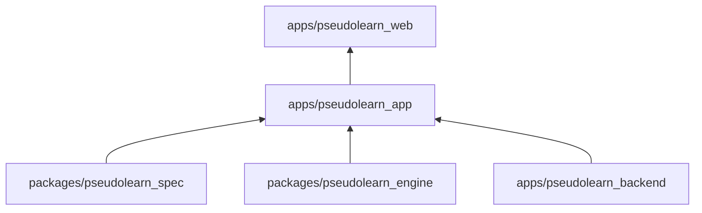
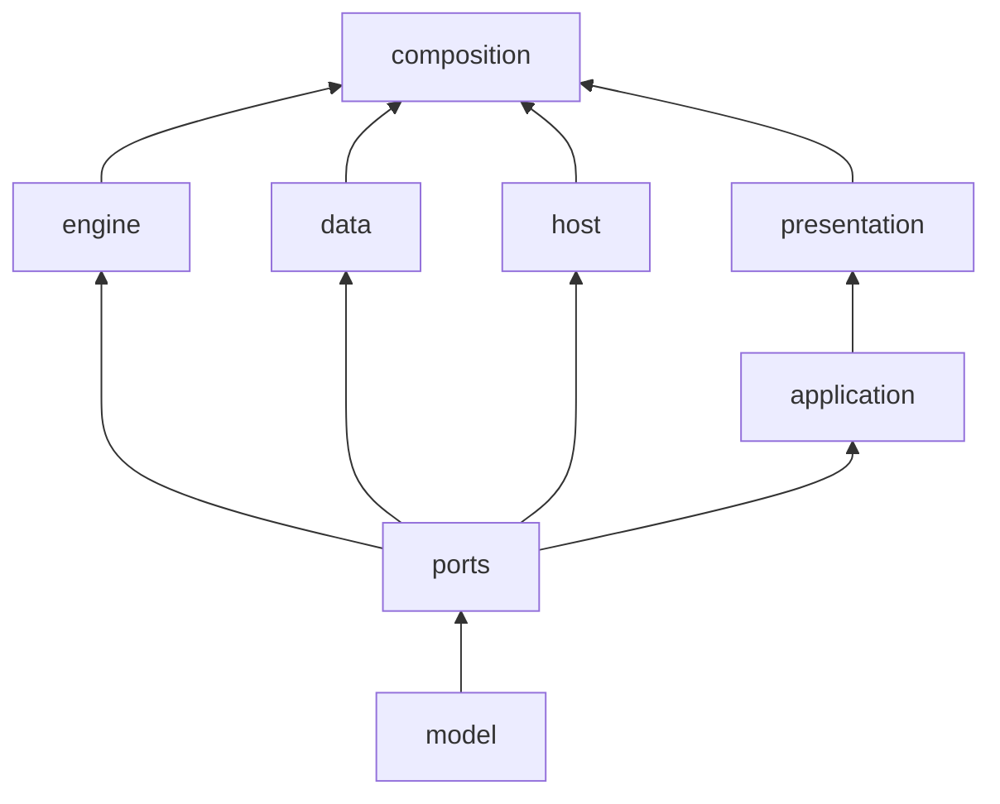
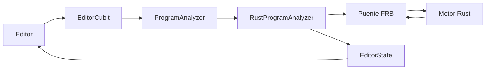

# pseudolearn_app

Aplicación Flutter de PseudoLearn: un editor de pseudocódigo con diagnósticos, ejecución paso a paso, diagramas
(ordinograma, estructograma y clases), código equivalente, ruta de aprendizaje, cuenta con sincronización y el agente
Nodo. Analiza y ejecuta programas llamando al motor Rust a través de un puente generado.

**No hace:** no define el lenguaje ni lo interpreta en Dart (el motor y el corpus son dueños de eso), no tiene backend
propio (usa el de `apps/pseudolearn_backend`) y no cuenta con carpeta `web/`: solo existen `ios/`, `macos/` y
`windows/`.

## Dónde encaja

- `pseudolearn_engine`: el crate `native/` depende de `pseudolearn_host` y `pseudolearn_api` por ruta.
- `pseudolearn_spec`: `tool/prepare_generated.sh` ejecuta `see export` para generar los activos del corpus.
- `pseudolearn_backend`: la app llama a `delete-account`, `agent-responses` y `agent-credits` en tiempo de ejecución.
- `pseudolearn_web`: `tool/generate_product_shot.dart` escribe las capturas en `../pseudolearn_web/src/assets/product`.

## Arquitectura

Se omiten las aristas desde `model` hacia todas las demás capas y las de `composition` hacia `ports` y `application`.
Las flechas van de la dependencia a quien la usa.

| Capa           | Carpeta            | Qué hace                                                                    |
|:---------------|:-------------------|:----------------------------------------------------------------------------|
| `model`        | `lib/domain/model` | Datos inmutables y funciones puras del dominio                              |
| `ports`        | `lib/domain/ports` | Interfaces que la app necesita del exterior                                 |
| `engine`       | `lib/engine`       | Adapta el puente Rust a los puertos y calcula la geometría de los diagramas |
| `data`         | `lib/data`         | Archivos `.pseudo`, SQLite, Supabase, plataforma, activos y compras         |
| `host`         | `lib/host`         | Carpeta de trabajo real de la ejecución de cada documento                   |
| `application`  | `lib/application`  | Cubits de estado de vista y casos de uso en Dart puro                       |
| `presentation` | `lib/presentation` | Widgets, pintores, tema, localización y navegación con `go_router`          |
| `composition`  | `lib/composition`  | Ensamblado estático de dependencias en el arranque, sin condicionales       |

El puente vive en `native/` (crate `pseudolearn_bridge`) y genera `lib/engine/bridge/` con
`flutter_rust_bridge`; `hook/build.dart` lo compila como activo nativo.

## Flujo principal

Flujo de una edición, no de dependencias:

## Reglas que conviene saber

- Una capa solo importa de las que lista `may_import` en `architecture.yaml`; dentro de `lib/` los imports son
  relativos.
- Solo `engine` conoce el transporte del motor; `presentation` no puede importar `engine`, `data` ni `ports`.
- Las preguntas al sistema operativo viven en archivos declarados de `data/platform/`; los widgets adaptativos
  (`Switch.adaptive` y similares) están prohibidos y `MediaQuery` solo se consulta en `presentation/shell/`.
- `composition` no tiene `if`, `switch` ni ternarios, y `presentation` no deriva datos (`where`, `sort`, `fold`) ni usa
  `await`.
- Límites: 250 líneas por archivo, 40 por función, 30 por `build`, 3 parámetros posicionales, anidación 3 y 5 métodos
  públicos por clase. Sin comentarios en el código.

## Comandos útiles

| Para qué                                     | Comando                                                                                               |
|:---------------------------------------------|:------------------------------------------------------------------------------------------------------|
| Instalar dependencias                        | `flutter pub get`                                                                                     |
| Generar exportación, l10n, puente y activos  | `bash tool/prepare_generated.sh`                                                                      |
| Ejecutar en macOS                            | `flutter run -d macos --dart-define-from-file=dart_define.local.json`                                 |
| Análisis estático                            | `flutter analyze --fatal-infos --fatal-warnings`                                                      |
| Tests de la app                              | `flutter test`                                                                                        |
| Tests del puente contra la biblioteca nativa | `bash tool/test_bridge.sh`                                                                            |
| Límites de `architecture.yaml`               | `dart run tool/check_limits.dart`                                                                     |
| Sistema de diseño                            | `dart run tool/check_design_system.dart`                                                              |
| Cobertura de formas de la vista              | `dart run tool/check_syntax_coverage.dart`                                                            |
| Manual de usuario en `es` y `en`             | `dart run tool/check_manual.dart`                                                                     |
| Conformidad del sujeto `app`                 | `cargo run -p see_cli --bin see -- conform --subject app` (en `packages/pseudolearn_spec`)            |
| Compilar                                     | `flutter build macos --release`, `flutter build ipa --no-codesign`, `flutter build windows --release` |

Requisitos: Flutter 3.47.5 (fijado en `pubspec.yaml`), Dart `^3.9.0` y Rust según `native/rust-toolchain.toml` solo para
compilar el puente. El inicio de sesión y la sincronización necesitan `SUPABASE_URL`, `SUPABASE_ANON_KEY` y
`GOOGLE_IOS_CLIENT_ID` en `dart_define.local.json`, que no se versiona.
