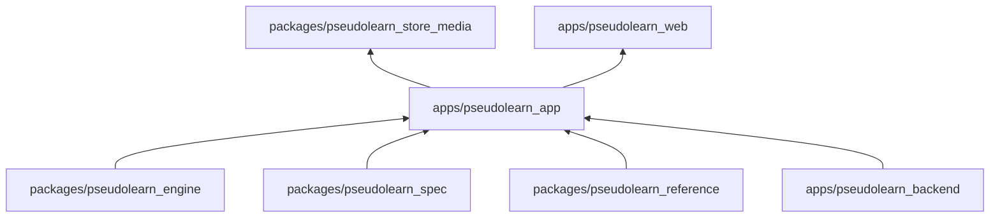
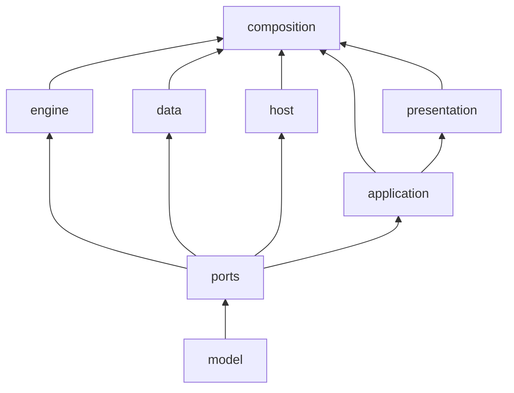
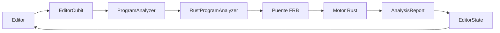

# pseudolearn_app

Aplicación Flutter de PseudoLearn para iOS, macOS, Windows y Android: editor de pseudocódigo con diagnósticos, ejecución paso a
paso, diagramas, código equivalente, ruta de aprendizaje, cuenta con sincronización y el agente Nodo. Analiza y ejecuta
los programas llamando al motor Rust a través de un puente generado (`native/`).

**No hace:** definir ni interpretar el lenguaje en Dart (lo hace el motor), tener backend propio (usa las funciones de
`apps/pseudolearn_backend`) ni publicarse en navegador: no existe carpeta `web/`, solo `ios/`, `macos/`, `windows/` y `android/`.

## Dónde encaja

Los vínculos no son dependencias de `pubspec.yaml`, que no declara ninguna por ruta:

- `engine`: `native/Cargo.toml` depende de `pseudolearn_api` y `pseudolearn_host` por ruta.
- `spec`: `tool/prepare_generated.sh` ejecuta `see export`, y `tool/syntax_coverage/help_catalog.dart` lee el catálogo
  `specifications/cases/catalogs.json`.
- `reference`: genera `assets/reference/` y `assets/route/` de la app.
- `backend`: en ejecución, la app llama a las funciones `agent-responses`, `agent-credits` y `delete-account`.
- `media`: `tool/generate_store_plates.dart` y `tool/generate_trailer_plates.dart` graban las placas que el motor de
  tienda lee de `build/store-plates`.
- `web`: `tool/generate_product_shot.dart` escribe las capturas en `../pseudolearn_web/src/assets/product`.

## Arquitectura

Ocho capas bajo `lib/`, declaradas en `architecture.yaml`. Las flechas van de la dependencia a quien la usa.

El diagrama omite las aristas desde `model` hacia las demás capas y las de `composition` hacia `model` y `ports`.

| Capa           | Carpeta            | Qué hace                                                                   |
|:---------------|:-------------------|:---------------------------------------------------------------------------|
| `model`        | `lib/domain/model` | Datos y reglas puras del dominio                                           |
| `ports`        | `lib/domain/ports` | Interfaces que la app necesita del exterior                                |
| `engine`       | `lib/engine`       | Adapta el puente Rust a los puertos y construye los diagramas              |
| `data`         | `lib/data`         | Documentos, índice, sincronización, cuenta, créditos, plataforma y activos |
| `host`         | `lib/host`         | Entorno local de ejecución de cada documento                               |
| `application`  | `lib/application`  | Cubits de estado de vista y casos de uso                                   |
| `presentation` | `lib/presentation` | Widgets, tema, localización (`l10n`) y rutas con `go_router`               |
| `composition`  | `lib/composition`  | Ensamblado de dependencias al arrancar                                     |

`native/` (crate `pseudolearn_bridge`, con su propio README) genera `lib/engine/bridge/` con `flutter_rust_bridge`, y
`hook/build.dart` lo compila como activo nativo.

## Flujo principal

Flujo de una edición, no de dependencias:

## Reglas que conviene saber

- Cada capa importa solo de sí misma y de las que lista `may_import`; `presentation` únicamente de `model` y
  `application`. Dentro de `lib/` los imports son relativos.
- Las preguntas al sistema operativo viven en cuatro archivos de `data/platform/`; los widgets adaptativos
  (`Switch.adaptive` y similares) están prohibidos y `MediaQuery` solo se consulta en `presentation/shell/`.
- `composition` no admite condicionales; `presentation` no filtra, ordena ni agrega datos (`where`, `fold`, `sort`…) ni
  usa `await`; los campos de estado de `application` son `final`.
- Ejecutar (y Continuar o Reproducir) es una ejecución continua, no un paso a paso acelerado: el editor, el diagrama y
  el código equivalente no siguen el foco hasta que la ejecución pide una entrada o termina, la barra solo ofrece
  Detener, y el estado se publica como mucho cada 100 ms. Tampoco lee las variables de cada evento salvo que la tabla de
  prueba de escritorio esté visible: cada lectura reconstruye en el motor un instante pasado y bloqueaba la interfaz.
  Con la tabla visible se publica cada paso para no perder filas. El historial de la pestaña Tareas tampoco se consulta
  durante la ejecución continua salvo que esa pestaña esté visible (como mucho cada 100 ms): cada consulta también
  reconstruye el pasado en el motor y frenaba la salida. Se carga al detenerse la ejecución. Paso a paso no cambia. El bucle cede el hilo cada
  8 ms y muestra una sola vez la espera de un efecto.
- El motor habla en bytes UTF-8 y el editor en unidades UTF-16. `SourceOffsetIndex` convierte entre ambos con un índice
  por línea (`Utf8LineOffsets`) y no recodificando el prefijo del texto en cada posición: eso era cuadrático y, con
  programas largos, se comía casi todo el tiempo de decodificar las respuestas del motor (abrir 3000 sentencias en un
  Android de gama baja bajó de 201 s a 37 s).
- Los diagramas y el código equivalente se calculan solo cuando su pestaña está a la vista. `CompanionCubit` recibe cada
  cambio del programa, recalcula la vista visible y deja pendiente la otra hasta que se muestre; antes ambas se
  recalculaban dos veces por tecla aunque estuvieran ocultas (con 1000 sentencias, 1,2 s por tecla en macOS; ahora
  70 ms). Una vista calculada tarde vuelve a aplicar el foco de la ejecución en curso. Con la pestaña visible y el
  editor al lado se recalcula en cada cambio, sin retardo, para no cambiar lo que se ve.
- Diagrama de flujo, estructograma y diagrama de clases comparten un `RustProgramStructureCache`: el mismo programa,
  perfil e idioma se analizan una sola vez (con el diagrama visible y 1000 sentencias, 0,3 s por tecla en macOS).
  Recuerda el último resultado estable (vista o rechazo por sintaxis), nunca un fallo del puente.
- La cinta reproducible solo se materializa cuando la ejecución continua se detiene, o en cada paso del paso a paso:
  antes se serializaba entera en cada paso y 2499 líneas de salida tardaban 40 s en macOS; ahora 6 s.
- Cada avance pide al motor solo las entradas de la cinta de efectos que aún no tiene (`effect_tape_from`) y las
  empalma en la posición que el motor declara, que puede ser anterior si el motor sustituyó una entrada provisional.
  Con la cinta completa en cada respuesta el costo crecía de forma cuadrática: las mismas 2499 líneas bajan de 6 s a
  0,6 s.
- Los colores y las duraciones literales solo existen en los archivos dueños que declara `architecture.yaml`.
- Los iconos y la pantalla de arranque de todas las plataformas salen de la geometría de marca: `tool/app_icon_canvas.dart`
  dibuja el icono una sola vez y `tool/generate_app_icons.dart` y `tool/generate_android_resources.dart` lo escriben en
  cada formato. En Android eso incluye el icono adaptativo con capa monocroma, el arranque previo a Android 12 y el de
  `windowSplashScreen`, junto con los colores y temas de `res/values*`; nada de eso se edita a mano.
- Android exige el permiso `INTERNET` en el manifiesto principal: Flutter solo lo añade en depuración, y sin él fallan
  en release Supabase, Nodo, la comprobación de conectividad y la red de los programas.
  El manifiesto retira `USE_BIOMETRIC` y `USE_FINGERPRINT`, que añade `flutter_secure_storage` aunque la app no usa
  biometría, para no declarar en Google Play permisos sin uso.
- El release de Android no ejecuta el lint vital (`lint.checkReleaseBuilds = false`): el lint de Android Gradle Plugin
  9.3 falla internamente al analizar `in_app_purchase_android` y detiene el build. R8 sigue activo, y las clases que
  solo se alcanzan por JNI (`PlatformCertificateVerifier` y `org.rustls.platformverifier`) se conservan con
  `proguard-rules.pro`.
- La carpeta de ejecución de un documento es un único segmento bajo `execution/`: el identificador se codifica, incluidos
  los puntos, para que `.` o `..` no salgan de ella en ninguna plataforma.
- El `applicationId` de Android es `com.pseudolearn.app` y no puede cambiar tras publicarse. La versión release se firma
  con la clave de subida si existe `android/key.properties` (no versionado, igual que el almacén de claves); si no, con
  la clave de depuración, que sirve para probar en un dispositivo pero no para Google Play.
- En Android, Google identifica la app por su paquete y la huella SHA-1 del certificado, y el token debe ir dirigido
  al cliente web que Supabase ya acepta; por eso Android pide `GOOGLE_SERVER_CLIENT_ID` y no el cliente de iOS. Sin ese
  valor, Google cae al inicio de sesión por navegador en vez de fallar en silencio. Apple usa siempre el navegador en
  Android. Ambos vuelven a la app por `pseudolearn://auth-callback`, y el deep linking propio de Flutter está
  desactivado para que ese enlace no llegue a `go_router` como si fuera una ruta.
- El respaldo de Android conserva documentos, índice y progreso, pero excluye `SharedPreferences`: ahí
  `flutter_secure_storage` guarda la sesión cifrada con una clave del Keystore que no viaja en el respaldo, y restaurarla
  en otro equipo haría fallar el descifrado. Tras restaurar, los algoritmos están y solo hay que volver a iniciar sesión.
- `AGENT_PURCHASES` elige cómo se venden los productos de Nodo: `storekit` (iOS y macOS), `google_play` (Android),
  `paddle`, `simulated` (desarrollo) o `unavailable`. Este último no vende nada: la oferta y la recarga muestran un
  aviso en lugar del checkout, y quien ya tenga Nodo activo en su cuenta lo sigue usando. Las versiones de Windows salen
  con `unavailable` porque Paddle no aprobó la cuenta para Nodo; cuando haya un proveedor aprobado se cambia el valor en
  los dos flujos de Windows, sin tocar código.
- App Store y Google Play comparten la cola de transacciones y la tienda de `data/credits/`; lo que cambia entre ellas
  se inyecta como datos (`StoreBillingProfile`: canal, página de suscripciones y significado de «pendiente») y como un
  flujo por plataforma (`AppStorePurchaseFlow`, `GooglePlayPurchaseFlow`). En StoreKit «pendiente» es una compra en
  curso y la tienda vuelve a entregar sola las transacciones sin terminar; en Google Play «pendiente» es un pago
  diferido (efectivo, por ejemplo), así que la compra se cierra con un aviso y no otorga nada hasta pasar a comprada.
- Google Play reembolsa en tres días lo que no se confirma. Por eso la suscripción se confirma y la recarga se consume
  solo después de que el backend acreditó los créditos (la recarga se compra con `autoConsume: false`), y al abrir la
  app se consultan las compras pasadas para canjear las suscripciones sin confirmar y las recargas sin consumir. Solo se
  vende el plan base de la suscripción: la prueba gratuita la concede el backend, nunca una oferta de la tienda. El ID
  de cuenta ofuscado de Play es el ID de usuario de Supabase, un UUID de 36 caracteres que no es un dato personal y cabe
  en el límite de 64. Gestionar la suscripción abre la página de Play del plan (`sku` y `package`).
- Límites: 250 líneas por archivo, 40 por función, 30 por `build`, 3 parámetros posicionales, anidación 3 y 5 métodos
  públicos por clase. Sin comentarios; `lib/engine/bridge/` y `lib/presentation/l10n/generated/` son generados.

## Comandos útiles

| Para qué                                     | Comando                                                                                               |
|:---------------------------------------------|:------------------------------------------------------------------------------------------------------|
| Instalar dependencias                        | `flutter pub get`                                                                                     |
| Generar exportación, l10n y puente           | `bash tool/prepare_generated.sh`                                                                      |
| Ejecutar en macOS                            | `flutter run -d macos --dart-define-from-file=dart_define.local.json`                                 |
| Ejecutar en un dispositivo Android           | `flutter run -d <id de adb> --dart-define-from-file=dart_define.local.json`                           |
| Iconos y arranque de Android                 | `flutter test tool/generate_android_resources.dart`                                                   |
| Archivos, HTTPS y zona horaria en un equipo | `flutter test integration_test/platform_host_smoke_test.dart -d <id>` (necesita Internet)             |
| Análisis estático                            | `flutter analyze --fatal-infos --fatal-warnings`                                                      |
| Tests de la app                              | `flutter test`                                                                                        |
| Tests del puente contra la biblioteca nativa | `bash tool/test_bridge.sh`                                                                            |
| Límites de `architecture.yaml`               | `dart run tool/check_limits.dart`                                                                     |
| Sistema de diseño                            | `dart run tool/check_design_system.dart`                                                              |
| Sin comentarios en `android/`                | `dart run tool/check_android_comments.dart`                                                           |
| Cobertura de formas de la vista              | `dart run tool/check_syntax_coverage.dart`                                                            |
| Manual de usuario en `es` y `en`             | `dart run tool/check_manual.dart`                                                                     |
| Conformidad del sujeto `app`                 | `cargo run -p see_cli --bin see -- conform --subject app` (en `packages/pseudolearn_spec`)            |
| Grabar las placas de las tiendas             | `flutter test tool/generate_store_plates.dart` (acotable con `--dart-define=STORE_PLATE_DEVICES=mac`) |
| Grabar la placa animada del tráiler          | `flutter test tool/generate_trailer_plates.dart`                                                      |
| Regenerar las capturas de la web             | `flutter test tool/generate_product_shot.dart`                                                        |
| Compilar                                     | `flutter build macos --release`, `flutter build ipa --no-codesign`, `flutter build windows --release`, `flutter build appbundle --release` |

Requisitos: Flutter 3.50.0 (fijado en `pubspec.yaml`), Dart `^3.14.0` y Rust según `native/rust-toolchain.toml` para
compilar el puente. Android necesita además JDK 17 y el NDK `28.2.13676358` que fija Flutter. Para probar compras de
Google Play hace falta `AGENT_PURCHASES=google_play`, una build instalada desde una pista de pruebas de Play y una
cuenta de prueba de licencias. El inicio de sesión y la sincronización leen `SUPABASE_URL`, `SUPABASE_ANON_KEY`,
`GOOGLE_IOS_CLIENT_ID` (iOS y macOS) y `GOOGLE_SERVER_CLIENT_ID` (Android) de `dart_define.local.json`, que no se
versiona.

## Pendientes declarados

Exigen una acción fuera del código:

- Subir a App Store Connect las capturas de iPhone Duo (las cuatro ranuras `apple.iphone-duo-*` del catálogo de
  `pseudolearn_store_media`, que ya las produce en `es` y `en`).
- Revisar el producto con la herramienta de preview de App Store Connect y, en la nominación de featuring, indicar que
  la
  app está optimizada para iPhone Duo.
