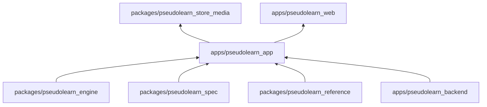
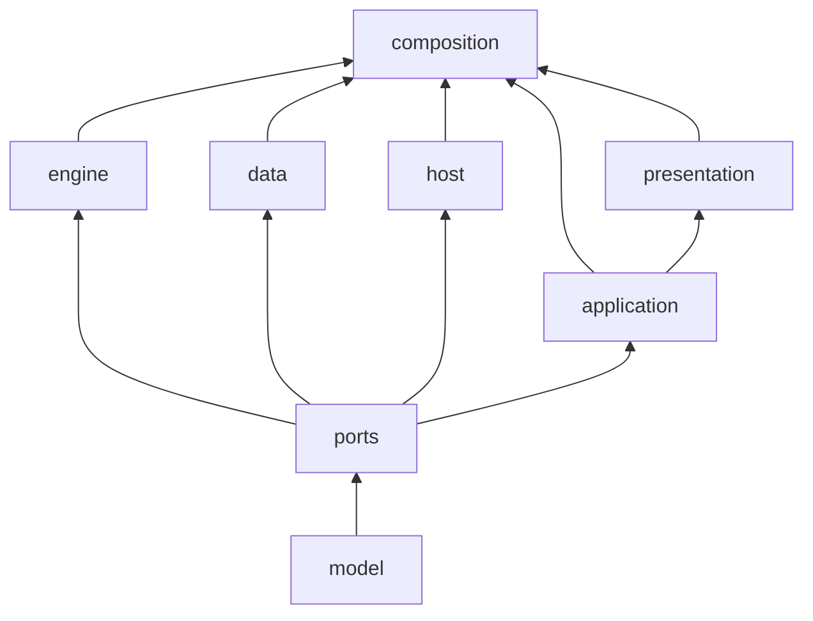
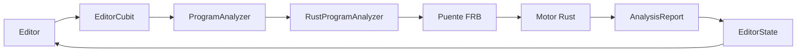

# pseudolearn_app

Aplicación Flutter de PseudoLearn para iOS, macOS y Windows: editor de pseudocódigo con diagnósticos, ejecución paso a
paso, diagramas, código equivalente, ruta de aprendizaje, cuenta con sincronización y el agente Nodo. Analiza y ejecuta
los programas llamando al motor Rust a través de un puente generado (`native/`).

**No hace:** definir ni interpretar el lenguaje en Dart (lo hace el motor), tener backend propio (usa las funciones de
`apps/pseudolearn_backend`) ni publicarse en navegador: no existe carpeta `web/`, solo `ios/`, `macos/` y `windows/`.

## Dónde encaja

Los vínculos no son dependencias de `pubspec.yaml`, que no declara ninguna por ruta:

- `engine`: `native/Cargo.toml` depende de `pseudolearn_api` y `pseudolearn_host` por ruta.
- `spec`: `tool/prepare_generated.sh` ejecuta `see export`, y `tool/syntax_coverage/help_catalog.dart` lee el catálogo
  `specifications/cases/catalogs.json`.
- `reference`: genera `assets/reference/` y `assets/route/` de la app.
- `backend`: en ejecución, la app llama a las funciones `agent-responses`, `agent-credits` y `delete-account`.
- `media`: `tool/generate_store_plates.dart` y `tool/generate_trailer_plates.dart` graban las placas que el motor de
  tienda lee de `build/store-plates`.
- `web`: `tool/generate_product_shot.dart` escribe las capturas en `../pseudolearn_web/src/assets/product`.

## Arquitectura

Ocho capas bajo `lib/`, declaradas en `architecture.yaml`. Las flechas van de la dependencia a quien la usa.

El diagrama omite las aristas desde `model` hacia las demás capas y las de `composition` hacia `model` y `ports`.

| Capa           | Carpeta            | Qué hace                                                                   |
|:---------------|:-------------------|:---------------------------------------------------------------------------|
| `model`        | `lib/domain/model` | Datos y reglas puras del dominio                                           |
| `ports`        | `lib/domain/ports` | Interfaces que la app necesita del exterior                                |
| `engine`       | `lib/engine`       | Adapta el puente Rust a los puertos y construye los diagramas              |
| `data`         | `lib/data`         | Documentos, índice, sincronización, cuenta, créditos, plataforma y activos |
| `host`         | `lib/host`         | Entorno local de ejecución de cada documento                               |
| `application`  | `lib/application`  | Cubits de estado de vista y casos de uso                                   |
| `presentation` | `lib/presentation` | Widgets, tema, localización (`l10n`) y rutas con `go_router`               |
| `composition`  | `lib/composition`  | Ensamblado de dependencias al arrancar                                     |

`native/` (crate `pseudolearn_bridge`, con su propio README) genera `lib/engine/bridge/` con `flutter_rust_bridge`, y
`hook/build.dart` lo compila como activo nativo.

## Flujo principal

Flujo de una edición, no de dependencias:

## Reglas que conviene saber

- Cada capa importa solo de sí misma y de las que lista `may_import`; `presentation` únicamente de `model` y
  `application`. Dentro de `lib/` los imports son relativos.
- Las preguntas al sistema operativo viven en cuatro archivos de `data/platform/`; los widgets adaptativos
  (`Switch.adaptive` y similares) están prohibidos y `MediaQuery` solo se consulta en `presentation/shell/`.
- `composition` no admite condicionales; `presentation` no filtra, ordena ni agrega datos (`where`, `fold`, `sort`…) ni
  usa `await`; los campos de estado de `application` son `final`.
- Ejecutar (y Continuar o Reproducir) es una ejecución continua, no un paso a paso acelerado: el editor, el diagrama y
  el código equivalente no siguen el foco hasta que la ejecución pide una entrada o termina, la barra solo ofrece
  Detener, y el estado se publica como mucho cada 100 ms. Tampoco lee las variables de cada evento salvo que la tabla de
  prueba de escritorio esté visible: cada lectura reconstruye en el motor un instante pasado y bloqueaba la interfaz.
  Con la tabla visible se publica cada paso para no perder filas. El historial de la pestaña Tareas tampoco se consulta
  durante la ejecución continua salvo que esa pestaña esté visible (como mucho cada 100 ms): cada consulta también
  reconstruye el pasado en el motor y frenaba la salida. Se carga al detenerse la ejecución. Paso a paso no cambia. El bucle cede el hilo cada
  8 ms y muestra una sola vez la espera de un efecto.
- Los colores y las duraciones literales solo existen en los archivos dueños que declara `architecture.yaml`.
- Límites: 250 líneas por archivo, 40 por función, 30 por `build`, 3 parámetros posicionales, anidación 3 y 5 métodos
  públicos por clase. Sin comentarios; `lib/engine/bridge/` y `lib/presentation/l10n/generated/` son generados.

## Comandos útiles

| Para qué                                     | Comando                                                                                               |
|:---------------------------------------------|:------------------------------------------------------------------------------------------------------|
| Instalar dependencias                        | `flutter pub get`                                                                                     |
| Generar exportación, l10n y puente           | `bash tool/prepare_generated.sh`                                                                      |
| Ejecutar en macOS                            | `flutter run -d macos --dart-define-from-file=dart_define.local.json`                                 |
| Análisis estático                            | `flutter analyze --fatal-infos --fatal-warnings`                                                      |
| Tests de la app                              | `flutter test`                                                                                        |
| Tests del puente contra la biblioteca nativa | `bash tool/test_bridge.sh`                                                                            |
| Límites de `architecture.yaml`               | `dart run tool/check_limits.dart`                                                                     |
| Sistema de diseño                            | `dart run tool/check_design_system.dart`                                                              |
| Cobertura de formas de la vista              | `dart run tool/check_syntax_coverage.dart`                                                            |
| Manual de usuario en `es` y `en`             | `dart run tool/check_manual.dart`                                                                     |
| Conformidad del sujeto `app`                 | `cargo run -p see_cli --bin see -- conform --subject app` (en `packages/pseudolearn_spec`)            |
| Grabar las placas de las tiendas             | `flutter test tool/generate_store_plates.dart` (acotable con `--dart-define=STORE_PLATE_DEVICES=mac`) |
| Grabar la placa animada del tráiler          | `flutter test tool/generate_trailer_plates.dart`                                                      |
| Regenerar las capturas de la web             | `flutter test tool/generate_product_shot.dart`                                                        |
| Compilar                                     | `flutter build macos --release`, `flutter build ipa --no-codesign`, `flutter build windows --release` |

Requisitos: Flutter 3.50.0 (fijado en `pubspec.yaml`), Dart `^3.14.0` y Rust según `native/rust-toolchain.toml` para
compilar el puente. El inicio de sesión y la sincronización leen `SUPABASE_URL`, `SUPABASE_ANON_KEY` y
`GOOGLE_IOS_CLIENT_ID` de `dart_define.local.json`, que no se versiona.

## Pendientes declarados

Exigen una acción fuera del código:

- Subir a App Store Connect las capturas de iPhone Duo (las cuatro ranuras `apple.iphone-duo-*` del catálogo de
  `pseudolearn_store_media`, que ya las produce en `es` y `en`).
- Revisar el producto con la herramienta de preview de App Store Connect y, en la nominación de featuring, indicar que
  la
  app está optimizada para iPhone Duo.
