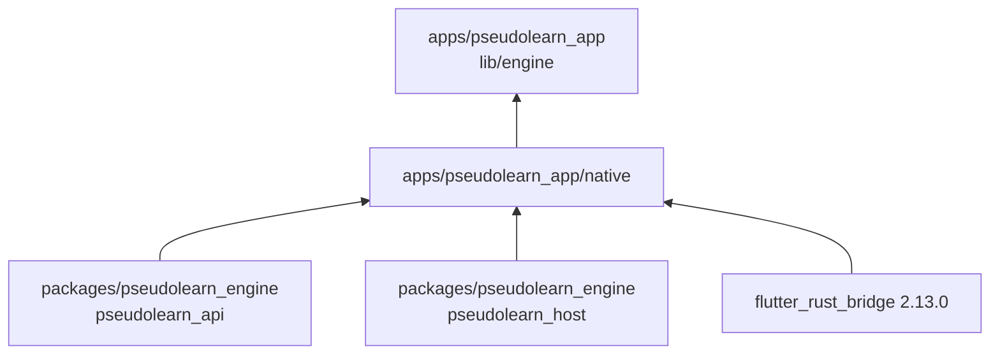
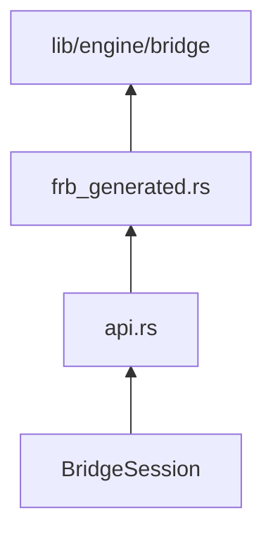

# pseudolearn_bridge

Crate Rust que conecta la app Flutter con el motor: expone tres funciones síncronas a Dart a través de
`flutter_rust_bridge`, guarda las sesiones del motor y transporta cada llamada como un sobre JSON. Se compila como
activo nativo desde `apps/pseudolearn_app/hook/build.dart`.

**No hace:** analizar ni ejecutar el lenguaje (lo hace `pseudolearn_api`), tener estado de interfaz ni caer de vuelta a
un
intérprete en Dart: si una sesión o un recurso no es válido, devuelve un fallo tipado.

## Dónde encaja



## Arquitectura

Un solo crate, `pseudolearn_bridge`, sin capas internas. Las flechas van de la pieza usada a quien la usa.



| Pieza                            | Qué hace                                                                                                                  |
|:---------------------------------|:--------------------------------------------------------------------------------------------------------------------------|
| `src/api.rs`                     | `create_session`, `call_session` y `close_session`; valida el sobre y guarda el registro de sesiones en un `thread_local` |
| `src/bridge_session.rs`          | Una `ApiSession` más un `HostWorker` por recurso; atiende `host_open`, `host_submit`, `host_poll` y `host_close`          |
| `src/frb_generated.rs`           | Salida de `flutter_rust_bridge_codegen`; no se versiona ni se edita                                                       |
| `lib/engine/bridge/` (en la app) | Lado Dart generado; no se versiona ni se edita                                                                            |

## Flujo principal

Camino de una llamada, no de dependencias:

```mermaid
flowchart LR
    dart["NativeRustTransport"] --> call["call_session"]
    call --> bridge["BridgeSession"]
    bridge --> engine["ApiSession"]
    bridge --> worker["HostWorker"]
    engine --> response["JSON de respuesta"]
    worker --> response
    response --> dart
```

## Reglas que conviene saber

- El crate solo puede depender de `pseudolearn_api`, `pseudolearn_host`, `flutter_rust_bridge` y `serde_json`
  (`architecture.yaml`).
- `rust-checks isolation` rechaza que `pseudolearn_bridge` alcance `pseudolearn_codegen`, `pseudolearn_aot_rt`,
  `cranelift-*`, `reqwest`, `ureq`, resolvedores DNS ni las features `test-host`, en seis destinos: iOS (dispositivo,
  simulador arm64 y x86_64), macOS (arm64 y x86_64) y Windows x64.
- `unsafe` solo existe en `src/frb_generated.rs`, que el verificador omite; el código escrito a mano no lo usa.
- Límites: 300 líneas por archivo, 40 por función, 4 parámetros posicionales, anidación 3 y 7 métodos públicos por
  clase.
  Sin comentarios, sin `unwrap`/`panic` y nombres de al menos tres caracteres (`architecture.yaml`).
- Las versiones de `flutter_rust_bridge` están fijadas con `=2.13.0` y `Cargo.lock` fija el grafo; `deny.toml` prohíbe
  versiones duplicadas.

## Comandos útiles

| Para qué                                           | Comando                                                                                                                                  |
|:---------------------------------------------------|:-----------------------------------------------------------------------------------------------------------------------------------------|
| Regenerar los bindings (en `apps/pseudolearn_app`) | `bash tool/bridge.sh generate`                                                                                                           |
| Comprobar que los bindings siguen vigentes         | `bash tool/bridge.sh check`                                                                                                              |
| Comprobarlo en un checkout limpio                  | `bash tool/bridge.sh clean-checkout`                                                                                                     |
| Probar el puente por FFI desde Dart (en la app)    | `bash tool/test_bridge.sh`                                                                                                               |
| Formato, Clippy y tests del crate                  | `cargo fmt --all --check`, `cargo clippy --all-targets`, `cargo test`                                                                    |
| Dependencias                                       | `cargo deny check`                                                                                                                       |
| Verificadores del monorepo                         | `cargo run --manifest-path ../../../packages/pseudolearn_rust_checks/Cargo.toml -p pseudolearn_check_command --bin rust-checks -- all .` |

Requisitos: Rust `1.99.0` con los destinos de `rust-toolchain.toml`, `cargo-deny`, `cargo-expand` `1.0.127` y
`flutter_rust_bridge_codegen` `2.13.0` (`.github/actions/setup-rust-bridge` los instala con esas versiones).
