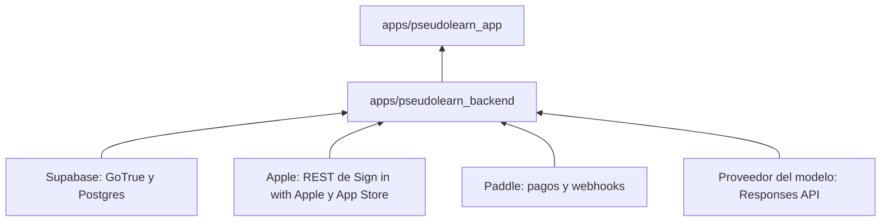
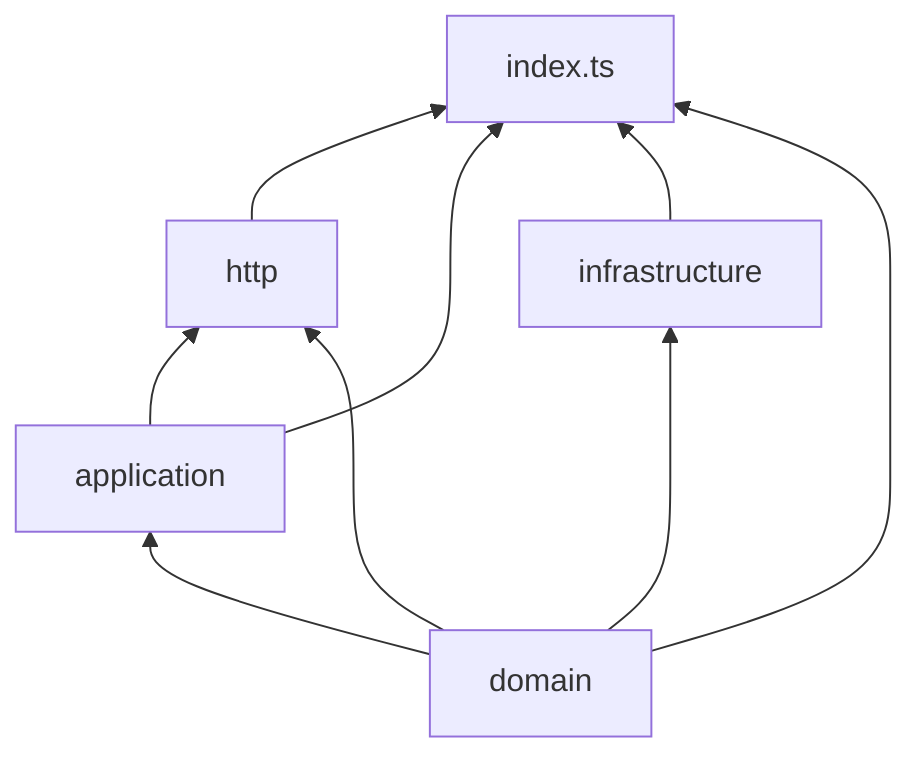
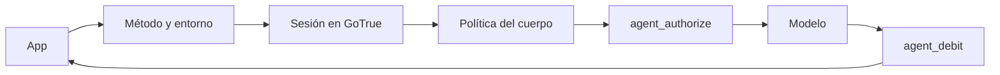

# pseudolearn_backend

Backend de Supabase de PseudoLearn: cuatro Edge Functions en Deno y las migraciones SQL del esquema de Postgres. Hace lo
que no cabe en RLS ni en funciones SQL: operaciones que exigen un secreto que la app no puede tener o una llamada a un
tercero (Apple, Paddle, el proveedor del modelo).

**No hace:** sincronizar documentos, progreso ni ejercicios (eso lo resuelven las RPC SQL `push_*` desde la app), ni
guardar tokens de Apple, ni usar Storage.

## Dónde encaja

## Arquitectura

Cada función de `supabase/functions/<función>/` es hexagonal. Las flechas van de la dependencia a quien la usa.

| Pieza                  | Qué hace                                                                                               | Nota                                                                  |
|:-----------------------|:-------------------------------------------------------------------------------------------------------|:----------------------------------------------------------------------|
| `delete-account`       | Elimina la cuenta: valida la sesión, revoca Sign in with Apple y borra el usuario de `auth.users`      | Sesión validada por `GET /auth/v1/user`, `verify_jwt = false`         |
| `agent-responses`      | Proxy del modelo del agente: fija el modelo, autoriza el saldo, reenvía y debita según el `usage` real | Dueño del dominio, el entorno y el libro que reutilizan las otras dos |
| `agent-credits`        | Saldo, canje de compras de App Store y enlaces de pago y portal de Paddle                              | Importa de `agent-responses`                                          |
| `store-events`         | Recibe notificaciones firmadas de App Store y webhooks de Paddle                                       | `verify_jwt = false`: lo autentican las firmas                        |
| `supabase/migrations/` | Esquema, RLS y RPC en el orden en que se aplican                                                       | Sin comentarios                                                       |
| `supabase/deferred/`   | Migración lista que espera una condición antes de pasar a `migrations/`                                | No se aplica con `db push` mientras esté aquí                         |
| `tool/`                | Verificador de arquitectura y su lexer                                                                 |                                                                       |

El diagrama omite las dependencias hacia `domain` de cada capa salvo las de composición; la matriz exacta está en
`architecture.json`.

## Flujo principal

Flujo de datos de `agent-responses`, no de dependencias:

Si el modelo falla, responde 429 o no trae `usage`, no hay débito.

## Reglas que conviene saber

- Lo único que se vende es Nodo, así que los productos se llaman `pseudolearn.nodo.trial`, `pseudolearn.nodo.monthly` y
  `pseudolearn.nodo.topup150` en la app, en `agent-credits/domain/purchase.ts`, en App Store Connect y en Paddle. Un
  identificador distinto en una tienda deja la compra sin canjear.
- Las capas solo importan lo que `architecture.json` les permite; `domain`, `application` y `http` no usan `Deno`,
  `fetch`, `crypto` ni `console`, e `infrastructure` no usa `Deno`, `fetch` ni `console`.
- El código de `supabase/functions/` no admite imports `npm:`, `jsr:`, `node:`, `http:` ni `https:`: solo la API web de
  Deno.
- Cero comentarios en `supabase/functions/`, `test/` y `tool/`; cada archivo de función tiene como máximo 120 líneas
  (`test/` y `tool/` exentos).
- El `fetch` global solo aparece en `index.ts`; el resto recibe un `Fetcher` inyectado.
- Ningún secreto vive en el repositorio (`*.p8` y `.env*` ignorados); los logs nunca llevan tokens, códigos, correos ni
  contenido.
- `deno fmt` no formatea este README: lo excluye `deno.json` porque los README del monorepo usan 120 columnas y
  `deno fmt` las reflujaría a 100.

## Comandos útiles

| Para qué                                                            | Comando                                                                      |
|:--------------------------------------------------------------------|:-----------------------------------------------------------------------------|
| Todos los verificadores (formato, lint, tipos, arquitectura, tests) | `deno task verify`                                                           |
| Solo el verificador de arquitectura                                 | `deno task architecture`                                                     |
| Tests                                                               | `deno task test`                                                             |
| Migraciones contra un Postgres temporal, con casos negativos        | `deno task migrations`                                                       |
| Servir una función en local                                         | `supabase functions serve delete-account --env-file supabase/functions/.env` |
| Aplicar migraciones al proyecto enlazado                            | `supabase db push --linked`                                                  |
| Desplegar funciones                                                 | `supabase functions deploy <función> --project-ref <ref>`                    |
| Declarar secretos                                                   | `supabase secrets set --project-ref <ref> NOMBRE=valor`                      |

Requisitos: Deno `>=2.9` para `verify`; la CLI de Supabase y Docker para servir y desplegar; `initdb`, `pg_ctl` y `psql`
de Postgres 17 en el `PATH` para `migrations`, que no forma parte de `verify`.
