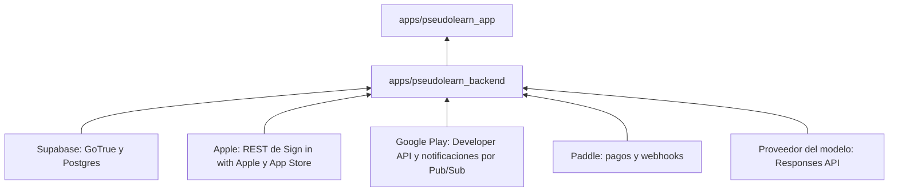
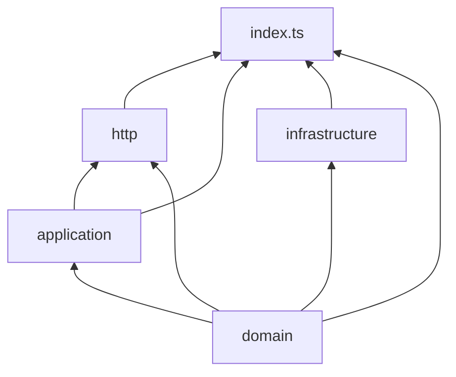
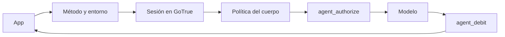

# pseudolearn_backend

Backend de Supabase de PseudoLearn: cuatro Edge Functions en Deno y las migraciones SQL del esquema de Postgres. Hace lo
que no cabe en RLS ni en funciones SQL: operaciones que exigen un secreto que la app no puede tener o una llamada a un
tercero (Apple, Google Play, Paddle, el proveedor del modelo).

**No hace:** sincronizar documentos, progreso ni ejercicios (eso lo resuelven las RPC SQL `push_*` desde la app), ni
guardar tokens de Apple, ni usar Storage.

## Dónde encaja

## Arquitectura

Cada función de `supabase/functions/<función>/` es hexagonal. Las flechas van de la dependencia a quien la usa.

| Pieza                  | Qué hace                                                                                               | Nota                                                                  |
|:-----------------------|:-------------------------------------------------------------------------------------------------------|:----------------------------------------------------------------------|
| `delete-account`       | Elimina la cuenta: valida la sesión, revoca Sign in with Apple y borra el usuario de `auth.users`      | Sesión validada por `GET /auth/v1/user`, `verify_jwt = false`         |
| `agent-responses`      | Proxy del modelo del agente: fija el modelo, autoriza el saldo, reenvía y debita según el `usage` real | Dueño del dominio, el entorno y el libro que reutilizan las otras dos |
| `agent-credits`        | Saldo, canje de compras de App Store y Google Play y enlaces de pago y portal de Paddle                | Importa de `agent-responses`                                          |
| `store-events`         | Recibe notificaciones firmadas de App Store, de Google Play por Pub/Sub y webhooks de Paddle            | `verify_jwt = false`: lo autentican las firmas                        |
| `supabase/migrations/` | Esquema, RLS y RPC en el orden en que se aplican                                                       | Sin comentarios                                                       |
| `supabase/deferred/`   | Migración lista que espera una condición antes de pasar a `migrations/`                                | No se aplica con `db push` mientras esté aquí                         |
| `tool/`                | Verificador de arquitectura y su lexer                                                                 |                                                                       |

El diagrama omite las dependencias hacia `domain` de cada capa salvo las de composición; la matriz exacta está en
`architecture.json`.

## Flujo principal

Flujo de datos de `agent-responses`, no de dependencias:

Si el modelo falla, responde 429 o no trae `usage`, no hay débito.

## Reglas que conviene saber

- Lo único que se vende es Nodo, así que los productos se llaman `pseudolearn.nodo.trial`, `pseudolearn.nodo.monthly` y
  `pseudolearn.nodo.topup150` en la app, en `agent-credits/domain/purchase.ts`, en App Store Connect, en Google Play
  Console y en Paddle. Un identificador distinto en una tienda deja la compra sin canjear.
- Las capas solo importan lo que `architecture.json` les permite; `domain`, `application` y `http` no usan `Deno`,
  `fetch`, `crypto` ni `console`, e `infrastructure` no usa `Deno`, `fetch` ni `console`.
- El código de `supabase/functions/` no admite imports `npm:`, `jsr:`, `node:`, `http:` ni `https:`: solo la API web de
  Deno.
- Cero comentarios en `supabase/functions/`, `test/` y `tool/`; cada archivo de función tiene como máximo 120 líneas
  (`test/` y `tool/` exentos).
- El `fetch` global solo aparece en `index.ts`; el resto recibe un `Fetcher` inyectado.
- Ningún secreto vive en el repositorio (`*.p8` y `.env*` ignorados); los logs nunca llevan tokens, códigos, correos ni
  contenido.
- `deno fmt` no formatea este README: lo excluye `deno.json` porque los README del monorepo usan 120 columnas y
  `deno fmt` las reflujaría a 100.
- **Tamaño de función**: `architecture.json` declara `function_lines` además de `file_lines`; `tool/function_spans.ts` mide cada declaración, método y flecha sobre los tokens del lexer y `tool/check_architecture.ts` reporta `SIZE-FUNCTION-LINES`. Las pruebas y las herramientas quedan exentas, como en el límite de archivo.
- **Consumo real de créditos**: para confirmar los 300 créditos del plan hace falta datos de producción. La consulta es `select turn_id, sum(credits) from agent_ledger_events group by turn_id` sobre una ventana de uso real; no hay datos de prueba que la sustituyan.

## Google Play

La app envía el `purchaseToken` como evidencia. `GooglePlayPurchaseVerifier` lo consulta con la Google Play Developer
API autenticado con una cuenta de servicio (JWT RS256 firmado con su clave → token OAuth con el alcance
`androidpublisher`, reutilizado hasta cinco minutos antes de caducar):

- **Plan:** `purchases.subscriptionsv2.get`. Otorga si el estado es `ACTIVE`, `IN_GRACE_PERIOD` o `CANCELED` (cancelar
  solo apaga la renovación) y existen `startTime` y la `expiryTime` de `pseudolearn.nodo.monthly`. El periodo empieza al
  verificarse y termina en `expiryTime`: `startTime` es la primera concesión de la suscripción, no la de cada renovación,
  y usarlo como inicio dejaba en cero el periodo anterior, porque el libro cierra el periodo vigente donde empieza el
  nuevo. Cada periodo se identifica por `lineItems[].latestSuccessfulOrderId` (o por token y caducidad si falta) y la
  suscripción por su token, que vincula al dueño en `agent_store_links`. Una fase `offerPhase.freeTrial` cuenta como prueba y pasa por la guarda
  `trial_used`.
- **Recarga:** `purchases.products.get`, con `purchaseState = 0`. Se identifica por `google_play:<token>`, así que
  repetir el canje de una recarga ya consumida responde `repeated` en vez de acreditar dos veces.
- **Cuenta:** `obfuscatedExternalAccountId` debe ser el usuario autenticado; si no, `purchase_owned_elsewhere`.
- **Compras de prueba** (`testPurchase` o `purchaseType = 0`): se rechazan salvo con
  `GOOGLE_PLAY_ACCEPT_TEST_PURCHASES=true`, igual que el entorno Sandbox de App Store solo se acepta si
  `APP_STORE_ENVIRONMENTS` lo lista.

`store-events/google-play` recibe las notificaciones en tiempo real por una suscripción push de Pub/Sub. Antes de leer
el cuerpo verifica el token OIDC de `Authorization: Bearer`: firma RS256 con las claves de
`https://www.googleapis.com/oauth2/v3/certs` (se recargan si aparece un `kid` desconocido), emisor de Google, `aud`
igual a `GOOGLE_PLAY_PUSH_AUDIENCE`, `email` igual a `GOOGLE_PLAY_PUSH_SERVICE_ACCOUNT` con `email_verified`, y vigencia
con cinco minutos de tolerancia. La notificación solo dice qué token cambió; el estado se vuelve a pedir a la API:

| Notificación                                          | Efecto                                                           |
|:------------------------------------------------------|:-----------------------------------------------------------------|
| Suscripción comprada, renovada, recuperada, etc.      | Se otorga el periodo vigente si el estado da derecho              |
| Suscripción en estado `EXPIRED`, `ON_HOLD` o `PAUSED` | `agent_end_subscription` con la `expiryTime`                     |
| `SUBSCRIPTION_REVOKED` (12)                           | Revoca el periodo vigente de esa suscripción                     |
| Recarga comprada (`ONE_TIME_PRODUCT_PURCHASED`)       | Se otorga, por si la app nunca llegó a canjearla                  |
| `voidedPurchaseNotification` (reembolso o anulación)  | Revoca la suscripción (`productType = 1`) o la recarga           |
| Prueba, compra pendiente cancelada, otro paquete      | Se ignora con su motivo                                          |

Un fallo de la API responde 5xx y Pub/Sub reintenta. No hizo falta migración: `store` es texto libre en el libro y las
RPC no enumeran tiendas. Se usó `purchases.products.get`, que no está obsoleto y valida el producto en la propia ruta,
en lugar del nuevo `purchases.productsv2`; se descartó `latestOrderId`, obsoleto en `subscriptionsv2`.

**Secretos** (`supabase secrets set`): `GOOGLE_PLAY_PACKAGE_NAME` (`com.pseudolearn.app`),
`GOOGLE_PLAY_SERVICE_ACCOUNT_JSON` (el JSON completo de la clave de la cuenta de servicio), `GOOGLE_PLAY_PUSH_AUDIENCE`
(la URL de `store-events/google-play`), `GOOGLE_PLAY_PUSH_SERVICE_ACCOUNT` (el correo de la cuenta con la que firma
Pub/Sub) y, solo para pruebas, `GOOGLE_PLAY_ACCEPT_TEST_PURCHASES=true`. Sin paquete o sin cuenta de servicio, Google
Play no se canjea; sin los dos valores de push, la ruta de notificaciones no existe.

**Operación:**

- La cuenta de servicio no necesita vincular un proyecto de Cloud: se invita su correo en Play Console (Usuarios y
  permisos) con «View financial data, orders, and cancellation survey responses», que da acceso de lectura a las
  compras, y «Manage orders and subscriptions».
- Para rotar la clave: crear una clave nueva en Google Cloud, actualizar `GOOGLE_PLAY_SERVICE_ACCOUNT_JSON`, redesplegar
  `agent-credits` y `store-events` y borrar la clave anterior.
- La suscripción push apunta a `https://<ref>.supabase.co/functions/v1/store-events/google-play`, con autenticación
  activada, la cuenta de `GOOGLE_PLAY_PUSH_SERVICE_ACCOUNT` y como audiencia esa misma URL. El tema de Pub/Sub debe dar
  permiso de publicación a `google-play-developer-notifications@system.gserviceaccount.com`, y en Play Console se elige
  «Get all notifications for subscriptions and one-time products» en Monetize > Monetization setup para recibir también
  las recargas.
- Para probar con cuentas de prueba de licencias se activa `GOOGLE_PLAY_ACCEPT_TEST_PURCHASES=true` en el proyecto de
  pruebas y se instala la app desde una pista de pruebas de Play.

## Integridad del libro de créditos

`20261110000001_agent_ledger_integrity.sql` reescribe `agent_authorize`, `agent_debit` y `agent_apply_purchase`. Las
decisiones salen de una auditoría de seguridad del 2026-11-10.

- **Un `x-request-id` solo autoriza una llamada.** El cliente elige el id y el libro lo usaba como clave de idempotencia:
  repetirlo volvía a autorizar y el segundo débito chocaba con el primero y no cobraba. Ahora `agent_authorize` responde
  `invalid_request` si el id ya tiene cualquier evento. La app genera un id nuevo en cada llamada, así que no le afecta.
- **Reserva mientras hay llamadas en vuelo.** Una autorización sin débito de los últimos 150 s (el modelo corta a los
  120 s) cuenta como en vuelo. Con llamadas en vuelo, se exige que el saldo supere `en vuelo × tope por llamada`; si no,
  `rate_limited`, que la app reintenta. Así el exceso sin cobrar se limita a una llamada, porque el coste real solo se
  conoce después. Se descartó cobrar 0 en los fallos del modelo para liberar la reserva antes: cambiaba la regla «sin
  `usage` no hay débito» y la reserva caduca sola.
- **Bloqueo por usuario.** `agent_authorize`, `agent_debit` y `agent_apply_purchase` toman
  `pg_advisory_xact_lock(hashtext('agent_ledger:' || usuario))`, y `agent_apply_purchase` también uno por
  `tienda:transacción`, para que las comprobaciones y los inserts no se crucen entre peticiones concurrentes.
- **Una recarga acredita una sola cuenta.** Las recargas no tienen `original_transaction_id`, así que no pasan por
  `agent_store_links`; si la misma `tienda + transacción` ya pertenece a otro usuario, se responde
  `purchase_owned_elsewhere`. No se añadió un índice único porque fallaría al desplegar si producción ya tuviera filas
  duplicadas.
- **Una sola prueba gratuita por cuenta, venga de donde venga.** La guarda `trial_used` se aplica cuando
  `p_product = 'trial'` o `p_trial`. Antes, las pruebas de Paddle (`trialing`) y las ofertas introductorias de App Store
  llegaban como `monthly` con `p_trial` y la saltaban.

**Pendientes declarados**

- Las notificaciones de App Store sin vínculo previo se atribuyen al `appAccountToken` que elige el comprador
  (`store_events_service.ts`). Explotarlo exige conocer el UUID de otra cuenta y un build que fije un token arbitrario;
  se registra como pista por validar, no se cambia el flujo de compra.
- Endurecimiento sin impacto demostrado: limitar el cuerpo de `delete-account` antes de leerlo, comprobar las extensiones
  X.509 de Apple analizándolas en vez de buscar bytes, deduplicar `notificationUUID` y el id de evento de Paddle, dejar
  constancia de las revocaciones que llegan antes que la compra, y aplicar la migración diferida que retira
  `delete_account()`.

## Comandos útiles

| Para qué                                                            | Comando                                                                      |
|:--------------------------------------------------------------------|:-----------------------------------------------------------------------------|
| Todos los verificadores (formato, lint, tipos, arquitectura, tests) | `deno task verify`                                                           |
| Solo el verificador de arquitectura                                 | `deno task architecture`                                                     |
| Tests                                                               | `deno task test`                                                             |
| Migraciones contra un Postgres temporal, con casos negativos        | `deno task migrations`                                                       |
| Servir una función en local                                         | `supabase functions serve delete-account --env-file supabase/functions/.env` |
| Aplicar migraciones al proyecto enlazado                            | `supabase db push --linked`                                                  |
| Desplegar funciones                                                 | `supabase functions deploy <función> --project-ref <ref>`                    |
| Declarar secretos                                                   | `supabase secrets set --project-ref <ref> NOMBRE=valor`                      |

Requisitos: Deno `>=2.9` para `verify`; la CLI de Supabase y Docker para servir y desplegar; `initdb`, `pg_ctl` y `psql`
de Postgres 17 en el `PATH` para `migrations`, que no forma parte de `verify`.
