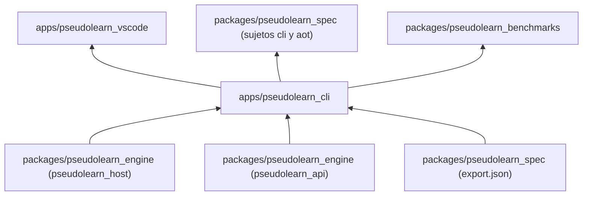
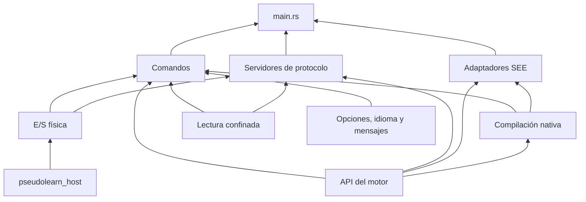
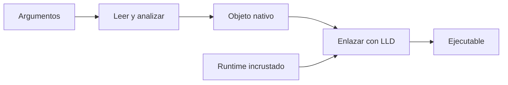

# pseudolearn_cli

El binario `pseudo`: la línea de comandos de PseudoLearn. Comprueba, ejecuta, compila a nativo, formatea,
traduce e inspecciona programas, y habla con editores y asistentes mediante un servidor de lenguaje (LSP), un
adaptador de depuración (DAP) y un servidor MCP.

**No hace:** no define la semántica del lenguaje ni analiza o ejecuta por su cuenta (todo pasa por la API pública
del motor), no tiene interfaz gráfica y no lee configuración ejecutable.

## Dónde encaja

La CLI importa el motor solo por su API pública con la feature `native` y por `pseudolearn_host` (ver `Cargo.toml`).
La exportación del corpus alimenta su catálogo de mensajes y sus pruebas. La extensión de VS Code empaqueta `pseudo`
y `pseudolearn_spec` lo ejecuta como sujeto de conformidad.

## Arquitectura

Un solo crate (`src/`) que funciona como borde: parsea argumentos, lee archivos y entorno, llama a la API y
presenta el resultado. Cada flecha va de la dependencia a quien la usa.

| Pieza                       | Módulos                                                                                                                           | Papel                                                                                       |
|-----------------------------|-----------------------------------------------------------------------------------------------------------------------------------|---------------------------------------------------------------------------------------------|
| Opciones, idioma y mensajes | `options`, `locale_resolution`, `messages`, `preferences_command`                                                                 | Argumentos con alias es/en, idioma de interfaz y catálogo generado por `build.rs`           |
| Comandos                    | `check_command`, `run_command`, `build_command`, `format_command`, `translate_command`, `ir_command`, `lock_command`, `project_*` | Una orden por módulo; las de proyecto usan `--proyecto`                                     |
| Lectura confinada           | `confined_sources`, `project_files`                                                                                               | Abre cada raíz con `cap-std` y entrega los bytes a la API                                   |
| E/S física                  | `physical_host`, `physical_session`, `tape_files`                                                                                 | Atiende los efectos pendientes con `pseudolearn_host`; lee y escribe cintas                 |
| Servidores de protocolo     | `lsp_*`, `dap_*`, `mcp_*`, `editor_*`                                                                                             | LSP, DAP, MCP y el modo `ejecutar --editor`, cada uno por stdio                             |
| Compilación nativa          | `native_*`, `linker_*`, `runtime_archive`                                                                                         | Enlaza con LLD, que descarga a la caché del usuario, y el runtime incrustado por `build.rs` |
| Adaptadores SEE             | `adapter`, `aot_adapter`, `aot_project_adapter`                                                                                   | `pseudo --see-adapter [aot]` para la conformidad                                            |

`xtask/` contiene el tooling (`verify`, `check-lock`, `http-test-server`) y no se enlaza a `pseudo`. Se omiten
las aristas hacia el catálogo de mensajes, que casi todos los módulos usan.

## Flujo principal

Flujo de `pseudo compilar`, no de dependencias:

Con diagnósticos de usuario se sale con código 1 sin enlazar; si el enlace falla, la salida previa no se
sobrescribe. El enlazador se busca junto a `pseudo`, luego en la caché del usuario y, si falta, se descarga.

## Órdenes

| Orden (alias)                  | Qué hace                                                                         |
|--------------------------------|----------------------------------------------------------------------------------|
| `comprobar` (`check`)          | Analiza archivos o un proyecto                                                   |
| `ejecutar` (`run`)             | Ejecuta en la VM; `--nativo`, `--editor`, `--grabar-cinta`, `--reproducir-cinta` |
| `compilar` (`build`)           | Genera un ejecutable nativo para un destino de la lista cerrada                  |
| `formatear` (`format`)         | Estilo canónico; `--verificar`, `--escribir`                                     |
| `traducir` (`translate`)       | Traduce al perfil de `--hacia`                                                   |
| `ri` (`ir`)                    | Imprime la representación intermedia                                             |
| `bloquear` (`lock`)            | Escribe `pseudolearn.lock` de un proyecto                                        |
| `preferencias` (`preferences`) | Fija el idioma de interfaz                                                       |
| `lsp`, `dap`, `mcp`            | Servidores por stdio                                                             |

Destinos de `compilar`: `aarch64-apple-darwin`, `x86_64-apple-darwin`, `x86_64-unknown-linux-musl` y
`x86_64-pc-windows-msvc`. El código de salida y los límites por orden son los de `TOOL.CLI.*` en el corpus.

## Reglas que conviene saber

- Solo hay dos dependencias de ruta permitidas: `pseudolearn_api` y `pseudolearn_host`. Los crates internos del
  motor están prohibidos.
- La feature `test-host` solo existe para conformidad: `architecture.yaml` la prohíbe en los destinos de
  distribución, así que un binario distribuido nunca embebe dobles de prueba.
- Los mensajes salen del catálogo que `build.rs` genera desde el corpus, y la ficha del lenguaje de `generated/` la
  produce `see agent-sheet`: ninguno se edita a mano.
- Una orden de archivo o de proyecto lee cada ruta por su raíz concedida (`cap-std`); no se comprueban prefijos
  sobre rutas absolutas.
- Límites: 300 líneas por archivo, 40 por función, 4 parámetros posicionales y 3 niveles de anidación. Sin
  `unsafe` ni pánicos explícitos.

## Comandos útiles

Se ejecutan desde `apps/pseudolearn_cli`.

| Para qué                               | Comando                                                                                       |
|----------------------------------------|-----------------------------------------------------------------------------------------------|
| Verificación completa del miembro      | `cargo xtask verify`                                                                          |
| Comprobar que `Cargo.lock` está al día | `cargo xtask check-lock`                                                                      |
| Compilar `pseudo`                      | `cargo build --release`                                                                       |
| Pruebas                                | `cargo test`                                                                                  |
| Pruebas de los sujetos nativos         | `cargo test --features test-host --test aot_adapter_tests --test aot_effect_parity`           |
| Servidor HTTP de pruebas en loopback   | `cargo xtask http-test-server [--bind <dirección>] [--tls-certificate <variante>]`            |
| Conformidad del sujeto `cli`           | `cargo run -p see_cli --bin see -- conform --subject cli` (desde `packages/pseudolearn_spec`) |
| Conformidad del sujeto `aot`           | `cargo run -p see_cli --bin see -- conform --subject aot` (desde `packages/pseudolearn_spec`) |

Requisitos: Rust `1.99.0` (`rust-toolchain.toml`), `cargo-deny` y la exportación del corpus generada antes de
compilar (`see export --root .` en `packages/pseudolearn_spec`; `cargo xtask verify` ya la ejecuta). En Linux, el
destino `x86_64-unknown-linux-musl` y `musl-gcc`. La primera compilación nativa descarga el enlazador y necesita red.
