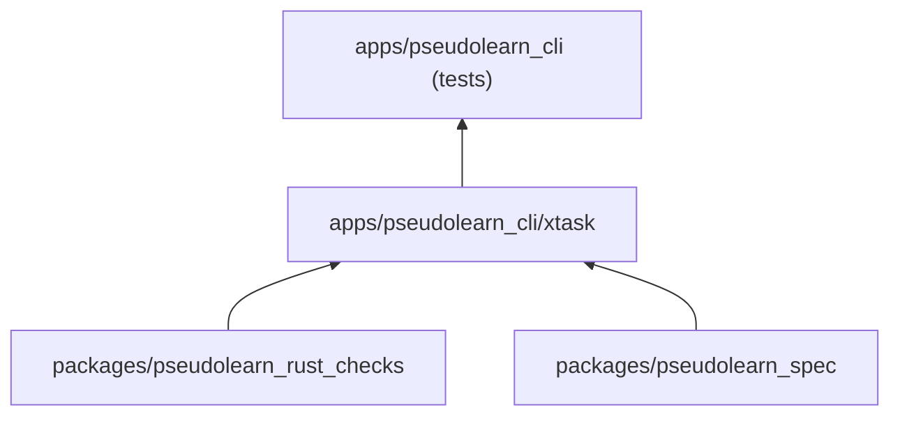
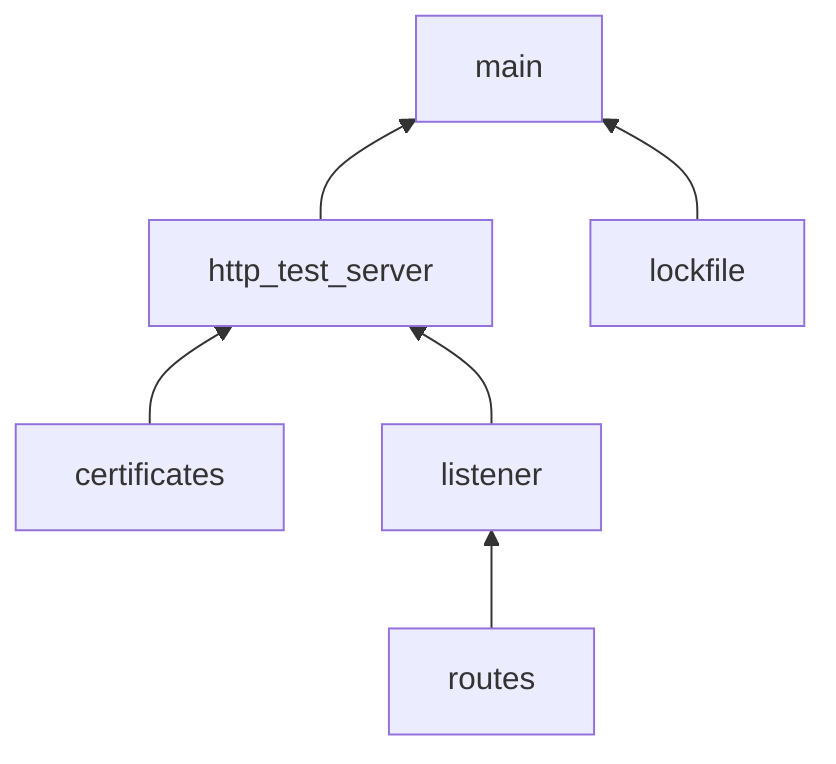
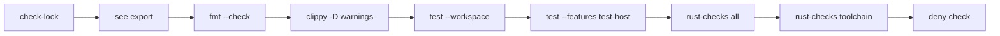

# xtask

Herramientas de desarrollo del workspace de `pseudolearn_cli`: la puerta de verificación `cargo xtask verify`, la
comprobación de `Cargo.lock` y un servidor HTTP/HTTPS local para las pruebas de red de la CLI.

**No hace:** implementar la CLI (no se enlaza al ejecutable `pseudo`), salir de loopback ni publicarse.

## Dónde encaja

- `pseudolearn_rust_checks` y `pseudolearn_spec` no son dependencias de Cargo: `verify` los invoca como comandos
  (`rust-checks all`, `rust-checks toolchain` y `see export`).
- La CLI usa `cargo xtask http-test-server` desde `tests/network_adapter_contract.rs`.
- Dependencias de Cargo: `flate2`, `rcgen`, `rustls` y `serde_json`.

## Arquitectura

Un solo crate declarado como `tooling` en `architecture.yaml`, sin `unsafe`. Las flechas van de la pieza usada a quien
la usa.

| Pieza                           | Qué hace                                                                            |
|:--------------------------------|:------------------------------------------------------------------------------------|
| `main`                          | Despacha `verify`, `check-lock` y `http-test-server`; `verify` ejecuta cada paso    |
| `lockfile`                      | Falla si `cargo metadata --locked` indica un `Cargo.lock` desactualizado            |
| `http_test_server`              | Lee las opciones, abre los listeners y anuncia sus direcciones en JSON              |
| `http_test_server_certificates` | Genera con `rcgen` los certificados `valid`, `expired`, `wrong-host`, `self-signed` |
| `http_test_server_listener`     | Atiende las conexiones HTTP y TLS, cada una en su hilo                              |
| `http_test_server_routes`       | Tabla de rutas y respuestas de prueba (`/texto`, `/eco`, `/lento`, `/contador`…)    |

`http_test_server_listener` también importa de `certificates` y `routes`; el diagrama omite esas aristas.

## Flujo principal

Orden de ejecución de `cargo xtask verify`, no dependencias:

## Reglas que conviene saber

- `--bind` solo acepta direcciones loopback y los puertos son efímeros; cualquier otra interfaz se rechaza.
- `--tls-certificate` admite `valid` (por defecto), `expired`, `wrong-host` y `self-signed`.
- El servidor imprime en stdout un JSON con `http_address`, `https_address`, `certificate_directory`,
  `root_certificate` y `tls_certificate`, y sigue en primer plano. Los certificados van a
  `target/http-test-server/<pid>/`.
- Sin `unsafe`, sin comentarios, nombres completos y límites de tamaño del `architecture.yaml` del workspace.

## Comandos útiles

| Para qué                             | Comando                                                  |
|:-------------------------------------|:---------------------------------------------------------|
| Verificación completa del workspace  | `cargo xtask verify`                                     |
| Solo el estado de `Cargo.lock`       | `cargo xtask check-lock [directorio]`                    |
| Servidor de pruebas de red           | `cargo xtask http-test-server --bind 127.0.0.1`          |
| Servidor con un certificado concreto | `cargo xtask http-test-server --tls-certificate expired` |
| Tests del xtask                      | `cargo test -p xtask`                                    |
| Solo los tests del servidor          | `cargo test -p xtask http_test_server`                   |

Requisitos: Rust `1.99.0` (`rust-toolchain.toml`), `cargo-deny` para `verify` y permiso para abrir sockets en loopback.
Los comandos se ejecutan desde `apps/pseudolearn_cli`.
