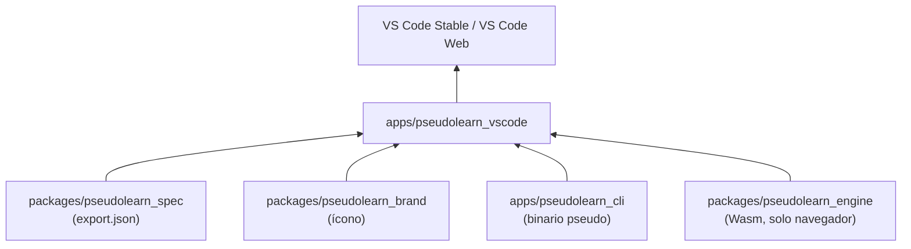
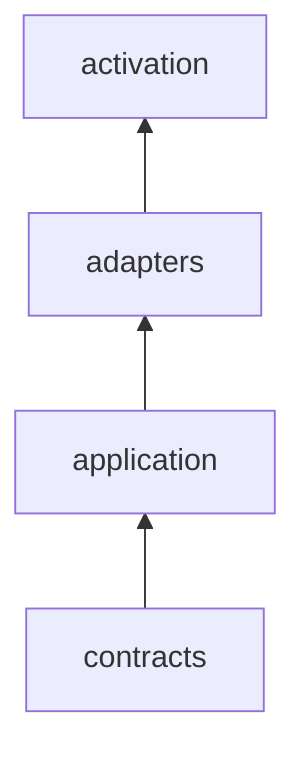
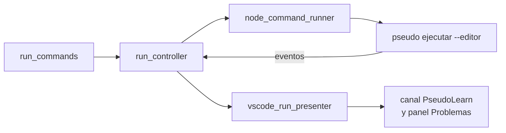

# pseudolearn_vscode

Extensión de VS Code para escritorio y navegador. Trae al editor el resaltado, los diagnósticos, la navegación, la
ayuda, la ejecución y la depuración de los programas `.pseudo`, delegando todo el análisis en el binario `pseudo`
(escritorio) o en el módulo Wasm del motor (navegador).

**No hace:** analizar, ejecutar ni validar el lenguaje por su cuenta (eso es de Rust); publicarse en Marketplace ni Open
VSX; actualizarse sola ni enviar telemetría.

> Este README es para quien desarrolla la extensión. Lo que ven los usuarios al instalarla es [
> `marketplace/README.md`](marketplace/README.md): el empaquetado lo incluye en el VSIX como su `readme.md`.

## Dónde encaja

## Arquitectura

Se omiten las aristas desde `contracts` hacia `adapters` y `activation`, y desde `application` hacia `activation`.

| Capa          | Qué contiene                                                                                                                                                                   |
|---------------|--------------------------------------------------------------------------------------------------------------------------------------------------------------------------------|
| `contracts`   | Puertos y datos: documentos del editor, cliente de lenguaje, anfitrión, configuración, transporte de Workers                                                                   |
| `application` | Casos de uso sobre los puertos: controlador de ejecución, ciclo de vida del cliente, resolución de configuración, diagnósticos, ayuda, traducción, definición del servidor MCP |
| `adapters`    | VS Code, Node y el proceso `pseudo` (escritorio); Workers, `workspace.fs` y Fetch (navegador)                                                                                  |
| `activation`  | Composición y registro de comandos para escritorio (`extension.ts`) y navegador (`browser_extension.ts`, más los dos Workers)                                                  |

Las dos activaciones comparten `contracts` y `application`; solo difieren en los adaptadores que componen.

## Flujo principal

Flujo de datos al ejecutar un archivo en escritorio (la dirección difiere de la de dependencias).

## Reglas que conviene saber

- Los imports siguen la matriz de `architecture.json`; las carpetas `src/common`, `src/helpers`, `src/misc` y
  `src/utils` están prohibidas.
- Límites: 300 líneas por archivo, 40 por función, 4 parámetros posicionales, anidación 3 y 7 métodos públicos por
  clase.
- La gramática TextMate y la configuración del lenguaje se generan desde `export.json` del corpus; no se editan a mano
  (`pnpm check:grammar` detecta la diferencia).
- **Íconos.** `media/icons/pseudo-file.svg` es una copia que genera `pseudolearn_brand` (`BRAND-COPY-STALE` si diverge);
  no se edita a mano. Sirve de ícono del lenguaje y, en `pseudolearn-icon-theme.json`, de ícono de los `.pseudo` en el
  explorador. VS Code solo pinta un tema de íconos de archivo a la vez, así que el tema incluye también un ícono
  genérico
  de archivo y de carpeta (`file.svg`, `folder.svg`, `folder-open.svg`, propios del paquete): quien lo activa no deja el
  resto de sus archivos sin ícono. La extensión no cambia el tema del usuario; se activa desde *Tema de íconos de
  archivo*. El Marketplace exige un PNG, que `pnpm generate:icon` rasteriza con `sharp` a `media/icon.png` (256 px, no
  se
  versiona) antes de empaquetar.
- **Configuración en caliente.** Cambiar `pseudolearn.profile`, `pseudolearn.interfaceLanguage` o
  `pseudolearn.server.path` se aplica sin recargar la ventana. En escritorio, `configured_session.ts` vuelve a resolver
  la configuración y, si `configurationDiffers` detecta un valor distinto, desecha la sesión (servidor de lenguaje,
  comandos, depurador y proveedor MCP) y la vuelve a crear con los valores nuevos; una ejecución en curso se detiene.
  Si la configuración nueva no es válida se muestra el error y se conserva la sesión anterior. Se recrea la sesión en
  vez de enviar solo `workspace/didChangeConfiguration` porque el perfil y el idioma también viajan en los argumentos de
  ejecución, depuración y traducción, que se fijan al crear la sesión. En navegador, `browser_extension.ts` sustituye
  las opciones y reinicia el servidor de lenguaje del Worker.
- **Menús de comandos.** Los comandos se exponen en la barra del editor sin pasar por la paleta: el botón de ejecución
  (`editor/title/run`) agrupa ejecutar y depurar archivo o proyecto; «Stop Run» va como botón propio en
  `editor/title` y solo se ve con la clave de contexto `pseudolearn.running`, que también oculta las acciones de
  ejecutar mientras hay una ejecución en curso (no se admiten dos a la vez). Las acciones menos frecuentes van al menú
  `…` y al menú contextual del texto. Todo se limita a editores `.pseudo` salvo «Stop Run».
    - Los íconos son *codicons* (`$(play)`, `$(debug-stop)`…), no SVG propios: VS Code los pinta con el color del tema
      activo, así que no hace falta una variante clara y otra oscura dentro del VSIX.
    - `pseudolearn.running` la publica `vscode_run_context.ts`: en escritorio desde `VscodeRunPresenter` según
      `isRunActive` (solo cuando cambia, para no emitir un `setContext` por cada salida), en navegador desde
      `BrowserRun.start` al empezar y en su `finally`.
    - El manifiesto web quita los comandos que el navegador no registra (`desktopOnlyCommands` en
      `scripts/lib/web-manifest.mjs`: instrucciones de agente) y los menús que los nombran, para no dejar
      botones que fallan con «comando no encontrado».
- El VSIX contiene solo lo declarado en `artifact.contract.json`; excluye fuentes, tests, scripts, ejemplos, mapas y
  `node_modules`.
- El README del VSIX es `marketplace/README.md` (`readme` del contrato). El `README.md` de esta carpeta no se empaqueta.
- **El VSIX de escritorio solo admite `dist/extension.js`** del directorio `dist/`: cualquier otro archivo (por ejemplo un `dist/web/test/index.js` residual de una compilación local) es un recurso no declarado y `pnpm package` falla.
- **Salida del host web**: el código de salida que pide el programa (`console_set_exit_code`) se muestra al terminar como `(exit code N)` cuando no es cero. La salida de error no tiene estilo propio porque el motor la une a la salida normal del programa; separarla exigiría que el motor publique los tramos de error.

## Comandos útiles

Desde esta carpeta.

| Para qué                              | Comando                                                             |
|---------------------------------------|---------------------------------------------------------------------|
| Instalar dependencias                 | `pnpm install --frozen-lockfile`                                    |
| Tipos                                 | `pnpm check:types`                                                  |
| Arquitectura, comentarios y tamaños   | `pnpm check:architecture`, `pnpm check:comments`, `pnpm check:size` |
| Contenido del paquete                 | `pnpm check:package`                                                |
| PNG del Marketplace                   | `pnpm generate:icon` (lo ejecutan `package` y `build:web`)          |
| Gramática vigente                     | `pnpm check:grammar` (regenerar: `pnpm generate:grammar`)           |
| Tests                                 | `pnpm test`                                                         |
| Compilar el binario `pseudo` incluido | `pnpm build:cli`                                                    |
| Bundle de escritorio                  | `pnpm build`                                                        |
| VSIX de escritorio del host           | `pnpm package` (`darwin-arm64` o `win32-x64`)                       |
| VSIX web                              | `pnpm package:web`                                                  |
| Escenarios en navegador               | `pnpm test:web`                                                     |
| Contraste LSP escritorio/Wasm         | `pnpm test:lsp:contrast`                                            |
| Depuración por stdio                  | `pnpm test:dap:stdio`                                               |
| Prueba en VS Code real                | `node tests/host/run-host.mjs trusted` (o `restricted`)             |

Requisitos: Node 22.23.3, pnpm 12.8.1; `build:cli` y `package` necesitan Cargo y un host `darwin-arm64` o `win32-x64`; `package:web`
necesita además la cadena del motor para el Wasm.
