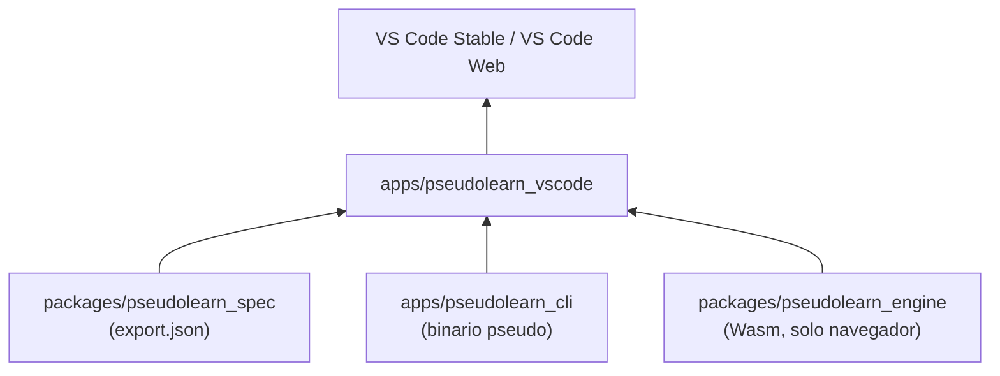
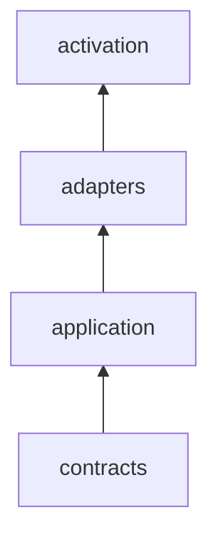
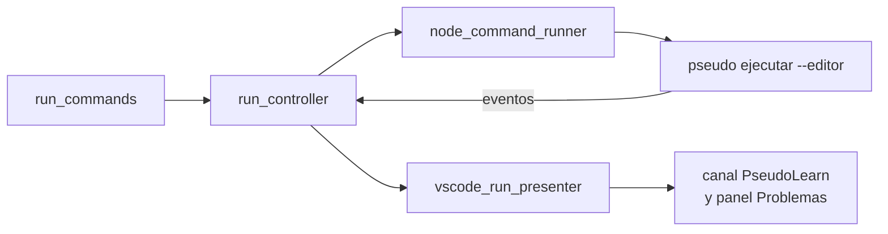

# pseudolearn_vscode

Extensión de VS Code para escritorio y navegador. Trae al editor el resaltado, los diagnósticos, la navegación, la
ayuda, la ejecución y la depuración de los programas `.pseudo`, delegando todo el análisis en el binario `pseudo`
(escritorio) o en el módulo Wasm del motor (navegador).

**No hace:** analizar, ejecutar ni validar el lenguaje por su cuenta (eso es de Rust); publicarse en Marketplace ni Open
VSX; actualizarse sola ni enviar telemetría.

> Este README es para quien desarrolla la extensión. Lo que ven los usuarios al instalarla es [
> `marketplace/README.md`](marketplace/README.md): el empaquetado lo incluye en el VSIX como su `readme.md`.

## Dónde encaja

## Arquitectura

Se omiten las aristas desde `contracts` hacia `adapters` y `activation`, y desde `application` hacia `activation`.

| Capa          | Qué contiene                                                                                                                                                                   |
|---------------|--------------------------------------------------------------------------------------------------------------------------------------------------------------------------------|
| `contracts`   | Puertos y datos: documentos del editor, cliente de lenguaje, anfitrión, configuración, transporte de Workers                                                                   |
| `application` | Casos de uso sobre los puertos: controlador de ejecución, ciclo de vida del cliente, resolución de configuración, diagnósticos, ayuda, traducción, definición del servidor MCP |
| `adapters`    | VS Code, Node y el proceso `pseudo` (escritorio); Workers, `workspace.fs` y Fetch (navegador)                                                                                  |
| `activation`  | Composición y registro de comandos para escritorio (`extension.ts`) y navegador (`browser_extension.ts`, más los dos Workers)                                                  |

Las dos activaciones comparten `contracts` y `application`; solo difieren en los adaptadores que componen.

## Flujo principal

Flujo de datos al ejecutar un archivo en escritorio (la dirección difiere de la de dependencias).

## Reglas que conviene saber

- Los imports siguen la matriz de `architecture.json`; las carpetas `src/common`, `src/helpers`, `src/misc` y
  `src/utils` están prohibidas.
- Límites: 300 líneas por archivo, 40 por función, 4 parámetros posicionales, anidación 3 y 7 métodos públicos por
  clase.
- La gramática TextMate y la configuración del lenguaje se generan desde `export.json` del corpus; no se editan a mano
  (`pnpm check:grammar` detecta la diferencia).
- El VSIX contiene solo lo declarado en `artifact.contract.json`; excluye fuentes, tests, scripts, ejemplos, mapas y
  `node_modules`.
- El README del VSIX es `marketplace/README.md` (`readme` del contrato). El `README.md` de esta carpeta no se empaqueta.

## Comandos útiles

Desde esta carpeta.

| Para qué                              | Comando                                                             |
|---------------------------------------|---------------------------------------------------------------------|
| Instalar dependencias                 | `pnpm install --frozen-lockfile`                                    |
| Tipos                                 | `pnpm check:types`                                                  |
| Arquitectura, comentarios y tamaños   | `pnpm check:architecture`, `pnpm check:comments`, `pnpm check:size` |
| Contenido del paquete                 | `pnpm check:package`                                                |
| Gramática vigente                     | `pnpm check:grammar` (regenerar: `pnpm generate:grammar`)           |
| Tests                                 | `pnpm test`                                                         |
| Compilar el binario `pseudo` incluido | `pnpm build:cli`                                                    |
| Bundle de escritorio                  | `pnpm build`                                                        |
| VSIX de escritorio (`darwin-arm64`)   | `pnpm package`                                                      |
| VSIX web                              | `pnpm package:web`                                                  |
| Escenarios en navegador               | `pnpm test:web`                                                     |
| Contraste LSP escritorio/Wasm         | `pnpm test:lsp:contrast`                                            |
| Depuración por stdio                  | `pnpm test:dap:stdio`                                               |
| Prueba en VS Code real                | `node tests/host/run-host.mjs trusted` (o `restricted`)             |

Requisitos: Node 22.23.3, pnpm 12.8.1; `build:cli` y `package` necesitan Cargo y un host `darwin-arm64`; `package:web`
necesita además la cadena del motor para el Wasm.
