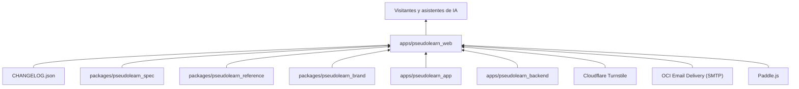
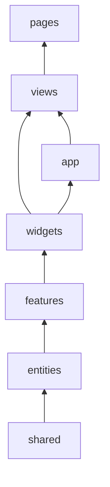
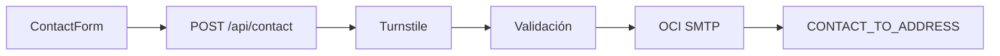

# pseudolearn_web

Sitio público de PseudoLearn (<https://pseudolearn.app>) en español e inglés: portada, el lenguaje (`/language`), la
ruta
de aprendizaje (`/learn`), el asistente Nodo (`/nodo`), descargas (`/download`), la especificación ilustrada (`/spec`),
historial de versiones, contacto, checkout de Paddle y páginas legales. Es un sitio Astro que se despliega en
Cloudflare Workers.

**No hace:** ejecutar pseudocódigo, leer el corpus ni el código de otros miembros, ni redirigir por idioma de forma
automática. Todo lo que muestra del resto del monorepo llega como artefacto generado o como `CHANGELOG.json`.

## Dónde encaja

Qué llega de cada uno: `spec` las fichas de agente (`see agent-sheet`), `reference` la especificación y la ruta, `brand`
el símbolo, el glifo de Nodo y la tarjeta social, `app` las capturas de `src/assets/product/` y `backend` las
constantes de créditos que `pnpm check:plan-constants` contrasta con `entities/nodo-plan`.

## Arquitectura

Capas al estilo Feature-Sliced Design, declaradas en `architecture.yaml`. Las flechas van de la dependencia a quien la
usa.

El diagrama omite las aristas desde `shared`, `entities` y `features` hacia las capas superiores; `app` no importa de
`views`, pero `views` sí importa de `app`.

| Capa            | Contenido                                                                                                                           |
| :-------------- | :---------------------------------------------------------------------------------------------------------------------------------- |
| `src/pages/`    | Rutas finas (14 líneas como máximo) que montan una vista; incluye `api/contact`, `llms*.txt`, `robots.txt` y el sitemap             |
| `src/views/`    | Una pantalla por ruta: home, language, learn, nodo, download, contact, versions, privacy, terms, checkout, specification, not-found |
| `src/widgets/`  | Bloques de página: encabezado, pie, héroes, muestras de lección, Nodo, descargas, lector de la especificación                       |
| `src/features/` | Interacciones: formulario de contacto, checkout de Paddle, cambio de idioma y de tema                                               |
| `src/entities/` | Modelos y accesos: contact-request, learning-route, legal, nodo-plan, platform, release, specification                              |
| `src/shared/`   | Configuración, i18n, estilos globales (`pl-`), UI, ficha de agente y acceso al entorno de ejecución                                 |
| `src/app/`      | Layouts y SEO                                                                                                                       |

## Flujo principal

Flujo de datos del formulario de contacto, no de dependencias:

## Reglas que conviene saber

- Las capas solo importan lo que permite `architecture.yaml`; `src/components`, `layouts`, `lib`, `styles`, `i18n`,
  `utils` y `helpers` están prohibidas.
- `cloudflare:workers`, `cloudflare:sockets` y `@changelog` (la raíz `CHANGELOG.json`) solo se importan desde un archivo
  cada uno.
- Límites: 210 líneas por `.astro`, 160 por TypeScript, 40 por función, 3 parámetros posicionales y anidación 3. Sin
  comentarios en el código.
- Presupuesto del build: 10 KiB de JavaScript por ruta, 24 KiB en total y 50 KiB de CSS por ruta (`pnpm check:budget`).
- Los artefactos generados no se editan a mano (`GEN-NO-HAND-COPY`): `shared/agent-sheet/generated/`,
  `entities/specification/generated/`, `entities/learning-route/generated/`, `src/assets/product/`, y los que emite el
  motor de marca y no se versionan: `symbol-path.generated.ts`, `nodo-glyph.generated.ts`, `social-card.svg` y
  `public/og-image.png`.

## Comandos útiles

| Para qué                                    | Comando                                                                          |
| :------------------------------------------ | :------------------------------------------------------------------------------- |
| Servidor de desarrollo                      | `pnpm dev`                                                                       |
| Build de producción (genera `og-image.png`) | `pnpm build`                                                                     |
| Servir el build sobre el runtime de Workers | `pnpm preview`                                                                   |
| Compilar y desplegar                        | `pnpm deploy`                                                                    |
| Tests de unidad y componentes               | `pnpm test`                                                                      |
| Extremo a extremo, accesibilidad y visual   | `pnpm test:e2e`, `pnpm test:a11y`, `pnpm test:visual`                            |
| ESLint, Stylelint y Prettier                | `pnpm lint`, `pnpm lint:css`, `pnpm format:check`                                |
| Tipos                                       | `pnpm check:types`                                                               |
| Los nueve verificadores propios             | `pnpm check:static`                                                              |
| Presupuesto de JavaScript y CSS             | `pnpm check:budget`                                                              |
| Todo lo anterior, en orden                  | `pnpm check:all`                                                                 |
| Regenerar la ruta y la especificación       | `cargo run -p reference_cli -- build` (en `packages/pseudolearn_reference`)      |
| Regenerar las fichas de agente              | `cargo run -p see_cli --bin see -- agent-sheet` (en `packages/pseudolearn_spec`) |
| Regenerar marca y tarjeta social            | `python3 -m pseudolearn_brand build` (en `packages/pseudolearn_brand`)           |
| Regenerar la imagen de previsualización     | `pnpm generate:og-image` (tras el comando de marca)                              |
| Regenerar las capturas de producto          | `flutter test tool/generate_product_shot.dart` (en `apps/pseudolearn_app`)       |

Requisitos: Node 26.13.1 (`.nvmrc`) y pnpm; Wrangler con cuenta de Cloudflare solo para desplegar. Las variables de
entorno están en `.env.example`.
