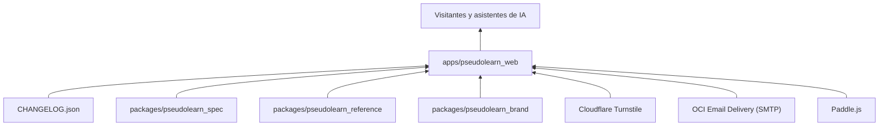
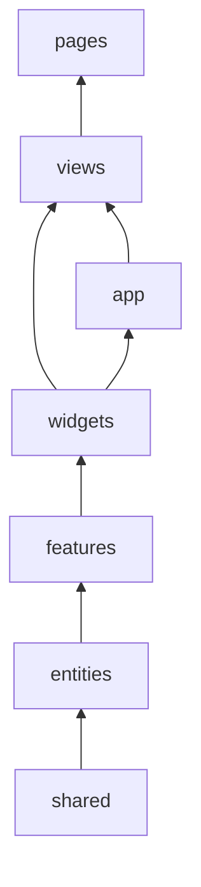
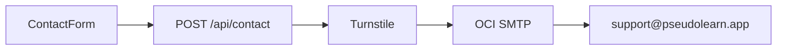

# pseudolearn_web

Sitio público de PseudoLearn (<https://pseudolearn.app>): landing, especificación ilustrada del lenguaje en `/spec`,
historial de versiones, contacto, checkout de Paddle y páginas legales, en español e inglés. Es un sitio Astro que se
despliega en Cloudflare Workers.

**No hace:** ejecutar pseudocódigo, leer el corpus ni el código de otras apps, ni redirigir por idioma de forma
automática. Todo lo que muestra del resto del monorepo llega como artefacto generado o como `CHANGELOG.json`.

## Dónde encaja

## Arquitectura

Arquitectura por capas al estilo Feature-Sliced Design. Las flechas van de la dependencia a quien la usa; cada capa
importa de sí misma y de las inferiores.

| Capa            | Contenido                                                                                                                     |
|:----------------|:------------------------------------------------------------------------------------------------------------------------------|
| `src/pages/`    | Rutas finas (14 líneas como máximo) que montan una vista; incluye `api/contact`, `llms*.txt`, `robots.txt`, sitemap y `/spec` |
| `src/views/`    | Una pantalla por ruta: home, contacto, versiones, privacidad, términos, checkout, especificación, 404                         |
| `src/widgets/`  | Bloques de página: encabezado, pie, héroe, descargas, historial, lector de especificación                                     |
| `src/features/` | Interacciones: formulario de contacto, checkout de Paddle, cambio de idioma y de tema                                         |
| `src/entities/` | Modelos y accesos: solicitud de contacto, release, especificación, plataforma, módulo, legal                                  |
| `src/shared/`   | Configuración, i18n propia, estilos globales (`pl-`), UI, ficha de agente y entorno de ejecución                              |
| `src/app/`      | Layout base y SEO                                                                                                             |

El diagrama omite las aristas desde `shared`, `entities` y `features` hacia las capas superiores; `app` importa de todas
salvo `views`, y `views` importa de `app`.

## Flujo principal

Flujo de datos del formulario de contacto, no de dependencias:

## Reglas que conviene saber

- Las capas solo importan lo que `architecture.yaml` permite; `src/components`, `layouts`, `lib`, `styles`, `i18n`,
  `utils` y `helpers` están prohibidas.
- `cloudflare:workers`, `cloudflare:sockets` y `@changelog` (la raíz `CHANGELOG.json`) solo se importan desde un archivo
  cada uno.
- Los límites son 210 líneas por `.astro`, 160 por TypeScript, 40 por función, 3 parámetros posicionales y 3 niveles de
  anidación.
- El presupuesto del build es 10 KiB de JavaScript por ruta, 24 KiB en total y 50 KiB de CSS por ruta
  (`pnpm check:budget`).
- Los artefactos generados (`shared/agent-sheet/generated/`, `entities/specification/generated/`, el símbolo de marca)
  no se editan a mano (`GEN-NO-HAND-COPY`); sin comentarios en el código.

## Comandos útiles

| Para qué                                    | Comando                                               |
|:--------------------------------------------|:------------------------------------------------------|
| Servidor de desarrollo                      | `pnpm dev`                                            |
| Build de producción                         | `pnpm build`                                          |
| Servir el build sobre el runtime de Workers | `pnpm preview`                                        |
| Compilar y desplegar                        | `pnpm deploy`                                         |
| Tests de unidad y componentes               | `pnpm test`                                           |
| Extremo a extremo, accesibilidad y visual   | `pnpm test:e2e`, `pnpm test:a11y`, `pnpm test:visual` |
| ESLint, Stylelint y Prettier                | `pnpm lint`, `pnpm lint:css`, `pnpm format:check`     |
| Tipos                                       | `pnpm check:types`                                    |
| Los ocho verificadores propios              | `pnpm check:static`                                   |
| Presupuesto de JavaScript y CSS             | `pnpm check:budget`                                   |
| Todo lo anterior, en orden                  | `pnpm check:all`                                      |

Requisitos: Node `>=22.23.3` (`.nvmrc`) y pnpm; Wrangler con cuenta de Cloudflare solo para desplegar. Las variables de
entorno están en `.env.example`.
