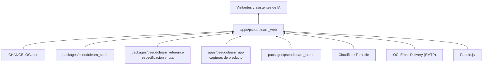
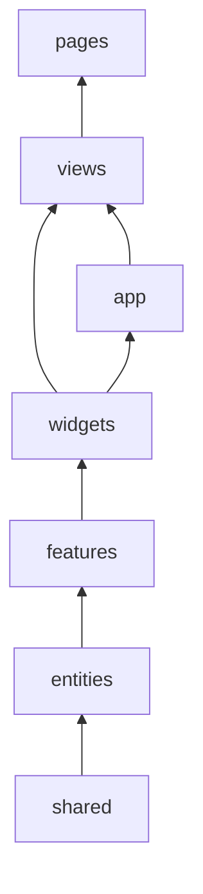
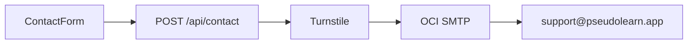

# pseudolearn_web

Sitio público de PseudoLearn (<https://pseudolearn.app>): portada, el lenguaje (`/language`), la ruta de aprendizaje
(`/learn`), el asistente Nodo (`/nodo`), descargas (`/download`), especificación ilustrada en `/spec`, historial de
versiones, contacto, checkout de Paddle y páginas legales, en español e inglés. Es un sitio Astro que se despliega en
Cloudflare Workers.

**No hace:** ejecutar pseudocódigo, leer el corpus ni el código de otras apps, ni redirigir por idioma de forma
automática. Todo lo que muestra del resto del monorepo llega como artefacto generado o como `CHANGELOG.json`.

## Dónde encaja

## Arquitectura

Arquitectura por capas al estilo Feature-Sliced Design. Las flechas van de la dependencia a quien la usa; cada capa
importa de sí misma y de las inferiores.

| Capa            | Contenido                                                                                                                     |
|:----------------|:------------------------------------------------------------------------------------------------------------------------------|
| `src/pages/`    | Rutas finas (14 líneas como máximo) que montan una vista; incluye `api/contact`, `llms*.txt`, `robots.txt`, sitemap y `/spec` |
| `src/views/`    | Una pantalla por ruta: home, lenguaje, aprender, Nodo, descargas, contacto, versiones, legales, checkout, especificación, 404 |
| `src/widgets/`  | Bloques de página: encabezado, pie, héroes, muestras de lección y ejercicio, Tareas, paradigmas, Nodo, descargas, lector      |
| `src/features/` | Interacciones: formulario de contacto, checkout de Paddle, cambio de idioma y de tema                                         |
| `src/entities/` | Modelos y accesos: solicitud de contacto, release, especificación, ruta de aprendizaje, plan de Nodo, plataforma, legal       |
| `src/shared/`   | Configuración, i18n propia, estilos globales (`pl-`), UI, ficha de agente y entorno de ejecución                              |
| `src/app/`      | Layout base y SEO                                                                                                             |

El diagrama omite las aristas desde `shared`, `entities` y `features` hacia las capas superiores; `app` importa de todas
salvo `views`, y `views` importa de `app`.

## Flujo principal

Flujo de datos del formulario de contacto, no de dependencias:

## Reglas que conviene saber

- Las capas solo importan lo que `architecture.yaml` permite; `src/components`, `layouts`, `lib`, `styles`, `i18n`,
  `utils` y `helpers` están prohibidas.
- `cloudflare:workers`, `cloudflare:sockets` y `@changelog` (la raíz `CHANGELOG.json`) solo se importan desde un archivo
  cada uno.
- Los límites son 210 líneas por `.astro`, 160 por TypeScript, 40 por función, 3 parámetros posicionales y 3 niveles de
  anidación.
- El presupuesto del build es 10 KiB de JavaScript por ruta, 24 KiB en total y 50 KiB de CSS por ruta
  (`pnpm check:budget`).
- Los artefactos generados (`shared/agent-sheet/generated/`, `entities/specification/generated/`,
  `entities/learning-route/generated/`, el símbolo de marca y las capturas de `src/assets/product/`) no se editan a mano
  (`GEN-NO-HAND-COPY`); sin comentarios en el código.

## Decisiones de la versión 2.0.0

- **El encabezado solo enlaza páginas.** Lenguaje, Aprender, Nodo · IA y Especificación, más Descargar como botón; la
  página actual lleva subrayado. Las anclas viven en el índice «En esta página» (`PageSections`), con forma de chips y
  marca `#`, para que nunca se confundan con un cambio de página.
- **La portada cuenta una historia, móvil primero.** El símbolo es el protagonista: en el héroe se dibuja recorriendo la
  escalera (`StairMark` con ceremonia) y en «Una lección por dentro» queda fijo como testigo y sube un peldaño por fase
  con una animación ligada al scroll (`view-timeline`, 0 KB de JS; sin soporte o con movimiento reducido queda completo).
  Los cinco golpes usan la primera lección real: el problema y su respuesta, el plan, el editor en un teléfono, el primer
  ejercicio «encontrar el error» y lo que te llevas. Luego vienen el recorrido del producto, la ruta como un camino
  continuo (un nodo numerado por parte, la pregunta que abre cada paradigma y la meta marcada con el banderín del símbolo
  junto al proyecto final), Nodo y el cierre con el símbolo completo. Las apariciones ligadas al scroll solo desplazan,
  nunca cambian la opacidad: si el navegador detiene la animación a medias, el contenido sigue visible.
- **La misma fórmula en todas las páginas de producto.** `StoryHero` abre cada página con un protagonista visual (el
  símbolo que se recorre en portada, Aprender y Descargas; el vocabulario que alterna de idioma en Lenguaje; el glifo de
  Nodo que se dibuja en Nodo). `PageSection` alterna tonos (`canvas`, `surface`, `field`) y la de campo redefine los
  tokens de tinta, marca, superficie y líneas, así que cualquier widget se lee sobre fondo oscuro sin estilos propios.
  Los pasos se cuentan con numerales grandes y las capturas van en marco de teléfono o en ancho completo. Soporte y la
  especificación usan la variante `compact` del héroe, porque ahí el contenido (el formulario, el índice, la lectura) es
  lo principal: el índice muestra las partes como barras en escalera, cifras reales de la edición
  (`specification-figures`) y el mismo camino con nodos de la ruta; cada sección abre con una cabecera de campo y la
  barra lateral marca la sección actual sobre el riel.
- **Accesibilidad sin animaciones a medias.** Todas las animaciones viven bajo `prefers-reduced-motion: no-preference`;
  la prueba de axe emula movimiento reducido para medir el estado final y no un fundido a medio camino.
- **Sin código de la ruta en las páginas que cambian de idioma.** Los programas de la ruta se escriben una vez en español
  y la edición inglesa solo traduce el vocabulario, así que sus identificadores y textos quedan en español. Las
  páginas muestran texto de la ruta (problemas, planes, preguntas) y capturas generadas por idioma; `/language` enseña los
  dos perfiles con los pares de palabras clave del apéndice de la especificación (`entities/specification/model/vocabulary`).
- **Ninguna cifra a mano.** Partes, lecciones, ejercicios, tipos, horas y secciones salen de los paquetes generados; los
  temas del formulario de contacto son las lecciones de la ruta y las partes de la especificación.
- **VS Code y la terminal aparecen como «Próximamente».** La extensión aún se instala solo desde un VSIX privado y la CLI
  solo se compila desde el código; no se ofrece descarga hasta que se publiquen.
- **La guía de SmartScreen va plegada** dentro de la tarjeta de Windows: Microsoft Store es la vía principal.
- **Nodo sin precio fijo.** La web muestra créditos y días y remite al precio en tu moneda de cada tienda. Los valores de
  `entities/nodo-plan` repiten las constantes de créditos del backend (`agent-responses/domain/credits.ts`).
- **Glifo de Nodo.** `NodoGlyph` reproduce en SVG la geometría de `agent_glyph_painter.dart` de la app; si el glifo
  cambia allí, se cambia aquí en el mismo cambio.
- **Capturas por escena y dispositivo.** `tool/generate_product_shot.dart` de la app escribe editor, Tareas, lección y
  ruta, en móvil y escritorio, claro y oscuro, español e inglés. `ProductShot` sirve la captura móvil por debajo de 900 px
  y la de escritorio por encima (`responsive`), o solo la móvil dentro de un marco de teléfono (`phone`).

## Comandos útiles

| Para qué                                    | Comando                                                                     |
|:--------------------------------------------|:----------------------------------------------------------------------------|
| Servidor de desarrollo                      | `pnpm dev`                                                                  |
| Build de producción                         | `pnpm build`                                                                |
| Servir el build sobre el runtime de Workers | `pnpm preview`                                                              |
| Compilar y desplegar                        | `pnpm deploy`                                                               |
| Tests de unidad y componentes               | `pnpm test`                                                                 |
| Extremo a extremo, accesibilidad y visual   | `pnpm test:e2e`, `pnpm test:a11y`, `pnpm test:visual`                       |
| ESLint, Stylelint y Prettier                | `pnpm lint`, `pnpm lint:css`, `pnpm format:check`                           |
| Tipos                                       | `pnpm check:types`                                                          |
| Los ocho verificadores propios              | `pnpm check:static`                                                         |
| Presupuesto de JavaScript y CSS             | `pnpm check:budget`                                                         |
| Todo lo anterior, en orden                  | `pnpm check:all`                                                            |
| Regenerar la ruta y la especificación       | `cargo run -p reference_cli -- build` (en `packages/pseudolearn_reference`) |
| Regenerar las capturas de producto          | `flutter test tool/generate_product_shot.dart` (en `apps/pseudolearn_app`)  |

Requisitos: Node `>=22.23.3` (`.nvmrc`) y pnpm; Wrangler con cuenta de Cloudflare solo para desplegar. Las variables de
entorno están en `.env.example`.
