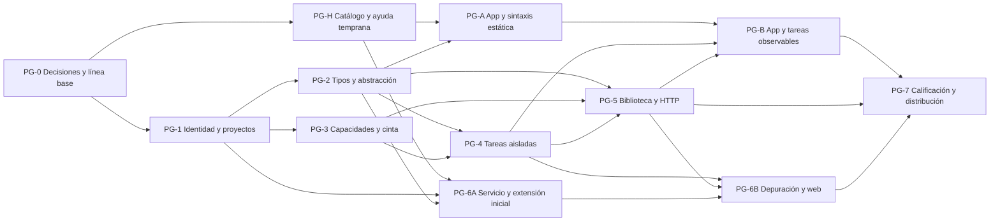
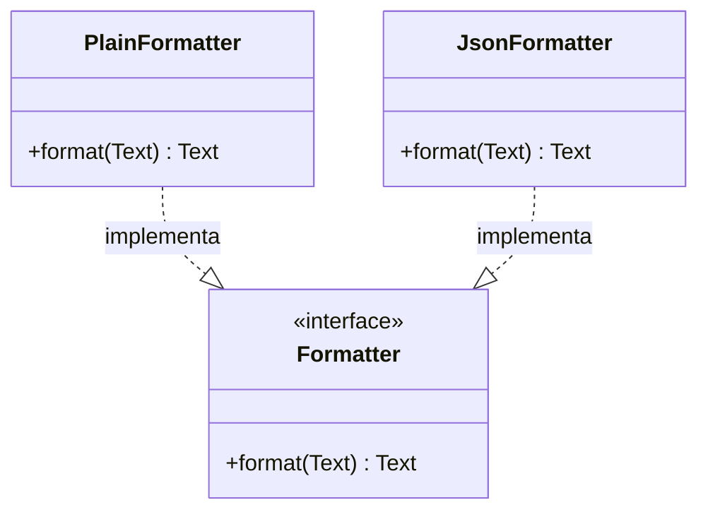
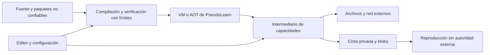

# Hoja de ruta de PseudoLearn hacia un lenguaje de propósito general

## Decisiones posteriores de la persona · 2026-10-22

Este registro actualiza las recomendaciones y puertas previas que lo contradigan; las opciones anteriores
se conservan como rastro de análisis, no como instrucciones vigentes.

- ADR-05, CF-03 y PG-0.06: se mantiene exclusivamente la edición 2026 antes de la primera publicación.
  Se permiten cambios necesarios documentados, incluso incompatibles; no se crea una edición GP.
- CF-02 y CF-19: contratos nuevos en estable 1.0.0, sin campo `cambio`; correcciones oficiales sobre
  la misma identidad y versión. Congelamiento hasta reapertura explícita. Los contratos existentes
  se auditan antes de cambiar estados; CF-12 no se corrige automáticamente.
- PG-0 admite una excepción acotada de implementación para SEE, contratos de proceso, tests y README
  necesarios para aplicar esta política; no autoriza cambios de semántica ni del motor.
- PG-0.05 queda diferido por autorización expresa a PG-7.07. Se mantienen derechos reservados;
  elegir y verificar licencia abierta es obligatorio antes del cierre final o publicación.
- Las pruebas con dispositivos físicos y los estudios con participantes de E-PG-08/10/12 son
  complementarios y no bloquean cierres. Se registrará su ausencia sin afirmar cobertura física
  ni eficacia pedagógica. Las comprobaciones automatizables de calidad y rendimiento siguen obligatorias.
- D-xx y TS-3 sin origen verificable se reconstruyen como propuestas nuevas; no se presume aprobación histórica.
- Se permiten referencias internas entre documentos de docs/; ningún archivo externo dependerá de ellos.

El detalle operativo está en [el plan de PG-0](plan-ejecucion-proposito-general/fase-pg-0-plan-ejecucion.md).
La petición directa de implementación revisó y autorizó PG-0.C02; su ejecución y cierre siguen sujetos a PHASE-GREEN.


Documento transitorio de análisis y propuesta. Su única base de planificación es `docs/pendientes-rezagados.md`, repriorizada por el encargo de la persona. Es autosustentable: ninguna implementación, corpus, README ni archivo fuera de `docs/` debe depender de este documento (`DOC-NO-TRANSIENT-REFS`). Las recomendaciones originales quedan aprobadas conceptualmente por la persona en su mensaje de seguimiento, con la ampliación didáctica descrita aquí. Este documento registra decisiones y trazabilidad; la implementación autorizada de PG-0 se ejecuta en el plan detallado. No autoriza PG-H ni PG-1 y no sustituye resultados experimentales ni el cierre PHASE-GREEN.

## 1. Resumen ejecutivo

La visión es un lenguaje estático, bilingüe, seguro y medible que permita aprender en español y construir programas reales sin cambiar de modelo mental al llegar a archivos, red o tareas concurrentes. El español es el perfil primario; el inglés conserva igual semántica y cobertura. La verbosidad no concede excepciones de seguridad ni rendimiento.

La base técnica ya existe: compilador Rust por capas, RI SSA verificada, VM con recolección determinista, AOT Cranelift, API total, reconstrucción temporal y herramientas de lenguaje. Sin embargo, esa base ejecuta un texto con un algoritmo principal y capacidades limitadas a consola y semilla. Generalizarla exige cambiar contratos de programa, tipos, capacidades y distribución; añadir solamente bibliotecas HTTP no alcanza.

Se recomienda un primer entregable **ENT-1**, cerrado en §5: proyectos y módulos con visibilidad; manifiesto, ediciones y dependencias fijadas; constantes, enumerados, registros, opcionales, resultados, patrones exhaustivos, interfaces mínimas, genéricos, clausuras, colecciones e iteración; E/S y HTTP mediante capacidades; asincronía y concurrencia estructurada con aislamiento de mutación; CLI, servicio multiarchivo, LSP, extensión de VS Code de escritorio y adaptación de la app didáctica de un solo archivo con cobertura visual de la sintaxis nueva. La variante web de la extensión, que ejecuta la VM Wasm dentro del navegador, forma parte de ENT-1 en navegadores de escritorio (C-12); su uso telefónico es una evaluación sujeta al experimento E-PG-08 (C-13), no una cobertura prometida. No se promete paridad entre capacidades del navegador y del escritorio. **ENT-1** nombra el entregable completo; **PG-1** es solo la fase «Identidad y proyectos» de §6, una de las doce que lo construyen.

La decisión central es conservar **reproducibilidad respecto de entradas completas**, ampliando la cinta para registrar efectos y su orden de entrega. La ejecución real de HTTP no es determinista respecto del texto y la semilla solamente. Reproducir consume la cinta sin reenviar peticiones ni reescribir archivos; retroceder consulta un estado histórico y no deshace el mundo. Las tareas comparten un planificador lógico determinista y no comparten objetos mutables. Concurrencia de E/S entra en ENT-1; paralelismo CPU y actores como construcción pública quedan para evaluación posterior.

La distribución inicial recomendada es VS Code: reutiliza `pseudo lsp`, admite una extensión fina y tiene una vía documentada para Wasm en navegador. Zed requiere además una gramática tree-sitter; JetBrains añade adaptación JVM y una matriz de productos; Neovim permite demostrar temprano interoperabilidad con poco envoltorio. El orden recomendado es VS Code, Neovim, Helix, Zed, JetBrains y Sublime, revisable según demanda comprobada. Un IDE propio no bloquea ENT-1.

Se excluyen del primer entregable JIT, backend C, autohoisting y nuevas optimizaciones sin cambios observables. También autoalojamiento, DSL semántico ejecutable, registro público, gobernanza pública e interfaz declarativa: ninguno resuelve una dependencia imprescindible del programa multiarchivo con efectos seguros. Licencia y derechos de distribución sí deben decidirse antes de distribuir artefactos.

La app conserva su edición de un solo archivo sin exigir manifiesto ni Importar/Exportar. Cada construcción nueva debe tener representación pedagógica adecuada: interfaz y realización en el diagrama de tipos; flujo local por tarea, suspensión/unión y una vista de eventos para concurrencia. Se prioriza además un catálogo declarativo de ayuda por identidad y papel sintáctico, compartido por hover de IDE y consulta táctil de app, con ejemplos verificables y sin comentarios en código.

Hay conflictos explícitos: exclusiones actuales del motor frente al nuevo alcance; compatibilidad prometida por F4 frente a cambios que afectan nombres o visibilidad; congelamiento de estados frente a excepciones descritas por SEE; decisiones D-xx ausentes del corpus consultado; afirmaciones históricas y metadatos de características no alineados. §11 conserva el rastro de conflictos y registra el tratamiento recomendado ya aprobado conceptualmente; las verificaciones y datos concretos pendientes siguen abiertos. El encargo de seguimiento termina con la actualización de este documento.

## 2. Metodología y fuentes

### 2.1 Alcance, reproducibilidad y grados de certeza

Se siguió la lectura obligatoria: `AGENTS.md`, README raíz, READMEs y reglas de engine/spec, README de la app para consumo, corpus y finalmente la hoja base. Después se inspeccionaron fuentes y evidencias puntuales. Revisión Git auditada: `b602ff447034c2daee8b33a778d422f78801cc97`; rama `feature/agregar-ruta-de-especificacion`; árbol inicialmente limpio. No se ejecutaron compiladores, suites, exportadores ni reanclajes: pueden generar archivos y el encargo inicial autorizó exclusivamente un Markdown nuevo y su seguimiento autoriza actualizar ese mismo archivo. Por ello no se certifica `PHASE-GREEN` de implementación alguna.

Antes de escribir: el archivo pertenece a documentación transitoria raíz, fuera de capas ejecutables; no tiene imports de código ni amplía dependencias permitidas; su responsabilidad única es analizar la hoja de ruta. No sustituye al README ni al corpus como dueño de decisiones vigentes.

Convenciones de evidencia utilizadas en todo el documento:

- **V — verificado:** contenido leído en un archivo o fuente primaria accesible. Un README prueba qué declara el repositorio; un resultado guardado prueba qué registró esa campaña. Ninguno prueba por sí solo el comportamiento de la revisión actual.
- **I — inferido/propuesto:** conclusión de diseño, puntuación, estimación de coste o presupuesto candidato. Tiene fundamento y un ensayo que puede refutarla; no es especificación vigente.
- **NV — no verificado:** falta ejecución, fuente accesible, procedencia suficiente o ensayo de plataforma. Se identifica cómo resolverlo.

Espacios de identificadores, disjuntos entre sí: **ENT-1** es el primer entregable; **PG-0…PG-7, PG-H, PG-A, PG-B, PG-6A/6B** son fases de §6; **F4, F7, F8, F9, F10** (sin guion) son las fases de la hoja base; **FUT-01…FUT-14** son capacidades futuras excluidas de §8; **C-01…C-16** son capacidades de ENT-1 en §5; **CF-01…CF-20** son conflictos de §11; **H-**, **R-**, **K-**, **S-**, **ADR-** y **E-PG-** conservan su significado de hallazgo, requisito, riesgo, fuente, decisión y experimento.

La web estuvo accesible mediante búsqueda y lectura de páginas oficiales. Las fechas siguientes son exclusivamente **fechas de consulta exigidas por el encargo**, no calendario de trabajo. Se usaron páginas versionadas cuando existen; una URL `latest`, `main` o documentación viva debe volver a comprobarse antes de fijar dependencias. No se deducen reglas desde resúmenes de terceros.

### 2.2 Técnicas aplicadas y ubicación de sus resultados

| Técnica | Aplicación concreta | Rastro |
|---|---|---|
| Auditoría | Contrato → fuente → resultado guardado → límite de afirmación | H-01 a H-22, §3 |
| Requisitos/atributos | Escenarios observables con puertas, exclusiones y prioridad | R-01 a R-20, §4–5 |
| Comparación | Matrices por tema y por plataforma, fuentes primarias | §2.4 y ADR-01 a ADR-13 |
| ADR | Opciones, pesos, vectores, recomendación, consecuencias, reversión | §7 |
| Riesgos/STRIDE | Probabilidad e impacto ordinales, residual, propietario y prueba adversaria | §9 |
| Dependencias | DAG, camino crítico provisional, S/M/L/XL y criterios de salida | §6 |
| Experimentos | Hipótesis, control, métrica, descarte y procedencia | E-PG-01 a E-PG-12, §6.3 |
| Trazabilidad | Cada punto base → requisito → fase → paquete; recorrido inverso por fase | §10 y §12 |

### 2.3 Registro de fuentes primarias

En las tablas, «rechazado» significa que no se adopta como decisión de PseudoLearn; no es una crítica a la fuente. Las referencias S-xx identifican este registro y las recomendaciones que lo usan. Las fuentes externas son informativas: antes de una futura implementación aprobada, sus motivos se redactarían de forma autosuficiente en el README dueño y el comportamiento en el corpus, sin citar este documento.

| ID | Fuente y URL | Consulta | Qué se tomó | Qué se rechazó o no acredita |
|---|---|---|---|---|
| S-01 | [Rust: ediciones](https://doc.rust-lang.org/edition-guide/editions/index.html) | 2026-10-22 | Elección explícita e interoperabilidad entre ediciones | Que una edición permita cambiar arbitrariamente representación o significado |
| S-02 | [Rust: módulos](https://doc.rust-lang.org/reference/items/modules.html) | 2026-10-22 | Espacios de nombres y correspondencia de rutas | Copiar sus dos convenciones de archivo o sus atributos |
| S-03 | [Rust: Future, Pin y Unpin](https://doc.rust-lang.org/book/ch17-05-traits-for-async.html) | 2026-10-22 | Coste conceptual de futuros y suspensión | Exponer préstamos y Pin al principiante |
| S-04 | [Kotlin: concurrencia estructurada](https://kotlinlang.org/docs/coroutines-basics.html) | 2026-10-22 | Árbol de tareas, unión y cancelación de hijos | Que estructura de tareas elimine carreras por sí sola |
| S-05 | [Kotlin: estado compartido](https://kotlinlang.org/docs/shared-mutable-state-and-concurrency.html) | 2026-10-22 | Necesidad de aislamiento o sincronización | Mutación compartida como opción inicial |
| S-06 | [Swift: concurrencia](https://docs.swift.org/swift-book/LanguageGuide/Concurrency.html) | 2026-10-22 | Suspensión explícita y aislamiento | Equiparar seguridad de datos con determinismo |
| S-07 | [Swift: SE-0306 actores](https://github.com/swiftlang/swift-evolution/blob/main/proposals/0306-actors.md) | 2026-10-22 | Reentrancia y cambios de estado entre suspensiones | Actor como transacción que cruza un await |
| S-08 | [Go: modelo de memoria](https://go.dev/ref/mem) | 2026-10-22 | Sincronización y ejecuciones sin carreras | Prometer resultado único a partir de canales |
| S-09 | [Go: módulos y MVS](https://go.dev/ref/mod#minimal-version-selection) | 2026-10-22 | Selección mínima sobre requisitos mínimos | Confundir MVS con resolver rangos semver arbitrarios |
| S-10 | [Zig: referencia 0.15.2](https://ziglang.org/documentation/0.15.2/) | 2026-10-22 | Uniones de error, opcionales y limpieza | `undefined`, punteros o metaprogramación ilimitada como base pedagógica; no se afirma que 0.15.2 sea la versión más reciente |
| S-11 | [Gleam: módulos](https://tour.gleam.run/basics/modules/) | 2026-10-22 | Módulo por archivo | Dependencia obligatoria de BEAM |
| S-12 | [Gleam: resultados](https://tour.gleam.run/data-types/results/) | 2026-10-22 | Error tipado genérico con variantes | Excepciones implícitas para fallos esperables |
| S-13 | [Gleam: tipos opacos](https://tour.gleam.run/advanced-features/opaque-types/) | 2026-10-22 | Separar tipo público de constructores privados | Exportar representación accidental |
| S-14 | [Roc: plataformas](https://www.roc-lang.org/docs/main/langref/platforms/) | 2026-10-22 | Frontera de E/S controlada por anfitrión | Suponer que toda concurrencia descrita ya está implementada |
| S-15 | [Roc: efectos actuales](https://www.roc-lang.org/functional) | 2026-10-22 | Frontera pura/efectiva explícita | Copiar el antiguo modelo Task como si fuera vigente |
| S-16 | [Elm: errores](https://guide.elm-lang.org/error_handling/) | 2026-10-22 | Ausencia y fallo como datos | Trasladar a PseudoLearn una garantía absoluta de ausencia de fallos |
| S-17 | [Elm: arquitectura](https://guide.elm-lang.org/architecture/) | 2026-10-22 | Modelo, vista y actualización | Acoplar el lenguaje a DOM o a un renderizador |
| S-18 | [Pony: capacidades](https://tutorial.ponylang.org/capabilities/reference-capabilities.html) | 2026-10-22 | Aislar mutación y compartir inmutables | Copiar todo su sistema de capacidades |
| S-19 | [Pony: dificultades de aprendizaje](https://www.ponylang.io/learn/reference-capabilities/) | 2026-10-22 | Coste conceptual reconocido por sus autores | Interpretarlo como ensayo con principiantes de PseudoLearn |
| S-20 | [Python: análisis léxico](https://docs.python.org/3/reference/lexical_analysis.html) | 2026-10-22 | Separar identificadores, palabras reservadas y contextuales | Adoptar NFKC: PseudoLearn prescribe NFC |
| S-21 | [Hedy: manual oficial](https://hedy.org/for-teachers/manual) | 2026-10-22 | Localización de palabras, materiales y diagnósticos | Afirmar que la localización sola demuestra mejores resultados |
| S-22 | [LSP 3.17](https://microsoft.github.io/language-server-protocol/specifications/lsp/3.17/specification/) y [metamodelo oficial 3.17.0](https://microsoft.github.io/language-server-protocol/specifications/lsp/3.17/metaModel/metaModel.json) | 2026-10-22 | Contrato interoperable de documentos y capacidades | Usar una función no anunciada o asumir depuración dentro de LSP |
| S-23 | [DAP: descripción oficial](https://microsoft.github.io/debug-adapter-protocol/overview.html) | 2026-10-22 | Adaptador independiente y capacidades negociadas | Depurador específico por IDE |
| S-24 | [VS Code: extensiones web](https://code.visualstudio.com/api/extension-guides/web-extensions) | 2026-10-22 | Worker, Wasm, cliente LSP de navegador, `workspace.fs` | Node, procesos o acceso arbitrario al disco dentro del navegador |
| S-25 | [VS Code web: límites y móvil](https://code.visualstudio.com/docs/remote/vscode-web) | 2026-10-22 | Soporte móvil documentado con límites y acceso de archivos dependiente del navegador | Garantía de ergonomía telefónica, offline o depuración local general |
| S-26 | [GitHub: github.dev](https://docs.github.com/en/codespaces/the-githubdev-web-based-editor) | 2026-10-22 | Editor web sin máquina de cómputo asociada, persistencia hasta commit | Equiparar github.dev con Codespaces |
| S-27 | [VS Code: publicación](https://code.visualstudio.com/api/working-with-extensions/publishing-extension) | 2026-10-22 | VSIX, vsce, publisher y validaciones de publicación | Suponer publicación anónima o aprobación garantizada |
| S-28 | [VS Code: resaltado](https://code.visualstudio.com/api/language-extensions/syntax-highlight-guide) | 2026-10-22 | TextMate complementado por tokens semánticos | Usar gramática de color como analizador normativo |
| S-29 | [VS Code: depurador](https://code.visualstudio.com/api/extension-guides/debugger-extension) | 2026-10-22 | Integración mediante DAP | Reutilizar el depurador JavaScript para bytecode PseudoLearn |
| S-30 | [Zed: desarrollo](https://zed.dev/docs/extensions/developing-extensions) | 2026-10-22 | `extension.toml`, Rust y `wasm32-wasip2` para envoltorio | Confundir ese Wasm con el módulo `wasm32-unknown-unknown` del motor |
| S-31 | [Zed: lenguajes](https://zed.dev/docs/extensions/languages) | 2026-10-22 | tree-sitter, consultas y servidor de lenguaje | Suponer que LSP elimina la necesidad de gramática |
| S-32 | [Zed: requisitos](https://zed.dev/docs/extensions/publishing/prerequisites) | 2026-10-22 | Licencias permitidas, textos del envoltorio en inglés, servidor no empaquetado | Suponer libertad de distribución equivalente a VSIX |
| S-33 | [Zed: publicación](https://zed.dev/docs/extensions/publishing/publishing-guide) | 2026-10-22 | PR al registro de extensiones | Dar por aprobado un artefacto local |
| S-34 | [Zed: depuradores](https://zed.dev/docs/extensions/debugger-extensions) | 2026-10-22 | Registro de adaptadores DAP | Afirmar falta actual de depuración en Zed |
| S-35 | [JetBrains: LSP SDK](https://plugins.jetbrains.com/docs/intellij/language-server-protocol.html) | 2026-10-22 | Adaptador de proceso y compatibilidad por producto | Suponer acceso en builds abiertos o Android Studio |
| S-36 | [JetBrains: distribución unificada y LSP](https://blog.jetbrains.com/platform/2025/09/the-lsp-api-is-now-available-to-all-intellij-idea-users-and-plugin-developers/) | 2026-10-22 | LSP accesible sin suscripción en distribución unificada | Confundir gratuidad de acceso con implementación abierta |
| S-37 | [JetBrains: resaltado](https://plugins.jetbrains.com/docs/intellij/syntax-highlighting-and-error-highlighting.html) | 2026-10-22 | Lexer/SyntaxHighlighter como vía SDK | Exigir un segundo comprobador semántico JVM |
| S-38 | [JetBrains: publicación](https://plugins.jetbrains.com/docs/intellij/publishing-plugin.html) | 2026-10-22 | ZIP, cuenta, primera carga manual y firma | Publicación idéntica a VS Code |
| S-39 | [JetBrains: aprobación](https://plugins.jetbrains.com/docs/marketplace/jetbrains-marketplace-approval-guidelines.html) | 2026-10-22 | Revisión y comprobación de compatibilidad | Garantía de admisión por pasar tests locales |
| S-40 | [Neovim: LSP](https://neovim.io/doc/user/helptag.html?tag=LspAttach) | 2026-10-22 | Cliente incorporado, config/enable | Necesidad de inventar un cliente LSP |
| S-41 | [Neovim: paquetes](https://neovim.io/doc/user/pack/) | 2026-10-22 | Directorio, repositorio o archivo instalable | Registro central obligatorio |
| S-42 | [Neovim: tree-sitter](https://neovim.io/doc/user/treesitter/) | 2026-10-22 | Resaltado estructural opcional | tree-sitter como semántica del motor |
| S-43 | [nvim-dap: autores](https://github.com/mfussenegger/nvim-dap) | 2026-10-22 | Cliente DAP adicional | Considerarlo parte incorporada de Neovim |
| S-44 | [Helix: configuración](https://docs.helix-editor.com/languages.html) | 2026-10-22 | `languages.toml`, LSP externo y gramática | Marketplace o Wasm del motor integrado por defecto |
| S-45 | [Helix: añadir lenguajes](https://docs.helix-editor.com/guides/adding_languages.html) | 2026-10-22 | Configuración, gramática y contribución al editor | Prometer una API genérica de plugins |
| S-46 | [Sublime: sintaxis](https://www.sublimetext.com/docs/syntax.html) | 2026-10-22 | `.sublime-syntax` y compatibilidad TextMate | Parser semántico adicional |
| S-47 | [Sublime: ejecución](https://www.sublimetext.com/docs/build_systems.html) | 2026-10-22 | Sistema de build y cancelación | Ejecutar shell derivado libremente del manifiesto |
| S-48 | [LSP de Sublime: autores](https://lsp.sublimetext.io/) | 2026-10-22 | Cliente adicional y proceso externo | LSP incorporado en Sublime |
| S-49 | [SublimeDebugger: autores](https://github.com/daveleroy/SublimeDebugger) | 2026-10-22 | DAP mediante paquete adicional | Garantía de mantenimiento por Sublime HQ |
| S-50 | [Package Control: publicar](https://packagecontrol.io/docs/submitting_a_package) | 2026-10-22 | Repositorio o paquete HTTPS, tags y revisión por PR | Monorepo privado como paquete directamente publicable |
| S-51 | [Stack Overflow: encuesta tecnológica](https://survey.stackoverflow.co/2025/technology) | 2026-10-22 | Evidencia de alcance y muestra IDE de 26 143 respuestas | MAU, suma de usuarios JetBrains o cuota representativa de principiantes |
| S-52 | [Apple: App Review](https://developer.apple.com/app-store/review/guidelines/) | 2026-10-22 | Restricciones 2.5.2 y requisitos adicionales de 4.7 cuando corresponda | Interpretar excepción educativa como aprobación universal |
| S-53 | [Google Play: abuso de dispositivo/red](https://support.google.com/googleplay/android-developer/answer/16559646) | 2026-10-22 | Restricción de descarga nativa y excepción para intérpretes con acceso indirecto | Asumir permiso para cualquier uso de código interpretado |
| S-54 | [Fetch: estándar vivo](https://fetch.spec.whatwg.org/) | 2026-10-22 | CORS, credenciales, cabeceras y restricciones del navegador | Prometer que HTTP web equivale a sockets nativos |
| S-55 | [reqwest: API consultada 0.13.5](https://docs.rs/reqwest/latest/reqwest/) | 2026-10-22 | Adaptador candidato, diferencias Wasm y opciones de proxy/TLS | Adoptarlo ya o heredar proxies/redirecciones ambientales |
| S-56 | [cap-std: API consultada 4.0.3](https://docs.rs/cap-std/latest/cap_std/) | 2026-10-22 | Directorios y redes como capacidades | Confundir biblioteca con aislamiento completo de proceso |
| S-57 | [Microsoft: STRIDE](https://learn.microsoft.com/en-us/azure/security/develop/threat-modeling-tool-threats) | 2026-10-22 | Clasificación de amenazas | Presentar la clasificación como auditoría de seguridad realizada |
| S-58 | [Gleam: sitio oficial](https://gleam.run/) | 2026-10-22 | Runtime BEAM y herramientas integradas | Transferir garantías o costes de BEAM a la VM propia |
| S-59 | [JetBrains: modelos de monetización](https://plugins.jetbrains.com/docs/marketplace/plugin-monetization.html) | 2026-10-22 | Existe modalidad gratuita para usuarios | Confundir gratuidad al usuario con tarifa verificada para publicar |
| S-60 | [VS Code: seguridad del canal de extensiones](https://code.visualstudio.com/docs/getstarted/extensions) | 2026-10-22 | Confianza del publicador y análisis de malware | Suponer que un VSIX propio elude requisitos de seguridad |
| S-61 | [OMG: ficha oficial UML 2.5.1](https://www.omg.org/spec/UML/2.5.1/) | 2026-10-22 | Identidad de la especificación y acceso al documento oficial | Certificar conformidad de notación por leer solo su ficha; el PDF completo no pudo extraerse por tamaño |
| S-62 | [Mermaid: diagramas de clases](https://mermaid.js.org/syntax/classDiagram.html) | 2026-10-22 | Notación de interfaz y realización para ilustrar la propuesta | Usarlo como oráculo del lenguaje o como sustituto del trazador Flutter; su sintaxis no norma UML |

Accesos incompletos: la ruta antigua `docs.helix-editor.com/debugger.html` devolvió 404; no se certifica estabilidad de DAP de Helix. La lectura de RFC 9110 fue rechazada por tamaño; antes de fijar política HTTP se debe leer una versión seccionada oficial. Las rutas ensayadas de «generics» en el tour de Gleam fallaron; S-12 sí verifica que Result tiene parámetros genéricos. La lectura completa del PDF oficial UML 2.5.1 también excedió el límite del lector web; la ficha S-61 y la notación de la implementación S-62 permiten proponer la representación, pero su validación exhaustiva contra OMG queda NV hasta consultar las secciones de interfaz/realización. No se rellena ningún hueco con resultados de blogs. S-51 no expuso en la extracción todos los porcentajes del gráfico: solo se usa el liderazgo declarado de VS Code y el tamaño de la muestra, sin inventar cifras de cada editor.

### 2.4 Matriz comparativa por problema

| Problema | Soluciones contrastadas en fuentes primarias | Aplicación y límite para PseudoLearn |
|---|---|---|
| Localización e identidad | Hedy localiza materiales/keywords (S-21); Python conserva keywords propias e identifica nombres con otra normalización (S-20); el corpus separa lexema e identidad | Un solo CST/semántica; español e inglés como tablas, sin traducir identificadores de usuarios |
| Módulos/encapsulación | Rust: árbol de módulos (S-02); Gleam: archivo y tipo opaco (S-11, S-13); Go: paquete como conjunto de archivos (S-09) | Archivo = módulo reduce ambigüedad; paquete = manifiesto; los nombres públicos tienen identidad independiente del perfil |
| Compatibilidad | Rust: edición optativa por crate e interoperabilidad (S-01); Python: palabras contextuales para reducir roturas (S-20) | Referencias comparativas históricas; decisión actual: una sola edición 2026 prepublicación, sin selector de edición por paquete. Los cambios pueden ser incompatibles si se documenta su impacto y se preserva la esencia de 2026 |
| Errores/ausencia | Gleam/Elm: Result/Maybe (S-12, S-16); Zig: unión de error y limpieza (S-10); Kotlin: propagación por árbol (S-04) | Resultado y Opcional, agotamiento controlado, limpieza estructurada; fallos internos no son errores recuperables del usuario |
| Async y memoria | Rust: futuros y pinning (S-03); Kotlin: tareas estructuradas pero mutación compartida peligrosa (S-04–05); Swift: aislamiento y reentrancia (S-06–07); Go: sincronización sin resultado único (S-08) | Planificador lógico y capturas transferibles verificadas; no confundir cooperación con ausencia de carreras lógicas |
| Actores y recolección | Pony impide compartir mutación mediante capacidades (S-18), con coste de aprendizaje reconocido (S-19); Gleam aprovecha runtime BEAM (S-58) | No trasladar la garantía de otro recolector al montón único de PseudoLearn; empezar por tareas aisladas |
| Efectos y portabilidad | Roc separa plataforma/anfitrión y efectos (S-14–15); cap-std materializa autoridad en valores (S-56) | Puertos de efecto; implementación nativa y web fuera de lógica pura; no importar un runtime ajeno completo |
| UI futura | Elm separa vista y actualización (S-17) | Árbol de vista como dato y evento como entrada; diseño analizado en ADR-11 |

No se selecciona un lenguaje porque su compilador esté escrito en Rust: compartir lenguaje de implementación no implica compartir runtime, GC, modelo de efectos ni objetivos pedagógicos. La comparación evalúa mecanismos concretos.

### 2.5 Registro de aprobación y alcance del seguimiento

La persona aprueba las decisiones pendientes «bajo el concepto de las recomendaciones» y encarga adaptar la hoja de ruta para la app y la explicación granular de sintaxis. Se registra como **aprobación conceptual**, sin volver a solicitar las mismas elecciones: determinismo grabable, tareas aisladas, archivo=módulo/perfil, edición de paquete compatible con 2026, distribución inicial y criterios de validación de ADR-01–11. ADR-12/13 concretan la ampliación pedida; sus detalles se someten a especificación, casos y experimentos, como los demás.

Permanecen pendientes los hechos que una aprobación no puede producir —resultados de spikes, evidencia de plataformas, procedencia histórica D-xx— y valores no elegidos por las recomendaciones —licencia concreta, cuentas, rutas de publicación y redacción final de sintaxis/contratos—. Conservar el congelamiento es parte de la opción recomendada y aprobada: no se interpreta el seguimiento como autorización para publicar una versión ni cambiar estados. PHASE-STOP sigue exigiendo confirmar el inicio de la fase siguiente tras cada cierre. PG-0 está en ejecución; las fases posteriores siguen sin autorización y requieren un mensaje explícito nuevo tras cerrar la fase vigente.

### 2.6 Revisión de coherencia

Una segunda lectura completa contrastó el documento consigo mismo, con `AGENTS.md`, con la hoja base y con el repositorio. Se comprobó por búsqueda que todos los IDs del corpus citados existen en `packages/pseudolearn_spec/specifications/`, que las rutas de código citadas en §3 existen, que la extensión de fuente es `.pseudo` y que `features/language-2026.yaml` conserva `estado_agregado: experimental` (CF-12). Se recalcularon todas las sumas ponderadas de R-01–R-20, ADR-01–13 y ADR-09, su sensibilidad y los productos P×I de §9: coinciden. Se comprobó que cada punto de la hoja base tiene destino en §12.1. Correcciones aplicadas:

| Problema detectado | Tipo | Corrección |
|---|---|---|
| «PG-1» nombraba a la vez el entregable completo y la fase «Identidad y proyectos» | Contradicción de identificadores | El entregable pasa a ser ENT-1; PG-1 queda solo como fase |
| «C-xx» nombraba a la vez capacidades de §5 y conflictos de §11 | Contradicción de identificadores | Los conflictos pasan a CF-xx |
| «F4…F10» de la hoja base y «F-01…F-14» de §8 eran confundibles (F4 frente a F-04) | Ambigüedad | Las capacidades futuras pasan a FUT-xx |
| Referencias a una fase «PG-6» inexistente y rangos «PG-2–04» | Incoherencia | Se citan PG-6A/PG-6B y rangos explícitos |
| §1 hacía depender la variante web de E-PG-08, mientras C-12 la incluye en ENT-1 | Contradicción | Variante web obligatoria en escritorio; teléfono como evaluación |
| PG-7 era la única fase con push, mientras `AGENTS.md` §9 exige publicar cada fase | Contradicción con fuente superior | La disciplina común de §6.1 incluye push ordinario comprobado en cada fase |
| Toda fase desde PG-H crea identidades nuevas del corpus, pero el congelamiento no define su estado ni su versión inicial | Falla bloqueante no registrada | CF-19 quedó resuelto en PG-0: estable 1.0.0, sin cambio ni revisión ficticia; freeze de existentes |
| §10 afirmaba que `AGENTS.md` no cambia, pero el nuevo miembro de extensión usará `node`/`pnpm`, cadena que `AGENTS.md` §9 asigna solo al frontend web | Contradicción futura | Nuevo conflicto CF-20, a decidir en PG-6A |
| E-PG-08, E-PG-10 y E-PG-12 requieren dispositivos físicos o participantes humanos y forman parte de puertas de fase | Falla de proceso | §6.3 los declara complementarios; registrar ausencia sin fingir cobertura ni eficacia |
| Las capacidades C-01–C-16 no tenían fase asignada | Hueco de trazabilidad | Tabla de capacidades por fase en §5 |
| El migrador de F7 aparecía en §12.1 pero no en las filas de §6.2 | Hueco de trazabilidad | PG-2 y PG-6A lo incluyen |

La decisión posterior del 2026-10-22 actualiza ADR-05, CF-03 y CF-19; los demás tratamientos,
puntuaciones y umbrales se conservan. PG-0 añade evidencia actual y no convierte datos históricos en resultados vigentes.

## 3. Estado actual verificado

Las rutas son relativas a la raíz del repositorio; los IDs refieren al corpus en `packages/pseudolearn_spec/specifications/`. El inventario permite reabrir la evidencia sin documentos históricos adicionales.

| Hallazgo | Estado y evidencia | Qué existe y límite de la conclusión |
|---|---|---|
| H-01 | V: `AGENTS.md`; README raíz | `SPEC-FIRST`, `PHASE-STOP`, `SPEC-VERSION-FREEZE`, una sola rama y separación de dueños. Esta tarea no autoriza implementación ni push |
| H-02 | V: engine `README.md` y `architecture.yaml`; crates presentes | Pipeline source/syntax/semantic/lowering/IR/bytecode/VM/timeline/API; AOT por RI; servicio sin importar ejecución; límites 300 líneas/archivo, 40/función, 4 parámetros, 3 niveles. Nuevas capas necesitan declaración, no excepciones tácitas |
| H-03 | V: `LANG.PROGRAM.STRUCTURE#R1`, `LANG.SUBPROGRAM.SCOPE#R1` | Un algoritmo por texto, unidades hermanas, resolución previa de firmas, sin ámbitos de bloque ni globales. No es un sistema de módulos |
| H-04 | V: `LANG.EDITION.MODEL#R1`, `LANG.CLASS.OUT-OF-SCOPE#R1` | Edición 2026; interfaces, genéricos y excepciones rechazados en posiciones estructurales. El cambio de perfil o rigor no los habilita |
| H-05 | V: `LANG.PROFILE.*`, `LANG.LEXICAL.KEYWORD#R1`, `LANG.SOURCE.ENCODING#R2` | Vocabularios es/en equivalentes en identidades; NFC sin reescribir fuente; nombres sensibles a caja/acentos. Traducción conserva nombres y diagnostica colisiones. No autoriza mezcla libre |
| H-06 | V: `LANG.LEXICAL.IDENTIFIER#R1`, `LANG.PROFILE.STRICTNESS#R1` | Estricto ASCII; flexible añade ñ, vocales acentuadas y ü. NFC ya está prescrito; admitir ñ estricta aún es cambio pendiente |
| H-07 | V: `ENG.EXEC.MODEL#R2`, `RT.HOST.INTERFACE#R1–R3`, `API.EXECUTE#R4` | Repetibilidad por programa/perfil/rigor/semilla/límites/entradas; solo consola y semilla; capacidad futura grabable; seek no repite efectos externos |
| H-08 | V: `LIB.MODEL#R1`, `LIB.CORE.*`, `LANG.TYPES.ARRAY#R1`, `LANG.CLASS.COPY#R1` | Dieciocho funciones incorporadas; arreglos completos no retornables/asignables; copia de objetos superficial. No hay base verificada para llamar a un arreglo actual «Vector genérico» ni usar Copiar como aislamiento profundo |
| H-09 | V: `crates/pseudolearn_source/src/span.rs`; `API.PROGRAM.VIEW#R2–R3` | Span interno solo tiene inicio/fin u32; vistas ligadas a revisión y eventos con fuente. Falta identidad explícita de archivo/proyecto para resolver diagnósticos multiarchivo sin ambigüedad |
| H-10 | V: service `src/lsp_session.rs`, `src/lsp_queries.rs`, README; `TOOL.LSP.CAPABILITIES#R1–R4` | Sync incremental, completado, hover, firmas, navegación local, símbolos, formato y asistencia. `route_request` no atiende rename, semanticTokens ni workspace; documentos por URI no equivalen a resolver proyectos |
| H-11 | V: CLI `src/lsp_command.rs`, `README.md` | `pseudo lsp` con framing Content-Length; comandos ejecutar/compilar/RI/formatear/traducir. AOT enlaza objetos con `cc`: esto no es backend que emita C |
| H-12 | V: Wasm `src/lib.rs`, README, `browser/browser.test.mjs`, engine `architecture.yaml` | `WasmSession.call` reenvía API JSON; ejecución síncrona en lotes; máximo lineal 256 MiB; prohibido alcanzar Cranelift. Hay prueba Chrome; integración VS Code y rendimiento Safari móvil NV |
| H-13 | V: app README §§1–3 y `native/`; `APP.ENGINE.BOUNDARY` | Flutter consume API por puente generado y puertos, sin semántica propia. Faltan evidencias físicas declaradas; conservar app no obliga a construir otro IDE |
| H-14 | V: `results/*.json`, manifiestos `conformance*.yaml`, `property-conformance.json` | Hay evidencia local guardada y vínculos; no se confunden con certificación actual ni con oráculo independiente |
| H-15 | V documental: engine README, spec README, trabajador de benchmarks README | Hay resultados históricos E-06/E-17, deudas E-16 y contraste B7.4; las campañas nuevas son locales. Contratos PERF y medición histórica se distinguen abajo |
| H-16 | V por búsqueda: corpus, READMEs y árbol versionado | D-01/03/04/08/12/14/15/16/19 solo aparecen en la hoja base consultada, no como contratos D-xx recuperables. No hay extensión VS Code ni gramática tree-sitter/TextMate de PseudoLearn hallada por nombre de archivo. NV: existencia en fuentes externas o no disponibles; pedir evidencia, no inventar su resolución |
| H-17 | V: `apps/pseudolearn_app/README.md` §§4.3, 4.10–4.18; `lib/engine/rust/rust_class_diagram_builder.dart`; `lib/domain/model/diagram/class_model.dart` | La app proyecta API.PROGRAM.VIEW sin parser propio; ClassRelationKind solo contempla generalization/association y el constructor filtra unidades class. No hay representación verificada de interfaz/realización; se requiere modelo, relaciones, geometría, foco y accesibilidad, no solo una etiqueta |
| H-18 | V: service `src/keyword_help.rs`, `src/hover.rs`, `src/lsp_queries.rs`; `TOOL.SERVICE.HOVER#R1–R3` y `#C4` | Hover ya existe, pero las descripciones son una tabla breve dentro de Rust con respuesta genérica para identidades no listadas; no hay ejemplos ni selección de papel gramatical en esa respuesta. El caso C4 comprueba identidad intrínseca, no cobertura completa de descripciones/ejemplos |
| H-19 | V: syntax `src/compound_scanner.rs`; `LANG.PROFILE.VOCABULARY#D1`; `LANG.SYNTAX.GRAMMAR#D1` | Con Paso y Por Referencia se reconocen como un token compuesto con tramo completo; forLoop combina forKeyword, asignación, límites, step, doKeyword y cierre. Una construcción repartida en varios tokens no necesita ni debe convertirse en un token gigante para explicarla |
| H-20 | V: app `lib/engine/rust/rust_focus_tracker.dart`, `lib/domain/model/execution/execution_focus.dart` | Foco único y pila de sentencias/marcos de ejecución; las clases de evento atendidas son entrada/salida de sentencia, decisión, llamada y retorno. No se observan task_id, espera/reanudación de tarea ni pilas separadas; orden de eventos guardado no equivale a soporte visual concurrente |
| H-21 | V: app `lib/engine/rust/rust_flowchart_block_builder.dart`, `rust_structogram_cell_builder.dart`; README §§4.15–4.16 | Hay proyecciones de condicional, selección, bucles y retorno; el fallback visual trata otras formas como proceso/hoja. La composición geométrica serie-paralelo actual no acredita semántica de tareas concurrentes ni una espera |
| H-22 | V: API `src/service_operations.rs`, `src/reference_vocabulary.rs`; app `lib/engine/rust/rust_syntax_reference_source.dart`; README §4.18 | Se comparten vocabulario/firmas/marcadores y existen recursos Markdown/JSON de conocimiento. En la ruta inspeccionada de operaciones públicas no aparece una consulta de ayuda contextual equivalente a hover; la referencia actual enumera tipos/palabras/funciones, sin catálogo granular comprobado por rol. Viabilidad del nuevo puerto I; integración app/IDE y latencia NV, a resolver por E-PG-11 |


### 3.1 Evidencia guardada de conformidad

Se analizaron JSON existentes sin ejecutarlos. «Observaciones» cuenta variantes de casos, no reglas ni programas únicos. Cada matriz incluye aplicabilidad; por tanto dividir «cumple» por el total no mide calidad general del lenguaje.

| Sujeto | Observaciones guardadas | Veredictos de casos | Matriz de reglas: cumplimiento / otros | Propiedades guardadas |
|---|---:|---|---|---|
| engine | 1550 | 1549 cumple, 1 no aplicable | 207 cumple, 2 no aplicable, 2 sin evidencia | 30 cumple |
| aot | 1224 | 843 cumple, 373 no aplicable, 8 pendiente | 58 cumple, 84 no aplicable, 5 pendiente, 1 sin evidencia | 13 cumple, 3 pendiente |
| service | 89 | 89 cumple | 45 cumple | 7 cumple |
| cli | 64 | 64 cumple | 26 cumple | 1 registro de propiedad |
| app | 221 | 220 cumple, 1 no aplicable | 45 cumple, 2 no aplicable | 2 registros de propiedades |

Archivos: `packages/pseudolearn_spec/results/{engine,aot,service,cli,app}.json`, sus `matrix-*.json` y `properties-*.json`. Son locales ignorados; otro checkout podría no tenerlos. Identificadores de evidencia para reproducir esta inspección:

| Archivo | SHA-256 de bytes leídos |
|---|---|
| `engine.json` | `7dc540cbaa5988305efc26a6089921aec8785cf18775734d463a272cd5c070e6` |
| `aot.json` | `48207a87fcbc88ce5d4b0837b39289e78391da6377fd8b5815c1db9afcb4083a` |
| `matrix-engine.json` | `a665d994029227ecf405b10102c3bd3ae428853ca3d9dbcc5a6b680988eff9bf` |
| `matrix-aot.json` | `e34e8814a6b403664a3b08429b3b99749185993a2b5412a6f2e5d270cb3dcc00` |
| `properties-engine.json` | `2719794e590aabbd2bffc45aa684b6f672fa4464130149e77ab18a3c19a9e7ec` |

Los informes incluyen hashes de contratos y versión de sujeto `0.1.0`; no acreditan un hash completo de fuentes y binario de esta revisión. **NV:** conformidad actual. Se resolvería con verificación y campañas nuevas autorizadas, asociando fuentes, objeto, binario, configuración y plataforma. El sujeto `reference` está retirado: no se propone instalarlo ni usarlo como oráculo nuevo.

### 3.2 Rendimiento: contratos y observaciones distintas

| Evidencia | Valor leído | Interpretación admisible |
|---|---|---|
| `PERF.AOT.LEVEL#R1–R3` | ≤1,70 frente a V1F por familia; AOT supera VM en diez cargas; emisión mediana ≤15 ms | Contrato vigente, no resultado ejecutado en esta auditoría |
| `PERF.ARTIFACT.SIZE#R1` | iOS arm64 ≤3 MiB; Wasm Brotli ≤600 KiB | Medición excluye pegamento JS, Flutter y recursos: no es presupuesto total de extensión |
| engine README, B7 | VM 30,026× geométrica frente a referencia histórica; mínimo 19,866× | Declaración de campaña ARM64 histórica; no comparación frente a Rust/Go ni promesa actual |
| engine README, E-06 | seek p95 agregado 32,868 ms; una carga 59,020 ms | No atribuir cumplimiento individual al agregado; nueva cinta necesita medir ambos |
| engine README, E-16 | VM parcial, library sin campaña | Deuda de robustez; no deducir cobertura total |
| engine README E-17 / spec README promoción | Wasm Brotli 480 752 B / 530 599 B | Campañas diferentes; no escoger la menor ni deducir regresión sin hashes comparables |
| spec README | Retiradas latencia de paso y throughput frontal; 770 000 frente a meta antigua de 1 000 000 líneas/s | No restaurar metas retiradas como requisitos ni inventar IDs PERF vigentes |

**NV:** rendimiento actual por plataforma, memoria telefónica, coste de los nuevos tipos/tareas y resultados AOT crudos de esta revisión. Los resuelven campañas con `pseudolearn_bench_worker`, techo semántico y arnés, siguiendo `PERF.PROTOCOL`, sin extrapolar un SO a otro.

## 4. Requisitos y criterios de priorización

### 4.1 Regla de inclusión

Primero se aplica un filtro: entra en ENT-1 lo exigido explícitamente por el encargo o una dependencia sin la cual eso no puede implementarse de forma segura, reproducible o distribuible. Se excluye una mejora puramente interna aunque tenga gran puntuación. Después se ordena por precedencias; dentro del mismo nivel, por utilidad ponderada y reducción de riesgo. Así no se convierten estimaciones en permisos ni se deja que un beneficio especulativo desplace módulos o HTTP.

Utilidad propuesta `U = 0,30 necesidad + 0,25 seguridad + 0,20 desbloqueo + 0,15 pedagogía + 0,10 evidencia`, cada componente de 1 a 5. No son datos experimentales. Tamaño y riesgo se publican aparte: un cociente utilidad/esfuerzo ocultaría una capacidad obligatoria XL. Prioridades: **O** obligación explícita; **D** dependencia necesaria; **F** futuro excluido. Todos los O y D deben satisfacerse para llamar ENT-1 al conjunto.

| ID | Requisito y escenario de calidad | Prioridad; vector; U propuesta | Prueba de aceptación principal |
|---|---|---|---|
| R-01 | Un proyecto abre, comprueba, ejecuta y compila módulos con visibilidad y reexportaciones | O; [5,4,5,5,4]; 4,65 | Grafo con import válido, ausente, privado, colisión y ciclo; mismo resultado VM/AOT |
| R-02 | Manifiesto declarativo, workspace, entradas y lock reproducibles | O/D; [5,5,5,3,4]; 4,60 | Resolución idéntica ante orden distinto; sin red con lock/caché completos; hash incorrecto rechazado |
| R-03 | Perfiles es/en por archivo y edición explícita por paquete | O; [5,3,4,5,4]; 4,20 | Import es→en y en→es; mezcla indebida diagnosticada; interfaz localizada independiente |
| R-04 | Evolución sin alterar los programas válidos 2026 | O; [5,5,5,4,4]; 4,75 | Corpus previo íntegro y migración con diff revisable; edición desconocida rechazada |
| R-05 | Tipos algebraicos, genéricos, registros e interfaces mínimas | O/D; [5,4,5,4,3]; 4,40 | Restricciones, patrones y representaciones comprobadas; errores estáticos sin valores sintéticos |
| R-06 | Funciones como valores, clausuras y ámbitos léxicos | O; [5,4,4,4,3]; 4,20 | Captura que sobrevive al marco, rechazo de escape inválido, GC forzado |
| R-07 | Colecciones y `Para Cada` seguras | O; [5,4,4,5,3]; 4,35 | Vacío, crecimiento, colisión, invalidación de iteración, agotamiento; orden definido |
| R-08 | Fallos esperables explícitos, limpieza y ausencia tipada | O; [5,5,5,5,4]; 4,90 | Error de archivo/HTTP como Resultado; ningún descarte silencioso; limpieza en todas las salidas |
| R-09 | Capacidades de E/S/red/tiempo grabables, sin autoridad ambiental | O; [5,5,5,4,4]; 4,75 | Denegación por defecto; reproducción sin llamada externa; cinta alterada rechazada |
| R-10 | Async y tareas estructuradas sin compartir mutación | O; [5,5,4,4,3]; 4,45 | Unión/cancelación/canales acotados; captura mutable rechazada incluso con alias transitivo |
| R-11 | HTTP y biblioteca estándar bilingüe portable | O; [5,5,4,4,4]; 4,55 | Cliente nativo/VM/AOT y adaptador web declarado; pruebas de error, límite y cancelación |
| R-12 | Rendimiento presupuesto por característica, separado de red real | O; [5,4,4,4,3]; 4,20 | Métricas candidatas de ADR-06 y PERF vigente, con procedencia y controles |
| R-13 | Seguridad de memoria/recursos y aislamiento de terceros | O/D; [5,5,5,4,4]; 4,75 | Sin permisos implícitos, límites de tareas/bytes/log; pruebas STRIDE de §9 |
| R-14 | LSP multiarchivo y configuración independiente de editor | O; [5,4,5,5,4]; 4,65 | Rename, navegación y diagnósticos idénticos desde dos clientes, incluidos archivos cerrados |
| R-15 | Extensión distribuible y depuración mínima interoperable | O/D; [5,4,5,4,4]; 4,50 | Instalación limpia, ejecución/entrada/cancelación y DAP VM; ningún parser semántico en cliente |
| R-16 | Escribir/ejecutar desde teléfono sin IDE propio inicial | O para evaluación; [5,4,3,5,2]; 4,05 | E-PG-08 y matriz explícita de capacidades; resultado negativo no se oculta |
| R-17 | Hábitos seguros sin suprimir pedagogía | O; [5,5,4,5,3]; 4,60 | Inmutabilidad inicial en 2026, tipos/errores visibles, diagnósticos accionables validados |
| R-18 | Mantenibilidad y evidencia no circular | D; [5,5,5,4,4]; 4,75 | Reglas/casos/vínculos, verificadores con negativos, README dueño y cero capas no declaradas |
| R-19 | La app mantiene un archivo editable y visualiza toda la sintaxis entregada, incluida concurrencia | O; [5,5,5,5,4]; 4,90 | Matriz exhaustiva construcción→vista/foco/estado; interfaz con realización, tareas suspendidas y reanudadas, sin manifiesto ni imports obligatorios |
| R-20 | Ayuda granular como datos compartidos con ejemplos y anclajes, sin comentarios de código | O/D; [5,4,5,5,5]; 4,75 | Toda identidad pedagógica activa y sus roles tienen ficha válida es/en; hover y consulta táctil devuelven misma identidad/ejemplo/rango; E-PG-11 |

En el vector U, el orden es necesidad, seguridad, desbloqueo, pedagogía y evidencia, con los pesos definidos arriba. Los valores U son juicio explícito para desempatar, no una estimación de duración ni precisión estadística. La prioridad real deriva del filtro y el DAG. La tabla no crea umbrales normativos del corpus.

### 4.2 Atributos de calidad y pruebas de tensión

Determinismo significa igualdad de observables con la misma cinta completa, no igualdad de latencia física. Portabilidad significa núcleo común y capacidades negociadas, no simular sockets o FFI donde no existen. Seguridad incluye memoria, permisos, secretos, agotamiento y efectos externos; Rust por sí solo no garantiza las últimas cuatro. Usabilidad pedagógica se valida con tareas humanas, nunca con métricas de autocompletado como sustituto.

La mantenibilidad conserva un dueño por responsabilidad y las matrices de imports. El bilingüismo exige corpus paralelo y una identidad única por símbolo de biblioteca. El rendimiento se evalúa con casos puros y con efectos simulados; el tiempo de Internet no mide el compilador.

## 5. Definición cerrada del primer entregable ENT-1

Todas las filas son necesarias salvo la cobertura móvil, cuyo compromiso es una evaluación y una capacidad documentada, no un resultado positivo supuesto. Nuevas plataformas requieren aceptación explícita; el mínimo de validación local inicial sigue macOS, y navegador real para la extensión web. No se declara soporte Linux/Windows/iOS por analogía.

| Capacidad incluida | Frontera exacta de alcance | Criterio de salida medible |
|---|---|---|
| C-01 Proyecto | Un manifiesto de paquete, workspace local, entrada explícita y ejecución de archivo aislado heredada | Un mismo proyecto con tres módulos, dos perfiles y biblioteca local pasa check/run/build desde otro directorio |
| C-02 Módulos | Archivo = módulo; import nominal, alias, público/privado, export/reexport explícitos; ciclos entre módulos rechazados inicialmente | Corpus positivo/negativo de cada operación; diagnósticos con ambos archivos y cadena del ciclo; sin E/S durante carga de módulo |
| C-03 Edición/perfiles | 2026 es la única edición antes de la primera publicación; perfil por archivo. Los cambios prepublicación pueden ser incompatibles, se documentan y preservan la esencia de 2026 | No crear una edición GP ni selector de edición por paquete; declarar impacto y migración asistida solo cuando un cambio la requiera |
| C-04 Tipos y valores | Constantes, enumerados, variantes, Opcional/Resultado, registros por valor y patrones básicos exhaustivos | Casos de variante omitida, duplicada, tamaño cero, ciclo de tamaño infinito y bordes; verificador RI rechaza disposición inválida |
| C-05 Abstracción | Genéricos de primer orden, interfaces nominales mínimas, funciones como valores/clausuras; sin metaprogramación ni especialización del usuario | Inferencia y límites de instanciación; escape/captura y despacho correctos VM/AOT; GC de entornos probado |
| C-06 Colecciones/control | Vector y Diccionario con orden especificado, iteración, salida anticipada y limpieza | Pruebas vacías, colisiones y mutación durante iteración; cierre exactamente una vez en retorno/error/cancelación |
| C-07 Efectos | Consola, argumentos explícitos, archivos relativos a capacidad, reloj como resultado registrado y temporizadores lógicos | Cinta completa reproduce salida/errores/estado sin tocar disco/red; capacidad insuficiente devuelve error tipado |
| C-08 Red/HTTP | Cliente HTTP/HTTPS, métodos explícitos, estado/cabeceras/cuerpo binario o texto, JSON básico y límites; sin servidor HTTP ni sockets arbitrarios iniciales | GET y POST locales de prueba, TLS inválido, timeout, redirección, cuerpo excesivo, cancelación y permiso denegado; no Internet en conformidad |
| C-09 Async/concurrencia | Funciones suspendibles, ámbitos de tareas, unión, cancelación cooperativa y canales acotados; sin tareas desprendidas ni mutación compartida | 10 000 agendas sembradas reproducen observables; límite de tareas/cola y bloqueo detectado en corpus; raíces de todas las tareas con GC forzado |
| C-10 Biblioteca | Texto, bytes, números vigentes, colecciones, E/S, tiempo, HTTP/JSON y tareas; facetas es/en del mismo símbolo | Igual firma, efectos y cobertura en ambos perfiles; sin vocabulario copiado; misma matemática rigurosa |
| C-11 Servicio/LSP | Workspace, archivos cerrados, config, formato, diagnósticos, rename, referencias, navegación, símbolos y tokens semánticos | Sesiones con 100 archivos/10 000 líneas totales, Unicode/NFC/UTF-16, edición obsoleta y cambio de manifiesto; resultados equivalentes en dos clientes |
| C-12 Extensión | VS Code escritorio y variante web, gramática derivada, LSP fino, ejecutar/detener/entrada, configuración y DAP VM de escritorio | VSIX instalado desde cero; sin parser normativo cliente; pruebas de host de escritorio y navegador; capacidades ausentes visibles |
| C-13 Experiencia telefónica | Ensayar edición, guardado, ejecución VM, entrada y cancelación en Safari iPhone y Chrome Android | Matriz de pruebas E-PG-08; si falla, el documento de producto no anuncia móvil completo y activa evaluación futura según §8 |
| C-14 Calidad/distribución | Documentación de uso bilingüe, licencia elegida, paquetes verificables y capacidades negociadas | PHASE-GREEN de miembros afectados; artefactos y licencias comprobados; conformidad sin regresiones no exentas; publicación solo con aprobación |
| C-15 App didáctica | Un archivo editable, preludio normativo, diagrama de tipos/UML, ordinograma, estructograma y vista de tareas/eventos; ejecución por capacidades del host | Cobertura exhaustiva de sintaxis por vista aplicable; interfaz nunca instanciada, await nunca presentado como rama, foco/estado por tarea correctos. Un ejercicio concurrente autocontenido no exige Importar/Exportar ni configurar proyecto; PG-A/PG-B y E-PG-12 |
| C-16 Ayuda de sintaxis | Catálogo declarativo de keywords/operadores/incorporadas y roles de construcciones; consulta común API/LSP/app, ejemplos derivados y paridad de perfiles | 100% de identidades/roles pedagógicos de edición admitida cubiertos o exclusión tipada justificada; alias y partes de lexema compuesto remiten a misma ficha; cero rutas rotas, ejemplos inválidos, prosa copiada en clientes o regresiones de selección; PG-H |

Casos integradores derivados de reglas futuras: una utilidad que lee un archivo, valida JSON y guarda un resultado; un cliente que solicita tres recursos HTTP con tareas hijas y maneja fallos parciales; una biblioteca genérica en inglés consumida desde programa español; una sesión depurada que consulta estado pasado después de una petición sin repetirla. Cada caso incluye entrada vacía, denegación de permiso, cancelación y agotamiento. Se añaden un archivo autocontenido con interfaz y dos implementaciones, una ejecución con dos tareas y efecto simulado, y consultas sobre cada palabra de Con Paso y sobre Hacer en bucle/selección. Los ejemplos futuros se redactan tras su especificación; no se inventa aquí sintaxis GP ejecutable. No se convierten capturas del motor en esperados.

Asignación de cada capacidad a las fases que la construyen; una capacidad repartida solo se da por cumplida cuando cierra su última fase:

| Capacidad | Fase principal | Fases que completan su criterio de salida |
|---|---|---|
| C-01 Proyecto | PG-1 | — |
| C-02 Módulos | PG-1 | — |
| C-03 Ediciones/perfiles | PG-1 | PG-2 (migración de ámbitos e inmutabilidad), PG-6A (migración desde el editor) |
| C-04 Tipos y valores | PG-2 | — |
| C-05 Abstracción | PG-2 | PG-4 (capturas entre tareas) |
| C-06 Colecciones/control | PG-2 | PG-3 (limpieza ante error de efecto), PG-4 (limpieza ante cancelación) |
| C-07 Efectos | PG-3 | PG-5 (adaptadores nativos y web) |
| C-08 Red/HTTP | PG-5 | PG-6B (adaptador Fetch en la extensión web) |
| C-09 Async/concurrencia | PG-4 | — |
| C-10 Biblioteca | PG-5 | PG-2 (facetas de colecciones), PG-3 (E/S y tiempo) |
| C-11 Servicio/LSP | PG-6A | — |
| C-12 Extensión | PG-6A | PG-6B (DAP y variante web) |
| C-13 Experiencia telefónica | PG-6B | — |
| C-14 Calidad/distribución | PG-7 | PG-0 (decisión de licencia) |
| C-15 App didáctica | PG-A | PG-B |
| C-16 Ayuda de sintaxis | PG-H | Cada fase que añade sintaxis (PG-1, PG-2, PG-3, PG-4, PG-5) |

## 6. Fases ordenadas por dependencias

### 6.1 Disciplina común y grafo

Tamaños relativos: **S** un borde acotado; **M** varias piezas de una capa/frontera; **L** varias capas; **XL** cambio transversal de representación y observables. No equivalen a personas, semanas ni fechas. Toda fase respeta: decisión de la persona → plan detallado de la fase → especificación → casos y oráculos independientes → tests/verificadores con negativos → código → README/arquitectura autosuficientes → evidencia local → commit y push ordinario comprobado a `feature/agregar-ruta-de-especificacion` → informe → confirmación explícita nueva. No se solapan implementaciones de fases sin autorización; el DAG indica independencia técnica posible. Los puntos de cierre de cada fase y las reglas de su plan detallado viven en el plan de ejecución de [`plan-ejecucion-proposito-general/`](plan-ejecucion-proposito-general/plan-ejecucion-proposito-general.md).



Camino crítico provisional por riesgo y mayor secuencia de cambios: PG-0 → PG-1 → PG-2/PG-3 (manda el que cierre después) → PG-4 → PG-5 → PG-6B → PG-7. PG-H puede cerrar ayuda útil de 2026 antes de módulos/genéricos; PG-A y PG-B son dependencias nuevas de la entrega. El camino por PG-B puede pasar a ser crítico tras E-PG-12: sin mediciones no se da por menor que el de extensiones. PG-6A puede preparar distribución antes de completar HTTP, pero su cierre no es el entregable ENT-1. Sin duraciones y sin resultados de spikes no existe un camino crítico temporal demostrado; este es un camino de dependencias bloqueantes y debe recalcularse tras cada puerta.

### 6.2 Trabajo y puertas por fase

| Fase | Dependencias; tamaño | Resultado y requisitos | Riesgo/experimento | Puerta específica de salida, además de disciplina común |
|---|---|---|---|---|
| PG-0 Decisiones y línea base | Autorizada el 2026-10-22; M | Concretar verificaciones CF-01 a CF-20; catálogo de capacidades y oráculos; evidencia reproducible; R-04/12/18 | K-01/02; preparar controles | CF-19 resuelto (nuevas estables 1.0.0, sin cambio); licencia diferida a PG-7.07 por autorización; vínculo de requisitos; campañas con fuentes/binarios identificados; discrepancias clasificadas sin alterar esperados |
| PG-H Catálogo y ayuda temprana | PG-0; M | Fichas 2026, esquema, exportación, consulta de contexto y clientes API/LSP/app; R-17/18/20 | K-16/17; E-PG-11 | Cobertura completa del inventario activo; roles Hacer/Hasta y token compuesto; ejemplos validados por caso/regla; no prosa ni parser en consumidores; consulta por teclado y táctil |
| PG-1 Identidad y proyectos | PG-0; XL | Archivo/revisión/proyecto, módulo/paquete, manifiesto, edición, perfiles, lock local; R-01–04/18 | K-03; E-PG-01/02 | Grafo y entradas sin ambigüedad; imports cruzados es/en; UTF-8/UTF-16 y spans multiarchivo; lock estable ante reordenamiento; 2026 sigue igual |
| PG-2 Tipos y abstracción | PG-1; XL | Constantes, enumerados, registros, patrones, Opcional/Resultado, ámbitos, clausuras, genéricos, interfaces, colecciones y migrador de edición; R-05–08/17 | K-04/05; E-PG-03/04/10 | VM/AOT coinciden con oráculos; instanciación acotada; error descartado rechazado; entornos y registros en mapas de raíces; ergonomía evaluada |
| PG-3 Capacidades y cinta | PG-1; XL | Suspensión de servicio, registro/reproducción, permisos, limpieza, tiempo lógico; R-08/09/13 | K-06/07; E-PG-05/09 | Una cinta válida reproduce sin efecto real; cinta divergente/cortada falla; cancelación y caída de proceso no se anuncian como rollback; presupuesto de log y privacidad definidos |
| PG-4 Tareas aisladas | PG-2, PG-3; XL | Async, árbol, colas/canales, aislamiento transitivo, planificador y raíces; R-06/10/12 | K-05/08; E-PG-06 | 10 000 agendas con semilla y entrega grabada, cero diferencias; adversarios de alias/cancelación/deadlock; mismo núcleo semántico en VM/AOT |
| PG-5 Biblioteca y HTTP | PG-2 a PG-4; L | Adaptadores nativos/web, archivos, texto/bytes/JSON, HTTP y tiempo; R-07–13 | K-07/09; E-PG-07/09 | Servidor de prueba controlado y cintas independientes; TLS/redirect/DNS/permisos/límites; capacidades web explícitas; corpus no depende de Internet |
| PG-6A Servicio y extensión inicial | PG-1, PG-2, PG-H; L | Workspace semántico, LSP con ayuda de PG-H, migración desde el editor, gramática generada, configuración, VSIX escritorio, miembro nuevo y CF-20; R-03/14/15/18/20 | K-03/10; E-PG-02 | Rename atómico multiarchivo, archivos cerrados, estados obsoletos, tokens y formato; dos clientes; instalar y correr proyecto sencillo |
| PG-6B Depuración y web | PG-4, PG-5, PG-6A; L | DAP VM, LSP en Worker, motor Wasm, comandos web y pruebas telefónicas; R-09/15/16 | K-10/11; E-PG-08 | DAP respeta revisión y horizonte; seek no reenvía HTTP; Unicode/i64 sin pérdida; informe móvil distingue cobertura y limitaciones reales |
| PG-A App y sintaxis estática | PG-1/2, PG-H; L | Contrato de archivo aislado GP, proyección de tipos/valores/control, interfaz/realización, referencia/ejercicios; R-03/05–08/17–20 | K-16/18; E-PG-12 estático | Cada forma nueva tiene vista apropiada y foco trazable; geometría estable, texto accesible y errores visibles; archivo autocontenido sin proyecto editable ni imports requeridos |
| PG-B App y tareas observables | PG-A, PG-3/4/5; L | Tareas, suspensiones, efectos/entradas por solicitud, tablas y pasos consistentes; R-09–13/19/20 | K-18/19; E-PG-12 dinámico | Mismas entradas/eventos producen mismas proyecciones; marcos/esperas de tareas sin mezcla; progreso lógico fiel y cancelación grabada; pruebas del puente real, no solo fakes |
| PG-7 Calificación/distribución | PG-5, PG-6B, PG-B; L | Conformidad, regresiones, PERF, documentación de usuario, app adaptada, artefactos; R-01–20 | K-01/12; todos los informes | Miembros y verificadores verdes; presupuestos aceptados; trazabilidad sin huecos; licencia/canal aprobados; publicación en canales externos solo con aprobación explícita de la persona |

PG-H puede entregar ayuda de 2026 de forma acotada. Después, cada fase de sintaxis entrega también contrato de ayuda y datos de proyección; PG-A/PG-B implementan sus superficies. Una característica no se publica como cubierta por la app hasta pasar la matriz de vistas, aunque su fase de motor ya haya pasado pruebas. La ampliación de cobertura no depende de terminar el plugin ni cambia el canal principal de distribución.

Si una puerta falla no se sustituye por una exención genérica ni por una plataforma distinta. Se registra el dato, se revisa la alternativa o se solicita decisión de alcance. El cierre de cada fila exige un mensaje nuevo conforme a `PHASE-STOP`; ninguna autorización de PG-0 se presume aprobación automática de PG-1.

### 6.3 Experimentos acotados propuestos

Se conserva el estilo de evidencia E-06/E-10/E-17 y del trabajador: hipótesis refutable, controles, muestras crudas, hashes, plataforma, semilla, validador de salida y resumen recalculable. Los nombres E-PG-xx son identificadores de esta propuesta, no experimentos existentes ni nuevos contratos del corpus. Los porcentajes y umbrales originales quedan aceptados como criterios conceptuales de trabajo, sujetos a fijar controles/dispositivos y a revisión si la evidencia los refuta; los añadidos E-PG-11/12 son candidatos de esta ampliación que se concretan en su especificación. No se ejecutaron en este encargo.

| Experimento; decisión | Hipótesis | Método acotado y control | Métrica y éxito/descarte |
|---|---|---|---|
| E-PG-01 Perfiles; ADR-01 | Perfil por archivo evita ambigüedad sin volver incómodos imports bilingües | 100 módulos sintéticos, casos de colisión y 20 pares canónicos; comparar archivo/módulo/mezcla con lexicón generado | Cero cambios de identidad en ida/vuelta y cero traducciones de nombres; ningún caso con dos interpretaciones válidas. Descartar mezcla libre ante una ambigüedad |
| E-PG-02 Proyecto/LSP; ADR-04/08 | Índice de proyecto conserva latencia con invalidación por dependencia | 10/100/1000 archivos, 10 000 líneas totales de control y carga ampliada; edición de cuerpo/firma; comparar reanálisis frío; 30 muestras por proceso en 10 procesos | P95 diagnóstico incremental ≤100 ms y rename ≤500 ms en máquina identificada; equivalencia exacta de resultados. Si falla, evaluar caché por dependencia antes de imponer límites a programas |
| E-PG-03 Genéricos/registros; ADR-06/07 | Monomorfización acotada mantiene representación sin etiquetas por valor | Vector/Resultado/registros para 1/10/100 combinaciones; control no genérico de misma semántica; incluir recursión de tipos e instanciación expansiva | Tiempo/bytes crecen como máximo proporcionalmente al número finito de instancias; coste de recorrido ≤1,10× control; límite tipado ante expansión infinita. Si falla tamaño, evaluar compartir código sin borrar tipos al azar |
| E-PG-04 Clausuras/GC; ADR-06/07 | Entornos tipados mantienen referencias vivas sin retener ámbitos enteros | Capturas inmutables, ciclos, escape, identidad y marcos suspendidos; forzar GC por asignación; control función directa | Cero pérdida/alias indebido, memoria liberable al cerrar último dueño, indirecta ≤1,25× control y sobrecoste de entorno medido. Descartar captura mutable compartida si requiere excepciones |
| E-PG-05 Efectos; ADR-02 | Reproducción nunca necesita reejecutar efectos reales | 1000 guiones con lectura/escritura/HTTP/tiempo; fallar en cada frontera solicitud/commit/respuesta; comparar segunda ejecución con adaptador que rechaza toda E/S | Cero llamadas reales al reproducir, traza/estado idénticos; cinta truncada o petición diferente rechazada. CPU extra pura ≤2%; bytes de log lineales con bytes grabados. Si falla, reducir frontera antes de sacrificar determinismo |
| E-PG-06 Tareas; ADR-03 | Aislamiento transitivo más agenda lógica elimina carreras observables internas | Hasta 1000 tareas, 10 000 agendas sembradas; cola llena, cancelación, hambre, alias cíclico, select simultáneo y GC forzado; comparar VM/AOT | Cero divergencias y cero capturas mutables admitidas; memoria por tarea y cola acotadas; 1000 continuaciones vacías ≤8 MiB adicionales candidato. Si falla AOT, no anunciar async nativo hasta solucionarlo |
| E-PG-07 HTTP portable; ADR-02/06/10 | Un contrato común se implementa con adaptadores diferenciados | Servicio local HTTPS y respuestas/cintas preparadas; Chromium/WebKit/Firefox y nativo; permisos, CORS, bytes, TLS, 4xx/5xx y aborto | Estado/cuerpo comunes idénticos; errores ambientales tipados; cero redirecciones fuera de permiso; sin memoria proporcional a cuerpo ilimitado. Descartar promesa de cabeceras/certificados controlables igual en web |
| E-PG-08 Extensión móvil; ADR-09/10 | VS Code web + Worker Wasm cubre ciclo básico telefónico | VSIX real, vscode.dev y github.dev; Safari iPhone y Chrome Android físicos, teclado táctil/físico; archivo suelto y repositorio de tres módulos; red normal y pérdida de red | Abrir/escribir/formatear/guardar/ejecutar/entrada/detener 20 veces por combinación, cero pérdida de texto; edición p95 ≤150 ms, cancelación ≤250 ms en lotes, ejecución ≤3× control en página mínima del mismo dispositivo con idéntico módulo Wasm y carga. Registrar RAM y arranque, no extrapolar. Un fallo persistente de guardado/teclado activa evaluación de IDE propio |
| E-PG-09 Seguridad; ADR-02/04 | Capacidad no se amplía por ruta, paquete ni redirección | 1000 rutas con traversal/symlink, archivos cambiantes, redirecciones/DNS a IP privada; paquetes alterados; lector de cinta hostil | Cero escapes y cero efectos repetidos; hash falla antes de ejecutar; log sin secretos por defecto; si un adaptador no puede garantizarlo se restringe su capacidad |
| E-PG-10 Pedagogía; ADR-01/07 | Errores explícitos e inmutabilidad reducen fallos sin bloquear tareas iniciales | Piloto propuesto con al menos 12 principiantes, orden contrabalanceado es/en según competencia; tareas archivo/error/captura, consentimiento y revisión humana | ≥80% completa manejo de error sin ayuda; tasa de recuperación y errores por tarea frente al diseño actual. No significación poblacional con n=12; ampliar estudio si incertidumbre o diferencias entre idiomas. Nunca atribuir participación a pruebas automáticas |
| E-PG-11 Ayuda granular; ADR-13 | CST + identidad + rol resuelven ayuda útil sin analizar de nuevo en cada cliente | Corpus 2026 es/en, ambos rigores, todos los alias y posiciones Unicode; cursor en cada palabra/espacio interior de compuesto, Hacer en for/while/switch, Hasta en Para frente a Hasta Que, código truncado, sombreado y revisión obsoleta; comparar API, LSP y app por puente | Cero asignaciones a ficha errónea, 100% de fichas/roles activos cubiertos; ejemplos vinculados aceptados con esperado derivado; p95 consulta caliente ≤20 ms en host identificado con contexto preparado; registrar coste frío aparte. Si rol no se resuelve, ayuda léxica declarada, no inferencia textual en cliente |
| E-PG-12 Visualización didáctica; ADR-12 | Proyecciones estructurales y de eventos enseñan sintaxis nueva sin falsear ejecución | Archivo con interfaz y dos implementaciones; variantes/Resultado/captura/iteración; tareas con mismo subprograma y nodos, una suspendida mientras otra avanza, cancelación, canal lleno, error y revisión nueva; comparar escena/tabla/foco con oráculo manual derivado y misma cinta. Piloto de al menos 12 principiantes, orden contrabalanceado | Cero confusión de identidades y cero omisiones silenciosas; contratos de accesibilidad/geometría sin aristas sobre cajas; ≥80% identifica interfaz frente a instancia y espera frente a ejecución en paralelo; medir por tarea e idioma. p95 proyección de ventana de 100 eventos/100 tareas visibles ≤50 ms candidato; volumen retenido paginado. Si falla comprensión, revisar notación conservando semántica; no retirar cobertura |

E-PG-08 necesita teléfonos físicos y E-PG-10/E-PG-12 necesitan participantes humanos con consentimiento. Una IA ejecutora no puede producir ni simular esa evidencia: prepara materiales, guiones y análisis, y la fase solo cierra ese punto con resultados aportados por la persona o con un aplazamiento explícito suyo registrado en el resumen de la fase. Una prueba automatizada nunca se presenta como participación humana.

En E-PG-06, cada agenda y secuencia de entregas define una cinta completa; se compara esa ejecución con sus repeticiones y backend, no se exige igualdad entre respuestas externas diferentes.

Protocolo de rendimiento propuesto: medir release, separar preparación, CPU del motor, adaptador, enlace y red; alternar controles; conservar resultados malos, medianas/p95 por carga e intervalos del 95% remuestreados por proceso. Los diez procesos y treinta muestras son diseño de ensayo, no licencia para promediar plataformas. E-06 actual aún declara una limitación de orquestación: no se presenta como si ya cumpliera este protocolo ampliado.

## 7. Registros de decisión de arquitectura

ADR-01–11 tienen estado **recomendación aprobada conceptualmente en el seguimiento**, pendiente de especificación y verificación; ADR-12/13 desarrollan el alcance adicional solicitado y conservan ese mismo proceso. Las alternativas se mantienen para trazabilidad y reversión. No se vuelven a pedir las elecciones ya aprobadas. Puntuación común, salvo ADR-09: vector `[S,D,P,E,R]`, seguridad 30%, determinismo 25%, pedagogía/bilingüismo 20%, facilidad de implementación/mantenimiento 15%, rendimiento/portabilidad 10%. Cada valor va de 1 (desfavorable) a 5 (favorable); total = suma ponderada. Son juicios razonados, no medidas. Una restricción obligatoria veta una opción aunque obtenga mayor total. La incertidumbre se resuelve con experimentos, sin convertir el decimal en certeza.

### ADR-01. Un perfil léxico por archivo, con identidad de símbolos independiente

**Contexto.** H-05/06: gramática por identidades, perfil explícito en `API.ANALYZE#R1`, identificación por primera apertura en CLI/servicio y alfabeto dependiente del rigor. Mezclar vocabularios cambia qué secuencias son nombres reservados. No basta concatenar dos tablas.

| Opción | Vector; total | Ventaja y coste concreto |
|---|---|---|
| Perfil por archivo | [5,5,4,5,5]; 4,80 | Coincide con unidad actual de análisis; admite equipos bilingües; necesita metadato para módulos sin algoritmo |
| Perfil por módulo de varios archivos | [5,5,3,3,5]; 4,30 | Unidad semántica coherente; obliga a definir política para archivos discrepantes y moverlos entre módulos |
| Perfil por paquete | [5,5,2,5,5]; 4,40 | Configuración simple; dificulta reutilizar y traducir un archivo aisladamente |
| Mezcla libre en archivo | [2,4,3,2,4]; 2,90 | Transición gradual; reserva unión de vocabularios, añade colisiones y ambigüedad de palabras compuestas |

**Recomendación.** Perfil por archivo. Como se recomienda archivo=módulo, el perfil también es del módulo; la opción de módulo de varios archivos queda descartada por ADR-04. Un manifiesto establece valor por defecto y una tabla explícita de excepciones por ruta. En archivo suelto 2026 se conserva detección actual; para un módulo nuevo sin apertura inequívoca manda configuración explícita. Discrepancia entre apertura inequívoca y configuración produce diagnóstico con ambas procedencias, no selección silenciosa por IDE.

Una palabra del otro perfil no se reconoce automáticamente como keyword. Si es un identificador legal y resuelto sigue siendo nombre; si aparece donde se esperaba una construcción se ofrece diagnóstico y corrección de perfil, sin sustituir texto automáticamente. No se usa búsqueda textual para decidir mezcla. El formateador canoniza solamente el perfil activo; la traducción opera por identidades y conserva identificadores, literales y trivia, rechazando colisiones como hoy. LSP muestra perfil y correcciones en cada documento; `locale` solo controla prosa.

La representación visible de lógicos es una cuestión observable: se recomienda que cada operación de formato o lectura use el perfil de su archivo de origen. Un lógico no lleva idioma en su valor; ATexto en un módulo inglés produce su texto inglés y el llamador español no retraduce esa cadena. El formato de intercambio JSON mantiene identidades canónicas. Importar una biblioteca no cambia el perfil del llamador. Esta extensión de LANG.IO.VALUE-FORMAT y LANG.PROFILE.TRANSLATION requiere casos es→en/en→es, incluida salida lógica, no solo programas numéricos.

La biblioteca publica un símbolo canónico con facetas es/en generadas del corpus: no dos implementaciones ni dos identidades de tipo. Los imports identifican paquete/módulo por nombre estable, no traducido; las funciones estándar pueden presentarse con alias normativos de perfil. Identificadores públicos de terceros se conservan y permiten alias de import explícito. Un nombre exportado que sea reservado en el destino exige alias explícito; no se inventa un escape compatible con 2026.

Python distingue nombres y palabras contextuales, pero usa NFKC; no justifica abandonar NFC. Hedy acredita viabilidad de localización, no mezcla textual segura ni beneficio humano ya demostrado (S-20/21). La restricción actual de ASCII estricto dificulta aprender con nombres españoles: se propone admitir al menos el alfabeto español como cambio prepublicación de 2026, conservando NFC y comparación sensible a caja/acentos, y documentando incompatibilidades. Extender a Unicode XID completo requiere un ensayo de homógrafos y herramientas de entrada, no se incluye implícitamente.

**Consecuencias.** Rutas y nombres API no cambian al traducir keywords. Se necesita catálogo de facetas, prueba de imports es/en y matriz de colisiones. **Reversión:** E-PG-01/10 demuestra una mejora pedagógica sustancial de mezcla con gramática no ambigua y coste de herramientas aceptado; entonces nuevo ADR y edición. Una conveniencia de editor no basta.

### ADR-02. Determinismo mediante efectos grabables y reproducción sin autoridad externa

**Contexto.** `ENG.EXEC.MODEL#R2`, `RT.HOST.INTERFACE#R1–R2` y `API.EXECUTE#R4` permiten ampliar entradas grabables, pero hoy no hay red/disco/reloj. La promesa de no efectos parciales no puede convertirse en atomicidad distribuida de HTTP.

| Opción | Vector; total | Criterio decisivo |
|---|---|---|
| Capacidades + cinta de efectos | [5,5,4,2,4]; 4,25 | Conserva reconstrucción y conformidad; exige protocolo y almacenamiento seguro |
| Modo de efectos libres no reproducible | [3,1,3,5,5]; 3,00 | Fácil integrar bibliotecas; pierde seek y oráculo repetible en programas reales |
| Conservar solo consola | [5,5,2,5,5]; 4,40 | Mayor total, pero vetado: no satisface R-09/11 ni el encargo |

**Recomendación.** Capacidades explícitas y tres operaciones distintas: ejecutar en vivo y registrar, ejecutar desde cinta, consultar historia. Identidad de ejecución ampliada a conjunto inmutable de fuentes, configuración resuelta, edición/perfil por unidad, semilla, límites y cinta de resultados/entregas de efectos. El sistema externo determina respuestas al grabar; con ellas fijadas, la reproducción es determinista. Sin la cinta no se promete repetir una sesión viva.

Cada efecto tiene identificador lógico, tarea solicitante, sitio fuente, clase de capacidad, argumentos canónicos o referencia segura a ellos, estado, respuesta/error, bytes y orden de entrega. La cinta registra también temporizadores, EOF, cancelación externa, errores y orden de disponibilización cuando proceda. En reproducción se coteja la solicitud completa; identidad, argumentos o orden divergentes detienen con error de reproducción, nunca se consulta al anfitrión para «completar». Un hash prueba integridad de bytes si el anclaje es confiable, no autenticidad por sí solo.

El núcleo emite solicitudes y cede; adaptadores autorizados realizan E/S. La compilación analiza los efectos transitivos de funciones para impedir que un callback declarado puro esconda E/S; el lenguaje público puede comenzar con anotación mínima de función efectiva, sin adoptar un sistema abierto de manejadores algebraicos. Se conserva salida tipada de servicio en VM y se amplía a AOT por la misma RI. El reloj físico solo aparece como lectura grabada; el reloj usado para planificar la semántica es lógico.

Archivos: en vivo lectura con contenido capturado o blob inmutable; directorios listados con orden definido; escritura solicitada/confirmada con permiso. Un directorio abierto como capacidad reduce autoridad (S-56); no basta normalizar `..` y verificar prefijos ante symlinks. No se expone `cwd`, variables de entorno ni proxy implícito al programa. La configuración del adaptador es entrada explícita.

El contrato de E/S diferencia bytes y texto UTF-8 con errores explícitos, sin normalización ni traducción de saltos de línea escondida. Los errores de sistema se proyectan a variantes portables, conservando detalle ambiental como dato adicional; no se usa errno del anfitrión como identidad normativa. En HTTP, una respuesta 404/500 sigue siendo respuesta con estado y cuerpo; fallo de transporte, denegación o cancelación es Resultado de error. Una función de conveniencia que exige 2xx deberá ser explícita y tipada.

HTTP: en vivo una petición puede salir y el proceso caer antes de grabar respuesta. No hay garantía de exactamente una vez ni rollback del servidor; se registra estado de resultado incierto cuando se pueda detectar, no se reintenta automáticamente una operación no idempotente. Cancelar detiene nuevos efectos y abandona/aborta los pendientes según capacidad; no afirma que el servidor no los procesó. Limpieza local exactamente una vez no equivale a transacción externa.

Timeline conserva cursor de cinta, tareas/colas, continuaciones, temporizadores lógicos, raíces y salida en checkpoints. Seek restaura/reproduce sin tocar el mundo y conserva la continuación viva según `API.EXECUTE#R4`. Ejecutar de nuevo desde el pasado sería otra ejecución y requeriría autorización independiente para efectos reales; no entra en ENT-1. Una cinta con datos omitidos por privacidad se marca no reproducible completamente; nunca se anuncia exactitud que no posee.

Conformidad: anfitrión falso con resultados derivados, respuestas corruptas/truncadas y orden de entrega explícito; sin red real en SEE. E/S real se prueba aparte con servidores/archivos efímeros controlados. La ejecución AOT puede compartir cinta y determinismo de salida sin anunciar observe/seek; esa capacidad sigue siendo propia de la VM hasta que se implemente. S-14/15 informan la frontera de efectos; no se adopta su modelo de memoria.

**Consecuencias.** Disco y secretos en la cinta son presupuesto y responsabilidad nuevos; la retención de blobs debe respetar horizonte. Un efecto pendiente exige nuevo contrato de suspensión, no reutilizar awaiting_input con significado distinto sin especificarlo. **Reversión:** E-PG-05/09 demuestra coste o privacidad inaceptables; opciones: capacidad restringida o modo vivo explícitamente sin seek, a decidir por la persona. No degradar la garantía actual silenciosamente.

### ADR-03. Async explícito con tareas estructuradas aisladas y canales acotados

**Contexto.** VM y GC actuales procesan una ejecución secuencial. Las referencias, parámetros por referencia y `Copiar` pueden conservar alias. Un bucle de eventos de un solo hilo elimina simultaneidad física pero no carreras lógicas entre suspensiones.

| Modelo | Vector; total | Seguridad, VM, GC y AOT |
|---|---|---|
| Tareas estructuradas aisladas + suspensión explícita | [5,5,4,3,4]; 4,40 | Vida acotada y raíces conocidas; requiere continuaciones y comprobación de capturas |
| Actores públicos desde el inicio | [5,3,3,2,3]; 3,45 | Aislamiento natural; buzones, ciclos y reentrancia complican enseñanza/replay/GC |
| Goroutines/hilos con estado compartido | [2,1,4,3,4]; 2,50 | Sintaxis sencilla; seguridad y agenda exigen sincronización adicional |
| Futuros sin estructura obligatoria | [4,3,2,4,4]; 3,35 | Composición flexible; tareas abandonadas y errores no observados quedan al usuario |

**Recomendación.** Async/await como identidad sintáctica bilingüe por definir, ámbitos de tareas obligatorios, unión al salir y cancelación cooperativa. El padre no termina exitosamente con hijos vivos; un fallo cancela hermanos y se devuelve de forma tipada al padre. Si hay varios fallos, el orden lógico fija el primero y los demás se conservan como asociados; no decide el reloj. Canales con capacidad explícita, cierre y contrapresión; elección simultánea resuelta por orden normativo de ramas/identidad, no azar de hilos. Espera sin tareas ejecutables ni efectos pendientes produce diagnóstico de bloqueo, diferente de awaiting_effect.

Para ENT-1, toda mutación pertenece a una tarea. Se comparten solo datos transitivamente inmutables; se rechaza capturar o enviar una referencia mutable, incluso escondida en registro, clausura, ciclo o parámetro por referencia. Una conversión explícita a instantánea inmutable puede copiar un grafo conservando alias internos y ciclos; tiene coste declarado. No se cambia `Copiar`, que sigue siendo superficial. Capacidades son asas opacas al intermediario de efectos, con permisos no amplificables; no son canales para leer memoria de otra tarea.

La comparación VM/AOT inicial exige sus observables comunes (salida, terminación y diagnósticos con sitio); las trazas completas se contrastan entre ejecuciones de VM mientras AOT no anuncie observe. No se trata una exención de traza como una comparación realizada.

El planificador usa cola lógica reproducible; altas y despertares tienen identidades monotónicas y desempate definido. Una tarea cede al suspenderse; para que un bucle CPU no impida cancelación o progreso, el presupuesto de masa de sentencia crea puntos de cesión lógicos que también son semántica reproducible. Esos puntos se especifican y los comparten VM/AOT, sin usar tiempo físico. El adaptador entrega resultados de E/S en un orden registrado; replay usa ese orden. Puede esperarse a una operación externa lenta: la concurrencia no garantiza plazos reales.

La implementación candidata baja funciones suspendibles a estados/continuaciones tipadas en RI. VM y AOT comparten disposición y mapas de raíces; el GC recorre marcos activos y suspendidos, entornos y mensajes pendientes. No se usa la pila nativa como única fuente de vida de una tarea. El montón puede seguir siendo único y no móvil, con pertenencia lógica verificada; separar montones es un experimento posterior si mejora recolección. Sin memoria mutable compartida no hacen falta mutex en el lenguaje inicial, pero adaptadores nativos pueden coordinar sus hilos internamente.

Lecciones contrastadas: Rust hace visible el coste de suspensión y movilidad; Kotlin estructura vida pero conserva problemas de estado compartido; Swift aísla datos y advierte sobre suspensiones/reentrancia; Go define sincronización, no repetibilidad única; Pony demuestra valor del aislamiento y el coste de enseñarlo (S-03–08, S-18/19). No se adopta el sistema completo de préstamos/capacidades ni se promete rendimiento BEAM.

**Consecuencias.** ENT-1 obtiene concurrencia de E/S y progreso cooperativo, sin promesa de aceleración multicore. Funciones CPU largas y captura de grafos necesitan diagnósticos claros y límites. La ausencia de carreras internas no garantiza orden global del servidor remoto. **Reversión:** E-PG-06 prueba que la representación cuesta demasiado o una aplicación obligatoria exige paralelismo; comparar actores aislados o transferencia única en ADR nuevo. No habilitar compartir mutación como atajo.

### ADR-04. Módulo por archivo, paquete por manifiesto y compilación de mundo cerrado

**Contexto.** H-03/09: actualmente un texto es un programa; spans sin archivo; semantic desvirtualiza con jerarquía cerrada. Múltiples archivos deben preservar identidad, accesibilidad y mapa fuente en todos los bordes.

| Opción | Vector; total | Compromiso |
|---|---|---|
| Archivo=módulo; programa completo cerrado | [5,5,5,4,4]; 4,75 | Resolución sencilla y desvirtualización posible; recompilar dependencias puede costar |
| Directorio=módulo; compilación separada binaria | [4,4,3,2,5]; 3,60 | Reutilización binaria; firmas, ABI y optimización interpaquete más complejas |
| Carga/import dinámico | [2,2,3,2,2]; 2,20 | Flexibilidad; autoridad de carga y mundo abierto sin justificación inicial |

**Recomendación.** Un archivo define un módulo; un paquete contiene módulos bajo un manifiesto y declara biblioteca y/o entradas ejecutables; un workspace coordina paquetes. Una aplicación selecciona una sola entrada. Bibliotecas no incluyen algoritmo obligatorio; el programa suelto 2026 sigue admitiendo exactamente su algoritmo. No hay evaluación con efectos al importar ni inicializadores globales de orden oculto; constantes se evalúan con pureza y presupuesto.

Rutas de import lógicas y explícitas: nombre/alias de dependencia más ruta de módulo relativa a raíz declarada; no descarga desde una cadena arbitraria en el código. Sin búsqueda en `cwd`, PATH, carpetas del IDE ni orden del disco. Identidad de paquete incluye origen y contenido bloqueado, no solo nombre visible. Rutas portables rechazan colisiones por caja/NFC que un SO distinguiría y otro no; la fuente original se conserva. No se siguen symlinks para escapar de la raíz autorizada.

Los diagnósticos de proyecto se ordenan por identidad/ruta lógica canónica de módulo y luego por las reglas locales de DIAG.ORDERING, nunca por recorrido del sistema de archivos ni orden de llegada al LSP; esta extensión observable queda incluida en la recomendación aprobada y debe especificarse antes de implementarla.

Privado por defecto en módulos nuevos; público explícito y reexportación explícita solo de símbolos públicos. Un alias no modifica identidad. Sin imports comodín iniciales. Se rechazan ciclos de dependencia de módulos/paquetes mostrando la cadena; recursión mutua dentro de un módulo sigue permitida. Si E-PG-02 revela necesidad real de ciclos de tipos, evaluar SCC de declaraciones sin inicializadores, sin habilitar ciclos de efectos.

Manifiesto candidato `pseudolearn.toml`, no ejecutable, con versión de esquema independiente, nombre, raíz, edición de paquete, perfil por defecto/excepciones, entradas, dependencias y límites solicitados. Permisos efectivos = intersección de solicitud y concesión externa; el archivo del proyecto no se autootorga acceso. Usuario/IDE eligen idioma de interfaz fuera del manifiesto, conservando criterio de CLI. Dependencias iniciales locales y archivos de contenido fijado; lock con identidad, origen, versión si existe, hash y aristas, orden canónico. No scripts de instalación/build de terceros.

MVS de Go exige requisitos mínimos ordenados, no rangos arbitrarios con exclusiones. Se recomienda fijación exacta inicial y diseñar MVS solo si se aprueba ese modelo de versiones; de lo contrario comparar resolutor de restricciones con conflictos explícitos antes de publicarlo. Registro público no es requisito de dependencias locales reproducibles.

Cada localización se identifica por proyecto/revisión, `SourceId` y span del archivo; internamente se pueden mantener offsets compactos y usar un `LocatedSpan`, sin convertir cada span en URI larga. Diagnósticos relacionados, nodos públicos, puntos RI, trampas AOT, eventos, formatos JSON/PLEV, DAP y LSP incluyen la asociación de archivo. Un ID nunca se recicla entre revisiones de forma observable. URI es transporte; no identidad semántica ni autorización. Debe medirse el coste de ensanchar el mapa fuente y versionarse su protocolo, no reinterpretar bytes existentes.

Se compila el grafo completo a una RI común y se cierra la jerarquía antes de desvirtualizar. Se admiten cachés de análisis/IR por hashes y dependencias sin prometer ABI binaria estable. Compilación separada y plugins nativos dinámicos quedan fuera: abrirían el mundo y debilitarían análisis de efectos, tipos y optimización. S-02/09/11/13 inspiran partes, no sus reglas completas.

**Consecuencias.** Aumenta el recurso público desde documento a proyecto con revisiones coordinadas; documentos y ejecuciones existentes conservan su ciclo de vida. Nuevas capas de resolución deben declararse antes de implementarlas. **Reversión:** coste de recompilación medido inaceptable, o ciclos indispensables en ejemplos obligatorios; comparar SCC/cachés/compilación separada con prueba de qué garantías se pierden.

### ADR-05. Edición única 2026 y compatibilidad prepublicación

**Contexto.** La edición vigente es 2026, independiente del perfil y rigor. F4 promete compatibilidad total mientras reserva palabras y cambia identificadores; F7 contempla cambios de ámbito. Congelamiento de versiones y diseño de ediciones son ejes distintos.

| Opción | Vector; total | Efecto |
|---|---|---|
| Edición explícita por paquete | [5,5,4,4,5]; 4,65 | Migración coherente, interoperabilidad por tipos comunes |
| Edición por archivo | [4,4,3,2,4]; 3,50 | Migración granular; multiplica configuraciones dentro de un paquete |
| Única edición global siempre actual | [3,4,4,5,5]; 3,95 | Menos configuración; rompe proyectos existentes |

**Decisión vigente (2026-10-22).** 2026 es la única edición antes de la primera publicación; no se crea ni se identifica una edición GP. Los cambios necesarios para completar el lenguaje se incorporan a 2026 antes de publicar, incluso si son incompatibles, con su impacto documentado y preservando la esencia de la edición. No se agrega un selector por paquete mientras exista una sola edición. Esta decisión reemplaza la recomendación anterior de ofrecer una edición optativa; la tabla conserva su evaluación como rastro, no como instrucción vigente.

Compatible significa que el mismo programa válido conserva análisis aceptado y observables contratados, incluidos errores, traza y representación de valores. Añadir un módulo de biblioteca importado explícitamente puede ser compatible; reservar un identificador existente, cambiar ámbito de bloque, mutabilidad por defecto, visibilidad, formato lógico o severidad de un error no se declara compatible por intuición. Nueva sintaxis puede afectar el reconocimiento pedagógico de formas fuera de alcance: requiere casos de colisión con nombres legales previos.

Migración produce diff, nunca sobrescritura silenciosa; añade alias/renombrados solo con revisión cuando hay colisión; mantiene identificadores y comentarios donde sea posible. Si ámbito o captura no se pueden preservar automáticamente se diagnostica intervención manual. Tipos con significado incompatible no cruzan la frontera mediante casts implícitos: conversión explícita o diagnóstico. No se promete ABI pública estable en esta primera ampliación.

Durante el congelamiento, las identidades existentes no cambian de estado ni versión. Las correcciones oficiales mantienen identidad, estado y versión y reanclan el texto en la misma especificación, sin campo `cambio`. Una identidad nueva empieza estable 1.0.0, sin `cambio` ni revisión atribuida; la validación requiere casos, vínculo de conformidad y revisión independiente real. Nada de ello autoriza publicar el lenguaje.

**Consecuencias.** Corpus y migrador deben cubrir programas previos como entradas, sin reescribir el oráculo para acomodar el compilador. **Reversión:** no existe una frontera interoperable coherente para una característica; aislarla o aplazarla antes de fragmentar el ecosistema.

### ADR-06. Presupuestos de coste y seguridad por característica

**Contexto.** RI verificada, bancos sin etiquetas, representación común VM/AOT y primera trampa con sitio son ventajas concretas que una nueva característica puede destruir. Los contratos actuales PERF no miden genéricos, HTTP ni tareas.

| Opción | Vector; total | Decisión |
|---|---|---|
| Presupuesto y oráculo por característica | [5,5,4,3,4]; 4,40 | Recomendada: permite aceptar semántica y medir coste |
| Optimización/JIT antes de semántica | [4,4,2,1,5]; 3,25 | Vetada por alcance y SPEC-FIRST |
| Diseñar sin puertas de rendimiento | [2,3,3,5,2]; 2,90 | No cumple visión ni evidencia requerida |

En esta tabla `PERF.PG.*` son **nombres candidatos, inexistentes hoy en el corpus**. Se aprobarían definiciones, controles y cobertura antes del código. Las complejidades son previsiones I, no resultados. No se sustituye ningún PERF vigente.

| Característica | Coste previsto VM / AOT | Seguridad y diseño que conserva optimizaciones | Métrica candidata / puerta |
|---|---|---|---|
| Perfiles y Unicode | Selección de tabla al analizar / mismo programa tipado | NFC solo para comparar; no semántica dependiente de grafía | `PERF.PG.LEXICON`: throughput y asignaciones frente a perfil único; E-PG-01 |
| Proyectos/import/export | O(archivos+aristas+texto) antes de ejecutar / igual | Sin carga dinámica ni efectos de import; mapa fuente fuera de despacho | `PERF.PG.PROJECT`: tiempos frío/caliente, memoria y bytes de mapas; E-PG-02 |
| Manifiesto/ediciones/lock | Carga/resolución previa; cero coste por instrucción / igual | Datos canónicos, entrada explícita, grafo cerrado | `PERF.PG.RESOLVE`: repetibilidad y escalado con aristas; sin red al usar lock |
| Constantes/enumerados/patrones | Comparaciones y saltos tipados / especialización de CFG | Exhaustividad y tamaño verificados; primera trampa conservada | `PERF.PG.MATCH`: coste frente a selección equivalente y tamaño de código |
| Registro por valor | Copia O(tamaño), marco/array contiguo / cargas directas | Disposición compartida, ciclos de tamaño infinito rechazados, raíces de campos | `PERF.PG.VALUE`: asignaciones de montón y copia por bytes; E-PG-03 |
| Opcional/Resultado | Discriminante de variante conocido por tipo / ramas eliminables | Variante etiquetada no equivale a etiquetar todo valor; sin nulo universal ni excepción oculta | `PERF.PG.RESULT`: coste frente a rama manual y bytes de objeto |
| Genéricos/interfaces | Instancias concretas o despacho explícito / monomorfización y desvirtualización cerrada | Sin reflexión por nombre ni especialización del usuario dependiente de backend | `PERF.PG.GENERICS`: CPU de compilación, código, llamadas directas/indirectas; E-PG-03 |
| Clausuras/ámbitos | Entorno tipado cuando escapa; indirecta / eliminación de entorno no escapante | Captura/identidad/efectos explícitos; no direcciones de pila visibles | `PERF.PG.CLOSURE`: asignaciones, retención y coste frente a llamada directa; E-PG-04 |
| Vector/Diccionario/iteración | Crecer amortizado; lookup esperado según diseño / mismas estructuras | Límites, hash y orden observable definidos; no depender de iteración aleatoria del anfitrión | `PERF.PG.COLLECTION`: operaciones, colisiones adversarias, bytes por elemento y conjunto vacío |
| Salida anticipada/limpieza | Pila estructurada de recursos / bloques de salida | Limpieza por ámbito, no GC finalizador externo; orden normativo en error/cancelación | `PERF.PG.CLEANUP`: caso vacío sin recursos y cierre masivo, cero doble cierre |
| Archivo/consola/tiempo | Suspensión y copia acotada / misma ABI de efecto | Autoridad explícita; bytes/cinta fuera del cálculo puro; sin reloj que cambie agenda | `PERF.PG.EFFECT`: CPU, bytes y memoria por solicitud; E-PG-05 |
| HTTP/bytes/JSON | Adaptador + límite de cuerpo, parseo O(bytes) / misma frontera | TLS no desactivable por código ordinario, límites de anidación y streaming acotado | `PERF.PG.HTTP`: carga simulada separa serialización/transporte; E-PG-07 |
| Async/tareas/canales | Continuaciones y O(tareas+colas) de raíces / máquina de estados | Sin hilos/alias mutables públicos ni agenda física observable | `PERF.PG.TASK`: asignaciones, cambio, raíces suspendidas y fairness lógico; E-PG-06 |
| Grabación/seek | Bytes de respuestas + checkpoints / AOT solo ejecución inicial | Consultar pasado no repite E/S; retención explícita de cinta y blobs | `PERF.PG.REPLAY`: p95 y peor carga, bytes por respuesta/horizonte; E-PG-05 |
| LSP/formato/traducción | Índice de dependencias / ejecución en host, no AOT de programas | Sin parser por editor; respuestas ligadas a revisión | `PERF.PG.SERVICE`: p95 de editar/rename/formato; E-PG-02 |
| Extensión/Wasm/móvil | Worker y mensajes JSON / AOT ausente en web | i64 exacto, lotes cancelables, copia propia ante memory.grow | `PERF.PG.WEB`: arranque, cancelación, memoria y edición; E-PG-08 |
| Ayuda granular | Contexto preparado compartido; lookup por identidad/rol / no ejecuta programa | Fichas validadas, Markdown saneado, i64/rangos sin pérdida; sin parser nuevo en clientes | PERF.PG.SERVICE candidato: latencia fría/caliente y bytes por ficha/respuesta; E-PG-11 |
| Proyección didáctica/tareas | Árbol de tipos más ventana acotada de eventos/estados / solo consumidor, no coste en ejecución AOT sin observador | Identidad por tarea/revisión; no activar observación por renderizar diagrama estático | PERF.PG.APP.VIEW candidato: tiempo/memoria por escena y ventana, paginación y pruebas sin consultas auxiliares; E-PG-12 |

Decisión subordinada de representación genérica, aprobada conceptualmente como recomendación: con el mismo vector `[S,D,P,E,R]`, monomorfización acotada `[5,5,4,3,4]` = 4,40; borrado universal de tipos `[3,5,4,4,2]` = 3,75; paso de diccionarios de operaciones tipadas `[4,5,3,3,4]` = 3,90. Se recomienda la primera por la restricción concreta de registros sin etiquetas y la representación compartida de H-02; el borrado reduce duplicación de código pero añade representación/ramas, y los diccionarios ahorran instancias a costa de llamadas indirectas. El criterio que puede revertirla es E-PG-03: tamaño o compilación inaceptables con controles correctos. Compartir código entre instancias solo se reconsidera con disposición y efectos equivalentes comprobados.

La estrategia de adaptadores queda aprobada conceptualmente; el crate concreto requiere validación: biblioteca HTTP mantenida detrás de un puerto `[4,5,4,4,4]` = 4,25; cliente HTTP/TLS propio `[2,4,3,1,3]` = 2,65; solo Fetch para todos los hosts `[3,4,3,3,2]` = 3,15. Se recomienda biblioteca mantenida para host nativo y Fetch para navegador, conservando contrato común y capacidades distintas. reqwest es candidato, no dependencia aprobada: su documentación consultada muestra proxies ambientales y diferencias de opciones en Wasm (S-55), que obligan a configuración explícita y E-PG-07/09. Implementar TLS propio no reduce un riesgo conocido del repositorio y crea otro sin demanda. La reversión depende de licencias, tamaño, plataformas y ensayo de permisos, no de preferencia por un crate.

No se promete coste cero de redes o closures. Los controles relevantes son programas equivalentes de la misma semántica y efectos simulados, no Rust sin comprobaciones. La suite pura previa conserva puerta candidata de sobrecoste ≤2% por infraestructura de efectos inactiva; mantener `PERF.AOT.LEVEL` y `PERF.ARTIFACT.SIZE` requiere medir, no trasladar dependencias HTTP al módulo móvil sin presupuesto.

Qué cerraría puertas futuras: reflexión por dirección rompe movilidad y JIT; import dinámico abre mundo; estado mutable compartido impide reordenar; efectos implícitos hacen inseguro autohoisting; aritmética sin contrato hace divergente un backend C; exponer layout de genéricos congela una ABI prematura. Se evitan con tipos/efectos explícitos, mapas fuente estables y representaciones internas privadas. JIT/C futuros consumirían RI verificada y tendrían que preservar enteros comprobados, binario64 riguroso, primera trampa, GC, traza y efectos. No se reserva sintaxis para esos backends ni se implementan anticipadamente.

**Consecuencias.** Los tamaños actuales pueden resultar insuficientes; no se aumentan presupuestos para ocultar una regresión. Se separan núcleo y adaptadores por capacidad. **Reversión:** una puerta carece de control representativo o medición reproducible; corregir el experimento antes de normarla, manteniendo la obligación de medir.

### ADR-07. Buenas prácticas enseñables mediante tipos y diagnósticos

**Contexto.** El lenguaje ya comprueba tipos, inicialización y límites, pero permite inferencia flexible, variables sin inicializar, visibilidad pública predeterminada y descarte advertido de retornos. Nuevas reglas no deben reinterpretar 2026.

| Opción | Vector; total | Compromiso |
|---|---|---|
| Tipos explícitos de fallo/ausencia y valores inmutables iniciales | [5,5,4,3,4]; 4,40 | Claridad y optimización; requiere enseñar variantes/capturas |
| Tipado dinámico y nulo general | [3,4,4,4,2]; 3,50 | Entrada inicial breve; fallos tardíos y representación distinta |
| Excepciones como vía habitual | [3,3,3,4,4]; 3,25 | Código lineal; efectos de control y limpieza menos visibles |

**Recomendación prepublicación para 2026.** Vínculo inmutable por defecto y mutación explícita; inicialización en declaración; firmas públicas con tipos; inferencia local determinista; `Opcional<T>` para ausencia; `Resultado<T,E>` para fallos esperables y propagación visible; patrones exhaustivos; módulo privado por defecto. Si alguna forma cambia programas 2026 antes válidos, documentar la incompatibilidad y preservar la esencia de la edición. La inmutabilidad del vínculo no significa inmutabilidad transitiva del objeto: ambos conceptos se distinguen en tipos y diagnósticos de tareas. No se elimina programación imperativa local ni las clases existentes.

Un Resultado no puede descartarse sin reconocimiento explícito: elevar a error para esa categoría en 2026, no para cualquier función. No añadir un escape llamado unwrap al usuario ni capturar automáticamente errores de aritmética como si fueran todos recuperables. Fallos de permisos, formato y HTTP son datos; defecto interno sigue `DIAG.ENGINE.INTERNAL-FAULT`; límites/cancelación siguen terminaciones definidas. La limpieza de recursos se ejecuta en retorno, propagación, salida de bucle y cancelación; cierre fallido no reemplaza el primer error sin conservarlo.

Genéricos de primer orden con restricciones de interfaces nominales mínimas; sin sobrecarga dependiente de inferencias complejas, tipos de orden superior ni macros generales. Monomorfización candidata conserva bancos tipados y permite Result/Vector sin un valor dinámico universal. Registros por valor tienen layout común y no prometen copia barata de tamaño arbitrario. Funciones son valores tipados; clausuras capturan inmutables por valor y mutables solo con semántica local explícita, nunca compartida entre tareas. Colecciones declaran invalidación durante iteración; diccionario no hereda orden accidental de `HashMap` Rust.

Diagnósticos propuestos: «resultado sin tratar» con dos caminos concretos (manejar/propagar), «captura mutable compartida» con cadena de tipos y lugar de captura, «rama faltante» con variantes, «permiso ausente» con operación solicitada, «declaración fuera de ámbito» con origen y posible sombreado. Código/argumentos iguales en es/en; prosa breve, un diagnóstico principal por causa y correcciones que no inventan intención, conforme a recuperación actual.

S-10/12/16 apoyan errores como datos, pero no prueban ergonomía de una sintaxis española nueva. S-19 explica por qué no comenzar con todo el sistema de capacidades. E-PG-10 valida aprendizaje; métricas E-09 de completado no lo sustituyen.

**Consecuencias.** Parte de F4 deja de ser una extensión totalmente compatible; debe quedar aislada por edición. Las formas finales de sintaxis se deciden desde corpus, no en la extensión. **Reversión:** el piloto encuentra barreras sin reducción de errores; simplificar sintaxis/diagnósticos o secuencia curricular conservando seguridad y explicitud.

### ADR-08. Servicio de proyecto, LSP y DAP como contratos independientes

**Contexto.** H-10/11: existe servidor documental, no servicio de workspace completo; `pseudolearn_service` no puede importar VM/AOT. Colocar «ejecutar» dentro de ese crate violaría `LAYER-DIRECTION`.

| Opción | Vector; total | Compromiso |
|---|---|---|
| Servicio común + LSP + adaptador DAP separado | [5,5,5,3,4]; 4,60 | Un dueño semántico, varios consumidores finos |
| Lógica propia por extensión | [3,3,3,1,4]; 2,80 | Duplica perfiles, resolución y migración |
| IDE propio inicial | [4,4,4,1,4]; 3,55 | Control UX, coste fuera del alcance inicial |

**Recomendación.** Servicio con snapshot de proyecto y revisión coordinada; resolver manifiesto/imports una vez, indexar símbolos de archivos abiertos/cerrados y dependencias, invalidar por firma/cuerpo según evidencia. Formato, traducción y correcciones derivan del mismo árbol y lexicón. LSP anuncia solo implementado: workspace folders/configuration y cambios de archivos, diagnósticos con relatedInformation, rename con prepareRename y WorkspaceEdit condicionado por versión, definition/references, símbolos, completado, hover, firmas, formato, semantic tokens y cancelación. La pérdida de un evento de watcher exige resincronizar, no reutilizar índice obsoleto.

La fuente oficial identifica 3.17 como una versión previa; se elige como base compatible con el servicio existente, sin afirmar que sea la última. No se requiere «LSP más reciente» indefinido: diseñar contra 3.17, negociar capacidades y posiciones; UTF-16 es el valor interoperable inicial, Unicode original permanece en núcleo. Tokens semánticos complementan TextMate; una gramática liviana evita pantalla sin color antes del arranque pero no decide validez. Variantes es/en se generan de datos del corpus, sin copias manuales (`GEN-NO-HAND-COPY`).

Contrato declarativo de configuración independiente: esquema con identidad/versión, edición del paquete, perfiles por ruta, rigor, entradas y límites solicitados; opciones personales separadas de idioma de interfaz, ejecutor y rutas confiables. Precedencia candidata para semántica: argumento explícito de invocación > manifiesto del paquete > valor heredado documentado; una discrepancia explícita con metadatos del archivo se diagnostica. En LSP la configuración del editor transporta opciones al mismo resolutor, no impone una semántica alternativa. Permisos siempre dependen de concesión externa; no se amplían por precedencia de archivos. Secretos no viven en el manifiesto ni en `.vscode` versionado.

DAP se implementa en un borde que consume API pública de ejecución/estado; CLI transporta stdio y la extensión actúa como cliente. Mínimo de escritorio: launch, breakpoints por archivo/revisión, continue, next, stepIn/stepOut, pause, stackTrace, scopes, variables paginadas y terminate. Solo expresiones puras para evaluate inicial; sin mutar estado ni disparar HTTP desde un watch. Tareas se representan con identidad lógica; no se fingen hilos SO. StepBack puede anunciarse para VM cuando respete horizonte y cinta; AOT no lo anuncia ni promete depuración fuente si no existe. DAP web completo queda condicionado al host; ENT-1 web ofrece ejecución/entrada/cancelación aunque el depurador del sitio no lo soporte.

S-22/23 separan protocolos y negociación. No se importa DAP/VM dentro de service; si hace falta un nuevo crate de adaptación, su capa/imports se deciden antes. **Consecuencias:** pruebas de protocolo reales y dos clientes, configuración única y artefactos por plataforma. **Reversión:** una capacidad no cabe en el protocolo estándar; extensión protocolaria mínima con degradación anunciada, sin trasladar semántica al cliente.

### ADR-09. Primer editor y orden de expansión

**Contexto y restricciones.** Debe distribuirse como extensión, reutilizar Rust/LSP y evaluar teléfono sin construir IDE. Ni ser un editor escrito en Rust ni tener estrellas en GitHub demuestra menor integración o mayor audiencia. La comparación siguiente describe mecanismos documentados, no prototipos ejecutados.

| Candidato | Lenguaje/LSP y resaltado | Depuración/ejecución | Rust nativo frente a Wasm; mantenimiento |
|---|---|---|---|
| VS Code escritorio y web | Cliente de extensión LSP; TextMate + tokens semánticos (S-24/28) | DAP escritorio; comandos CLI. Web: comandos propios con VM Wasm, sin proceso nativo | `pseudo lsp` stdio en escritorio; cliente browser + Worker en web. Dos hosts y binarios por SO/arquitectura; semántica única |
| Zed | Extensión Rust/Wasm de envoltorio, LSP y tree-sitter obligatorio por lenguaje (S-30/31) | Extensiones DAP admitidas (S-34); ejecución por tareas/comandos disponibles del editor | Envoltorio `wasm32-wasip2` localiza/descarga servidor nativo; no basta entregar Wasm del motor. Mantener gramática, consultas y compatibilidad API |
| IntelliJ/JetBrains | Plugin JVM con LSP en productos compatibles; lexer/highlighter SDK o estudiar TextMate, sin asumirlo universal (S-35–37) | Integración de ejecución y depuración por SDK; DAP genérico listo para todos los productos NV | Proceso Rust nativo; no uso directo del Wasm del motor documentado. Matriz de IDE/build, Gradle y adaptación JVM; esfuerzo mayor |
| Neovim | Cliente LSP incorporado y configuración Lua; syntax de Vim o tree-sitter opcional (S-40–42) | CLI y cliente adicional nvim-dap (S-43) | Rust stdio; Wasm requeriría host no aportado. Configuración simple; compatibilidad de cliente/plugins debe fijarse |
| Helix | LSP incorporado/configuración TOML; tree-sitter y consultas (S-44/45) | Ejecutar CLI desde entorno; estabilidad del DAP actual NV | Servidor Rust externo; sin host del Wasm del motor documentado. Configuración ligera, gramática e instalación de binario a cargo de distribución |
| Sublime Text | Paquete Python/datos; LSP adicional y `.sublime-syntax`/TextMate (S-46/48) | Build systems y paquete adicional SublimeDebugger (S-47/49) | Rust como proceso; Wasm requiere host adicional. Tres piezas de comunidad y compatibilidad de Python/editor |

| Candidato | Empaquetado, publicación y revisión vigente | Costos y fricción comprobable |
|---|---|---|
| VS Code | `package.json`, VSIX con vsce; publisher/cuenta y credenciales; validaciones de recursos y controles de seguridad del canal Marketplace (S-27/60) | La guía consultada no fija tarifa por una extensión gratuita: costo de publicación exacto NV, no se inventa USD 0. Costos propios: binarios, pruebas y soporte. Autenticación/publicación debe revalidarse al distribuir |
| Zed | Repositorio con `extension.toml`; PR a registro, pruebas manuales, licencias permitidas; no empaquetar LSP/DAP, localizarlo o descargarlo (S-32/33) | No tarifa indicada en guía; monto exacto NV. Fricción principal: revisión, licencia y alojamiento separado de binario |
| JetBrains | ZIP generado por Gradle, cuenta, primera subida manual, firma y aprobación/compatibilidad (S-38/39) | La modalidad gratuita para usuarios existe (S-59); tarifas para publicación gratuita NV en páginas leídas; no confundir comisión comercial con costo de plugin gratuito. Pruebas/firma y matriz JVM son costes propios |
| Neovim | Directorio/archivo/repositorio instalable; sin aprobación central para distribución directa (S-41) | Sin tienda obligatoria ni tarifa de tienda en esa vía; alojamiento y soporte propios. Integración en catálogos de terceros tendría revisión propia |
| Helix | Configuración y gramática locales; contribución upstream por cambio de lenguajes (S-45) | Sin marketplace exigido por esta vía; revisión upstream si se busca inclusión. Instalación de servidor no desaparece |
| Sublime | `.sublime-package` o repositorio público con tags; canal Package Control mediante PR; HTTPS si se aloja paquete (S-50) | No tarifa indicada; costo exacto NV. Su regla de un paquete en raíz obliga a preparar una distribución/exportación del monorepo; licencia del editor para usuario es otro coste, precio actual no verificado |

Audiencia: S-51 declara a VS Code como el más utilizado; 26 143 respuestas IDE, selección múltiple. No proporciona por extracción cifras comparables completas ni usuarios activos. Para Zed/Neovim/Helix/Sublime el tamaño absoluto y porcentaje exacto quedan **NV**; se resolverían leyendo los datos descargables originales y su metodología. Los puntajes de alcance siguientes son hipótesis ordinales, con sensibilidad, no tamaños inventados. JetBrains es familia con solapamiento: no se suman cuotas. Otros candidatos (Emacs, Vim, forks de VS Code) pueden consumir protocolo o artefactos, pero no se prioriza integración específica sin demanda; no se presume acceso al Marketplace de un fork.

Criterios y pesos específicos: menor esfuerzo **18%**, menor tiempo hasta versión útil **15%** (ordinal, sin calendario), audiencia **20%**, menor fricción de distribución **12%**, reutilización LSP **15%**, navegador/teléfono **13%**, menor dependencia de plataforma **7%**. Valores 1–5 favorables. Los pesos se proponen antes de puntuar para evitar adaptar la regla al ganador.

| Candidato | Esfuerzo | Primera utilidad | Alcance | Distribución | LSP | Web/móvil | Independencia | Total / 5 | Tamaño relativo de integración |
|---|---:|---:|---:|---:|---:|---:|---:|---:|---|
| VS Code escritorio + web | 4 | 4 | 5 | 4 | 5 | 5 | 3 | 4,41 | M escritorio; L con web y DAP |
| Neovim | 5 | 5 | 3 | 4 | 5 | 2 | 5 | 4,09 | S envoltorio; M calificación completa |
| Helix | 4 | 4 | 2 | 3 | 5 | 2 | 5 | 3,44 | M incluyendo gramática compartida |
| Zed | 3 | 3 | 3 | 3 | 5 | 1 | 4 | 3,11 | M envoltorio; L con nueva gramática |
| JetBrains | 2 | 2 | 4 | 3 | 4 | 1 | 2 | 2,69 | L por SDK y matriz de productos |
| Sublime | 3 | 3 | 2 | 3 | 4 | 1 | 3 | 2,69 | M con clientes adicionales |

Justificación de puntuaciones: VS Code evita gramática estructural adicional y es el único candidato con ruta de extensión web documentada; su doble host y Marketplace reducen facilidad/independencia. Neovim reduce envoltorio pero terminal/configuración son barrera para principiantes; teléfono mediante terminal remota es posibilidad inferida, no cobertura probada. Helix reutiliza LSP pero necesita gramática; Zed añade su SDK, revisión y restricciones de empaquetado. JetBrains tiene alcance potencial mayor pero cuesta adaptar SDK y depuración; Sublime requiere dos clientes adicionales. Asignar 5 a web en VS Code expresa viabilidad del mecanismo, no éxito de la prueba telefónica.

**Recomendación formal.** VS Code primero; Neovim segundo para probar agnosticismo; Helix tercero, Zed cuarto reutilizando gramática; JetBrains quinto y Sublime sexto. Empate final se resuelve por alcance potencial, pendiente de evidencia. El orden entre Helix/Zed/JetBrains es provisional: audiencia ±1 cambia hasta 0,20 y no justifica grandes diferencias de inversión sin adopción real.

Sensibilidad: si E-PG-08 reduce web/móvil de VS Code de 5 a 1, cae de 4,41 a 3,89 y Neovim queda primero con estos pesos. Si se traslada peso a alcance, VS Code puede recuperar ventaja; eso requiere nueva decisión explícita, no retocar puntajes en silencio. Si todos los alcances salvo el liderazgo de VS Code se sustituyen por un valor neutro 3, el primer puesto se conserva con web viable. El coste monetario NV no se representa como barato: fricción puntúa pasos de publicación conocidos. El lanzamiento no debe esperar estadísticas perfectas, pero sí el spike de la ventaja decisiva. Para cerrar los costos NV se consultarían los términos vigentes del canal y la cuenta de publicador de cada proveedor; para audiencias NV, el conjunto original descargable de S-51 y su diccionario, sin sustituirlo por porcentajes de blogs.

Plan mínimo de extensión:

1. Asociar `.pseudo` y perfiles; gramática TextMate generada desde exportación de tokens con pruebas de literales, comentarios, palabras multipalabra, caja/acentos y ambos perfiles. Los tokens semánticos corrigen resolución, sin parser de lenguaje en TypeScript.
2. Cliente LSP en escritorio que inicia versión verificada de `pseudo lsp`; configuración y raíz por manifiesto, stderr separado de protocolo, cancelación/reinicio y cierre limpios. No ejecutar binarios de un proyecto no confiable al abrirlo.
3. Comandos comprobar, ejecutar, detener, entregar entrada, elegir entrada del paquete, formatear y traducir; compilar AOT solo donde exista capacidad/enlazador. Salida de programa literal; errores localizados del núcleo.
4. DAP de escritorio mediante API pública. Configuración deriva del contrato común; `.vscode` solo preferencias del editor. Artefactos por plataforma con hashes y licencias; instalación local primero y publicación después de aprobación.
5. Variante `browser` con cliente LSP de navegador y Worker; transportar mensajes al núcleo de servicio compilado a Wasm. El `WasmSession.call` actual no expone directamente una sesión LSP: debe añadirse un borde fino aprobado o adaptarse el protocolo a operaciones comunes sin repetir semántica. Worker de ejecución separado para que un programa no monopolice el servidor.
6. Pruebas: contrato contra servidor real, host VS Code de escritorio, `@vscode/test-web` en navegadores documentados, instalación VSIX desde cero y E-PG-08 físico; archivos cerrados/virtuales, fuente obsoleta, i64 extremos, memoria creciente, desconexión, bucle infinito y cancelación.

**Consecuencias.** Envoltorio VS Code necesita miembro de distribución y toolchain declarado; no se introduce código TypeScript en engine. Gramática y binarios son generados/empacados, no copias manuales. **Reversión:** falla la ruta web o publicación/licencia, o adopción medida favorece otro editor; recalcular criterios y conservar protocolo común.

### ADR-10. Cobertura telefónica parcial mediante extensión web; app propia condicionada

**Contexto.** El usuario necesita escribir y ejecutar en teléfono. La VM interpreta bytecode sin JIT; eso es distinto del compilador Wasm/nativo que usa el navegador internamente. El módulo del motor no ejecuta su AOT en iOS.

| Opción | Vector; total | Alcance |
|---|---|---|
| Extensión web + VM Wasm | [4,5,4,4,3]; 4,15 | Reusa editor y núcleo; capacidades del navegador limitadas |
| Editor remoto con máquina de cómputo | [3,3,3,4,5]; 3,35 | E/S/AOT del servidor; cuenta, red, coste y frontera de confianza |
| IDE/app móvil propios iniciales | [4,5,5,1,4]; 4,00 | Control táctil/offline; inversión y distribución nuevas, vetadas inicialmente |

**Hechos de plataforma y límites.** Una extensión web puede ejecutar JavaScript/Wasm en Worker y usar `workspace.fs`; no puede crear procesos. VS Code documenta uso móvil con límites por pantalla y diferencias de APIs de archivo por navegador (S-24/25). `github.dev` no tiene una VM remota asociada; el cómputo de PseudoLearn tendría que venir del Wasm de la extensión, no del sitio (S-26). Esto fundamenta una posibilidad técnica, todavía no una integración verificada.

El máximo lineal de 256 MiB del artefacto PseudoLearn no garantiza que todo teléfono disponga de esa memoria, ni incluye editor/Workers/blobs. La ejecución síncrona debe dividirse en lotes y ceder entre ellos para atender entrada/cancelación. Un Worker único que atienda LSP y un lote largo puede bloquear ambos; por eso se separan instancias. Serializar enteros como Number rompería el contrato i64 aunque el cálculo Wasm sea correcto.

| Necesidad | Cobertura esperada con extensión web | Qué falta demostrar o queda fuera |
|---|---|---|
| Escribir, completar, diagnosticar, formatear | I: usa editor existente y servicio Wasm | NV: teclado táctil, selección, accesibilidad y estabilidad en pantalla pequeña |
| Ejecutar programas, consola, input, detener | I: VM Wasm sin servidor ni JIT de PseudoLearn | NV: integración real, p95/lotes/memoria en dispositivos de E-PG-08 |
| Proyecto multiarchivo | I: lectura por `workspace.fs` y proveedor de repositorio | No garantizar carpetas locales en Safari ni acceso arbitrario al disco; ensayo por proveedor |
| Guardado y trabajo sin red | Parcial: depende de proveedor/editor/almacenamiento del navegador | Offline completo y persistencia ante cierre/expulsión NV; no anunciarlo antes de prueba |
| HTTP | Adaptador Fetch, sujeto a CORS/credenciales/política del sitio | Sin sockets arbitrarios, cabeceras restringidas ni control TLS nativo (S-54) |
| Archivos y efectos | Proveedor virtual o selección concedida por usuario | Sin permisos generales del sistema; la cinta debe incluir bytes permitidos |
| Compilación AOT, FFI y procesos | No cubierto localmente | Requiere ejecución remota explícita o escritorio; no backend nativo en teléfono |
| Depuración temporal completa | Ejecución y consultas API son posibles en núcleo | DAP/UI web NV; documentación de VS Code web limita depurador general. No prometerlo por tener timeline |

**Tiendas.** Apple 2.5.2 restringe código que cambie funciones de la app y contempla una excepción educativa limitada, con código suministrado visible y editable. 4.7 regula otras categorías y añade obligaciones, incluida exposición de APIs nativas con permiso previo. La VM sin JIT no garantiza admisión. Google Play restringe descargas de dex/JAR/.so externos y distingue código en intérprete/VM con acceso indirecto a APIs; el código interpretado también debe respetar sus políticas. Son hechos leídos de S-52/53, no aprobación para PseudoLearn. La distribución por página web no presenta una app propia a esas tiendas; una futura app generalista requerirá analizar su comportamiento concreto y revisión. No se propone generar/ejecutar nativo descargado en iOS ni usar excepciones territoriales como base del producto.

**Recomendación.** Evaluar y entregar el máximo verificable por extensión; especificar capacidades de navegador. Si no cubre escritura/guardado/ejecución básica fiable, el requisito móvil completo permanece abierto y activa análisis futuro de IDE propio, requisito previo para prometer cobertura móvil completa. Ejecución remota sería opción explícita con presupuesto/privacidad, no fallback secreto ni requisito para todos.

**Consecuencias.** La clasificación «propósito general» corresponde al lenguaje y a su host de escritorio; la web ofrece subconjunto anunciado. **Reversión:** E-PG-08 acredita cobertura completa de los casos de producto, o demuestra insuficiencia estable. En el segundo caso no se expande ENT-1 automáticamente: la persona decide activar la fase futura.

### ADR-11. UI declarativa futura como árbol puro más eventos grabables

**Contexto.** El corpus define ejecución determinista y la app consume proyecciones; ninguna fase inicial pide un framework UI. Flutter demuestra un destino posible, no una dependencia que deba importarse en semantic/runtime.

| Opción | Vector; total | Efecto |
|---|---|---|
| Árbol de vista como dato + eventos | [5,5,4,3,4]; 4,40 | Reproducible e independiente del renderizador |
| Objetos widget con callbacks imperativos compartidos | [3,2,3,2,4]; 2,70 | Familiar; tiempo/estado de host se filtran en ejecución |
| HTML/JavaScript libre embebido | [2,2,3,4,3]; 2,60 | Prototipo rápido; seguridad y semántica duplicadas |

**Recomendación de futuro.** Una función pura del modelo emite un valor `Vista`; el anfitrión renderiza y devuelve eventos con identidad de nodo, contenido y orden como entradas grabables. Una transición tipada produce nuevo modelo y solicitudes de efecto; respuesta de archivo/red vuelve por la misma cinta. Identidades de vista estables por claves lógicas, nunca direcciones ni coordenadas. Resolución de pantalla, foco, reloj/animación y accesibilidad relevantes para el programa se convierten en entradas explícitas; renderizar el mismo árbol en dos dispositivos no obliga a píxeles idénticos.

Decisiones tempranas habilitadoras: funciones como valores y clausuras seguras (R-06), variantes/registros/genéricos (R-05), efectos/tareas estructurados (R-09/10) y tipos públicos opacos. Se deja posible representar Vista como suma/árbol inmutable; **no se introduce ahora un tipo incorporado Vista ni sintaxis de widgets**. El árbol debe tener límites de profundidad/tamaño, y callbacks como mensajes tipados sin autoridad ambiental. El anfitrión puede ser Flutter, web u otro sin importar sus tipos al motor. S-17 inspira flujo de datos; no se copia Elm ni el árbol de widgets Flutter.

**Consecuencias.** Replay reconstruye estado lógico y árbol; efectos visuales no grabables no forman parte del determinismo del programa. El coste de diff/render no contamina el camino rápido sin UI. **Reversión:** una prueba futura con dos renderizadores demuestra que el árbol no expresa requisitos reales; revisar protocolo preservando frontera de entradas. Activación y medida están en §8.

### ADR-12. App de aprendizaje con archivo único y proyecciones completas de la sintaxis

**Contexto y alcance solicitado.** El lenguaje pasa a ser el producto principal y la app sigue siendo su entorno de aprendizaje. Se conserva un documento editable por sesión: no se obliga a aprender manifiestos, Importar/Exportar ni administración de paquetes para experimentar con interfaces, errores, clausuras o tareas. Esto amplía la adaptación de app antes prevista como mera compatibilidad; entra en el primer entregable mediante R-19, C-15, PG-A y PG-B. No es el IDE propio de FUT-05 ni el framework de UI declarativa de FUT-06: se adapta un producto existente y sus vistas del programa.

| Opción | Vector [S,D,P,E,R]; total | Consecuencia concreta |
|---|---|---|
| Archivo único y proyecciones nuevas sobre API común | [5,5,5,3,4]; 4,60 | Conserva experiencia inicial, núcleo y oráculo; requiere extender modelos de app y eventos |
| Convertir la app en IDE multipaquete | [4,4,2,1,3]; 3,05 | Duplica el canal de distribución y añade administración de proyecto ajena al aprendizaje inicial |
| Mantener app limitada a 2026 | [4,5,2,5,5]; 4,10 | Menor coste, pero vetado por el seguimiento: la app dejaría de enseñar las capacidades del lenguaje principal |

**Recomendación.** Un archivo de la edición elegida constituye una unidad didáctica con entrada única y preludio estándar fijado por edición. El host aporta configuración reproducible, límites y escenarios de efectos; el usuario no escribe manifiesto ni imports para acceder a las capacidades de enseñanza prometidas. Este modo debe ser una operación/configuración pública del mismo núcleo, también comprobable desde CLI/SEE, no una transformación secreta del texto en Dart. El contrato de preludio define nombres disponibles y sombreado; no se inyectan dependencias desde lo instalado en el equipo. Perfil y rigor son metadatos visibles del documento; jamás se migra un archivo 2026 por abrirlo.

Interfaces e implementaciones, funciones, tipos y tareas del ejemplo pueden declararse en ese archivo, según la futura gramática aprobada. Si se pega un import/export, la app conserva y analiza la forma, presenta su explicación y, cuando corresponda, un nodo de dependencia externa o diagnóstico de resolución; no descarga paquetes, crea archivos ni simula que un import no resuelto ejecuta. La administración de proyectos continúa en CLI/plugins. Así se distingue cobertura de sintaxis y visualización de la obligación de soportar un workflow multipaquete en la app.

**Datos primero.** API.PROGRAM.VIEW necesita identidades semánticas públicas de interfaz, implementación, restricción genérica, captura, variante, iteración, ámbito de tareas y punto de suspensión; relaciones con papeles explícitos y tramos fuente. Los eventos incorporan tarea, padre, solicitud de efecto, cambio de estado, canal y continuación cuando sean observables. El núcleo decide significado y orden; la app decide disposición, interacción y texto de presentación. No se exporta un árbol privado del compilador ni se dibuja una convención Flutter desde Rust. Las asociaciones siguen proyecto/revisión/archivo/nodo, aunque solo haya un archivo editable.

#### Representación de una interfaz

Se propone caja de tipo con nombre, marca técnica `«interface»` y operaciones/restricciones públicas; la explicación de la marca y demás rótulos sigue el idioma de interfaz. La implementación se muestra con línea discontinua y triángulo hueco hacia el contrato; la herencia actual conserva línea continua. La dependencia de uso es otra relación y no se convierte en herencia o asociación de posesión. El marcador de interfaz se toma como convención de representación a especificar para PseudoLearn, compatible con las notaciones ilustradas en S-62; la comprobación exhaustiva OMG permanece NV por la limitación de S-61.

Ejemplo esquemático de proyección —no define sintaxis GP ni agrega Mermaid como dependencia de la app—:



Una interfaz sin implementación también se ve. Una clase con contrato incumplido conserva ambas cajas y la relación con estado inválido/diagnóstico; no se presenta como implementación válida. La interfaz no crea objeto ni marco de ejecución: la tabla muestra el valor concreto, el tipo declarado y la relación con el contrato. Una llamada por interfaz resalta el método concreto seleccionado y permite inspeccionar su contrato; no inventa ejecución de un cuerpo abstracto. Cada fila de firma y relación vuelve al tramo de origen; diagrama a código es navegación, sin edición gráfica inversa.

#### Asincronía y concurrencia: estructura, estado y orden

Se necesitan tres proyecciones complementarias, todas en PG-B: flujo local de cada tarea, estructura de creación/unión y ventana de eventos/estados. La visualización no debe enseñar que async crea por sí mismo otra tarea, que await bloquea todo el programa, ni que concurrencia significa ejecución simultánea en varios núcleos. Bajo ADR-03 solo una tarea ejecuta instrucciones del lenguaje en cada punto lógico; otras pueden estar listas, esperando o terminadas.

| Forma/concepto | Ordinograma | Estructograma y diagrama de tipos | Ejecución/tabla/ayuda |
|---|---|---|---|
| Función suspendible | Unidad de subprograma con marca de suspensión posible, sin bifurcación automática | Cuerpo estructurado normal y firma suspendible | Firma explica que puede ceder; declararla no inicia una tarea |
| await/espera | Punto identificable de suspensión y continuación en su flujo, con vínculo a solicitud o tarea esperada | Celda con marca de espera; el cuerpo posterior sigue en la misma tarea | Estado esperando con causa/ID, luego reanudada; distinguir resultado ya disponible, sin suspensión efectiva |
| Ámbito de tareas y creación de hijas | Contenedor de alcance; enlaces de creación y unión con significado explícito | Cuerpo secuencial por tarea y panel de relaciones; no forzar aristas concurrentes dentro de un NS clásico | Árbol padre/hijas, límites y unión obligatoria; error/cancelación no permiten hijos abandonados |
| Canal y contrapresión | Operaciones de envío/recepción y espera, no variable compartida | Operación local y conexión al canal en panel complementario | Cola acotada, emisor/receptor, cierre y bloqueo; mensajes/valores por estado paginado |
| HTTP/archivo/temporizador | Nodo de efecto con identidad/capacidad y resultado | Celda de efecto, con espera solo si realmente suspende | Solicitud pendiente/completada/fallida/incierta y origen simulado o real; credenciales y datos sensibles ocultos |
| Resultado/propagación/limpieza | Ramas de variantes y salidas explícitas; limpieza en orden | Selección exhaustiva y salida estructurada | Mostrar variante/error y recursos cerrados sin sustituir el primer fallo |
| Interfaces/genéricos/registros | Las declaraciones se inspeccionan como unidades/tipos, sin fabricar pasos de ejecución | Caja de interfaz/realización, parámetros de tipo y representación por valor/referencia | Tipo declarado y concreto, campos, restricciones; sin una fila de memoria falsa por contrato |
| Clausura y captura | Subprograma enlazado al sitio de creación; entorno solo cuando existe | Cuerpo propio y capturas identificadas | Entorno tipado, identidad y capturas; diferencia entre copia de valor y alias, sin exponer direcciones |
| Enumerados/Opcional/patrones | Selector con variantes y cobertura; casos inválidos visibles | Selección por variantes y exhaustividad | Valor/ausencia distinguibles de variable no inicializada |
| Colecciones/Para Cada/ámbitos/inmutabilidad | Bucle/iterador y salida identificables | Celda/ámbito léxico e iteración con vínculo al origen | Tamaño, orden definido, cursor, inmutabilidad y variables que salen de ámbito |
| Constantes, módulos/import/export y visibilidad | Declaración o dependencia estructural, sin efecto ficticio | Vista de símbolos/tipos o dependencia externa; no inventar una celda ejecutable por cada keyword | Explicación y restricciones del modo archivo; forma analizable no implica proyecto externo resuelto |

Los puntos de suspensión y la notación de tareas son extensiones didácticas explícitas, con leyenda y casos propios; no se presentan como símbolos tradicionales de NS/ISO ya existentes. Un salto a otra tarea no es una arista de control dentro del cuerpo local. No se reutiliza el rombo de condición para un await ni una bifurcación alternativa para representar dos hijas que sí deben unirse.

Ejemplo de lectura de una cinta ilustrativa, con una tarea de E/S y otra que puede avanzar; las etiquetas son conceptos de futuros eventos, no nombres de evento implementados:

| Orden lógico | Evento observado | Qué debe mostrar la app |
|---|---|---|
| 1 | El padre crea T1 y T2 | Ambas hijas pertenecen al ámbito; ninguna pantalla afirma dos instrucciones CPU simultáneas |
| 2 | T1 solicita Q1 y se suspende | T1 esperando Q1; conservar su marco y variables, sin mover foco a la línea siguiente |
| 3 | T2 calcula y termina | Foco del evento en T2; T1 conserva espera y su panel; unión aún pendiente |
| 4 | Se entrega resultado de Q1 | Q1 tiene resultado; T1 pasa a lista, que no significa que ya ejecutó su continuación |
| 5 | T1 reanuda y termina | Foco en su continuación y datos propios; la misma línea de otra tarea no reutiliza su identidad |
| 6 | El padre completa la unión | El ámbito continúa porque ambas hijas terminaron; si hubo fallo/cancelación se presenta el camino normativo correspondiente |

El foco pasa a tener un evento global seleccionado y estados/focos conservados por tarea. Dos tareas ejecutando el mismo subprograma comparten nodos fuente pero no marcos ni identidad de tarea. RustFocusTracker y su pila única no se reciclan como si cada cambio de tarea fuera una llamada anidada: se requieren pilas lógicas por tarea y proyección de estados. La tabla se filtra por tarea/marco/evento, mantiene identidad y alias de valores y pagina grandes colecciones. El eje de la vista es orden lógico de cinta, sin anchuras temporales que aparenten medir duración real no grabada.

Paso global consume el siguiente evento observable. Paso de una tarea puede avanzar la agenda hasta el siguiente evento de esa tarea, aplicando también todos los eventos intermedios de las demás; no congela tareas ajenas ni cambia el planificador. Si la seleccionada espera un efecto, la UI informa la espera y las opciones de avanzar/cancelar permitidas; no fabrica un resultado. Una petición Leer se identifica por tarea/solicitud cuando hay varias pendientes. La animación puede suavizar el dibujo, pero su reloj no decide el próximo evento del programa.

**Efectos en la app.** Para enseñar cada capacidad se ofrecen escenarios deterministas del mismo protocolo: archivo virtual, respuesta HTTP preparada, timeout, denegación y cancelación. Se rotulan como simulados. Los puertos de E/S reales se conceden y registran según host; soporte visual de HTTP no equivale a permiso para cualquier red o ruta en iOS. Los mocks de UI no son una segunda implementación de semántica: el anfitrión entrega datos al motor y la VM produce la ejecución. La política de retroceso de la app no se amplía por accidente; las proyecciones nuevas deben poder reconstruirse desde la cinta para su comprobación, aunque el producto conserve avance hacia delante.

**Cobertura y errores.** Cada nueva construcción agrega una fila de cobertura de vistas y focos desde su especificación. Por celda: representación exacta, extensión didáctica declarada o no aplicable con motivo; por ejemplo una interfaz abstracta carece de paso ejecutable, pero tiene caja y ayuda. «No aplicable» no permite ocultar una sintaxis que sí debe explicarse. Diagramas conservan estructura recuperable ante error semántico; un nodo desconocido no cae silenciosamente en proceso/hoja ordinaria. Los verificadores rechazan una identidad nueva sin correspondencia y tienen casos negativos deliberados.

La pestaña de código equivalente también declara su alcance: cada destino clasifica la construcción como equivalente comprobada, explicación ilustrativa identificada o traducción no disponible. No se emite una traducción parcial como programa equivalente ni se sustituye una tarea por código secuencial para llenar el panel. Se bloquea el destino para ese programa con motivo preciso cuando no puede conservar sus garantías; no se introduce un backend Python/Rust ejecutable ni backend C como consecuencia de esta adaptación. Las visualizaciones pedidas sí son puerta de ENT-1; equivalencia universal entre modelos concurrentes de otros lenguajes no se presupone.

**Consecuencias y pruebas.** Cambian modelos/puertos de dominio, adaptadores Rust, estados derivados, trazadores y pintores de la app, con sus límites de architecture.yaml. Presentación no importa el núcleo, no deriva semántica y no decide agenda con Timer; composición sigue estática. Las escenas se prueban por identidades, relaciones, geometría, accesibilidad y eventos esperados; no se agrega dependencia en capturas golden contra la política visual vigente de la app. Puente real y pruebas de widget cubren el mismo archivo con ambas sintaxis, tamaños compactos, tareas repetidas, estados inválidos y cancelación. E-PG-12 verifica comprensión además de geometría.

**Reversión.** Si las notaciones confunden suspensión y paralelismo o no escalan, cambiar disposición, agrupación o panel complementario; conservar contrato y cobertura. Ni exigir proyectos a principiantes ni congelar la app en 2026 son sustitutos aceptables de la adaptación pedida.

### ADR-13. Catálogo declarativo de ayuda por identidad y papel sintáctico

**Contexto y viabilidad.** H-18/19/22 prueban que no hace falta reconocer palabras por regex en cada consumidor: existen tokens compuestos, CST y consulta hover. TOOL.SERVICE.HOVER#R2 ya contempla descripción breve; falta contenido granular verificable, ejemplos y consulta pública compartida con la app. Se prioriza PG-H sobre la edición vigente antes de esperar módulos/concurrencia; cada construcción nueva incorpora después su ficha y sus roles en la fase que la especifica.

| Opción | Vector [S,D,P,E,R]; total | Ventaja y límite |
|---|---|---|
| Catálogo declarativo con anclajes y ejemplos, exportado desde SEE | [5,5,5,4,4]; 4,75 | Dueño único, independencia de editor y cobertura verificable |
| Mostrar directamente texto/resumen de la especificación | [5,5,2,4,4]; 4,15 | Reutiliza contrato; granularidad y propósito no coinciden con la duda al cursor |
| Comentarios/doc-comments en Rust o programas de usuario | [3,4,3,3,4]; 3,35 | Rechazada por QUALITY-NO-COMMENTS y por acoplar referencia a implementación |
| Diccionario propio en cada app/extensión | [3,3,3,4,4]; 3,25 | Inicio local fácil, deriva entre versiones/perfiles y repite resolución |

**Recomendación.** Catálogo de datos/documentos en pseudolearn_spec, con esquema validado, identidades estables y exportación reproducible; ubicación y formato concreto se fijan al especificarlo, sin inventar aquí un bloque see/1 ya soportado. Debe existir un dueño de la descripción pedagógica y reutilizar lexemas, firmas, tipos, efectos y restricciones vigentes, sin copiarlos en Rust/Dart/TypeScript. El servicio recibe el contexto, resuelve identidad/rol y materializa respuesta estructurada. Los clientes solo deciden cómo mostrarla. El texto de keyword_help.rs se migraría a datos revisados en su fase; retirarlo sin conservar el contenido útil sería pérdida de información, no limpieza.

#### Qué se reutiliza del corpus y qué necesita autoría propia

| Fuente actual | Reutilización propuesta | Límite |
|---|---|---|
| LANG.PROFILE.VOCABULARY y LIB.MODEL | Identidades, alias, forma canónica, firma y tipos | No duplicar lexemas dentro de cada ficha traducida |
| LANG.SYNTAX.GRAMMAR y CST | Forma de construcción, papeles de componentes, rango y relaciones | La EBNF sola no explica por qué usar el bucle ni cómo cambia su contador |
| Reglas LANG.*, LIB.*, ENG.* | Anclajes de verdad, restricciones y comportamiento a explicar | El resumen del documento o texto legal no es automáticamente una explicación por rol; no recortar frases ni generar promesas de forma heurística |
| Casos/propiedades derivados | Ejemplo mínimo referenciado y esperado independiente | Elegir un caso existente solo si es pedagógicamente apto; si falta, redactar caso específico desde la regla. Nunca capturar el motor para fabricar esperado |
| DIAG.* y política de rigor | Restricciones, errores comunes y disponibilidad por rigor | Ficha no altera severidad ni introduce una variante del lenguaje |
| assets/knowledge de app y sus marcadores | Lecciones extensas, ejercicios y figuras que consumen fichas/ejemplos comunes | La narrativa curricular sigue siendo de app; no se copia la gramática ni se hace depender el corpus de activos Flutter |

Las especificaciones pueden reutilizarse como anclajes y datos estructurados, pero la explicación breve necesita autoría editorial granular. No se mantiene una segunda especificación: las frases didácticas se revisan contra sus reglas y los ejemplos se validan; las firmas y formas se generan. El catálogo vive con las fuentes de comportamiento y no enlaza URLs ni esta hoja transitoria. La prosa de consumidor deja de contener listas normativas locales. Para ayuda de funciones definidas por el usuario se ofrece su firma/tipo/contrato conocido; esta decisión no exige que escriba comentarios ni inventa una descripción de su intención.

#### Contrato candidato de ficha y consulta

Cada ficha declara identidad de tema, identidades de tokens/construcción y rol, edición/capacidades/rigores disponibles, título y resumen por idioma de interfaz, propósito, plantilla canónica generable, explicación de partes, restricciones, errores comunes, anclajes de regla y referencias de ejemplos. Los ejemplos conservan perfil propio y, cuando se muestra una forma traducida, usan la traducción normativa con detección de colisiones. No se fabrica prosa inglesa a partir de un resumen español en tiempo de ejecución: la traducción editorial se valida y versiona como dato.

Consulta común candidata: documento/revisión, posición y unidad de coordenadas negociada, idioma de interfaz y nivel de detalle; perfil/edición se toman de la configuración resuelta, no de una suposición del cliente. Respuesta: identidad del tema, identidad léxica si existe, construcción/rol, confianza del contexto, rango del lexema consultado, rango de la construcción y secciones/ejemplos. La API publica la capacidad negociable y las identidades, no offsets de CST privados. Respuesta obsoleta se rechaza; no se muestra ayuda de otra revisión.

LSP permite contenidos Markdown o texto y un rango opcional en Hover (S-22). Eso no exige que el contenido provenga de doc-comments. El adaptador LSP renderiza la misma ficha con un ejemplo acotado; la API estructurada sirve a Flutter y a los otros transportes. El cliente puede sanear Markdown y la ficha no incluye HTML ejecutable, comandos de shell ni enlaces command arbitrarios. Las firmas continúan por signatureHelp, que no se sobrecarga para representar toda una estructura de control.

El clic/tap no es una operación estándar universal de LSP: en IDE se usa hover y un comando de explicar sintaxis en el cursor; en la app, consulta desde selección/menú contextual o pulsación mantenida sin apropiarse del toque normal para colocar el cursor. Esas acciones invocan el mismo resolutor. No se exige precisión de puntero para acceder en móvil ni se rompe la navegación a definición sobre identificadores. Un panel ampliado de referencia usa la misma identidad para mostrar más detalle y los ejemplos completos.

#### Un token compuesto no es lo mismo que una construcción repartida

Se especifican tres niveles que comparten contenido, sin confundir sus unidades: identidad léxica, papel contextual de ese token y construcción envolvente. Resolver por texto visible produciría errores donde la misma palabra cumple papeles diferentes.

| Posición consultada | Resolución recomendada | Explicación que se muestra |
|---|---|---|
| Dentro de Con o Paso, o del espacio/tabulación interior de Con Paso ya reconocido | Un token step con todo su tramo original; rol de incremento en forLoop | Paso del contador, valor evaluado una vez, caso de paso cero y dirección. Misma ficha en ambas palabras |
| Dentro de Por o Referencia del token compuesto | Identidad byReference y parámetro envolvente | Alias de la casilla y modo de paso; no una ficha de la preposición Por aislada |
| Hacer dentro de Para, Mientras o Segun | Misma identidad doKeyword, distinto construct_id/role_id del CST | Comienzo del cuerpo correspondiente y vínculo a su cabecera; no tres vocabularios duplicados |
| Hasta en Para frente a Hasta Que de Repetir | Identidad to en el primer contexto; until compuesto en el segundo | Límite del contador frente a condición de terminación posterior; no unión de textos por coincidencia |
| Para, asignación, Hasta, Con Paso, Hacer y FinPara | Ficha de bucle contado más apartado del componente seleccionado | Plantilla completa, partes y orden normativo; no fingir que la cabecera es un token único |
| Un operador de asignación/comparación o palabra de tipo | Token y papel de su uso según CST/semántica | Diferenciar asignar, comparar y declarar, con ejemplo de la operación consultada |
| Nombre Longitud sombreado por declaración de usuario | Símbolo resuelto del programa | Su firma/tipo; no ayuda de intrínseco por coincidir la grafía |
| Comentario, literal, espacio fuera de token o forma incompleta | Sin ficha de keyword; ayuda léxica parcial declarada si hay token reconocido | No buscar la palabra más cercana ni adivinar un rol; código incompleto puede ofrecer la ficha general sin afirmar una estructura que no existe |

La regla de inclusión del punto y el tratamiento de fronteras semiabiertas se especifican explícitamente, incluida la excepción de cursor al final del token si se desea mantener la conducta actual de QueryContext.token_at. No se cambia el lexer para que una ficha «alcance más»: el range del token compuesto conserva sus espacios originales y la construcción puede tener un rango mayor. No se fusionan keywords a través de salto de línea, comentario o cadena que el léxico no permite. Conversión UTF-8/puntos de código/UTF-16 queda en el núcleo y sus transportes.

Ejemplo mínimo propuesto para enseñar el bucle contado de la edición vigente; no se inserta ahora como caso normativo. La ficha enlazaría los contratos LANG.CONTROL.FOR y su caso derivado aprobado, y explicaría inicial/límite/paso/cuerpo/cierre. La salida esperada se deriva del recorrido inclusivo de R3, no de ejecutar este ejemplo:

```text
Algoritmo Contar
  Definir indice Como Entero;
  Para indice <- 1 Hasta 3 Con Paso 1 Hacer
    Escribir indice;
  FinPara
FinAlgoritmo
```

Salida prevista del ejemplo: tres líneas con 1, 2 y 3. Al consultar Con Paso la tarjeta se centra en el incremento; al consultar FinPara explica el cierre y muestra la cabecera relacionada. Un identificador indice sigue mostrando su tipo y uso, con una acción secundaria para explicar la construcción, sin sustituir el hover de símbolos.

**Puertas y costes.** El verificador exige cobertura de keywords/operadores/incorporadas y roles pedagógicos declarados por edición, resolución de anclajes y alias, traducciones editoriales y ejemplos válidos para perfil/rigor; rechaza ficha huérfana, vínculo roto, forma retirada, ejemplo imposible o prosa de una edición que no corresponde. No se exige ficha para cada blanco del texto. Las propiedades prueban igualdad de identidad al consultar cada parte de un compuesto, diferencias contextuales de Hacer/Hasta, ausencia en comentarios/cadenas, colisión/sombreado y revisión obsoleta. La respuesta no vuelve a analizar por cada palabra en el cliente; con contexto preparado E-PG-11 mide consulta caliente y coste frío separado. Se amplía PERF.PG.SERVICE como propuesta, sin presentarlo como PERF vigente.

**Consecuencias.** PG-H aporta ayuda útil antes de las nuevas construcciones. PG-2/3/4/5 deberán añadir fichas y casos a la vez que su semántica; ninguna edición publicada queda con la descripción genérica como cobertura completa. App y LSP comparten contenido aunque sus controles de interacción sean distintos. Un diccionario puramente de cadenas no basta: la identidad y el papel contextual son la parte que permite granularidad sin duplicar parser.

**Reversión.** Si el piloto muestra tarjetas demasiado largas, cambiar presentación o resumen, conservando acceso al contenido completo. Si un rol no puede resolverse con árbol recuperado, devolver ayuda general con confianza declarada y medir frecuencia; no añadir comentarios de código ni regex locales como solución. Si la nueva forma de recurso SEE resulta desproporcionada, usar un recurso declarativo existente extendido con schema/export y pruebas equivalentes, no trasladar el catálogo a cada extensión.

## 8. Hoja de ruta futura, no priorizable para ENT-1

«No priorizable» significa que no compite con una dependencia pendiente de ENT-1. La adaptación de la app existente (ADR-12) y su ayuda (ADR-13) sí son alcance inicial; no se confunden con crear el IDE propio de FUT-05 ni con permitir que programas creen UI mediante FUT-06. Una activación exige decisión nueva, especificación/casos cuando corresponda y su propio cierre `PHASE-STOP`. Los beneficios siguientes son hipótesis a medir, no promesas. No se añaden hooks, sintaxis ni capas solo para este futuro (`SCOPE-YAGNI`).

| ID | Capacidad excluida | Por qué no bloquea ENT-1 | Condición de activación | Beneficio y descarte medibles |
|---|---|---|---|---|
| FUT-01 | JIT de escritorio | VM ejecuta interactivo y Cranelift ya produce AOT; no añade capacidad de programa | Perfiles reales prueban que latencia de ciclo compilar/ejecutar impide una tarea y VM/AOT no cumplen el presupuesto aceptado | Experimento separado: latencia total, calentamiento, RSS, tamaño y observables; exigir mejora candidata ≥20% en cargas objetivo, sin degradar trampa/GC/replay. No extrapolar a iOS |
| FUT-02 | Generación/paso a C como backend | Enlazar objetos con `cc` ya ocurre; emitir C no habilita módulos/HTTP/async | Plataforma obligatoria sin backend nativo viable o beneficio de distribución demostrado | Comparar compilar+enlazar+ejecutar y dependencias; diferencial bit a bit, overflow comprobado y raíces; descartar si introduce UB o no supera coste de toolchain |
| FUT-03 | Autohoisting | Los efectos y orden de evaluación deben fijarse primero; código explícito ya funciona | Perfil identifica trabajo repetido relevante y existe análisis de pureza/alias/trampas suficiente | Contraste con control sin pase, ≥10% mejora candidata en cargas seleccionadas, cero cambios de primera trampa, masa de sentencia o eventos. Descartar elevación de HTTP, lecturas, azar o reloj |
| FUT-04 | Tree shaking, eliminación de asignaciones, PGO, cachés semánticas avanzadas y cualquier nueva optimización interna sin cambio observable | No proporcionan una construcción nueva; ENT-1 conserva el backend y diseño vigentes | Mediciones de tamaño, compilación o ejecución exceden presupuesto en casos reales y la persona autoriza optimización concreta | Razones por carga, bytes/RSS/CPU, intervalo y suite diferencial. Una regresión se informa; no se mueve automáticamente esta fila a ENT-1 ni se aumenta presupuesto |
| FUT-05 | IDE propio web o móvil | Extensión es canal inicial; servicio común y VM están desacoplados | E-PG-08 demuestra carencia persistente en escribir/guardar/ejecutar en teléfono; o adopción exige offline/accesibilidad no cubiertos por plugins | Antes de prometer móvil completo, prototipo acotado del IDE propio; repetir mismas tareas y dispositivos, cero pérdida de texto, comparar pasos/latencia/memoria. Incluir reglas de tienda si hay app. No duplicar motor |
| FUT-06 | UI declarativa | Un lenguaje de consola, automatización y red no necesita framework de vistas | Casos de producto aprobados y dos anfitriones dispuestos a consumir árbol/eventos | Árbol+eventos reproducen el mismo modelo en dos renderizadores, métricas de nodos, bytes, diff y latencia; descartar protocolo dependiente de Flutter o reloj libre |
| FUT-07 | Paralelismo CPU y actores públicos | Concurrencia estructurada de E/S satisface alcance sin races internas ni colector concurrente | Cargas aprobadas se benefician de multicore o la organización por actores simplifica aplicaciones reales | Speedup por número de núcleos, memoria por tarea/actor, pausas GC, prueba de aislamiento y replay; actor no reentrante frente a reentrante con casos de intercalado |
| FUT-08 | FFI C general y carga dinámica | Biblioteca estándar implementada por adaptadores controlados cubre ENT-1; ABI interna AOT no es FFI del usuario | Biblioteca indispensable no implementable como capacidad cerrada y revisión de autoridad aprobada | Cruce ABI, copias, códigos de fallo y contención de crash; cero puntero/alias sin dueño. Una FFI irrestricta invalida sandbox/determinismo y exige frontera explícita |
| FUT-09 | Autoalojamiento | Rust implementa el compilador y tiene verificadores; reescribirlo no cambia capacidades de usuarios | Lenguaje/stdlib maduros, bootstrap reproducible y utilidad de mantenimiento comprobable | Comparar capacidad, build, diagnósticos, esfuerzo de doble bootstrap y tamaño; doble compilación reproducible, no circularidad del oráculo. No adoptar por prestigio |
| FUT-10 | Semántica formal en DSL ejecutable | Corpus ya es oráculo; un DSL nuevo tendría que validarse y podría duplicarlo | Casos de ambigüedad repetidos que propiedades actuales no resuelven; capacidad de mantener semántica independiente | Modelar un subconjunto, comprobar correspondencia con reglas y generar contraejemplos; medir reglas ambiguas/resueltas y coste de mantener dos modelos. No reemplazar corpus sin aprobación |
| FUT-11 | Registro público de paquetes | Dependencias locales/contenido fijado y lock bastan para primeras bibliotecas | Hay demanda real de reutilización externa, licencia, respuesta a abuso, revocación y mantenimiento financiables | Resolución offline/reproducible, integridad, restauración, reporte de vulnerabilidad y prueba de paquete malicioso; medir instalaciones fallidas y carga operativa. No confundir hashes con reputación |
| FUT-12 | Gobernanza pública/RFC y guía de contribución externa | La persona puede decidir el primer diseño con reglas actuales | Contribuidores externos activos y reparto explícito de autoridad | Propuestas trazables, revisión independiente y tasa de decisiones reabiertas; evitar proceso sin participantes. Guía pública después de contrato/distribución estable |
| FUT-13 | Compilación separada y ABI estable de bibliotecas | Grafo completo mantiene mundo cerrado y permite imports entre paquetes fuente | Recompilación real excede presupuesto y cachés aprobadas no bastan | Tiempo incremental, tamaño, información de optimización interpaquete y compatibilidad de binarios; revalidar desvirtualización |
| FUT-14 | Servidor HTTP, sockets arbitrarios, extensiones de protocolo y biblioteca matemática ampliada sin demanda | Cliente HTTP y operaciones concretas bastan al alcance cerrado | Aplicación aprobada requiere escuchar, streaming/protocolo nuevo o función numérica ausente | Medir carga/contrapresión, permisos y fidelidad numérica con oráculo independiente; no importar catálogo entero sin casos |

Orden razonado del futuro: cerrar carencias móviles comprobadas si R-16 no se satisface; después capacidades de aplicaciones reales (servidor/FFI/UI/paralelismo) según su demanda y riesgos; optimizaciones solo con cuello demostrado; registro/gobernanza cuando haya usuarios y obligaciones operativas; autoalojamiento/DSL cuando resuelvan una dificultad verificable. No es un calendario ni prioridad heredada de F9/F10. Licencia de distribución no se aplaza con gobernanza: es puerta de PG-7.

## 9. Riesgos y modelado de amenazas

### 9.1 Escala, exposición y límites de cuantificación

Probabilidad **P** de que el problema aparezca durante el diseño/implementación propuestos, estimada subjetivamente: 1 <10%; 2 10–30%; 3 >30–60%; 4 >60–85%; 5 >85%. Son bandas para discutir, **no frecuencias observadas** ni predicción actuarial. Sin campañas ni historial comparable no sería riguroso fingir un cálculo estadístico. Impacto **I**: 1 corrección local S; 2 afecta una frontera M sin romper contrato; 3 rehacer varias capas L o incumplir una puerta; 4 rompe compatibilidad/replay de proyectos; 5 pérdida de datos, fuga de secretos, ejecución con privilegios indebidos o invalida seguridad central.

Exposición ordinal `P×I`: 1–4 baja, 5–9 moderada, 10–15 alta, 16–25 crítica. Multiplicar ordinales sirve para ordenar revisión, no calcula pérdida esperada en dinero/tiempo. Se informa residual propuesto, que solo se acepta después de evidencia. I=5 requiere revisión de mitigación aunque el producto sea pequeño; una fuga reproducida bloquea salida, independientemente del número.

| ID; riesgo | P×I inicial | Mitigación y responsable propuesto | Señal temprana y prueba | Residual objetivo |
|---|---:|---|---|---:|
| K-01 Alcance crece sin cierre | 4×3=12 | Persona: lista cerrada C-01–16, no optimizaciones/preparación de futuro | Fase añade capacidad sin R/ADR; auditoría de trazabilidad | 2×3=6 |
| K-02 Cambiar 2026 bajo etiqueta compatible | 4×4=16 | Dueño corpus + persona: edición y migración explícitas | Nombre antes válido pasa a reservado; diferencial de corpus | 1×4=4 |
| K-03 Archivo/revisión equivocados en diagnóstico o rename | 3×4=12 | Dueños source/API/service: identidad compuesta, ediciones por versión | Dos archivos con mismo offset/nombre; E-PG-02 | 1×4=4 |
| K-04 Explosión de genéricos/tamaño | 3×3=9 | Semantic/codegen: instanciación acotada y presupuesto | Instancias crecen superlinealmente; E-PG-03 | 2×3=6 |
| K-05 Alias/captura rompe aislamiento o GC | 3×5=15 | Semantic/runtime/VM/AOT: transferibilidad transitiva y raíces completas | Referencia mutable cruza tarea o desaparece al suspender; E-PG-04/06 | 1×5=5 |
| K-06 Replay repite POST/escritura | 3×5=15 | API/timeline/anfitrión: separar modos y validar cinta | Adaptador recibe llamada durante seek; E-PG-05 | 1×5=5 |
| K-07 Permiso ampliado por ruta, DNS o redirect | 3×5=15 | Dueño adaptadores: capacidades no amplificables y pruebas adversarias | Symlink/host privado pasa filtro; E-PG-09 | 1×5=5 |
| K-08 Hambre, bloqueo o fuga de tareas | 4×3=12 | VM/RI: unión obligatoria, límites/colas y agenda lógica | Tareas vivas después de salir; E-PG-06 | 2×3=6 |
| K-09 Dependencias TLS/HTTP y blobs exceden tamaño/memoria | 4×3=12 | Dueños adaptadores/Wasm: aislamiento de grafo y presupuestos separados | Artefacto supera PERF o memoria crece con red ilimitada; E-PG-07 | 2×3=6 |
| K-10 SDK/tienda/editor rechaza distribución | 3×3=9 | Dueño extensión + persona: calificar versión/host/licencia antes de publicar | Binario Wasm equivocado, revisión o licencia incompatible | 2×3=6 |
| K-11 Teléfono pierde texto o no permite flujo básico | 4×4=16 | Dueño extensión: guardado confirmado y ensayos físicos | Teclado oculta comandos, expulsión de pestaña, CORS; E-PG-08 | 2×4=8 |
| K-12 Confundir evidencia vieja con verde actual | 4×4=16 | Dueños SEE/benchmarks: hashes de fuentes/binarios/corpus y plataforma | Informe con versión sin procedencia exacta; PG-0/7 | 1×4=4 |
| K-13 Cinta revela credenciales o datos personales | 4×5=20 | Dueño host/API: mínimo de datos, permisos y retención, almacén privado | Token en log exportado o blob fuera del horizonte; E-PG-05/09 | 1×5=5 |
| K-14 Cambio de backend rompe semántica numérica | 2×4=8 | Dueños RI/library/codegen: oráculos racionales y frontera de efecto | Diferencias de último bit, primera trampa o GC; diferencial | 1×4=4 |
| K-15 Programa o paquete agota host | 4×4=16 | Dueño host: límites de combustible/tareas/bytes, aislamiento de proceso cuando exista | Compilación infinita, cuerpo comprimido enorme, OOM; pruebas de estrés | 2×4=8 |
| K-16 Catálogo de ayuda deriva de reglas/perfiles | 4×3=12 | Dueños SEE/service: anclajes, generación de formas, ejemplos derivados y cobertura | Ficha promete semántica distinta o falta traducción; E-PG-11 y negativo de vínculo roto | 1×3=3 |
| K-17 Explicación asignada a palabra/rol equivocado | 4×3=12 | Service/API: CST y símbolo resuelto, rangos compuestos y revisión, sin regex de consumidor | Hacer recibe explicación de otro control, literal activa ficha o builtin sombreado; E-PG-11 | 1×3=3 |
| K-18 Foco concurrente enseña estado o causalidad falsos | 4×4=16 | App/API/VM: identidad de tarea/solicitud/marco y orden lógico común | Dos tareas comparten foco por node_id, espera aparece ejecutada o unión anticipada; E-PG-12 | 1×4=4 |
| K-19 Lenguaje nuevo queda sin cobertura didáctica de app | 4×4=16 | Dueños lenguaje/app: matriz exhaustiva y puertas PG-A/PG-B/PG-7 | Nueva forma cae como proceso genérico, se oculta o exige proyecto para probarla | 2×4=8 |

Una reducción de P requiere evidencia y revisión; no se descuenta por haber escrito una mitigación. K-05/06/07/13 exigen casos negativos reproducibles y revisión de frontera antes de PG-7. Riesgos residuales no son excepciones a reglas.

### 9.2 Límites de confianza y activos

Activos: archivos y credenciales de la persona, integridad de dependencias/binarios, disponibilidad del editor, cinta privada y fidelidad de observaciones. Fuentes hostiles: texto del programa, manifiestos y paquetes de terceros, respuestas HTTP, cintas importadas y rutas/URI suministradas por un cliente. Compilador/VM verificados siguen siendo código confiado con posibilidad de defectos; el navegador o SO aportan fronteras adicionales, no pruebas de corrección.



El programa no recibe acceso a credenciales del publicador ni a APIs del editor por poder emitir un efecto. Un Workspace Trust es una protección del cliente, no una concesión universal de permisos al programa. Un manifiesto malicioso no puede pedir que la extensión ejecute un shell para «preparar» dependencias.

### 9.3 STRIDE aplicado a fronteras concretas

S=suplantación, T=alteración, R=repudio, I=divulgación, D=denegación, E=elevación. Se usa la clasificación S-57; las mitigaciones y pruebas son propuestas propias ligadas a R-09/13/18.

| Superficie / clases | Amenaza concreta | Control mínimo y prueba de abuso |
|---|---|---|
| HTTP S/T | Certificado inválido, respuesta del host equivocado o redirección que filtra Authorization | TLS validado en nativo, límites de destino por concesión, retirar credenciales al cambiar origen; servidor de prueba hostil y cadena de redirects |
| HTTP I/E | SSRF hacia loopback, metadata o IP privada por DNS cambiante; proxy ambiental inesperado | Política de destinos y resolución/conexión del adaptador nativo; denegar rangos no concedidos; no heredar proxy del entorno. En navegador límites propios y CORS adicionales; no afirmar paridad |
| HTTP D | Cuerpo infinito, bomba comprimida, JSON profundo, conexiones que nunca responden | Presupuestos de bytes comprimidos/descomprimidos, profundidad, pendientes y tiempo externo; timeout como resultado grabado, abortar/limpiar; pruebas controladas |
| HTTP R | Reintento de POST después de cancelación o caída | No prometer exactly-once; registrar estados inciertos y prohibir reintento automático indebido; simular caída en cada frontera |
| Archivos T/E | Traversal, symlink/TOCTOU, salida que pisa fuentes | Directorio-capacidad y operaciones confinadas, política de symlinks, escritura temporal+rename donde sea posible; pruebas concurrentes de sustitución de enlace. Una comprobación de prefijo no basta |
| Archivos I/D | Leer credenciales o llenar disco/cinta | Permisos mínimos por ruta/operación, límite de bytes/cuota y almacén privado; archivo ajeno rechazado, espacio insuficiente como error sin borrar versión previa |
| FFI E/T/I | Biblioteca nativa recibe punteros/autoridad y evade VM | FFI general excluida; capacidades nativas cerradas, ABI validada, ningún puntero arbitrario. Futuro FFI requiere modelo de proceso/vida y ensayo de crash; `unsafe` no se amplía sin decisión |
| Código tercero D/E | Programa infinito, grafo de tipos explosivo, escape mediante comando de editor | Verificador, límites de análisis/instancias/ejecución, sin install hooks, sin shell derivado; corpus adversario y cancelación desde otro Worker/proceso cuando esté disponible |
| Paquetes S/T | Typosquatting, dependencia con mismo nombre/origen distinto, hash alterado | Alias explícito e identidad de origen+contenido en lock; comprobar antes de compilar; dependencias sin ejecutar instalación. Hash no implica confianza en autor |
| Paquetes R/I | Dependencia cambia entre máquinas o extrae secretos al construir | Lock/caché reproducibles, procedencia de binarios, sin red en conformidad ni scripts de build de paquetes; detectar cambio antes de uso |
| Cinta T/R | Importar respuesta cambiada o solicitud con ID ajeno | Esquema y límites, enlace con configuración/fuentes, secuencia e integridad; anclaje/autenticación si se comparte; reproducción rechaza mismatch sin efecto externo |
| Cinta I | Guardar tokens/cuerpos privados como log de depuración | Credenciales por referencias a secretos, no en manifiesto; no exportar cinta automáticamente; bytes sensibles con política de retención y borrado. Redacción que impide replay debe declararse |
| LSP/DAP S/T/E | Cliente apunta a URI arbitraria, rename obsoleto o evaluate con efecto | Validar revisión/raíz/capacidades; WorkspaceEdit atómico; evaluate puro; rechazar URI y rutas fuera de autorización. No ejecutar al abrir documento |
| Publicación S/T | Servidor descargado o actualización de extensión sustituida | Origen definido, hashes y artefactos identificados, permisos del publicador separados del usuario; fallo cerrado ante mismatch y mecanismo de reversión |
| Ayuda y proyecciones T/I/E | Ficha/identificador inyecta Markdown activo, ejemplos revelan cinta privada o click ejecuta comandos | Catálogo declarativo validado, escapar texto de usuario y sanear render, sin comandos arbitrarios ni ejemplos ejecutados al consultar; secretos fuera de fichas/tablas y revisión ligada al documento |

No se promete que AOT sea un sandbox frente a defectos del compilador/runtime. Para código no confiable, el host deberá combinar límites del lenguaje con aislamiento de proceso/capacidades disponible; en web, Worker y sandbox del navegador. Un OOM del proceso o fallo del sistema no puede transformarse siempre en un `Result`; se debe distinguir fallo controlado del lenguaje de terminación del host (§11), sin degradar `API.ERRORS#R2` de manera implícita.

## 10. Impacto por paquete, para fases de implementación posteriores

Esta sección inventaría responsabilidades de la implementación del diseño aprobado conceptualmente. **No propone ni ejecuta editar esos archivos en este paso.** Toda decisión que se apruebe más adelante deberá escribirse en su dueño normativo sin depender de este documento. `AGENTS.md` no se cambia en este paso; si una fase necesita modificarlo (CF-19, CF-20), lo reporta y espera decisión de la persona.

| Miembro / dueño | Fases; requisitos | Impacto eventual a evaluar | Documentación/reglas/verificación y decisión previa |
|---|---|---|---|
| `packages/pseudolearn_spec` | Todas; R-01–20 | Contratos de proyecto/tipos/efectos/tareas, casos derivados, propiedades, esquemas de fuente, catálogo granular y contratos de proyección/tareas de app, conformidad multiarchivo | README y `architecture.yaml` de SEE si cambian capas; contratos/lang/lib/api/eng/rt/tool/perf, recursos exportados y vínculos como datos. `see validate`, lock verificado, export check, casos/propiedades y negativos. Congelamiento existente conservado; identidades nuevas estables 1.0.0 sin `cambio`, con revisión real antes de validar |
| engine: `pseudolearn_source`, diagnostics, lexicon, syntax | PG-1, PG-2 y PG-6A; R-01/03/04/05/14 | Identidad de fuente, perfil/edición, nuevas construcciones, diagnósticos y gramática generada | README engine y de crates, matriz engine sin importar host/IDE. Generadores del corpus, tests de Unicode/recuperación y arquitectura. Perfiles/edición aprobados conceptualmente; sintaxis final sigue SPEC-FIRST |
| engine: semantic, lowering, IR | PG-1 a PG-4; R-01/05/06/08/10 | Proyecto resuelto, visibilidad, efectos, genéricos, capturas, patrones, continuaciones y verificación | Contratos RI/cobertura, README dueño, negativos de RI, límites de instanciación. Nueva capa de proyectos solo tras asignar nivel/imports; no añadir responsabilidad de disco al checker |
| engine: abi, bytecode, runtime, vm, timeline | PG-2 a PG-5; R-05–10/12/13 | Layout registros/variantes/entornos, raíces suspendidas, pertenencia a tarea, solicitudes, cinta y checkpoints | Misma representación VM/AOT; README y reglas engine; tests GC/raíces/masas/cinta/seek; nuevas invariantes sin `unsafe` en runtime. Garantía grabable/aislamiento aprobada conceptualmente; concretar protocolos y evidencias |
| engine: library | PG-2/5; R-07/08/11 | Fachadas estándar y datos de firmas bilingües; puertos de efecto | No introducir dependencias de red/SO por conveniencia en library: hoy importa runtime/diagnostics. Decidir si hace falta capa nueva de contratos puros. Casos LIB y oráculos matemáticos |
| engine: aot_rt/codegen | PG-2 a PG-5; R-05/06/09/10/12 | ABI de continuaciones/efectos, raíces, sitios multiarchivo y código común | README/invariantes ABI y `architecture.yaml`; único unsafe permitido según reglas vigentes; conform aot, GC forzado, PERF.AOT. No transferencia AOT→VM como atajo oculto |
| engine: service/API/conformance | PG-H/PG-1/PG-6A/PG-6B/PG-A/PG-B; R-01/03/04/14/15/18–20 | Catálogo exportado y resolutor de identidad/rol/rango, consulta estructurada común y render LSP, proyecto, negociación, proyecciones públicas de tipos/tareas/eventos y conformidad | API total y versionado de wire/PLEV, revisiones y capacidades; service sin importar VM/UI. Catálogo sin comentarios ni fuentes duplicadas en consumidores. Casos/propiedades de ayuda y cobertura de nuevas formas; DAP en borde apropiado |
| engine: Wasm y pruebas browser | PG-3/5/6B; R-09/11/15/16 | Puertos de host, borde de LSP si se aprueba, Workers e interacción con capacidades web | `isolation` continúa prohibiendo Cranelift; browser test y reproducibilidad de artefacto; presupuesto PERF incluye qué se mide. Cobertura web aceptada como evaluación/capacidades explícitas; quedan ensayos reales |
| `apps/pseudolearn_cli` | PG-1/3/5/6A/6B; R-01/02/09/14/15 | Leer manifiesto/proyecto, permisos explícitos, adaptadores de E/S/HTTP, migración y transportes LSP/DAP | Solo API, nunca internos de engine; README/architecture, catálogo generado, tests de protocolo/procesos/entorno y `cargo xtask verify`. Elegir dependencias HTTP/TLS tras spikes |
| Nuevo miembro de extensión, ruta por decidir | PG-6A, PG-6B y PG-7; R-14–16 | Empaquetado VSIX, cliente, comandos, gramática generada y pruebas de hosts | Como producto distribuible pertenece a `apps/`, según raíz; README/reglas propios antes de código. Persona elige ruta, cadena Node/pnpm u otra explícita, licencia y canales; no nuevo workspace Cargo raíz |
| `packages/pseudolearn_benchmarks` y tooling engine | PG-0 a PG-7; R-12/18 | Cargas nuevas, controles semánticos y reporte de coste por capacidad | README/reglas de su propio miembro y del trabajador Rust; respetar cadenas, no usar Dart dentro de engine ni convertir JS de extensión en arnés normativo. Candidatos PERF requieren aprobación |
| `packages/pseudolearn_rust_checks` | Si nueva regla mecánica necesaria; R-18 | Verificar nuevas fronteras/aislamiento sin exenciones genéricas | Leer su README/reglas antes de tocarlo; fixture negativo para cada regla. Sin cambios preventivos por este documento |
| `apps/pseudolearn_app` y puente `native/` | PG-H/PG-A/PG-B/PG-7 y compatibilidad PG-1; R-03–11/17–20 | Modo archivo único, ayuda por consulta compartida, modelos/puertos de interfaz/realización, foco y tabla por tarea, escena de espera/unión/efecto, accesibilidad y ejercicios; puente generado desde su dueño | README/reglas de app y submiembro, matriz por nueva sintaxis y tests espejo; respetar engine→model/ports, data→model/ports y presentation→model/application. Anfitriones de efectos reales/simulados por puertos, sin E/S en proyección engine ni await en pintores. Verificadores Flutter y puente real; no gestor multipaquete ni IDE nuevo |
| `apps/fe-pseudolearn`, backend, marca | Ninguna fase de lenguaje inicial | Sin cambios necesarios para demostrar ENT-1 | Sitio, registro/backend público y nuevas piezas de marca requieren otro alcance; no extender por asociación |

La quinta cadena Rust y las cadenas de los consumidores no se mezclan dentro de un miembro. Los SDK de otros editores pueden exigir JVM/Lua: son una decisión futura de miembro y tooling, no una excepción informal a §9 de AGENTS. La elección de dependencias candidatas reqwest/cap-std no autoriza agregarlas ni amplía las listas externas existentes.

## 11. Conflictos y decisiones abiertas

Se conserva el rastro de CONFLICT-REPORT. Las opciones originales no se borran: la persona aprobó conceptualmente sus recomendaciones (§2.5), y aquí se actualiza su tratamiento sin modificar fuentes normativas. Los hechos NV siguen sin verificar, las condiciones de reversión siguen vigentes y la ejecución de fases conserva PHASE-STOP. Las nuevas precisiones de app/ayuda responden al seguimiento; no se solicita otra vez permiso por las elecciones conceptuales ya aprobadas.

| ID | Fuentes y conflicto/brecha | Opciones | Tratamiento conceptual aprobado y concreción pendiente |
|---|---|---|---|
| CF-01 | engine README excluye construcciones, concurrencia, reloj libre y efectos no grabables; `RT.HOST.INTERFACE#R1` solo consola/semilla frente a visión GP | Ampliar capacidades grabables; modo vivo sin replay; conservar alcance antiguo | Ampliación grabable ADR-02/03, manteniendo fuera efectos no grabables. Alcance conceptual confirmado en seguimiento; SPEC-FIRST antes del código, sin editar README/corpus en este paso |
| CF-02 | `AGENTS.md` congela estados/versiones; spec README describe promoción a estable y avances hacia propuesta/experimental durante congelamiento | Aplicar freeze literal; autorizar transición concreta; aclarar alcance de excepción | Mantener congelamiento literal por precedencia. Se conserva el freeze según recomendación aprobada; concretar identidades nuevas sin promover estados. No usar excepciones del README como autorización de publicación |
| CF-03 | F4 afirma compatibilidad total; añadir reservadas, ñ estricta, Result/descarte o visibilidad puede cambiar análisis/observables de nombres antes legales | Auditar adición una por una; conservar solo 2026 y documentar incompatibilidad; romper sin clasificar | Decisión: mantener 2026 como única edición prepublicación. Cambios incompatibles necesarios se registran en la misma especificación y preservan la esencia; no se crea edición GP ni se afirma compatibilidad total |
| CF-04 | Hoja base refiere D-01/03/04/08/12/14/15/16/19 y TS-3 sin decisiones verificables en corpus consultado | Persona aporta origen; reconstruir opciones como propuestas; asumir decisiones históricas | Tratar como referencias de procedencia NV y propuestas nuevas trazadas, nunca como decisión aprobada. No se abre otro documento de prioridades |
| CF-05 | Base parte de post-R9 completado; engine README aún llama abierto B7.4 y muestra exenciones/deuda; raíz advierte plataformas sin evidencia | Exigir cierre de toda historia; calificar solo contratos vigentes; ignorar deuda | Aprobado calificar contratos vigentes, cerrar incumplimientos aplicables y registrar retirados/exentos; PG-0 reúne la evidencia; no reinstalar reference ni borrar hallazgos para declarar paridad. Cerrado en PG-0 (2026-10-22): cinco sujetos sin regresiones exigibles |
| CF-06 | Documentación raíz/spec alude a presupuestos AOT incumplidos; engine y PERF.AOT actual declaran nivel ≤1,70 cumplido y optimizado retirado | Repetir campaña actual; identificar deuda de plataforma; asumir que textos son del mismo control | PG-0 identifica contrato/hash/plataforma y mide; no seleccionar afirmación conveniente. Medido en PG-0 (2026-10-22, Apple M2): PERF.AOT.LEVEL y PERF.ARTIFACT.SIZE cumplen |
| CF-07 | `ENG.EXEC.MODEL#R3` y `ENG.EXEC.EFFECT-ORDER#R2` hablan de ausencia de efectos parciales; red puede aceptar POST antes del fallo/cancelación local | Transacción distribuida obligatoria; limitar promesa a commit lógico; prohibir mutaciones externas | Recomendar frontera lógica explícita y estado externo incierto, con casos. Frontera lógica aprobada conceptualmente; redactar sus casos y contrato antes de HTTP; no prometer rollback remoto |
| CF-08 | service README llama opcional a extensión VS Code; encargo la exige como distribución | Mantener opcional; convertir en puerta inicial | El encargo fija inclusión en este análisis. La fase futura deberá decidir miembro/cadena/licencia y documentar su nuevo alcance en su dueño |
| CF-09 | `LANG-ES-DOCS` exige READMEs en español; Zed requiere textos del envoltorio para usuarios en inglés; requisitos de licencia/canales pueden chocar con monorepo privado | No publicar Zed; separar metadatos de canal con autorización; solicitar excepción puntual | Conservar documentos del repo en español, según opción aprobada; concretar paquete/metadatos de canal sin extender una excepción general a AGENTS. No cambiar AGENTS ni ocultar incompatibilidad |
| CF-10 | app README excluye rebobinado de producto, núcleo sí permite seek; el nuevo plugin pide depuración | Cambiar app; exponer seek solo donde se ofrece; prohibir depuración histórica | La adaptación didáctica de ADR-12 está pedida y entra en PG-A/PG-B; eso no incorpora automáticamente un control de rebobinado a la app. Plugin puede usar seek según capacidades; no confundir capacidad del núcleo y UX de un consumidor |
| CF-11 | `API.ERRORS#R2` ninguna excepción/aborto en frontera; OOM/kill del host o crash de FFI no siempre es capturable | Promesa limitada a entradas/recursos contratados; aislar procesos; prohibir futuro FFI | Explicitar límite entre fallo controlado y caída del host, preservar garantía para entradas admitidas con presupuesto. Persona revisa formulación antes de ampliar efectos/FFI |
| CF-12 | `features/language-2026.yaml` conserva `estado_agregado: experimental` y criterio de experimental; contratos leídos declaran estable y README dice sin experimentales | Corregir metadato con autorización; conservar como histórico explícito; ignorar | Reportar discrepancia de agregación y comprobar semántica del manifiesto en PG-0. No certificar estabilidad agregada desde esta auditoría ni cambiar estados |
| CF-13 | Documentación oficial JetBrains: SDK vinculado a productos comerciales/builds; anuncio de distribución unificada permite LSP sin pago | Fijar producto/build concreto; soporte abierto vía alternativa; generalizar a familia | No se interpreta «comercial» como pago obligatorio actual ni como compatibilidad de todo IDE. Matriz real por producto/build en su spike antes de soporte |
| CF-14 | Teléfono completo solicitado; web documentada pero flujo físico NV y capacidades restringidas | Aceptar cobertura parcial; activar IDE futuro; añadir host remoto opcional | Decisión explícita tras E-PG-08. No rebajar requisito móvil completo sin informar; evaluación inicial incluida y carencia sigue abierta |
| CF-15 | `LANG-EN-CODE` exige código del repositorio en inglés; corpus conserva programas españoles y visión enseña en español | Interpretar por ámbito; prohibir nombres españoles en ejemplos; pedir excepción general | Distinción de ámbito aprobada conceptualmente: implementación/herramientas en inglés, programas/ejemplos según perfil; conservar corpus vigente y no modificar AGENTS |
| CF-16 | H-17/20/21 muestran clases sin interfaces, foco/pila únicos y fallback de proceso; seguimiento exige visualizar sintaxis nueva conservando archivo único | Congelar app; convertirla en IDE; extender proyecciones y ejecución por tarea | ADR-12: adaptar app en PG-A/PG-B sin gestor de proyectos; cada forma tiene representación y pruebas; no confundir layout serie-paralelo con ejecución concurrente |
| CF-17 | TOOL.SERVICE.HOVER ya prevé descripción; tabla Rust actual carece de ejemplos/roles y la referencia normativa tiene otra granularidad | Reusar texto sin adaptación; comentarios; catálogo con anclajes y consulta común | ADR-13 y PG-H priorizados: contenido como datos, formas/firmas reutilizadas, explicación editorial validada y API/LSP/app comunes; no concluir conformidad completa desde C4 |
| CF-18 | App ofrece código equivalente Python/Rust; nuevas garantías de tareas/efectos no tienen traducción universal demostrada | Omitir formas; fingir equivalencia; declarar capacidad por destino | Cobertura visual completa sí es puerta; cada emisor anuncia equivalencia validada o no disponibilidad precisa, sin salida parcial presentada como equivalente. Esto no es Importar/Exportar del lenguaje ni un backend ejecutable nuevo |
| CF-19 | `AGENTS.md` §10 congela estados y versiones y pide editar «la especificación existente»; fases futuras necesitan identidades nuevas del corpus | Establecer estado/versión inicial; reabrir versionado; mezclar reglas nuevas en contratos ajenos | Resuelto por decisión del 2026-10-22: identidades nuevas estables 1.0.0, sin `cambio` ni `reviewed_by` inventado. La validación exige revisión independiente real. Identidades existentes siguen congeladas; las correcciones oficiales conservan estado/versión y requieren reanclaje |
| CF-20 | `AGENTS.md` §9 asigna `node`/`pnpm` solo a `apps/fe-pseudolearn`; la extensión VS Code (ADR-09) necesitará esa u otra cadena en un miembro nuevo de `apps/` | Ampliar §9 para el miembro nuevo; otra cadena declarada; empaquetar sin toolchain propia | A decidir por la persona al iniciar PG-6A, antes de crear el miembro; no se usa la cadena del frontend por analogía |

Decisiones de diseño aún abiertas aunque no contradigan fuentes: nombres/sintaxis finales de módulo/export/captura/async, orden y equivalencia de colecciones, facultades exactas de archivo/red, almacenamiento privado de cintas, límites por defecto, plataforma mínima de artefactos y licencia/cuenta publicadora. La edición queda fijada en 2026; su contenido aún requiere contratos SPEC-FIRST. Sus opciones se acotan por los ADR; no son excusa para introducir un diseño provisional en el corpus congelado.

## 12. Trazabilidad bidireccional

### 12.1 Cada punto de la única hoja base

La columna «base» reproduce su alcance, no hereda prioridad. Los D-xx son referencias mencionadas por la base, de procedencia no verificada (H-16/CF-04). Los nombres PG y F de este documento son destinos de propuesta. Para obtener paquetes se cruza la fase con §10; se ofrecen también dueños principales aquí.

| Punto de `pendientes-rezagados.md` | Requisito / ADR | Destino y tratamiento | Dueño principal |
|---|---|---|---|
| F4 mecanismo de ediciones | R-03/04; ADR-05 | PG-0/1; se conserva una única edición 2026 hasta primera publicación; registrar cambios incompatibles antes de publicar | spec, source, syntax, semantic, API, CLI |
| F4 módulos/importación/visibilidad | R-01; ADR-04 | PG-1; obligatorio | spec, semantic, API, CLI |
| F4 constantes/enumerados | R-05; ADR-07 | PG-2; obligatorio como base de variantes/patrones | spec, syntax, semantic, lowering, runtime/codegen |
| F4 Opcional | R-05/08; ADR-07 | PG-2; ausencia tipada, sin alterar referencia no inicializada 2026 | spec, semantic, ABI/runtime |
| F4 Resultado; D-15 | R-08; ADR-02/07 | PG-2/3; obligatorio antes de E/S | spec, semantic, IR, VM/AOT |
| F4 registros por valor; D-04 | R-05/12; ADR-06/07 | PG-2, E-PG-03; validar layout compartido | spec, ABI, runtime, lowering, codegen |
| F4 Segun exhaustivo/patrones | R-05/08; ADR-07 | PG-2; patrones básicos, sin lenguaje de patrones ilimitado | spec, syntax, semantic, lowering |
| F4 interfaces/rasgos; D-16 | R-05; ADR-04/07 | PG-2; interfaces nominales mínimas para restricciones; sin herencia múltiple | spec, semantic, IR/codegen |
| F4 Unicode NFC y ñ estricta; D-14 | R-03/04/17; ADR-01/05 | NFC ya vigente; evaluar el alfabeto estricto como cambio prepublicación de 2026, documentar incompatibilidad, PG-1/2 | spec, source, lexicon, syntax |
| F4 estándar de archivos/texto/matemática; D-03 | R-09/11/12; ADR-02/06 | PG-3/5 archivos/texto/bytes; matemática vigente rigurosa; expansión adicional FUT-14 con demanda | spec, library, API, host CLI/web |
| F7 ámbitos de bloque; D-12 | R-06/04; ADR-05/07 | PG-2; incompatible aislado, migración | spec, semantic, service, CLI |
| F7 funciones como valores/clausuras | R-06; ADR-03/07 | PG-2, E-PG-04; capturas verificadas | spec, semantic, ABI/runtime/VM/codegen |
| F7 genéricos | R-05; ADR-06/07 | PG-2, E-PG-03; primer orden y límites | spec, semantic, lowering/codegen |
| F7 colecciones nativas | R-07/11; ADR-06/07 | PG-2/5; Vector/Diccionario y contratos | spec, library/runtime, VM/AOT |
| F7 Para Cada | R-07; ADR-07 | PG-2; iteración e invalidación definidas | spec, syntax, semantic, lowering |
| F7 retorno/salida y limpieza | R-08/10; ADR-02/03/07 | Retornar ya existe; PG-2/3 extiende salidas/limpieza sin duplicarlo | spec, lowering, VM/AOT, host |
| F7 migración automática | R-04/14/17; ADR-05/08 | PG-2/6A; diff revisable, casos imposibles explícitos | spec, service, API, CLI |
| F8 manifiesto; D-19 | R-02/03; ADR-04 | PG-1; esquema declarativo independiente de editor | spec, resolver a decidir, API/CLI |
| F8 workspaces | R-01/02/14; ADR-04/08 | PG-1/6A; paquetes locales y revisión coordinada | spec, semantic/service, CLI |
| F8 lockfile | R-02/13; ADR-04 | PG-1; origen/contenido/aristas, sin scripts | spec, resolver/CLI |
| F8 resolutor mínimo y aliases | R-02; ADR-04 | PG-1 aliases/fijación exacta; MVS general pendiente de modelo, FUT-11 | spec, resolver/CLI |
| F8 tree shaking; D-08/TS-3 | R-12; ADR-06 | FUT-04, excluido por instrucción explícita sobre optimizaciones | IR/codegen, benchmarks |
| F8 registro; D-01 | R-02/13/18; ADR-04 | FUT-11; lock local no depende de registro | Futuro producto de paquetes, CLI/spec |
| F9 licencia; D-01 | R-15/18 | PG-0 difiere la elección a PG-7.07 por autorización; derechos reservados hasta elección y auditoría de artefactos | Persona, miembro de extensión/CLI |
| F9 gobernanza/RFC | R-18 | FUT-12; sin proceso público preventivo | Persona y futuros mantenedores |
| F9 guía de contribución bilingüe | R-03/18 | FUT-12; PG-7 sí incluye documentación de uso del entregable | Dueños de miembros/publicación |
| F10 concurrencia estructurada | R-10; ADR-03 | PG-4; adelantada explícitamente, no opcional | spec, IR, runtime, VM/AOT, API |
| F10 C FFI | R-13; ADR-02/06 | FUT-08; distinto de usar cc para enlazar | ABI/host futuro y política de seguridad |
| F10 autoalojamiento | R-18; ADR-06 | FUT-09; no dependencia de ENT-1 | Futuro compilador/bootstrap |
| F10 JIT escritorio | R-12; ADR-06 | FUT-01, excluido | Futuro codegen/runtime, benchmarks |
| F10 DSL semántico ejecutable | R-18 | FUT-10; no sustituye oráculo actual | spec/oráculos futuros |

### 12.2 Puntos nuevos y justificación de inclusión o exclusión

| Punto nuevo del encargo/análisis | Restricción que lo exige | Requisitos / ADR | Fase / paquetes |
|---|---|---|---|
| HTTP/red en primer entregable | Encargo explícito y fallos externos | R-08/09/11/13; ADR-02/06 | PG-3/5; spec, API, host CLI/web |
| Async y planificador determinista | HTTP concurrente + `ENG.EXEC.MODEL#R2` | R-09/10; ADR-02/03 | PG-3/4; IR, VM/AOT, timeline |
| Cinta completa/privacidad/cancelación incierta | `RT.HOST.INTERFACE#R2`, efectos reales y STRIDE | R-09/13; ADR-02 | PG-3/7; API/timeline/host/spec |
| Identidad de archivo y revisión de proyecto | Span actual sin archivo y imports | R-01/14; ADR-04/08 | PG-1/6A; source, diagnostics, API/wire/service |
| Perfil por archivo e imports entre idiomas | Sintaxis bilingüe y reglas de nombres reservados | R-03/17; ADR-01 | PG-1/2/6A; lexicon/syntax/service/spec |
| Prácticas seguras nuevas | Visión pedagógica y seguridad | R-08/17; ADR-07 | PG-2/6A/7; semantic/diagnostics, documentación de usuario |
| Servicio/LSP como distribución | Encargo explícito, H-10 | R-14/15; ADR-08 | PG-6A; service, API, CLI |
| Primer plugin y comparación formal | Agnosticismo al IDE | R-15/16; ADR-09 | PG-6A/6B/7; nuevo miembro distribuidor |
| DAP mínimo | Reutilizar depuración sin IDE propio | R-15; ADR-08 | PG-6B; borde API/CLI/extensión |
| Teléfono mediante extensión web | Encargo explícito y módulo Wasm existente | R-16; ADR-09/10 | PG-6B, E-PG-08; Wasm/host/extensión |
| Backend C y autohoisting | Exclusión explícita de primer entregable | R-12; ADR-06 | FUT-02/03; ningún cambio inicial |
| IDE propio y UI declarativa | Visión futura, no canal inicial | R-06/09/16; ADR-10/11 | FUT-05/06; ningún widget/tipo Vista inicial |
| Evaluación de seguridad/licencias/artefactos | Ejecución de terceros y publicación | R-13/15/18; ADR-02/09 | PG-0/7; host, verificación y distribución |
| Adaptación de app con archivo único y toda sintaxis | Seguimiento explícito; H-17/20/21 | R-19; ADR-12; C-15 | PG-A/PG-B; modelos/puertos/adaptadores/estados/pintores de app y API de tipos/tareas |
| Ayuda granular sin comentarios, con ejemplos | Seguimiento explícito; H-18/19/22; TOOL.SERVICE.HOVER | R-20; ADR-13; C-16 | PG-H temprano y extensión por cada sintaxis; SEE/export/service/API/LSP/app |
| Interfaces y realización en diagramas | F4 interfaces y nueva exigencia de cobertura | R-05/19; ADR-12 | PG-2 define contrato/vista; PG-A dibuja y prueba, sin instanciar interfaz |
| Async, suspensión, canales y foco por tarea | F10 adelantada y nuevo uso didáctico | R-09/10/19; ADR-03/12 | PG-3/4 eventos y estado; PG-B proyección y pruebas por cinta |
| Aprobación de recomendaciones previas | Mensaje de seguimiento, sin inicio de implementación | R-18; §2.5/11/13 | PG-0 concreta datos y evidencia sin volver a pedir las elecciones aprobadas |

### 12.3 Recorrido inverso para revisar una fase

| Fase | Puntos base que justifica | Requisitos y decisiones nuevos que justifican el resto |
|---|---|---|
| PG-0 | F4 ediciones, F9 licencia, situación post-R9 | R-04/12/18; CF-01–20; decisiones actuales resueltas/diferidas con evidencia, sin autorizar fases siguientes |
| PG-H | Ampliación del seguimiento sobre ayuda ya prevista por TOOL.SERVICE.HOVER | R-17/18/20; ADR-13; catálogo/granularidad/ejemplos y E-PG-11, sin esperar sintaxis futura |
| PG-1 | F4 módulos/edición 2026/Unicode, F8 manifiesto/workspace/lock/alias | R-01–04/14/18; ADR-01/04/05; identidad multiarchivo |
| PG-2 | Tipos/constantes/interfaces F4 y abstracción/control/migración F7 | R-05–08/17/19/20; ADR-06/07/12/13; no capacidad sin casos, ficha y datos de proyección |
| PG-3 | E/S/Resultado F4, limpieza F7 | R-08/09/13; ADR-02; cinta y capacidades necesarias para HTTP |
| PG-4 | Concurrencia adelantada F10 | R-06/10/12; ADR-03; aislamiento y agenda |
| PG-5 | Biblioteca F4 y colecciones F7 | R-07–13; ADR-02/06; HTTP explícitamente añadido por encargo |
| PG-6A/B | Migrador F7 y workspace F8 | R-03/14–16/18/20; ADR-08–10/13; distribución, ayuda común y teléfono |
| PG-A | Representación didáctica de tipos y control F4/F7, pedida en seguimiento | R-03/05–08/17–20; ADR-12; archivo único y cobertura estática |
| PG-B | Concurrencia F10 y E/S F4 llevadas a enseñanza | R-09–13/19/20; ADR-12; foco/eventos/tareas y E-PG-12 |
| PG-7 | F9 licencia, verificación común | R-01–20; puertas de conjunto con app/ayuda, sin anticipar gobernanza pública |
| Futuro FUT-01–14 | Tree shaking F8, registro F8, gobernanza F9, restantes F10 | Exclusiones expresas del encargo y condiciones medibles de §8 |

Comprobación bidireccional propuesta para cada cierre: ninguna fila base sin destino; ningún requisito sin capacidad C-xx y fase; ninguna fase sin requisito y paquete dueño; ningún futuro sin activación/beneficio. Una implementación no podrá citar esta matriz desde fuera de `docs/`: trasladará el contrato aprobado al corpus y el motivo a su README, cumpliendo `DOC-NO-TRANSIENT-REFS` y `DOC-README-TRUTH`.

## 13. Las cinco decisiones de mayor desbloqueo, aprobadas conceptualmente

1. **Alcance y reproducción: aprobado el modelo grabable con tareas aisladas.** Se conserva seek sin repetir efectos y la distinción entre commit lógico y resultado externo incierto. Desbloquea R-08–13, PG-3/4/5 y DAP; la formulación detallada sigue SPEC-FIRST. La app adapta su observación en PG-B sin cambiar la semántica.
2. **Edición y compatibilidad: se mantiene 2026 como única edición antes de la primera publicación.** No se crea una edición GP. Se admiten cambios prepublicación necesarios, incluso incompatibles, con impacto documentado y preservando la esencia; estados/versiones de contratos existentes siguen congelados. Identidades nuevas son estables 1.0.0 sin `cambio`. Un experimento no reemplaza autorización de publicación.
3. **Proyecto y perfiles: aprobado archivo=módulo y perfil por archivo; 2026 es única edición.** Se aceptan identidad de fuente/revisión, manifiesto declarativo, permisos externos, ciclos rechazados inicialmente y dependencias fijadas. La procedencia histórica D-xx sigue NV; no se presenta su ausencia como aprobación de un hecho histórico. La app usa modo archivo con preludio normativo y sin administración de módulos.
4. **Distribución: aprobada la recomendación inicial VS Code escritorio/web y evaluación móvil.** Se conservan pesos y condiciones de reversión de ADR-09; no se promete cobertura telefónica antes del ensayo. La elección concreta de licencia, cuenta y ruta de publicación no estaba en las recomendaciones y sigue por concretar. App adaptada y ayuda compartida complementan al plugin, sin un IDE propio inicial.
5. **Línea base y presupuestos: aprobado exigir evidencia vigente y ensayos refutables.** PG-0 identifica contratos/artefactos/plataformas, separa deuda aplicable de historia retirada y fija controles de medición. La aprobación no convierte NV en verde. Se incorporan E-PG-11/12 para ayuda/contexto y comprensión visual, con su propia definición de muestras y aceptación.

La persona aprobó las recomendaciones de estas decisiones; §2.5 registra su alcance. Quedan por concretar parámetros y reunir evidencia, sin solicitar nuevamente los conceptos aprobados. Este seguimiento añade R-19/20 y PG-H/PG-A/PG-B. PG-0 está autorizado en el plan detallado; su informe no autoriza otra fase. Cada fase conserva SPEC-FIRST, PHASE-GREEN y PHASE-STOP.
