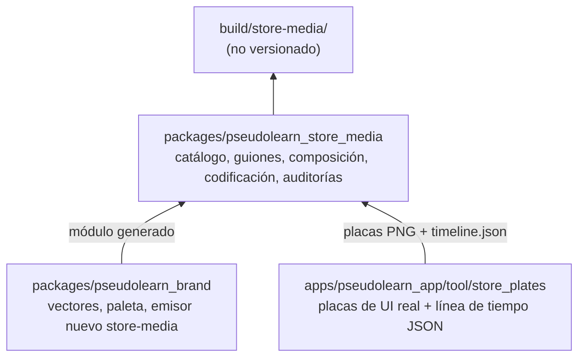

# Motor de assets para tiendas — plan de ejecución asistido

## 0. Metadatos y contrato de ejecución

- Fecha: 2026-11-10. HEAD al redactar: `2e543b2afbfccd083439dca00446760e2f761f56`. Rama:
  `feature/agregar-ruta-de-especificacion` (`GIT-SINGLE-BRANCH`). Árbol limpio.
- Petición: un motor que genere de forma **automatizada y determinista** (sin imágenes ni vídeos generados por IA)
  todos los assets de las tiendas donde PseudoLearn está publicada hoy: capturas, vistas previas en vídeo, vídeos de
  encabezado y de resultados de búsqueda, imagen universal y arte de Microsoft Store, en `es` y `en`. El trabajo es
  **asistido**: cada fase implementa primero su arquitectura y después abre un diálogo de narrativa y estilo con la
  persona; solo con su aprobación se escribe el código que produce el resultado final.
- Referencias revisadas: `~/Personal/traceiron/packages/traceiron-store-presentation-swift` (`CREATIVE.md`,
  `CreativeHeaderSafeArea.swift`), `apps/pseudolearn_app/tool/generate_store_material.dart` y `tool/product/`, y
  `packages/pseudolearn_brand`.
- Documento transitorio: ningún README, especificación ni código lo cita (`DOC-NO-TRANSIENT-REFS`). Cada decisión se
  traslada al README de su dueño en el mismo cambio (`DOC-README-TRUTH`, `DOC-NO-ORPHAN-DECISION`).

### 0.1 Reglas para quien ejecute

1. Antes de tocar un miembro, releer `AGENTS.md`, su README y su archivo de reglas; comprobar rama, HEAD y diff.
2. Por fase: arquitectura → tests con caso negativo → **diálogo de narrativa y estilo** → aprobación explícita →
   producción `es`/`en` → auditorías → informe.
3. Cero comentarios en código, código en inglés, documentación en español. Ediciones quirúrgicas, sin formateadores
   masivos.
4. Ningún secreto en el repositorio. Las claves de App Store Connect se leen del entorno.
5. Ninguna subida, colocación ni envío a revisión sin aprobación explícita en el chat. El motor nunca crea
   *submissions*.
6. Al cerrar cada fase: verificadores en verde, commit con la skill `commit-message`, push ordinario y **parada**
   (`PHASE-GREEN`, `PHASE-STOP`).
7. Una contradicción entre fuentes se reporta y se espera respuesta (`CONFLICT-REPORT`).

## 1. Fuentes oficiales consultadas (2026-11-10)

Las cifras de §2 salen de estas páginas, leídas hoy, no de memoria. Las páginas de ayuda de Apple llegaron
parcialmente resumidas por su tamaño: la fase F0 vuelve a confirmar cada número contra la página viva y contra el
catálogo de la API (`GET /v1/appAssetLibraryRefData`), que es la autoridad operativa.

| Fuente | Qué aporta |
|---|---|
| [Apple · Asset best practices](https://developer.apple.com/app-store/asset-best-practices/) | Superficies, narrativa, UI real, bucle, silencio, portada, zona segura de las plantillas, prohibiciones de contenido |
| [Apple · Creative assets](https://developer.apple.com/help/app-store-connect/reference/app-information/creative-assets-specifications/) | Medidas, fps, duración y formatos de encabezado, búsqueda y eventos |
| [Apple · Screenshots](https://developer.apple.com/help/app-store-connect/reference/screenshot-specifications) | Clases de iPhone (incluido Duo), iPad y Mac |
| [Apple · App previews](https://developer.apple.com/help/app-store-connect/reference/app-information/app-preview-specifications) | Resoluciones aceptadas, códec, bitrate, audio, portada |
| [Microsoft · Screenshots, images and trailers (MSIX)](https://learn.microsoft.com/en-us/windows/apps/publish/publish-your-app/msix/screenshots-and-images) | Capturas de escritorio, logotipos, *super hero art*, tráileres |
| [Microsoft · Store listing info (MSIX)](https://learn.microsoft.com/en-us/windows/apps/publish/publish-your-app/msix/add-and-edit-store-listing-info) | Límites de texto del listado |

Lo que dicen las buenas prácticas de Apple y condiciona la arquitectura:

- Encabezado: **una sola idea clara**, pensada para quien no conoce la app. Búsqueda: el propósito se entiende de un
  vistazo y se muestra la experiencia real (UI).
- Vídeo: la portada funciona sola; empezar fuerte; nada de cortes rápidos (también por accesibilidad); **bucle sin
  saltos**; autoplay **silenciado**, así que la pieza funciona sin sonido y el audio, si lo hay, es textura de marca.
- Capturas y previews: UI real, ordenadas como **una historia** de uso; las previews con principio, nudo y final.
- Prohibido: precios, URL, ©, premios no verificables, logotipos o referencias a **otras plataformas o tiendas**,
  reconocimientos de Apple. Contenido apto 4+.
- Cohesión: misma paleta, iconografía, tipografía, mensaje y tono en todas las piezas. Todo texto localizado.
- Las plantillas oficiales (Figma, Photoshop, Pixelmator, Sketch) **definen la zona segura** del encabezado, la
  búsqueda y la imagen universal. La página no publica los números: hay que extraerlos de las plantillas (F0).

Lo que dice Microsoft y difiere de Apple:

- Capturas: **sin logotipos, iconos ni mensajes de marketing añadidos**; lo crítico en los **dos tercios superiores**
  (la parte inferior puede quedar bajo superposiciones). El texto va en la **leyenda** del campo (≤ 200 caracteres),
  no dentro de la imagen.
- *Super hero art*: sin título ni texto, sin UI, nada clave en el tercio inferior.
- Tráileres: algunas disposiciones recortan arriba y abajo; la información clave va al centro.

## 2. Mapa de plataformas y variantes

Alcance: **solo las tiendas donde la app está hoy**: App Store (iOS/iPadOS y macOS, compra universal «Mac, iPad y
iPhone») y Microsoft Store (MSIX, familia Escritorio). Idiomas: `es` y `en`.

### 2.1 App Store — iOS/iPadOS

| Asset | Variante | Medida | Formato y reglas | Estado actual | Fase |
|---|---|---|---|---|---|
| Captura | iPhone, Dynamic Island (medium) — **obligatoria** | 1206 × 2622 (o 1179 × 2556), y apaisadas | PNG/JPEG sin alfa, 1–10 | El generador produce 1320 × 2868 y 1290 × 2796 (clase *large*); verificar en F0 qué ranura cubre ASC | F2 |
| Captura | iPhone, Dynamic Island (large) | 1320 × 2868 (o 1290 × 2796 / 1260 × 2736) | idem | Existe | F2 |
| Captura | **iPhone Duo, pantalla interior** | 2007 × 2853 / 2853 × 2007 | idem; da la insignia «hecha para iPhone Duo»; obligatoria desde abril de 2027 con SDK iOS 27.1+ | **Falta** | F2 |
| Captura | **iPhone Duo, pantalla exterior** | 1398 × 2034 / 2034 × 1398 | idem | **Falta** | F2 |
| Captura | iPad 13" — obligatoria | 2064 × 2752 (o 2048 × 2732), y apaisadas | idem | Existe | F2 |
| App preview | iPhone (todas las clases, Duo incluido) | 886 × 1920 / 1920 × 886 | 15–30 s, ≤ 30 fps, H.264 High ≤ 4.0 10–12 Mbps, AAC estéreo 256 kbps 44,1/48 kHz, ≤ 500 MB, hasta 3 por tamaño e idioma, portada elegible | **Falta** | F3 |
| App preview | iPad | 1200 × 1600 / 1600 × 1200 | idem | **Falta** | F3 |
| Creative asset | **Vídeo de encabezado** | 3840 × 1646 (21:9) | .mov/.m4v/.mp4, 30 o 60 fps, 5–30 s, bucle, silenciado por defecto | **Falta** | F4 |
| Creative asset | **Vídeo de búsqueda** | 3:2, mín. 1920 × 1280, máx. 3840 × 2560 | idem; silenciado y sin opción de activar sonido | **Falta** | F4 |
| Creative asset | Imagen universal | 5244 × 2950 (16:9) | PNG sin alfa | **Falta** | F4 |
| Creative asset | Imagen de encabezado / de búsqueda (alternativa estática) | 3840 × 1646 / 3:2 | PNG/JPEG sin alfa | No se produce salvo decisión (§8) | — |
| Evento in-app | Tarjeta 16:9 y detalle 9:16 | — | — | Fuera de alcance: no hay evento aprobado (`SCOPE-YAGNI`) | — |

### 2.2 App Store — macOS

| Asset | Medida | Reglas | Estado | Fase |
|---|---|---|---|---|
| Captura Mac — obligatoria | 2880 × 1800 (16:10; también 2560 × 1600, 1440 × 900, 1280 × 800) | PNG/JPEG sin alfa, 1–10 | Existe | F2 |
| App preview Mac | 1920 × 1080, solo horizontal | Mismo perfil de vídeo que iOS | **Falta** | F3 |
| Encabezado y búsqueda | — | Apple los describe para iOS 27 y iPadOS 27; para macOS **no consta**. F0 lo confirma con el catálogo de la API | Por confirmar | F4 |

### 2.3 Microsoft Store — Escritorio (MSIX)

| Asset | Medida | Reglas | Estado | Fase |
|---|---|---|---|---|
| Captura de escritorio — obligatoria | ≥ 1366 × 768, admite 3840 × 2160 | PNG ≤ 50 MB, 1–10 (se recomiendan ≥ 4), leyenda ≤ 200 caracteres por idioma, nada añadido, lo crítico arriba | 2 capturas planas | F5 |
| Icono de tile 1:1 | 300 × 300 PNG | Recomendado; si falta, usa el del paquete | Por revisar | F5 |
| *Super hero art* 16:9 | 1920 × 1080 o 3840 × 2160 PNG | Recomendado para apps; sin texto ni UI; nada clave en el tercio inferior; requisito para que se vean tráileres | **Falta** | F5 |
| Tráiler | 1920 × 1080 MP4 H.264 High, 50 Mbps, GOP cerrado de medio fps, AAC-LC 48 kHz 384 kbps; ≤ 60 s recomendado; miniatura PNG 1920 × 1080; título ≤ 255 | Hasta 15; cada uno con vídeo, título y miniatura; solo se muestra arriba si hay *super hero art*; sin clasificación IARC; solo envíos comerciales (no *sandbox*). La sección **aparece** para PseudoLearn en el Centro de partners | **Falta** | F5 |
| Póster 2:3 (720 × 1080 / 1440 × 2160) y caja 1:1 (1080 × 1080 / 2160 × 2160) | — | La documentación dice que no aplica a apps; la interfaz del Centro de partners los recomienda. **Se generan** por decisión de la persona | **Falta** | F5 |
| Xbox, Holographic | — | La app no se publica ahí | Fuera de alcance | — |

### 2.4 Inventario de producción por idioma

Sin contar variantes apaisadas opcionales: 5 clases de captura Apple × hasta 10 + 3 clases de preview × hasta 3 +
2 vídeos de creative + 1 imagen universal + hasta 10 capturas de Windows + super hero art + tráiler. Todo × 2 idiomas.
El catálogo de §3 hace que cada pieza sea una fila de datos, no código.

## 3. Arquitectura

### 3.1 Decisión de herramienta

| Opción | A favor | En contra | Veredicto |
|---|---|---|---|
| Flujo de traceiron (Swift, Core Graphics, AVAssetWriter, grabación con `simctl`) | Probado en producción; codificación nativa | Añade una **sexta cadena** (Swift) que `AGENTS.md` §9 no declara; solo macOS; dibujo imperativo (~2 700 líneas); la grabación del simulador no es determinista ni cubre Windows | Se reutilizan **ideas** (catálogo, zona segura, auditorías, subida), no el código |
| Todo en Flutter (fotogramas en `flutter test` + codificador) | Una sola cadena; UI real | Componer tipografía cinética y montaje en tests de widgets es torpe; sin vista previa en vivo para el diálogo | Se usa solo para la UI real |
| **HyperFrames** (HTML con atributos de tiempo → Chrome sin cabeza → FFmpeg) | Node y pnpm ya son cadena del repo; determinista; **vista previa en el navegador**, ideal para dialogar estilo y narrativa; HTML/CSS/SVG expresivo para tipografía y movimiento; Apache-2.0 | Dependencias nuevas: FFmpeg del sistema y Chromium | **Elegido para componer y codificar** |

**Decisión D-01 — Híbrido de dos etapas.** La app produce **placas**: secuencias de fotogramas de su UI real,
renderizadas con los widgets reales y el **motor nativo real** (`nativeTestEngine`, como ya hace
`tool/product/product_dependencies.dart`), reloj fijo y documentos sembrados. Un paquete nuevo compone esas placas con
la marca, el texto y el movimiento, y codifica. Así la UI que se ve es la que ejecuta la app (Apple lo pide) y la
composición es libre sin tocar la app.

Placa ≠ captura del simulador: se rasteriza el árbol de widgets con `RenderRepaintBoundary` al tamaño lógico de cada
dispositivo (Duo interior 951 × 669, exterior 466 × 678, iPad, Mac, Windows), sin depender de que exista el simulador.
Si Apple rechazara el aspecto por no venir de un dispositivo, F2 añade la variante grabada; no se adelanta.

### 3.2 Miembros y dependencias

- `pseudolearn_brand` sigue siendo la fuente de la identidad: se le añade un emisor `store-media` (símbolo, lockups,
  paleta y medidas en un módulo TypeScript) y su `check` lo vigila con `BRAND-TS-STALE` (`GEN-NO-HAND-COPY`). No
  rasteriza ni anima: eso no es su papel.
- `apps/pseudolearn_app/tool/store_plates/` (evoluciona `tool/product/`): escenas guionadas en Dart que conducen la
  app real y exportan, por fotograma, el PNG opaco y un `timeline.json` con los rectángulos de interés (línea en
  ejecución, nodo del diagrama, fila de la tabla, burbuja de Nodo) para que la composición pueda resaltar o encuadrar
  sin adivinar.
- `packages/pseudolearn_store_media` (Node + pnpm + TypeScript, HyperFrames fijado a versión exacta): todo lo demás.

### 3.3 Capas de `pseudolearn_store_media` (`architecture.json`)

| Capa | Responsabilidad | Puede importar |
|---|---|---|
| `catalog` | Especificaciones de tienda como datos validados: tienda, plataforma, ranura, medida, fps, duración, códec, límites, zona segura | — |
| `story` | Guiones por asset: escenas, tiempos, claves de texto, placas que usa; textos `es`/`en` en archivos de datos | `catalog` |
| `layout` | Zonas seguras, proyección de recorte por perfil de dispositivo, ajuste de texto, reglas por tienda (p. ej. «dos tercios superiores») | `catalog` |
| `compose` | Composiciones HyperFrames (HTML/CSS/SVG) parametrizadas por guion y layout | `catalog`, `story`, `layout` |
| `render` | Adaptadores: productor de HyperFrames, FFmpeg, `ffprobe`, PNG opaco | `catalog` |
| `audio` | Síntesis determinista de la partitura anclada a los hitos del guion; escritura WAV | `catalog`, `story` |
| `audit` | Medida, fps, duración, códec, alfa, audio, sonoridad, bucle, contraste, léxico, zona segura, tamaño de archivo | `catalog`, `layout` |
| `pipeline` | Plan objetivo × idioma × asset, manifiesto con SHA-256, orquestación | todas |
| `cli` | `plan`, `preview`, `render`, `audit`, `review-board` | `pipeline` |

Las variantes se inyectan como datos (`catalog/*.json`): añadir una ranura de tienda no modifica código.

### 3.4 Lo que se reutiliza de traceiron (como idea, reimplementado y documentado en el README)

- Catálogo resuelto desde `GET /v1/appAssetLibraryRefData`; si hay dos especificaciones elegibles, se detiene.
- **Zona segura del encabezado y la búsqueda**: modelo de recorte centrado `s = max(w/W, h/H)` sobre perfiles de
  dispositivo (iPhone vertical, iPhone Duo vertical y horizontal, iPad vertical y horizontal) con sus obstáculos
  (isla, botones, pestañas), comprobación de **todos los fotogramas** antes de codificar y lámina de revisión
  `safe-area-review.png`. Diferencia: traceiron estimó la zona de capturas de Preview; aquí se parte de la **zona de
  las plantillas oficiales** y los perfiles solo la endurecen.
- Auditoría del archivo codificado (dimensiones, fps, duración, códec, audio, orientación, tamaño), bucle por
  diferencia media RGB entre el primer y el último fotograma ≤ 0,005, contraste ≥ 4,5:1 de cada rol de texto contra el
  fondo de peor caso, léxico prohibido por tienda, informe `<pieza>.audit.json` con SHA-256.
- Política de subida: referencias con prefijo y hash, reutilización de idénticos, verificación de propiedad antes de
  reemplazar, nunca tocar lo que el flujo no creó, nunca crear *submissions*.

### 3.5 Lo que se retira

`tool/generate_store_material.dart` compone hoy titulares sobre la UI en Flutter. Cuando F2 cubra las mismas ranuras,
la composición pasa al paquete nuevo y la app conserva solo la exportación de placas. `generate_product_shot.dart`
(capturas de la web) no se toca. Los objetivos de Google Play (`googlePlayPhone`, `googlePlayFeatureGraphic`,
`MarketingAudience.googlePlay`) **se retiran** en F2: una plataforma donde la app no está publicada no se mantiene; se
planificará cuando se publique.

### 3.6 Audio y localizaciones

- **Audio acorde al vídeo** (decisión de la persona, 2026-11-10; sustituye a la de silencio). La banda sonora se
  **sintetiza de forma determinista** en el propio motor: sin muestras grabadas, sin bibliotecas de música y sin IA.
  Una partitura en datos (tempo, tonalidad, motivo y capas) se ancla a los mismos hitos del guion y de
  `timeline.json`: cada instrucción ejecutada, cada nodo que se ilumina y cada mensaje de Nodo es una nota o un acento.
  Así el sonido sigue al programa que avanza, en lugar de ser una música ajena pegada encima.
- Siguiendo a Apple, es textura de marca y no transmite información: la pieza se entiende en silencio, sin golpes
  bruscos y con un bucle limpio (la cola de la partitura resuelve en su inicio). Se normaliza a −16 LUFS integrados,
  con pico verdadero ≤ −1 dBTP (es el nivel que pide Microsoft; Apple no fija ninguno). Formato: AAC-LC estéreo,
  48 kHz, 256 kbps en Apple y 384 kbps en Microsoft.
- Lleva audio: app previews (Apple lo exige), vídeo de encabezado (en la página de producto se puede activar el
  sonido) y tráiler de Microsoft. El vídeo de búsqueda **no** lleva pista: allí no se puede activar el sonido y el
  catálogo no la exige.
- La auditoría mide sonoridad, pico, duración igual a la del vídeo y continuidad del bucle (energía de los primeros y
  los últimos 50 ms).
- **Localizaciones:** dos piezas por asset, `es` (español neutro) y `en` (inglés de EE. UU.). Locales de destino:
  App Store `es-MX` y `en-US`; Microsoft Store el español neutro que ofrezca el Centro de partners y `en-us`. F0 lee
  los locales reales de ambas fichas; si hay otros del mismo idioma, reciben la misma pieza.

## 4. Narrativa: semilla para el diálogo

No es una decisión: es el punto de partida de las conversaciones de F2–F5.

- **Lo que hay que contar.** PseudoLearn ya no es una app de ejercicios: es un **lenguaje de programación real**
  escrito como pseudocódigo en español o inglés, con motor propio que lo analiza, lo ejecuta paso a paso, lo dibuja y
  lo traduce; y **Nodo · IA**, que explica y escribe código que el propio motor verifica antes de mostrarlo.
- **Arco candidato** (las capturas como capítulos, la preview como el relato completo):
  1. *Una idea en palabras* — escribes lo que piensas, casi como una frase.
  2. *Cobra vida* — se ejecuta instrucción por instrucción y el diagrama late con ella.
  3. *Lo ves pensar* — la tabla de prueba de escritorio muestra cada variable cambiar.
  4. *No estás solo* — Nodo explica el error y propone código **verificado**.
  5. *Ya es un lenguaje* — el mismo programa en Python y Rust, o compilado a nativo.
  6. *Un camino* — la ruta de aprendizaje y el progreso.
- **Encabezado (una sola idea):** el símbolo de la escalera se recorre como un programa que avanza; cierra el bucle
  donde empezó. **Búsqueda:** UI real ejecutando un programa con el ordinograma iluminándose, propósito legible en
  pequeño.
- Límites de honestidad: las respuestas de Nodo en las placas salen de un puerto falso con guion, pero deben ser
  respuestas que el agente real puede dar y su código debe pasar el analizador; siempre con la etiqueta «IA»; sin
  promesas medibles («aprende en X días») ni menciones a otras plataformas en Apple.

## 5. Fases

Cada fase = **A** arquitectura y verificadores → **B** diálogo de narrativa y estilo (opciones con borradores
visibles en la vista previa de HyperFrames) → **C** aprobación → **D** producción `es`/`en` y auditorías →
**E** informe y parada.

### F0 — Verificación y decisiones (sin código de producción)

1. Respuestas de la persona a §8.
2. Consultar `appAssetLibraryRefData` con la clave del entorno: confirmar cada fila de §2, incluido si macOS admite
   encabezado y búsqueda, y guardar la respuesta en `build/`.
3. Inventario actual de App Store Connect (qué ranuras de captura tienen contenido, idiomas declarados) y del Centro
   de partners (si la sección de tráileres aparece para esta app).
4. Descargar las plantillas oficiales de creative assets (requiere permiso) y extraer las zonas seguras numéricas.
5. Instalar FFmpeg y fijar versión de HyperFrames y Chromium (requiere permiso).
6. Registrar en `AGENTS.md` §9 la dependencia del sistema FFmpeg y el miembro nuevo.

Sale: catálogo inicial (`catalog/*.json`) y lista de discrepancias.

### F1 — Esqueleto del motor

- README, `architecture.json`, verificador de límites y comentarios con caso negativo, test de arquitectura.
- `catalog` con validación y casos infelices (medida fuera de rango, fps no admitido, duración fuera de 5–30 s).
- `layout`: proyección y zonas seguras con ejemplos que fallan.
- `audit` completo contra archivos sintéticos (uno válido y uno inválido por regla).
- Emisor `store-media` en `pseudolearn_brand` con su `check`.
- Exportador de placas en la app con una escena de prueba y `timeline.json`.
- CLI `plan` y `preview` con una composición neutra de prueba.

Sin diálogo: es infraestructura.

**Resultados de F1 (2026-11-10).**

- `packages/pseudolearn_store_media`: nueve capas (`catalog`, `story`, `layout`, `audio`, `audit`, `compose`,
  `pipeline`, `render`, `cli`), 20 ranuras en `catalog/slots.json`, léxico por tienda, 139 tests (incluidos los casos
  negativos de los tres verificadores y una integración real con FFmpeg) y `pnpm check` en verde. Todas las
  dependencias npm tienen al menos 14 días (`minimumReleaseAge`).
- La previa del CLI es `calibrate --guides`: escribe el proyecto HyperFrames y dibuja la zona segura. En vez de un
  comando `preview` propio, se puede abrir ese proyecto con `pnpm exec hyperframes preview`.
- Calibraciones reales aceptadas por la auditoría: app preview de iPhone (886 × 1920, 15 s, AAC −16,1 LUFS), vídeo de
  encabezado (3840 × 1646, 10 s) y vídeo de búsqueda (3840 × 2560, sin pista). La primera pasada del encabezado se
  rechazó por sonoridad (−17,6 LUFS, limitada por el pico): la auditoría funcionó y se reequilibró la voz.
- Errores que encontraron los tests: un color ilegible daba NaN y pasaba la auditoría de contraste, y la escala de dos
  octavas subía solo una por vuelta. Los dos están corregidos y cubiertos.
- `pseudolearn_brand` emite `src/compose/brand.generated.ts` (18 artefactos), vigilado con `BRAND-TS-STALE`.
- La app graba placas con `tool/generate_store_plates.dart`: 886 × 1920 a 30 fps, motor nativo real y `timeline.json`
  fijado por un archivo de contrato que prueban la app y el motor.

### F2 — Capturas Apple (iPhone DI, **iPhone Duo interior y exterior**, iPad 13", Mac)

- A: escenas de placa por capítulo, plantilla de captura con titular, variantes vertical/apaisada, reglas de zona.
- B: diálogo — orden de capítulos, tono de titulares, tema claro u oscuro, tratamiento del marco, cómo mostrar el
  pliegue del Duo (interior como dos paneles, exterior compacto).
- D: hasta 10 por clase y por idioma; retirada de la composición antigua.

### F3 — App previews (iPhone/Duo 886 × 1920, iPad 1200 × 1600, Mac 1920 × 1080)

- A: placas animadas (fotograma a fotograma con `pump`), plantilla de relato de 15–30 s, partitura sincronizada con los hitos,
  selección de portada, auditoría de códec y bitrate.
- B: diálogo — arco de principio, nudo y final; ritmo sin cortes rápidos; papel de Nodo; ¿una preview o tres?
- D: producción y verificación de portada a tamaño reducido.

### F4 — Creative assets (encabezado 21:9, búsqueda 3:2, universal 16:9)

- A: modelo de zona segura con perfiles, comprobación por fotograma, lámina de revisión, bucle perfecto.
- B: diálogo — la idea única del encabezado, cómo se anima el símbolo, lema de búsqueda, fps 30 o 60, duración.
- D: producción, fotogramas de revisión y lámina; revisión humana en **Preview** de App Store Connect (no hay API).

### F5 — Microsoft Store (escritorio)

- A: plantilla de captura **sin texto añadido** y leyendas como datos, super hero art sin texto ni UI, tráiler
  1920 × 1080 con perfil de Microsoft (50 Mbps, GOP cerrado, AAC 48 kHz), miniatura, icono de tile.
- B: diálogo — si las capturas cuentan la misma historia que Apple con UI de Windows, leyendas, estilo del hero.
- D: producción y comprobación en el Centro de partners.

### F6 — Publicación asistida

- App Store Connect: subida y colocación de creative assets (biblioteca de assets) y de capturas y previews por API,
  con las reglas de §3.4. Cada ejecución real, con aprobación en el chat.
- Microsoft Store: lista de comprobación manual con rutas de archivos y leyendas por idioma; la automatización por la
  API de envíos solo si la persona la pide (`SCOPE-YAGNI`).

### Resultados de F0 (2026-11-10)

**Zonas seguras oficiales.** Plantilla Sketch de Apple `creative_assets-templates.sketch` (modificada en el CDN el
2026-08-28, SHA-256 `0f6f6f86e89ccf8a74f9214b29481c6748e21fc677ecc72fbc623ae3470d8957`). Se leyó el rectángulo
«Art Safe Area» de cada mesa y se comprobó contra la vista previa renderizada del propio archivo, porque los marcos de
grupo de la búsqueda y de la universal están desactualizados en el JSON (los dos dicen 1658 × 1060). No hizo falta
descargar los PSD.

| Pieza | Lienzo | Zona segura (px) | X | Y |
|---|---|---|---|---|
| Encabezado | 3840 × 1646 | 1097, 493 · 1646 × 661 | 28,57–71,43 % | 29,95–70,11 % |
| Búsqueda | 3840 × 2560 | 836, 765 · 2168 × 1030 | 21,77–78,23 % | 29,88–70,12 % |
| Universal 16:9 | 5244 × 2950 | 1921, 660 · 1402 × 962 | 36,63–63,37 % | 22,37–54,98 % |

- Encabezado y búsqueda están centrados en los dos ejes. La universal está centrada en horizontal y **desplazada hacia
  arriba**: su zona termina al 55 % del alto.
- La búsqueda admite de 1920 × 1280 a 3840 × 2560. El catálogo guarda la zona en fracciones, así que vale para todo
  ese rango.
- **Discrepancia con traceiron.** traceiron estimó, a partir de capturas de Preview, X 30–70 % e Y 38–75 % para el
  encabezado. La zona oficial sube el límite superior (30 % frente a 38 %) y baja el inferior (70 % frente a 75 %).
  Algunos obstáculos que midió traceiron, como las pestañas de iPad hasta el 34 % del alto, caen dentro de la zona
  oficial. F4 parte de la zona oficial, añade los perfiles de obstáculos como comprobación más estricta y valida el
  resultado en Preview de App Store Connect.

**Herramientas fijadas.**

| Herramienta | Versión | Notas |
|---|---|---|
| FFmpeg y ffprobe | 9.0.2 (Homebrew) | Instalados. Codificadores disponibles: `libx264`, `h264_videotoolbox`, `aac` y `aac_at` |
| `hyperframes` y `@hyperframes/producer` | 0.8.206 (2026-10-26) | Requieren Node ≥ 22 y `puppeteer` 25. La 0.9.30 salió el 2026-11-10 y no cumple las dos semanas de antigüedad. Se instala en F1 |
| Node y pnpm | Los de `AGENTS.md` §9 | Sin cambios |

`AGENTS.md` §9 registra el miembro nuevo y FFmpeg como dependencia del sistema.

**API de App Store Connect (solo `GET`, 2026-11-10).** Clave «PseudoLearn Analytics» leída del entorno
(`ASC_KEY_ID`, `ASC_ISSUER_ID`, `ASC_KEY_PATH` en el perfil de shell de la persona, fuera del repo).

Estado de la ficha:

| Plataforma | Versión | Locales | Capturas ocupadas | Previews |
|---|---|---|---|---|
| iOS | 1.1.1 `READY_FOR_SALE` | `es-MX` (principal) y `en-US` | `APP_IPHONE_67` = 5 (clase Dynamic Island large) e `APP_IPAD_PRO_3GEN_129` = 5 | Ninguna |
| macOS | 1.1.1 `READY_FOR_SALE` | `es-MX` y `en-US` | `APP_DESKTOP` = 5 | Ninguna |

Catálogo `appAssetLibraryRefData`. Corrige o precisa §2 donde difiere de las páginas de ayuda:

| Ranura | Grupo y plataforma | Lo que dice el catálogo |
|---|---|---|
| Encabezado | `DEFAULT_PROFILE`, plataforma `ANY`, 1 por idioma | Imagen 3840 × 1646 **solo PNG** (la ayuda admite JPEG); vídeo 3840 × 1646 a 30 o 60 fps, duración 5–30 s pero `shortName` `t10~30`, sin audio obligatorio; universal 5244 × 2950 PNG |
| Búsqueda | `DEFAULT_PROFILE`, `ANY`, 1 por idioma | Imagen 3:2 (1920–3840 × 1280–2560); vídeo 3:2 a 30 o 60 fps, 5–30 s, sin audio obligatorio; universal |
| App preview iPhone (DI large, DI medium, Duo) | `IPHONE_APP_STORE`, hasta 3 | 886 × 1920 / 1920 × 886, **23–30 fps**, duración 5–30 s pero `shortName` `t15~30`, **audio obligatorio** |
| App preview iPad 13" | `IPAD_APP_STORE`, hasta 3 | 1200 × 1600 / 1600 × 1200, mismas reglas |
| App preview Mac | `MAC_APP_STORE`, hasta 3 | 1920 × 1080, mismas reglas |
| Capturas Duo | `IPHONE_DUO_PROFILE`, hasta 10 | 2853 × 2007, 2007 × 2853, 2034 × 1398, 1398 × 2034, sin alfa |
| Capturas Mac | `MAC_APP_STORE`, hasta 10 | 2880 × 1800 y demás; el catálogo admite alfa y rotula 16:9 lo que es 16:10 |

Consecuencias para el plan:

1. **Encabezado y búsqueda no van por plataforma:** su grupo es `ANY`, con una pieza por idioma para toda la app. La
   pregunta de si macOS «admite» encabezado se reduce a si la Mac App Store los muestra. Se comprueba en Preview
   (F4); el motor no produce piezas distintas para Mac.
2. **Duraciones:** el vídeo de encabezado dura entre 10 y 30 s y las app previews entre 15 y 30 s, para cumplir a la
   vez el campo `duration` y el `shortName`, como hizo traceiron.
3. **Audio:** las app previews **exigen** pista de audio. Llevan la banda sintetizada de §3.6. Los
   vídeos de encabezado y búsqueda no llevan pista.
4. **Imágenes estáticas en PNG** siempre, y opacas también en Mac, aunque allí el catálogo admita alfa.
5. **Dynamic Island (medium):** la ayuda la declara obligatoria, pero la 1.1.1 se publicó solo con la clase large. F2
   produce la clase large en 1320 × 2868 y añade la medium (1206 × 2622) solo si App Store Connect la exige al enviar.
6. `RETENTION_MESSAGE_ASSET` aparece en el catálogo, pero ninguna fase lo pide (`SCOPE-YAGNI`).

**Discrepancias registradas.**

1. Microsoft llama «Arte de póster 9:16» en el Centro de partners a una medida de 720 × 1080, que es 2:3, como dice
   su documentación. F5 genera las medidas de la documentación (720 × 1080 y 1440 × 2160).
2. Las especificaciones de app preview de Apple detallan el audio, pero no dicen si la pista es obligatoria. El
   catálogo de la API sí lo dice (`audioRequired: true`), y las previews llevan la banda de §3.6.
3. La página de creative assets de Apple no rotula sus filas de 16:9. La plantilla confirma que la pieza de
   5244 × 2950 es la **universal**.

## 6. Verificación por fase (`PHASE-GREEN`)

- `pseudolearn_store_media`: tests, verificador de límites, test de arquitectura, `audit` sobre todo lo producido.
- `pseudolearn_brand`: `build`, `check`, `check_limits.py`, tests.
- `pseudolearn_app`: `flutter analyze`, `flutter test`, `check_limits.dart`, `check_design_system.dart`.
- Revisión visual humana: láminas de zona segura, portadas a 600 px, dos bucles seguidos, Preview de ASC.

## 7. Riesgos

| Riesgo | Mitigación |
|---|---|
| Las plantillas oficiales cambian la zona segura | El catálogo guarda la zona como dato y su origen; la comprobación por fotograma falla si cambia |
| Apple trata las placas rasterizadas como no representativas | Son la UI real con el motor real; si hay rechazo, F2/F3 añaden grabación de simulador como adaptador alternativo de `render` |
| Chromium y FFmpeg varían entre máquinas | Versiones fijadas en el README; auditoría por archivo, no por igualdad binaria |
| Respuestas de Nodo inventadas | Guion validado por el analizador y revisado en el diálogo |
| Ranura obligatoria Dynamic Island (medium) sin cubrir | F0 la verifica; F2 la produce explícitamente |

## 8. Decisiones de la persona y preguntas abiertas

Resueltas el 2026-11-10:

| Tema | Decisión |
|---|---|
| Google Play | Se retira; se planificará cuando la app se publique allí |
| Póster y caja de Microsoft Store | Se generan |
| Tráiler de Microsoft Store | La sección existe para la app; se produce en F5 |
| Audio | Banda sintetizada de forma determinista y anclada a los hitos de cada vídeo; el vídeo de búsqueda va sin pista (§3.6). Sustituye a la decisión inicial de silencio |
| Localizaciones | Español neutro y inglés de EE. UU. (§3.6) |
| Herramienta | Se aprueba D-01: placas de UI real desde la app, composición con HyperFrames y codificación con FFmpeg; la dependencia del sistema se registra en `AGENTS.md` en F0 |

Pendiente fuera de este motor:

1. **Idioma declarado en App Store.** La ficha muestra «Idioma: EN» aunque la app está en español. App Store toma esa
   lista de los idiomas que declara el binario de iOS (carpetas `*.lproj` y `CFBundleLocalizations`), no de la ficha.
   Hoy `ios/Runner` tiene `es.lproj` y `en.lproj` y `knownRegions` incluye `es`, pero su `Info.plist` no declara
   `CFBundleLocalizations`. En `macos/Runner` pasa lo contrario: declara `es` y `en` en `CFBundleLocalizations`, pero
   `knownRegions` solo tiene `en` y no existe `es.lproj`. La versión publicada (1.1.1) puede ser anterior a estos
   archivos. Queda como pendiente de `apps/pseudolearn_app`, fuera de este motor: se comprueba con el siguiente build
   en TestFlight antes de publicar las piezas `es`.
