# 15 — Plan técnico de ejecución de R6: Backend nativo AOT (`pseudolearn_codegen`) y cierre de estabilidad de `LANG`

**Estado:** R6 implementada parcialmente; fase abierta hasta verificar rendimiento, portabilidad y conformidad completa.
**Fase cubierta:** R6 («Backend nativo») de `docs/plan-nucleo-rust/07-fases.md`
**Paquetes afectados (cuando se autorice la ejecución):** `packages/pseudolearn_spec`, `packages/pseudolearn_engine`,
`apps/pseudolearn_cli`, `packages/pseudolearn_benchmarks`
**Restricción de proceso:** Este documento es el entregable único de análisis independiente para R6. No modifica código
ni especificaciones existentes (`SPEC-FIRST`, `PHASE-STOP`, `CONFLICT-REPORT`).

---

## 1. Problema, contexto y restricciones innegociables

### 1.1 Qué debe resolver R6 y para quién

Al cierre de R5 («Ejecución y Remanso») y su remediación arquitectónica B7
(`docs/plan-nucleo-rust/14-rfc-cierre-b7-arquitectura-y-rendimiento.md`), el núcleo Rust de PseudoLearn cuenta con un
frontend completo (`pseudolearn_lexer`, `pseudolearn_parser`, `pseudolearn_sema`, `pseudolearn_lowering`), una
representación intermedia SSA tipada de 74 operaciones (`pseudolearn_ir`), una biblioteca determinista
(`pseudolearn_library`), un runtime de montón plano con recolector exacto por clases de tamaño (`pseudolearn_runtime`) y
la máquina virtual de registros **Clepsidra** con motor de línea de tiempo **Remanso** (`pseudolearn_vm` y
`pseudolearn_timeline`).

Sin embargo, el paquete `packages/pseudolearn_engine/crates/pseudolearn_codegen` permanece como un marcador de posición
de una línea (`#![forbid(unsafe_code)]`) y la orden `pseudo compilar` (`pseudo build`) aún no existe. La fase R6 debe
resolver tres necesidades concretas:

1. **Para la persona que usa la CLI (`apps/pseudolearn_cli`):** Producir mediante
   `pseudo compilar <archivo.pseudo> [-o <salida>]` un **ejecutable nativo autónomo** del sistema anfitrión que se
   ejecute directamente en el sistema operativo sin requerir el binario `pseudo`, el código fuente ni un intérprete
   externo, manteniendo exactamente el mismo comportamiento observable (salidas, entradas, diagnósticos en tiempo de
   ejecución, límites de recursos y códigos de salida) que `pseudo ejecutar`.
2. **Para el rendimiento del lenguaje (`PERF.AOT.LEVEL`, meta `N3`):** Eliminar el sobrecoste de despacho e
   interpretación de bytecode de la VM y acercar la ejecución de programas PseudoLearn al techo nativo verificado de
   Rust comprobado (`V1F`), alcanzando una razón geométrica $\le 1{,}30\times$ por familia de carga de trabajo sobre la
   suite `PERF.SUITE.AWFY-CORE` (lo que representa una aceleración adicional de **$20\times$ a $75\times$ sobre la VM de
   R5** y de **$\sim 600\times$ a $1.800\times$ sobre el sujeto Dart `reference`**).
3. **Para la gobernanza del corpus (`packages/pseudolearn_spec`):** Incorporar el sujeto `aot` como **segundo ejecutor
   Rust independiente** que consume `pseudolearn_ir` sin pasar por `pseudolearn_vm`. Al contar con dos sujetos Rust
   conformes (`engine` y `aot`) además de `reference`, las especificaciones de ejecución de `LANG.*` alcanzan las
   condiciones para transicionar de `experimental` a `estable` según `SEE.LIFECYCLE`.

### 1.2 Invariantes semánticos que la compilación nativa no puede relajar

A diferencia de un compilador de C o Rust estándar, donde el desbordamiento entero en modo *release* envuelve en
complemento a dos y un fallo de límites aborta el proceso con un pánico opaco del lenguaje anfitrión, el código nativo
generado por PseudoLearn está sujeto por contrato (`SPEC-BEHAVIOR-TRUTH`) a las siguientes obligaciones observables:

| Obligación                                                                    | Especificación y reglas                                                                                        | Implicación directa sobre el generador de código nativo                                                                                                                                                                                                                                                                                                                                                                                   |
|-------------------------------------------------------------------------------|----------------------------------------------------------------------------------------------------------------|-------------------------------------------------------------------------------------------------------------------------------------------------------------------------------------------------------------------------------------------------------------------------------------------------------------------------------------------------------------------------------------------------------------------------------------------|
| **Aritmética entera comprobada con signo de 64 bits**                         | `LANG.TYPES.INTEGER`, `LANG.OPS.ARITHMETIC`, `LANG.OPS.DIVISION`, `IR.INSTRUCTIONS` (`O5`–`O12`, `O15`)        | Prohibido usar aritmética con envoltura silenciosa (`iadd` sin comprobación). Toda suma, resta, multiplicación, negación, división (`div`/`mod` con divisor $0$ o `i64::MIN / -1`) y conversión debe detectar desbordamiento y emitir el diagnóstico exacto con su `IrSpan`.                                                                                                                                                              |
| **Determinismo matemático bit a bit en `binary64`**                           | `LIB.CORE.MATH`, `LIB.CORE.ROUNDING`, `LANG.OPS.POWER`, `IR.INSTRUCTIONS` (`O22`, `O26`–`O32`), decisión `T23` | Prohibido delegar `sin`, `cos`, `atan`, `ln`, `exp` o `real.pow` a la `libm` del sistema operativo o a intrínsecos de LLVM que dependan de ella (en R5 se demostró empíricamente que la `libm` de macOS diverge entre $4\,\%$ y $8\,\%$ de los casos frente al redondeo correcto IEEE-754). `sqrt` y `abs` son exactos en IEEE-754 hardware (`fsqrt`/`fabs`); las trascendentes deben invocar `pseudolearn_library`.                      |
| **Orden estricto de evaluación y de trampas**                                 | `ENG.EXEC.EFFECT-ORDER`, `IR.INSTRUCTIONS#R3`, `IR.INSTRUCTIONS#R8`                                            | Ninguna optimización del backend puede reordenar dos instrucciones que puedan trampear o producir salida/entrada, ni hoisted una división o un acceso a arreglo por encima de una comprobación o de una llamada con efectos.                                                                                                                                                                                                              |
| **Semántica de memoria, identidad y arreglos 1-based con celdas indefinidas** | `LANG.ARRAY.ACCESS`, `LANG.ARRAY.DIMENSION`, `MEM.IDENTITY`, `MEM.VALUE.COPY`, `LANG.CLASS.COPY`               | Toda lectura de arreglo (`array.get`, `O52`) o campo de objeto (`object.get_field`, `O55`) debe verificar límites ($1 \le i \le \text{len}$) y **definición de celda** (etiqueta `Undefined` en el banco auxiliar o en el valor empaquetado), emitiendo ` runtime_uninitialized_read` o `runtime_index_out_of_bounds` con la posición exacta del acceso.                                                                                  |
| **Cómputo exacto de los 4 presupuestos de `ENG.LIMITS`**                      | `ENG.LIMITS#R1`, `ENG.LIMITS#D1`, `IR.INSTRUCTIONS#R5`                                                         | El código nativo debe contabilizar exactamente: (1) `instruction_units` acumulando el peso estático `block.mass` al entrar a cada bloque básico antes de la primera instrucción que pueda trampear (`límite = 10.000.000`); (2) `frames` al entrar a cada función/método (`límite = 1.000`); (3) `cells` activas tras recolección exacta en asignaciones (`límite = 16.777.216`); y (4) `output_chars` acumulados (`límite = 1.048.576`). |
| **Diagnósticos de fallo estructurados y códigos de salida**                   | `DIAG.CATALOG`, `TOOL.CLI.MESSAGES`, `TOOL.CLI.CONVENTIONS`, `RT.FAULT.REPORTING`, `RT.PROCESS`                | Un fallo en tiempo de ejecución dentro del binario compilado no puede producir `SIGSEGV`, `SIGABRT` ni un `panic!` de Rust. Debe formatear el diagnóstico en el idioma del perfil del programa (o el solicitado), con línea y columna de `IrSpan`, escribirlo en `stderr` y terminar con código de salida `3` (fallo de ejecución) o `4` (límite de recursos).                                                                            |
| **Exención explícita de observación e inspección paso a paso**                | `07-fases.md` §R6, `MEM.MANAGED.UNOBSERVABLE`, `ENG.TRACE.*`, `ENG.STATE.*`                                    | El sujeto `aot` está **exento** de las especificaciones de traza (`ENG.TRACE.EVENTS`, `ENG.TRACE.STEP`) y de instantáneas de estado (`ENG.STATE.SNAPSHOT`, `ENG.STATE.INCREMENTAL`). La ejecución con `--traza` o desde el depurador visual de la aplicación sigue siendo responsabilidad exclusiva de `pseudolearn_vm` + `pseudolearn_timeline`.                                                                                         |

### 1.3 Restricciones operativas y de recursos medidas en la máquina de trabajo

Toda propuesta técnica para R6 debe operar dentro de los límites físicos reales del entorno de desarrollo verificado
durante este análisis (`Apple M2`, `Mac14,3`, 8 núcleos, 16 GiB de RAM, macOS `aarch64-apple-darwin`,
`rustc 1.99.0-nightly (10f332a60 2026-04-06)` con `LLVM 23.1.1`):

1. **Techo de memoria RAM:** Tras un incidente previo en el repositorio donde una ejecución concurrente sin tope superó
   los 26 GiB de RAM, toda compilación y verificación debe poder ejecutarse con `--jobs 1` y `--test-threads=1` bajo un
   vigilante de memoria ($\le 4\text{ GiB}$ RSS pico).
2. **Restricción crítica de espacio en disco (medida en este análisis):**
    - El volumen local (`/System/Volumes/Data`) dispone únicamente de **3,9 GiB libres** (99 % de ocupación sobre 228
      GiB).
    - Los directorios `target/` existentes de los espacios de trabajo Rust ya consumen **$\sim 6,7\text{ GiB}$**
      (`packages/pseudolearn_engine/target` = 2,6 GiB; `packages/pseudolearn_spec/target` = 1,6 GiB;
      `apps/pseudolearn_cli/target` = 1,4 GiB; `packages/pseudolearn_benchmarks/ceiling/target` = 894 MiB;
      `packages/pseudolearn_rust_checks/target` = 212 MiB).
    - **Consecuencia arquitectónica inmediata:** Cualquier alternativa que requiera compilar o enlazar estáticamente una
      cadena C++ masiva (como `llvm-sys` / `inkwell`, cuyos artefactos de compilación superan entre 3 GiB y 8 GiB en
      `target/`) o que genere cientos de ejecutables sin depuración de símbolos durante `see conform` agotará el disco
      de inmediato (`ENOSPC`).
3. **Tamaño del binario `pseudo` (`PERF.ARTIFACT.SIZE#R1`):** El binario de línea de comandos en perfil `release` tiene
   un objetivo de **$\le 8\text{ MiB}$** y un techo duro de **$\le 15\text{ MiB}$**.

---

## 2. Estado de partida verificado al cierre de R5

### 2.1 Línea base de rendimiento verificada (`reference` vs. `engine` R5 VM vs. techo nativo `E-02R`)

A continuación se consolidan los tiempos medianos verificados en los artefactos del repositorio sobre la misma máquina
(`Apple M2`, 16 GiB RAM):

- **Sujeto `reference` (Dart):** `packages/pseudolearn_spec/results/benchmarks/r3-awfy-baseline.json`.
- **Sujeto `engine` (VM Clepsidra en R5 tras cierre de B7):**
  `packages/pseudolearn_benchmarks/results/macos-r5-vm/summary.json`.
- **Techo nativo comprobado en Rust (`V1` sin marcos, `V1F` con pila de marcos, `V2R` con montón plano `Vec<u64>` +
  trampas inmediatas + combustible por bloque):** `packages/pseudolearn_spec/results/benchmarks/r3-e02.json` y
  `packages/pseudolearn_benchmarks/results/e02r/summary.json`.

| Carga (`PERF.SUITE.AWFY-CORE`) | Familia     | `reference` Dart (µs) | `engine` VM R5 (µs) | Aceleración VM R5 / `reference` | `V1` Rust nativo (µs) | `V1F` Nativo + marcos (µs) | `V2R` Montón plano + combustible (µs) | Razón `V2R / V1F` (`E-02R`) | Margen disponible (`VM R5 / V2R`) |
|--------------------------------|-------------|----------------------:|--------------------:|--------------------------------:|----------------------:|---------------------------:|--------------------------------------:|----------------------------:|----------------------------------:|
| `sieve`                        | `arrays`    |             11.066,41 |              314,58 |                 $35{,}18\times$ |                  6,84 |                       6,87 |                                  8,76 |             $1{,}276\times$ |                **$35{,}9\times$** |
| `permute`                      | `recursive`    |             57.075,83 |            1.875,04 |                 $30{,}44\times$ |                 36,75 |                      38,96 |                                 40,66 |             $1{,}044\times$ |                **$46{,}1\times$** |
| `queens`                       | `arrays`    |             11.275,05 |              551,37 |                 $20{,}45\times$ |                 14,25 |                      14,31 |                                 17,31 |             $1{,}210\times$ |                **$31{,}9\times$** |
| `towers`                       | `objects` |              9.752,09 |              275,96 |                 $35{,}34\times$ |                 12,16 |                      12,89 |                                 13,24 |             $1{,}027\times$ |                **$20{,}8\times$** |
| `list`                         | `objects` |             32.396,15 |              970,14 |                 $33{,}39\times$ |                 22,92 |                      26,51 |                                 29,96 |             $1{,}130\times$ |                **$32{,}4\times$** |
| `storage`                      | `objects`   |              9.206,29 |              463,42 |                 $19{,}87\times$ |                 11,23 |                      17,13 |                                 20,60 |             $1{,}202\times$ |                **$22{,}5\times$** |
| `bounce`                       | `objects`   |             41.008,22 |            1.579,01 |                 $25{,}97\times$ |                 10,81 |                      27,40 |                                 34,96 |             $1{,}276\times$ |                **$45{,}2\times$** |
| `mandelbrot`                   | `numeric`   |            164.687,06 |            2.732,88 |                 $60{,}26\times$ |                169,53 |                     157,97 |                                158,18 |             $1{,}001\times$ |                **$17{,}3\times$** |
| `nbody`                        | `numeric`   |             21.293,68 |              911,09 |                 $23{,}37\times$ |                 10,00 |                       9,95 |                                 11,86 |             $1{,}192\times$ |                **$76{,}8\times$** |
| `richards`                     | `objects`   |            170.130,03 |            5.861,26 |                 $29{,}03\times$ |                 88,91 |                     135,59 |                                147,89 |             $1{,}091\times$ |                **$39{,}6\times$** |
| **Media geométrica**           | **Todas**   |                     — |                   — |             **$30{,}03\times$** |                     — |                          — |                                     — |         **$1{,}142\times$** |                **$33{,}7\times$** |

**Razones geométricas por familia en `E-02R` (`V2R / V1F`):**

- `numeric`: **$1{,}092\times$** (umbral `N3` $\le 1{,}30\times$).
- `recursive`: **$1{,}044\times$** (umbral `N3` $\le 1{,}30\times$).
- `objects`: **$1{,}142\times$** (umbral `N3` $\le 1{,}30\times$).
- `arrays`: **$1{,}242\times$** (umbral `N3` $\le 1{,}30\times$).

**Hallazgo clave del estado de partida:** La variante `V2R` de `E-02R` modela **exactamente** la representación de
memoria que R5 adoptó en `pseudolearn_abi` y `pseudolearn_runtime` (`T13` y `T14`): montón contiguo `Vec<u64>` indexado
por `Handle(u32)` en palabras de 64 bits, cabecera `CommonHeader` de 2 palabras en banda, listas libres por clases de
tamaño (`SizeClasses`), trampas aritméticas y de límites inmediatas, y contabilidad de combustible por bloque básico.
Esto demuestra que **no hay ningún cuello de botella en la representación de datos ni en el runtime de R5** para cumplir
`N3`: toda la brecha de $33{,}7\times$ entre la VM de R5 y `V2R` proviene del bucle de despacho de bytecode y del acceso
indirecto al banco de registros virtuales de la VM.

### 2.2 Estado real de los crates del motor (`packages/pseudolearn_engine`)

El espacio de trabajo `packages/pseudolearn_engine` contiene 19 crates organizados en capas estrictas verificadas por
`architecture.yaml`:

1. **`pseudolearn_abi` (`crates/pseudolearn_abi`):**
    - Define `Word(u64)`, `Handle(u32)`, `ValueTag` (`Integer`, `Real`, `Boolean`, `Character`, `Text`, `Array`,
      `Object`, `Cell`, `Undefined`), `CommonHeader` (2 palabras: `kind_and_flags` y `length_or_class`) y el trazador
      `RootTracer`.
    - Declara `#![forbid(unsafe_code)]`.
2. **`pseudolearn_ir` (`crates/pseudolearn_ir`):**
    - Genera su catálogo de 74 códigos de operación (`OpCode`, `O1`–`O74`) en `build.rs` directamente desde
      `IR.INSTRUCTIONS`.
    - Estructura un `Module` con `functions: Vec<Function>`, `classes: Vec<ClassDeclaration>` (incluyendo `fields`,
      `parent`, `methods: BTreeMap<String, String>`) y `entry: usize`.
    - Cada `Function` es un grafo de bloques básicos SSA con parámetros de bloque
      (`Block { id, parameters: Vec<(ValueId, IrType)>, instructions: Vec<Instruction>, terminator: Terminator, mass: u32 }`),
      sin nodos $\phi$ tradicionales.
    - Cada instrucción conserva su `IrType` de resultado y su `IrSpan` (`start_offset`, `end_offset`, `line`, `column`,
      `end_line`, `end_column`), garantizando que cualquier trampa pueda reconstruir la posición exacta en el código
      fuente.
    - El verificador SSA (`verify.rs`) comprueba tipos, dominación, aridad de terminadores, masas de bloque y
      prohibición de bloques huérfanos antes de entregar el módulo a cualquier consumidor.
3. **`pseudolearn_lowering` (`crates/pseudolearn_lowering`):**
    - Desazucara el AST tipado a `pseudolearn_ir::Module`.
    - Materializa el paso por referencia (`VAR` / `REF`) mediante celdas explícitas en el montón (`cell.new`,
      `cell.load`, `cell.store`, `O58`–`O60`) cuando una variable o elemento escapa a un parámetro por referencia, y
      mantiene el resto de variables locales en valores SSA puros (`ValueId`) pasados como argumentos de bloque básico.
    - Resuelve estáticamente las llamadas a subprogramas (`call`, `O61`), constructores y superllamadas (`call.super`,
      `O63`), y emite `call.method` (`O62`) para despacho polimórfico sobre clases con tablas de métodos en
      `Module.classes`.
4. **`pseudolearn_runtime` (`crates/pseudolearn_runtime`):**
    - `heap.rs`: Montón plano `Heap` con `words: Vec<u64>` y banco paralelo `defined: Vec<bool>` para distinguir celdas
      inicializadas de `Undefined` sin robar bits de un `i64` o `f64` desempacado en arreglos y objetos.
    - `size_classes.rs`: Asignador y recolector `SizeClasses` con barrido por clases de tamaño y compactación/reuso
      determinista gobernado por el calendario `GcSchedule`.
    - `text.rs`: `TextArena` con deduplicación para cadenas de longitud $\le 64$ bytes, internado de literales y
      validación de índices de caracteres Unicode (1-based por escalar Unicode).
    - `budget.rs` y `random.rs`: Contabilidad de los 4 presupuestos de `ENG.LIMITS` y generador pseudoaleatorio
      determinista `RandomGenerator` (SplitMix64).
5. **`pseudolearn_library` (`crates/pseudolearn_library`):**
    - Implementa en Rust seguro puro todas las funciones intrínsecas: conversión (`text_to_integer`, `text_to_real`),
      redondeo (`trunc`, `round`), potencia (`pow`) y funciones trascendentes (`sqrt`, `abs`, `ln`, `exp`, `sin`, `cos`,
      `atan`) con el bucle de refinamiento de Ziv en doble-doble precisión (`dd.rs`, `ziv.rs`, `payne_hanek.rs`).
6. **`pseudolearn_codegen` (`crates/pseudolearn_codegen`):**
    - Ya está declarado en `packages/pseudolearn_engine/architecture.yaml` con permiso para importar
      `pseudolearn_diagnostics`, `pseudolearn_abi`, `pseudolearn_ir`, `pseudolearn_library` y `pseudolearn_runtime`.
    - A su vez, `pseudolearn_api` ya tiene permiso en `architecture.yaml` para importar `pseudolearn_codegen`.

---

## 3. Conflictos detectados entre fuentes (`CONFLICT-REPORT`)

Siguiendo la regla `CONFLICT-REPORT` de `AGENTS.md` §2 y §3, antes de proponer el diseño se reportan seis tensiones o
contradicciones verificadas entre documentos del repositorio y el estado real del código, junto con la resolución
propuesta para cada una:

| ID          | Fuentes en tensión                                                                                                                              | Naturaleza del conflicto                                                                                                                                                                                                                                                                                                                                                                                                                                                                                                                                                                                                                                                         | Resolución propuesta                                                                                                                                                                                                                                                                                                                                                                                                                                                                                                                                                                                                                                            |
|-------------|-------------------------------------------------------------------------------------------------------------------------------------------------|----------------------------------------------------------------------------------------------------------------------------------------------------------------------------------------------------------------------------------------------------------------------------------------------------------------------------------------------------------------------------------------------------------------------------------------------------------------------------------------------------------------------------------------------------------------------------------------------------------------------------------------------------------------------------------|-----------------------------------------------------------------------------------------------------------------------------------------------------------------------------------------------------------------------------------------------------------------------------------------------------------------------------------------------------------------------------------------------------------------------------------------------------------------------------------------------------------------------------------------------------------------------------------------------------------------------------------------------------------------|
| **C-R6-01** | `04-arquitectura-del-workspace-rust.md` §3 vs. `packages/pseudolearn_engine/architecture.yaml` y `Cargo.toml`                                   | `04` §3 establece que `pseudolearn_abi` y `pseudolearn_runtime` son los dos únicos crates del motor donde se permite `unsafe` (documentado en la tabla «Invariantes de `unsafe`» de su `README.md`) para la frontera ABI con el código nativo. Sin embargo, en el estado actual de R5, `packages/pseudolearn_engine/Cargo.toml` declara `[workspace.lints.rust] unsafe_code = "forbid"` global y `architecture.yaml` tiene `unsafe_allowed: false` en **todas** las capas. En Rust 2024 (`rustc 1.99.0`), incluso exponer funciones con `#[unsafe(no_mangle)] pub extern "C" fn` o desreferenciar el puntero `*mut AotContext` pasado desde el código máquina requiere `unsafe`. | Mantener `#![forbid(unsafe_code)]` en `pseudolearn_codegen` (la emisión de archivos objeto `.o` con `cranelift-object` es 100 % Rust seguro) y habilitar `unsafe_allowed: true` únicamente en el crate de frontera ABI del runtime (`pseudolearn_runtime`, o un crate hoja dedicado `pseudolearn_aot_rt`), cambiando el lint del workspace a `unsafe_code = "deny"` y fijando `#![forbid(unsafe_code)]` explícito en los 18 crates restantes, con la tabla obligatoria «Invariantes de `unsafe`» en el `README.md` correspondiente (ver decisión **D-R6-02**).                                                                                                  |
| **C-R6-02** | `04-arquitectura-del-workspace-rust.md` §2 y `packages/pseudolearn_engine/README.md` §6 vs. `11-plan-r5-ejecucion-remanso.md` (`T14`) y `E-02R` | `04` y el `README.md` del motor arrastran de R3 la frase «trampas diferidas y transferencia AOT → VM». Pero en R5 (`11` §2.3, decisión `T14`) el experimento `E-02R` demostró que el flag de trampa diferida en memoria (`C3`) imponía una penalización de $10\,\%$ a $50\,\%$ en código nativo, por lo que R5 reemplazó las trampas diferidas por **trampas inmediatas**.                                                                                                                                                                                                                                                                                                       | Actualizar el `README.md` de `packages/pseudolearn_engine` y `04` para reflejar `T14`: en código nativo AOT las trampas son **inmediatas** mediante comprobación en registros (`adds`/`subs`/`smull` o comparación de límites) y salto condicional frío (`brif` con `Block::is_cold`) a un epílogo de trampa por sitio que devuelve el control al runtime con el `FaultSiteId` exacto (ver decisión **D-R6-03**).                                                                                                                                                                                                                                               |
| **C-R6-03** | `09-plan-r3-motor-clepsidra.md` (`D-R3-07`) y `04` §2 vs. `07-fases.md` §R6 y `SCOPE-YAGNI`                                                     | En R3 (`D-R3-07`) se hipotetizó diferir a R6 una «transferencia AOT → VM mediante marco canónico» (desoptimización en pila / OSR) por si un binario AOT necesitaba activar observación en caliente. Por el contrario, `07-fases.md` §R6 exime explícitamente a `aot` de toda regla de observación (`ENG.TRACE.*`, `ENG.STATE.*`), limita sus especificaciones nuevas a `RT.ABI`, `RT.FAULT.REPORTING`, `RT.PROCESS`, `RT.LINKING`, `TOOL.CLI.BUILD` y `PERF.AOT.LEVEL`, y destina la VM de R5 (que ya es $30\times$ más rápida que Dart con sobrecoste de observador pausado $\le 0{,}9\,\%$) a toda ejecución observada.                                                        | Aplicar `SCOPE-YAGNI`: **descartar la desoptimización en caliente AOT → VM**. Incluir la VM, el bytecode y el motor de línea de tiempo dentro de cada ejecutable producido por `pseudo compilar` multiplicaría el tamaño de cada binario de usuario y exigiría mapas de reconstrucción de registros SSA en cada punto seguro para una capacidad que ninguna especificación de R6 ni las fases R7/R8/R9 consumen. Se conserva la compatibilidad de representación en `pseudolearn_abi` (`Word`, `Handle`, `CommonHeader`), pero `aot` ejecuta de principio a fin en modo nativo no observado (ver decisión **D-R6-04**).                                         |
| **C-R6-04** | `packages/pseudolearn_spec/crates/see_cli/src/bindings.rs` (línea 15) vs. `04-arquitectura-del-workspace-rust.md` §1                            | `see_cli/src/bindings.rs` busca el manifiesto de conformidad del sujeto `"aot"` en `../pseudolearn_aot/conformance.yaml` (un paquete que no existe en la topología de 6 miembros Rust de `04` §1, donde el backend nativo vive en `packages/pseudolearn_engine/crates/pseudolearn_codegen`). Además, `see_cli/src/conformance.rs` solo despacha `"reference"`, `"engine"` y `"cli"`.                                                                                                                                                                                                                                                                                             | Actualizar `see_cli/src/bindings.rs` y `see_cli/src/conformance.rs` para que el sujeto `"aot"` lea su manifiesto en `packages/pseudolearn_engine/conformance-aot.yaml` (o `packages/pseudolearn_engine/crates/pseudolearn_codegen/conformance.yaml`) y lance `conformance_adapter --subject aot` (ver decisión **D-R6-05**).                                                                                                                                                                                                                                                                                                                                    |
| **C-R6-05** | `07-fases.md` §R6 («Las reglas de ejecución de `LANG` pasan a `estable`») vs. `see_validation/src/lifecycle.rs` y el catálogo `LANG.*`          | En el corpus hay 72 especificaciones `LANG.*`: **66** tienen casos `execute` y **6** son puramente léxicas/sintácticas/estáticas sin casos `execute` (`LANG.DECL.UNUSED`, `LANG.LEXICAL.ERRORS`, `LANG.PROGRAM.STRUCTURE`, `LANG.SOURCE.POSITION`, `LANG.SYNTAX.ANALYSIS-LIMITS`, `LANG.SYNTAX.RECOVERY`). Además, `see_validation::lifecycle::stability` exige para toda especificación `estable`: (1) al menos un revisor en `revisado_por` distinto de `duenos`; (2) cero bloques `pregunta`; y (3) que todos los sujetos declarados en `sujetos` tengan vínculos para cada regla de la especificación.                                                        | El corpus actual ya declara `aot` en las 66 especificaciones con operación `execute`; sus vínculos se validaron con conformidad. Completar `revisado_por` con revisión independiente y pasar a `"estado": "estable"` esas 66 especificaciones ejecutables de `LANG.*`, sin cambiar `version`. Las seis especificaciones estáticas quedan fuera de esta promoción. |
| **C-R6-06** | `PERF.ARTIFACT.SIZE#R1` ($\le 8\text{ MiB}$ objetivo, $\le 15\text{ MiB}$ techo para `pseudo`) vs. empaquetado de `staticlib` de Rust con `std` | En el prototipo empírico `P-R6-01` (§5.1) se midió que `rustc --crate-type=staticlib` genera un archivo `.a` de **18,68 MiB** porque empaqueta todos los miembros objeto de `libstd` con sus secciones DWARF sin depurar, incluso pasando `-C strip=debuginfo`. Si `pseudo` incrustara ese `.a` en crudo con `include_bytes!`, el binario `pseudo` superaría los 22 MiB, violando `PERF.ARTIFACT.SIZE#R1`.                                                                                                                                                                                                                                                                       | Durante la construcción del artefacto de runtime AOT, ejecutar `ld -r` + `strip -S -x` (o `llvm-strip --strip-debug`) sobre el archivo de runtime antes de empaquetarlo o instalarlo junto al binario. Nuestro prototipo verificó que `strip -S -x` reduce `librt.a` de **18,68 MiB a 1,95 MiB** (y `ld -r` + `strip -S -x` a **1,34 MiB**), dejando el ejecutable final enlazado y depurado en **333,7 KiB** y el binario `pseudo` total dentro del objetivo de $\le 8\text{ MiB}$.                                                                                                                                                                            |

---

## 4. Definición del problema desde cero y abanico completo de alternativas

### 4.1 Descomposición del problema de compilación nativa

Un backend nativo para PseudoLearn toma como entrada un `pseudolearn_ir::Module` ya verificado por
`pseudolearn_ir::verify` (en forma SSA con parámetros de bloque, tipos estáticos `IrType` y `IrSpan` por instrucción) y
debe producir un ejecutable del sistema operativo anfitrión que:

1. Inicialice un contexto de ejecución con el montón plano (`Heap`), la arena de textos (`TextArena`), el generador
   `RandomGenerator`, la entrada estándar y los contadores de `ENG.LIMITS`.
2. Ejecute el código máquina correspondiente a las funciones del módulo.
3. Ante el retorno normal de la función de entrada (`entry`), vuelque la salida y termine con código `0`.
4. Ante una trampa semántica (división por cero, desbordamiento entero, índice fuera de rango, lectura no inicializada,
   conversión inválida, raíz negativa, etc.) o un exceso de límite (`ENG.LIMITS`), formatee el diagnóstico normativo en
   `stderr` con su posición fuente exacta y termine con código `3` o `4`.

Para resolver este problema sin dar por sentada la sugerencia preliminar de `04-arquitectura-del-workspace-rust.md`, se
evaluaron **seis arquitecturas completas de backend (A1–A6)** y **cuatro subejes ortogonales de diseño (B, T, S, H)**.

---

### 4.2 Alternativas de arquitectura de backend (A1–A6)

#### Alternativa A1: Emisión de objeto nativo con Cranelift (`cranelift-codegen` + `cranelift-module` +
`cranelift-object`) + runtime estático (`libpseudolearn_runtime_aot.a`) + enlazador del sistema (`cc`)

- **Cómo funciona:**
    - `pseudolearn_codegen` traduce cada `pseudolearn_ir::Function` directamente a CLIF (*Cranelift IR*). Como ambos
      usan SSA con parámetros de bloque básico (sin nodos $\phi$), la correspondencia estructural entre bloques y
      parámetros de `pseudolearn_ir` y CLIF es biyectiva ($1:1$).
    - Las operaciones escalares frecuentes (`const.*`, `int.add/sub/mul`, `real.add/sub/mul/div`, comparaciones, saltos
      condicionales, incremento y comprobación de `fuel`, comprobación de límites y acceso directo en línea al vector
      plano `heap_base` para arreglos escalares y campos de objetos) se emiten como instrucciones máquina en línea en
      registros del procesador.
    - Las operaciones pesadas o poco frecuentes (`array.new`, `object.new`, `object.copy`, `text.*`,
      `math.sin/cos/atan/ln/exp`, `real.pow`, `io.read_line`, `io.write`, recolección de basura en puntos de asignación
      y formateo de trampas) se emiten como llamadas directas `extern "C"` a símbolos del runtime (`rt_aot_*`).
    - `cranelift-object` emite en memoria un archivo objeto nativo (`.o` Mach-O en macOS, ELF en Linux, COFF en Windows)
      en pocos milisegundos, sin escribir código fuente intermedio.
    - `pseudo compilar` invoca al enlazador del sistema (a través del driver `cc` estándar o `ld`/`lld`) uniendo el `.o`
      generado con la biblioteca estática precompilada y depurada del runtime (`libpseudolearn_runtime_aot.a`) para
      producir el ejecutable final.
- **Fuentes primarias consultadas:**
    - Bytecode Alliance, *Cranelift Code Generator Architecture & ISLE Lowering*, Wasmtime Project Documentation
      (2023–2026).
    - Fallin, C., *Safe, Fast Instruction Selection and Register Allocation in Cranelift* (`regalloc2`,
      IonMonkey/Cranelift design notes, 2022).
- **Qué se toma de las fuentes:** El modelo de bloques con parámetros SSA de CLIF, el asignador de registros
  `regalloc2`, la emisión directa de objetos relocalizables con `cranelift-object` (basado en el crate `object` de Rust
  puro) y la separación entre caminos rápidos en línea y llamadas a helpers del runtime.
- **Qué se rechaza de las fuentes:** Se rechaza el mecanismo de trampas de hardware de WebAssembly (`SIGSEGV`/`SIGILL`/
  `SIGFPE` con manejadores de señal POSIX/Mach y desenrollado de pila nativo), porque requiere `unsafe` complejo
  dependiente del sistema operativo y no transporta limpiamente el `FaultSiteId` + `IrSpan` de PseudoLearn. En su lugar
  se usan saltos condicionales fríos a bloques de trampa explícitos al final de cada función.

#### Alternativa A2: Cranelift dual AOT + JIT (`cranelift-object` para CLI +
`cranelift-jit` en memoria para el adaptador de conformidad)

- **Cómo funciona:**
    - Idéntica a **A1** para `pseudo compilar`, pero añade `cranelift-jit` en `pseudolearn_conformance` para compilar el
      código máquina directamente en páginas `mmap` ejecutables (`RX`) dentro del proceso del adaptador y saltar a un
      puntero de función `unsafe extern "C" fn(*mut AotRuntimeContext) -> u32` sin invocar al enlazador del sistema
      durante `see conform --subject aot`.
- **Fuentes primarias consultadas:**
    - Documentación de `cranelift-jit` y `wasmtime-jit` (Bytecode Alliance).
- **Qué se toma:** La idea de amortizar el coste del enlazador externo durante ejecuciones masivas de pruebas (que en
  **A1** resolvemos de forma más limpia y segura mediante una caché de binarios direccionada por el hash SHA-256 de la
  IR).
- **Qué se rechaza:** Se rechaza ejecutar código JIT en memoria dentro del proceso del adaptador por tres razones de
  peso: (1) exige `unsafe` con `mmap`/`mprotect` (`MAP_JIT` en macOS Apple Silicon) y transmutación de punteros a
  función; (2) **falsea la prueba del sujeto `aot`**, porque no ejercita el archivo objeto `.o`, las relocalizaciones de
  símbolos, el enlazado real ni el protocolo de proceso (`RT.LINKING`, `RT.PROCESS`, códigos de salida 0/3/4); y (3) una
  caché de ejecutables por hash de IR en **A1** sumada al enlace rápido (`~34 ms`) logra probar el binario real sin
  penalizar las repeticiones de perfiles (`es`/`en`, `strict`/`flexible` producen exactamente la misma IR y enlazan una
  sola vez).

#### Alternativa A3: Backend LLVM (`inkwell` / `llvm-sys` o emisión de LLVM IR textual + `llc`/`clang`)

- **Cómo funciona:**
    - Traduce `pseudolearn_ir::Module` a LLVM IR (ya sea enlazando contra las bibliotecas C++ de LLVM mediante
      `llvm-sys`/`inkwell`, o emitiendo un archivo `.ll` textual e invocando `clang`/`llc`) y delega la optimización
      (`-O2`) y la generación de código máquina a LLVM.
- **Fuentes primarias consultadas:**
    - Lattner, C. & Adve, V., *LLVM: A Compilation Framework for Lifelong Program Analysis & Transformation*, CGO
      (2004); `llvm-project` LangRef (`llvm.sadd.with.overflow.i64`).
- **Qué se toma:** El patrón de intrínsecos de aritmética con bandera de desbordamiento (`sadd.with.overflow` → `adds` +
  `b.vs` en Arm64 / `add` + `jo` en x86_64) y la anotación de pesos de predicción de salto en los caminos de trampa
  (`cold`).
- **Qué se rechaza:**
    - En su variante `llvm-sys`/`inkwell`, se rechaza de plano: introduce una dependencia externa en C++ de cientos de
      megabytes, **consume entre 3 GiB y 8 GiB de disco en `target/`** (inviable con los 3,9 GiB libres de la máquina
      actual), multiplica el tamaño del binario `pseudo` por encima de 40–60 MiB (violando
      `PERF.ARTIFACT.SIZE#R1` $\le 15\text{ MiB}$) y requiere que toda máquina que compile el motor tenga instalado un
      SDK completo de LLVM coincidente.
    - En su variante de emisión textual `.ll` invocando `clang`, se rechaza como backend primario porque `clang` sobre
      `.ll` no está garantizado en instalaciones mínimas de Linux/Windows sin paquete LLVM completo, y la sintaxis
      textual de LLVM IR rompe compatibilidad menor entre versiones de LLVM del sistema anfitrión.

#### Alternativa A4: Transpilación estructurada a C99 o Rust invocando el compilador del sistema (`cc`/`clang` o
`rustc`)

- **Cómo funciona:**
    - `pseudolearn_codegen` es un emisor de texto puro (0 dependencias externas en Cargo) que traduce el
      `pseudolearn_ir::Module` a un único archivo fuente C99 (con `__builtin_add_overflow`) o Rust
      (`#![no_ implicit_prelude]`, usando `i64::overflowing_add`), y `pseudo compilar` invoca a `cc -O1` o
      `rustc -C opt-level=1` enlazando contra `libpseudolearn_runtime_aot.a` / `.rlib`.
- **Fuentes primarias consultadas:**
    - Peyton Jones, S. et al., *The Glasgow Haskell Compiler via-C Backend*; Tarditi, D. et al., *TIL / TILT &
      C-as-portable-assembly*; diseño de compiladores AOT que emiten C (Nim, Chicken Scheme, Mercury).
- **Qué se toma:** La simplicidad del contrato `#[repr(C)]` de `AotRuntimeContext` y el uso del driver `cc` del sistema
  exclusivamente para el paso final de **enlace** de objetos ya compilados.
- **Qué se rechaza:** Se rechaza como estrategia de generación de código por cuatro defectos medidos y estructurales:
    1. **Riesgo semántico de UB y reordenamiento en C (`ENG.EXEC.EFFECT-ORDER`):** Un compilador C con `-O2` aplica
       reglas de aliasing estricto y asume ausencia de efectos laterales visibles en lecturas de memoria, pudiendo
       reordenar comprobaciones o fusionar accesos salvo que se abuse de `volatile` (lo que destruye el rendimiento).
    2. **Latencia de compilación en conformidad y propiedades (`P-R6-01`):** Invocar `rustc -O2` tarda **99,81 ms** por
       programa (y crece superlinealmente en funciones grandes con muchos bloques SSA); invocar `clang -O1` tarda
       **54,79 ms** frente a **34,55 ms** de solo enlazar un `.o` ya emitido en $<1\text{ ms}$ en memoria por Cranelift.
       En 10.000 ejecuciones de pruebas de propiedades (`E-17`), compilar vía `rustc` o `clang` añade entre **9 y 17
       minutos** de CPU.
    3. **Dependencia de un compilador completo en tiempo de ejecución del usuario:** Mientras que enlazar un `.o` solo
       requiere un enlazador (`ld` / `lld` / `link.exe`), transpilar a C o Rust exige cabeceras del sistema,
       preprocesador y frontend C o una instalación completa de `rustc` en la máquina del usuario final.
    4. **Calidad de código para grafos SSA arbitrarios:** `pseudolearn_ir` usa bloques básicos con parámetros SSA y
       saltos arbitrarios. Traducir un CFG SSA irreducible o con múltiples predecesores a Rust seguro obliga a simular
       un `loop { match block_id { ... } }` (una máquina de estados que reproduce el bucle de despacho de una VM), y en
       C obliga a `goto` con variables de copia des-SSA-ificadas.

#### Alternativa A5: Ejecutable autónomo por empaquetado de bytecode + VM (`pseudo_runner` + tráiler de bytecode, estilo
`dart compile exe` / `QuickJS` / `Deno compile`)

- **Cómo funciona:**
    - `pseudo compilar` no traduce `pseudolearn_ir` a código máquina del procesador; en su lugar, serializa el
      `BytecodeModule` de `pseudolearn_vm` y lo concatena al final de una plantilla binaria precompilada
      (`pseudo_runner`) que contiene `pseudolearn_vm` + `pseudolearn_runtime`. Al ejecutarse, el binario lee su propio
      tráiler y lo interpreta en la VM Clepsidra.
- **Fuentes primarias consultadas:**
    - Documentación de `Deno compile` y `Node.js Single Executable Applications (SEA)`; Bellard, F., *QuickJS `qjsc`
      bytecode bundler*.
- **Qué se toma:** Nada para `pseudolearn_codegen`.
- **Qué se rechaza:** Se rechaza por completo porque **incumple los dos objetivos fundamentales de R6**:
    1. **Incumple la meta de rendimiento `N3` (`PERF.AOT.LEVEL`):** Un ejecutable que por dentro interpreta bytecode en
       `pseudolearn_vm` corre exactamente a la velocidad de la VM de R5 ($314{,}58\text{ }\mu\text{s}$ en
       `sieve`, $5.861{,}26\text{ }\mu\text{s}$ en `richards`), quedando **$33{,}7\times$ más lento que `V2R`** e
       incumpliendo por un factor de $\sim 30\times$ el umbral `V2R/V1F <= 1.30x`.
    2. **Incumple la independencia de sujetos para cerrar `LANG` como `estable` (`07-fases.md` §R6):** Si `aot`
       ejecutara el mismo intérprete `pseudolearn_vm` que `engine`, un defecto en `pseudolearn_vm` pasaría inadvertido
       en ambos sujetos, destruyendo el valor de validación cruzada que exige `SEE.LIFECYCLE`.

#### Alternativa A6: Emisor de código máquina y contenedores binarios escrito desde cero sin dependencias (
`Arm64` Mach-O/ELF + `x86_64` ELF/PE/Mach-O propios)

- **Cómo funciona:**
    - Escribir manualmente en `pseudolearn_codegen` el selector de instrucciones `x86_64` y `aarch64`, el asignador de
      registros lineal, el codificador binario de instrucciones de ambas arquitecturas y los serializadores de archivos
      objeto Mach-O, ELF y COFF, con cero crates externos en `Cargo.toml`.
- **Fuentes primarias consultadas:**
    - Cercueil, P. / Procacci, Q., *QBE Compiler Backend* (`c99` minimal SSA backend); Wirth, N., *Compiler
      Construction (Oberon RISC code generator)*.
- **Qué se toma:** La filosofía de mantener la traducción de cada instrucción IR acotada, explícita y predecible sin
  pasadas especulativas.
- **Qué se rechaza:** Se rechaza escribir desde cero dos codificadores de ISA (`aarch64` con codificación de inmediatos
  bitmask e IEEE-754 escalar, y `x86_64` con prefijos REX/VEX y direccionamiento ModR/M+SIB), un asignador de registros
  SSA con *spilling* y tres formatos de contenedor relocalizable (Mach-O, ELF, COFF) dentro de los límites de tamaño de
  archivo/función de `architecture.yaml` (`max_file_lines: 300`, `max_function_lines: 40`). El riesgo de defectos
  sutiles de codificación de instrucciones o de relocalizaciones ABI entre macOS (`aarch64`), Linux (`x86_64`) y Windows
  (`x86_64` MSVC/GNU) es altísimo y duplica exactamente lo que `cranelift-codegen` + `cranelift-object` ya resuelven en
  Rust auditado y sin `unsafe` en la API de construcción.

---

### 4.3 Subejes ortogonales de diseño (B, T, S, H)

Incluso eligiendo el generador de código máquina, cuatro decisiones arquitectónicas determinan si el backend será
rápido, seguro y mantenible:

#### Subeje B — Frontera ABI y confinamiento de `unsafe` (`C-R6-01`)

- **Opción B1 (Recomendada): Runtime AOT en `pseudolearn_runtime::aot_abi` con interfaz `extern "C"` mínima e
  invariantes de `unsafe` auditados.**
    - `pseudolearn_codegen` conserva `#![forbid(unsafe_code)]`.
    - `pseudolearn_runtime` habilita `unsafe_allowed: true` en `architecture.yaml` (tal como previó
      `04-arquitectura-del-workspace-rust.md` §3) únicamente para el módulo de frontera `aot_abi`, donde cada función
      `#[unsafe(no_mangle)] pub unsafe extern "C" fn rt_aot_*` convierte `ctx: *mut AotRuntimeContext` en
      `&mut AotRuntimeContext` en su primera línea y delega inmediatamente a funciones 100 % seguras de
      `pseudolearn_runtime` y `pseudolearn_library`. Toda función con `unsafe` tiene su fila obligatoria en la tabla
      «Invariantes de `unsafe`» de `packages/pseudolearn_engine/crates/pseudolearn_runtime/README.md`, verificada
      mecánicamente por `rust-checks unsafe-docs`.
- **Opción B2: Aislamiento en un crate hoja nuevo `pseudolearn_aot_rt`.**
    - Mantiene `pseudolearn_runtime` con `#![forbid(unsafe_code)]` y crea un vigésimo crate `pseudolearn_aot_rt` con
      `unsafe_allowed: true`. Es viable, pero añade un crate adicional a `architecture.yaml` cuando
      `04-arquitectura-del-workspace-rust.md` §3 ya designó explícitamente a `pseudolearn_runtime` y `pseudolearn_abi`
      para ese rol.
- **Opción B3: Todo por llamadas a helpers sin estado en punteros.** Imposible sin `#[unsafe(no_mangle)]` en Rust 2024 o
  sin un envoltorio en C.

#### Subeje T — Estrategia de bajada de trampas y comprobaciones aritméticas (`C-R6-02`)

- **Opción T1 (Recomendada): Comprobaciones en línea en registros + bloques de trampa fríos por función (
  `Immediate Cold Trap Stubs`).**
    - Para cada operación que puede trampear en línea (`int.add`, `int.sub`, `int.mul`, `int.neg`, `int.div`, `int.mod`,
      `array.get`, `array.set`, `object.get_field`, `object.set_field`, `check.not_null`, y comprobación de `fuel` al
      inicio de bloque), el código nativo ejecuta la comprobación en registros (`sadd_overflow` / `icmp` en CLIF) y
      salta con `brif` a un bloque marcado como frío (`builder.set_cold_block(trap_block)`) que llama a
      `rt_aot_raise_fault(ctx, fault_site_id, aux_value)` y retorna inmediatamente el código de fallo.
    - Beneficio: **cero escrituras/lecturas de banderas de trampa en memoria** en el camino feliz; el asignador de
      registros de Cranelift coloca los bloques `cold` fuera de la línea caliente de instrucciones y no contamina los
      registros del bucle.
- **Opción T2 (Descartada): Llamada a función `extern "C"` por cada operación aritmética o de arreglo (`M-HELPER`).**
    - Medida en nuestro prototipo `P-R6-01` (§5.1): en `sieve`, llamar a `rt_add_i64` y `rt_array_get/set` por
      instrucción degrada el tiempo de **14,15 µs a 75,98 µs ($5{,}37\times$ más lento)**, incumpliendo estrepitosamente
      la meta `N3` ($\le 1{,}30\times$ sobre `V1F`).
- **Opción T3 (Descartada): Bandera de trampa diferida en memoria (`ctx.trapped`).**
    - Descartada en R5 (`11` §2.3, `T14`) porque obliga a comprobar `ctx.trapped` antes de cada efecto o salto hacia
      atrás y ensucia la caché L1.

#### Subeje S — Raíces de recolección de basura (`GC Roots`) y presupuesto `ENG.LIMITS#D1` (`cells`)

- **Opción S1 (Recomendada): Pila de sombra explícita de asas (`Shadow Stack` en `AotRuntimeContext`) sincronizada en
  asignaciones y llamadas.**
    - El recolector `SizeClasses` de `pseudolearn_runtime` no mueve objetos (las asas `Handle(u32)` son estables durante
      toda la vida del objeto) y solo recolecta en puntos de asignación (`array.new`, `object.new`, `object.copy`,
      `cell.new`) cuando `GcSchedule` lo indica.
    - Por tanto, en cada función compilada, las variables SSA cuyo `IrType` puede contener un `Handle` (`Array`,
      `Object`, `Cell`, `Any`/`Unknown`) tienen una ranura asignada en una ventana del *shadow stack*
      (`ctx.roots[frame_base .. frame_top]`). Mientras el programa opera entre asignaciones, los valores viven en
      registros del procesador a máxima velocidad; únicamente **antes de una instrucción de asignación o de una llamada
      a función**, se escriben en su ranura de `ctx.roots` las asas vivas.
    - Beneficio: **100 % portátil** entre arquitecturas y sistemas operativos, **cero dependencia de mapas de pila
      DWARF/stackmaps experimentales**, y **paridad matemática exacta con la VM** en el conteo de `cells` activas tras
      GC (`ENG.LIMITS#D1`).
- **Opción S2 (Descartada): Stack maps nativos de Cranelift + caminado de marcos de pila nativos (
  `Frame Pointer Walking`).**
    - Exige código `unsafe` dependiente de la ABI de cada plataforma para recorrer punteros `fp` en la pila de hardware
      y decodificar tablas de stackmaps propietarios, con alto riesgo de errores de alineación entre macOS Arm64, Linux
      x86_64 y Windows x64, sin aportar ganancia medible porque en AWFY las asignaciones ya pasan por el runtime
      (`storage`, `list`, `richards`).

#### Subeje H — Ejecución del sujeto `aot` en `see conform` y pruebas de propiedades

- **Opción H1 (Recomendada): Compilación AOT real con caché en memoria/disco temporal indexada por el hash SHA-256 del
  `pseudolearn_ir::Module` serializado + `librt_aot.a` precompilado.**
    - En el corpus de especificaciones, cada caso `execute` se ejecuta hasta en **4 combinaciones** de perfil (`es`/
      `en` $\times$ `strict`/`flexible`). Como el perfil léxico (`es` vs `en`) produce **exactamente la misma IR**, y en
      los casos sin diferencias de severidad `strict` y `flexible` también producen la misma IR, una caché direccionada
      por el hash del módulo IR reduce el número de enlaces nativos en `see conform --subject aot` en más de un
      **$65\,\%$** (de $\sim 968$ enlaces a $\sim 250$ enlaces únicos $\times 34\text{ ms} \approx 8{,}5\text{ s}$ en
      total).
    - Además, cada binario ejecutado en el directorio temporal se borra inmediatamente al cerrar la sesión (o se
      mantiene un anillo LRU de $\le 32$ binarios en RAM/disco $< 15\text{ MiB}$), garantizando **impacto cero en el
      espacio en disco** de 3,9 GiB.

---

## 5. Comparación multicriterio ponderada y evidencia experimental

### 5.1 Prototipo empírico `P-R6-01` (medido en esta máquina)

Para no comparar con argumentos teóricos, se ejecutó en `/tmp/r6-proto` (y se limpió inmediatamente después) un
prototipo acotado sobre la máquina de referencia (`Apple M2`, `rustc 1.99.0`, `clang 17 / Apple ld`) midiendo tres
magnitudes críticas:

1. **Tamaño del archivo de runtime estático (`librt.a`) y del ejecutable final** bajo distintas estrategias de
   empaquetado.
2. **Latencia mediana de compilación y enlace** (sobre 7 repeticiones) para: (a) enlace directo de un `.o` ya emitido +
   `librt.a` (modelo Cranelift **A1**), (b) compilación C + enlace (`clang -O0`, `-O1`, `-O2`, modelo **A4-C**), y (c)
   compilación Rust + enlace (`rustc -O0`, `-O2`, modelo **A4-Rust**).
3. **Tiempo de ejecución de `sieve` (500 iteraciones por muestra)** sobre el montón plano `RtCtx` con cabecera de 2
   palabras, comprobación de límites 1-based, comprobación de desbordamiento en 64 bits y contabilidad de `fuel` por
   bloque básico, comparando llamadas a helpers `extern "C"` (`M-HELPER`) frente a emisión en línea en registros con
   salto frío a trampa (`M-DIRECT`).

#### Tabla 5.1a — Latencia de compilación/enlace y tamaño de artefactos (`P-R6-01`)

| Operación / Artefacto medido                                                                                     | Resultado empírico (`Apple M2`) | Impacto en R6                                                                                                                                    |
|------------------------------------------------------------------------------------------------------------------|--------------------------------:|--------------------------------------------------------------------------------------------------------------------------------------------------|
| Tamaño de `librt.a` crudo (`rustc --crate-type=staticlib -C opt-level=z -C panic=abort`)                         |    **18.685.632 B (17,82 MiB)** | **Desfavorable si no se trata:** incrustarlo en crudo en `pseudo` violaría `PERF.ARTIFACT.SIZE#R1` ($\le 15\text{ MiB}$).                        |
| Tamaño de `librt.a` tras `strip -S -x` (eliminación de secciones DWARF de `libstd`)                              |      **2.047.376 B (1,95 MiB)** | Reduce el archivo estático un **$89{,}0\,\%$** ($9{,}1\times$ menor).                                                                            |
| Tamaño de `rt_merged.o` tras `ld -r` de puntos de entrada `rt_aot_*` + `strip -S -x`                             |      **1.402.960 B (1,34 MiB)** | Reduce el runtime empaquetable a **1,34 MiB**, permitiendo que `pseudo` completo quede en $\sim 5{,}5\text{ MiB}$ ($\le 8\text{ MiB}$ objetivo). |
| Tamaño del ejecutable autónomo final (`.o` + `rt_merged.o` con `-Wl,-dead_strip` + `strip`)                      |       **341.664 B (333,7 KiB)** | Binarios de usuario ultraligeros ($\sim 334\text{ KiB}$ con `std` completa, $\sim 33\text{ KiB}$ sin formateo `std`).                            |
| Latencia de enlace puro de `.o` + `librt.a` (**A1 Cranelift Object**, donde CLIF$\to$.o toma $<1{,}5\text{ ms}$) |                    **34,55 ms** | $\sim 250$ programas únicos del corpus enlazan en **$\sim 8{,}6\text{ s}$**.                                                                     |
| Latencia de `clang -O0` (compilar C + enlazar, **A4-C**)                                                         |                    **51,02 ms** | $+47{,}7\,\%$ más lento que enlazar el `.o` directo.                                                                                             |
| Latencia de `clang -O1` (compilar C + enlazar, **A4-C**)                                                         |                    **54,79 ms** | $+58{,}6\,\%$ más lento que enlazar el `.o` directo.                                                                                             |
| Latencia de `clang -O2` (compilar C + enlazar, **A4-C**)                                                         |                    **57,79 ms** | $+67{,}3\,\%$ más lento en programas pequeños; escala peor en funciones grandes.                                                                 |
| Latencia de `rustc -C opt-level=0` (compilar Rust + enlazar, **A4-Rust**)                                        |                    **88,91 ms** | $2{,}57\times$ más lento que **A1**.                                                                                                             |
| Latencia de `rustc -C opt-level=2` (compilar Rust + enlazar, **A4-Rust**)                                        |                    **99,81 ms** | $2{,}89\times$ más lento que **A1**.                                                                                                             |

#### Tabla 5.1b — Rendimiento de ejecución en `sieve` según estrategia de bajada (`P-R6-01` vs. `E-02R` y `R5 VM`)

| Variante de código nativo sobre el montón plano de PseudoLearn                                                                            | Tiempo por iteración de `sieve` (µs) | Razón frente a `V1F` (`6,87 µs`) | ¿Cumple `N3` ($\le 1{,}30\times$)?                             | Aceleración frente a `engine` VM R5 (`314,58 µs`) |
|-------------------------------------------------------------------------------------------------------------------------------------------|-------------------------------------:|---------------------------------:|----------------------------------------------------------------|---------------------------------------------------|
| `engine` VM R5 (intérprete de bytecode Clepsidra, línea base actual)                                                                      |                            314,58 µs |                  $45{,}79\times$ | No aplica (es VM, cumple `N2`)                                 | $1{,}00\times$                                    |
| `M-HELPER` (`clang -O0`, llamadas `extern "C"` por instrucción IR)                                                                        |                            114,56 µs |                  $16{,}68\times$ | **No** (falla por $12{,}8\times$)                              | $2{,}75\times$                                    |
| `M-HELPER` (`clang -O1`, llamadas `extern "C"` no inlinables por instrucción IR)                                                          |                             75,98 µs |                  $11{,}06\times$ | **No** (falla por $8{,}5\times$)                               | $4{,}14\times$                                    |
| `M-DIRECT` ingenuo (operaciones en registros, pero `ctx->fuel += mass` leído/escrito en memoria en cada iteración)                        |                             14,15 µs |                   $2{,}06\times$ | **No** (supera $1{,}30\times$ por tráfico a memoria de `fuel`) | $22{,}23\times$                                   |
| `V2R` (`E-02R`, operaciones en registros + `fuel` acumulado en registro/bloque con comprobación contra límite + trampas inmediatas frías) |                          **8,76 µs** |              **$1{,}276\times$** | **Sí ($\le 1{,}30\times$)**                                    | **$35{,}91\times$**                               |
| `V1F` (`E-02R`, techo nativo Rust comprobado con pila de marcos)                                                                          |                              6,87 µs |                  $1{,}000\times$ | Referencia (`1,00x`)                                           | $45{,}79\times$                                   |

**Dos lecciones empíricas decisivas de la Tabla 5.1b (incluyendo resultados desfavorables):**

1. **Resultado desfavorable 1 (`M-HELPER`):** Un backend AOT que simplemente emita una secuencia de llamadas
   `extern "C"` al runtime para cada instrucción IR (`rt_add_i64`, `rt_array_get`, etc.) tarda **75,98 µs** en `sieve`
   ($11{,}06\times$ sobre `V1F`), **fracasando por completo en la meta `N3` ($\le 1{,}30\times$)**. Por tanto,
   `pseudolearn_codegen` **debe** emitir en línea en registros las operaciones aritméticas, comparaciones, saltos y
   accesos a arreglos/campos sobre el puntero base del montón (`ctx.heap_base`).
2. **Resultado desfavorable 2 (`M-DIRECT` con `fuel` en memoria por bloque):** Incluso emitiendo la aritmética y el
   acceso al arreglo en línea, si el generador de código hace una carga y almacenamiento en memoria
   (`ctx->fuel += mass`) en cada cabecera de bucle sin mantener el contador de unidades de instrucción o el puntero base
   del montón en registros/locales rápidos (o recargándolo solo tras llamadas que puedan realojar el `Vec<u64>`), el
   tiempo de `sieve` sube de **8,76 µs a 14,15 µs** ($2{,}06\times$ sobre `V1F`, superando el umbral $1{,}30\times$).
   Esto dicta una regla de diseño crucial para `pseudolearn_codegen` (§8.3):
    - El puntero base del montón (`heap_base: *mut u64`) y el puntero base de definición (`defined_base: *mut u8`) se
      cargan en valores SSA/registros de Cranelift al inicio de la función y **solo se recargan después de una llamada
      al runtime que pueda asignar memoria** (`array.new`, `object.new`, `object.copy`, `cell.new`).
    - El contador de presupuesto de instrucciones (`fuel_remaining: i64`) se mantiene y decrementa eficientemente,
      comprobando `fuel_remaining < block.mass` con un salto condicional frío a `rt_aot_exhaust_instruction_budget`.

---

### 5.2 Matriz de evaluación multicriterio ponderada

Definimos diez criterios explícitos cuyos pesos suman **100 %**, justificados por las reglas de `AGENTS.md` y los
objetivos de `07-fases.md`:

| #       | Criterio                                                                           |     Peso | Justificación del peso                                                                                                                                                               |
|---------|------------------------------------------------------------------------------------|---------:|--------------------------------------------------------------------------------------------------------------------------------------------------------------------------------------|
| **C1**  | **Corrección semántica y determinismo del corpus**                                 | **20 %** | Innegociable (`SPEC-BEHAVIOR-TRUTH`): orden exacto de trampas, matemáticas de Ziv, `ENG.LIMITS` e independencia respecto al intérprete VM para validar `LANG` como `estable`.        |
| **C2**  | **Rendimiento del código nativo generado (`N3`: $\le 1{,}30\times$ vs `V1F`)**     | **20 %** | Meta cuantitativa central de R6 (`PERF.AOT.LEVEL`) y razón de ser de un compilador nativo frente a la VM de R5.                                                                      |
| **C3**  | **Latencia de compilación + enlace (`pseudo compilar` y `see conform`)**           | **12 %** | Determina la experiencia interactiva de la CLI y la viabilidad de correr $\sim 1.000$ observaciones del corpus y pruebas de propiedades sin superar topes de tiempo.                 |
| **C4**  | **Coste de desarrollo y riesgo de calendario en R6**                               | **12 %** | Respetar los límites de `architecture.yaml` (`300` líneas por archivo, `40` por función) y entregar un sistema completo y probado sin sobreingeniería (`SCOPE-YAGNI`).               |
| **C5**  | **Huella en disco de compilación, RAM pico y `PERF.ARTIFACT.SIZE`**                | **10 %** | Crítico ante los **3,9 GiB libres en disco**, el límite de RAM tras el incidente de 26 GiB y el techo de $\le 15\text{ MiB}$ ($\le 8\text{ MiB}$ objetivo) para el binario `pseudo`. |
| **C6**  | **Seguridad de memoria y confinamiento de `unsafe`**                               |  **8 %** | Reglas `QUALITY-NO-PANIC` y política de `unsafe` de `AGENTS.md` §4 (`#![forbid(unsafe_code)]` en todos los crates salvo frontera ABI documentada).                                   |
| **C7**  | **Portabilidad multiplataforma (`macOS arm64`, `Linux x86_64`, `Windows x86_64`)** |  **6 %** | El núcleo y la CLI deben funcionar en los tres sistemas operativos de referencia de `01-principios-y-criterios.md`.                                                                  |
| **C8**  | **Mantenibilidad y desacople arquitectónico**                                      |  **5 %** | Capa `pseudolearn_codegen` limpia, sin dependencias C++ externas ni fragilidad ante actualizaciones del sistema operativo.                                                           |
| **C9**  | **Reproducibilidad determinista del artefacto compilado**                          |  **4 %** | La misma entrada e IR deben producir el mismo código máquina determinista.                                                                                                           |
| **C10** | **Efecto sobre las fases siguientes (R7, R8, R9)**                                 |  **3 %** | Facilitar el empaquetado de distribución en R7/R9 sin arrastrar dependencias nativas pesadas.                                                                                        |

#### Puntuación comparada (escala 1 a 10 por criterio)

| Criterio (Peso)                              |            **A1: Cranelift Object AOT + `librt.a` depurado** | **A2: Cranelift Object + JIT en conformidad** |               **A3: LLVM (`inkwell` / `llvm-sys`)** | **A4: Transpilación C99 / Rust + `cc`/`rustc`** |           **A5: Empaquetado Bytecode + VM** |         **A6: Emisor máquina propio desde cero** |
|----------------------------------------------|-------------------------------------------------------------:|----------------------------------------------:|----------------------------------------------------:|------------------------------------------------:|--------------------------------------------:|-------------------------------------------------:|
| **C1.** Corrección y determinismo (20 %)     |                                                      **9,5** |             8,0 *(JIT no prueba enlace real)* |            8,5 *(riesgo intrínsecos float/reorden)* | 7,0 *(riesgo UB/reorden en C; CFG SSA en Rust)* | 3,0 *(no es sujeto independiente de la VM)* |  6,0 *(alto riesgo de bugs de codificación ISA)* |
| **C2.** Rendimiento nativo `N3` (20 %)       |                                                      **9,0** |                                       **9,0** |                                             **9,8** |                                             9,2 |         1,0 *(33,7x más lento; falla `N3`)* |            7,5 *(asignador de registros básico)* |
| **C3.** Latencia de compilación (12 %)       |               **9,2** *(~36 ms con enlace; <2 ms con caché)* |                                       **9,6** |                                                 5,0 |               6,0 *(55–100 ms por compilación)* |                                         9,5 |                                          **9,4** |
| **C4.** Coste y riesgo de desarrollo (12 %)  |                                                      **8,5** |            7,0 *(doble backend Object + JIT)* |                                                 5,5 |                                         **8,8** |                                         9,5 |       2,0 *(meses de trabajo multi-ISA/formato)* |
| **C5.** Disco (3,9 GiB), RAM y tamaño (10 %) |                     **9,0** *(Rust puro, `pseudo` ~5,5 MiB)* |                                           8,5 | 1,0 *(agota los 3,9 GiB de disco; binario >40 MiB)* |                                         **9,2** |                                         8,5 |                                          **9,8** |
| **C6.** Confinamiento de `unsafe` (8 %)      | **9,5** *(`codegen` 100 % safe; `unsafe` solo en `aot_abi`)* |     5,5 *(JIT exige `mmap` RX y `transmute`)* |          3,0 *(miles de llamadas FFI C++ `unsafe`)* |                                         **9,5** |                                     **9,5** |                                          **9,0** |
| **C7.** Portabilidad 3 OS / 2 ISA (6 %)      |      **9,5** *(soporte maduro Arm64/x86_64 Mach-O/ELF/COFF)* | 7,5 *(peculiaridades W^X / `MAP_JIT` por OS)* |                 6,5 *(distribución de LLVM por OS)* |    7,5 *(requiere compilador C/Rust instalado)* |                                     **9,5** | 3,0 *(requiere implementar 2 ISAs x 3 formatos)* |
| **C8.** Mantenibilidad (5 %)                 |                                                      **9,0** |                                           7,5 |                                                 5,0 |                                             7,5 |                                         8,0 |                                              4,0 |
| **C9.** Reproducibilidad (4 %)               |                                                      **9,5** |                                           8,5 |                                                 8,0 |               6,5 *(depende del `cc` del host)* |                                     **9,5** |                                          **9,5** |
| **C10.** Efecto en R7–R9 (3 %)               |                                                      **9,5** |                                           8,0 |            3,0 *(bloquea CI y distribución ligera)* |                                             7,0 |                                         5,0 |                                              8,0 |
| **TOTAL PONDERADO (sobre 10,00)**            |                                                     **9,14** |                                      **8,12** |                                            **6,35** |                                        **7,98** |                                    **5,69** |                                         **6,21** |

---

## 6. Decisión recomendada y defensa frente a la mejor alternativa descartada

### 6.1 Decisión recomendada

Se recomienda adoptar **A1 refinado** (**Cranelift Object AOT + Runtime estático depurado
`libpseudolearn_runtime_aot.a` + Trampas inmediatas frías `T1` + Pila de sombra explícita `S1` + Caché de conformidad
por hash de IR `H1`**).

### 6.2 Defensa frente a las dos mejores alternativas descartadas (**A2** y **A4**)

1. **Por qué A1 supera a A4 (Transpilación a C99 o Rust):**
    - **Fidelidad al grafo SSA con parámetros de bloque:** `pseudolearn_ir` fue diseñada específicamente en R3
      (`09-plan-r3-motor-clepsidra.md` §3.2) con bloques básicos parametrizados
      (`Block.parameters: Vec<(ValueId, IrType)>`) e instrucciones tipadas (`O1`–`O74`) para encajar $1:1$ con CLIF. En
      Cranelift, un bloque con parámetros y un `br_if(cond, then_b, then_args, else_b, else_args)` se traduce en 5
      líneas de Rust seguro. En cambio, en Rust generado como código fuente no existen saltos arbitrarios con argumentos
      entre bloques básicos, lo que obliga a envolver toda función en un `loop { match block_id { ... } }`
      (reintroduciendo una variable de estado de despacho) o a reconstruir árboles estructurados; y en C99 obliga a
      des-SSA-ificar con copias temporales antes de cada `goto` y luchar contra las optimizaciones del compilador C que
      pueden alterar el orden observable de efectos y trampas (`ENG.EXEC.EFFECT-ORDER`).
    - **Velocidad de compilación e independencia del compilador en el host:** `cranelift-object` emite directamente el
      archivo `.o` nativo en memoria en $<1{,}5\text{ ms}$, requiriendo del sistema operativo únicamente el enlazador
      estándar (`34,55 ms`), frente a los `55–100 ms` de invocar `clang` o `rustc` completo en cada compilación.
    - **Determinismo del código máquina:** Con Cranelift fijado por `Cargo.lock`, el mismo `pseudolearn_ir::Module`
      produce exactamente los mismos bytes de código máquina `.o` en cualquier máquina de la misma arquitectura, sin
      depender de qué versión de Xcode, GCC o Clang tenga instalada el usuario.

2. **Por qué A1 con caché por hash de IR (`H1`) supera a A2 (Cranelift Object + JIT):**
    - El único motivo para añadir `cranelift-jit` era acelerar `see conform --subject aot`. Pero introducir
      `cranelift-jit` tiene dos costes graves: (a) rompe `#![forbid(unsafe_code)]` en el adaptador de conformidad
      (requiere páginas `RWX`/`MAP_JIT` y conversión de punteros crudos a función) y (b) hace que
      `see conform --subject aot` **no pruebe los binarios reales enlazados** que produce `pseudolearn_codegen`, dejando
      `RT.LINKING` y `RT.PROCESS` fuera del bucle de conformidad del corpus.
    - En **A1 + H1**, el adaptador de conformidad calcula el hash SHA-256 del módulo IR (que es idéntico entre los
      perfiles `es` y `en`, y entre `strict` y `flexible` cuando la IR no varía), compila y enlaza un binario
      Mach-O/ELF/PE real una sola vez por módulo IR único ($\sim 250$ módulos únicos en todo el
      corpus $\approx 8{,}5\text{ s}$ totales), y lo ejecuta como subproceso real verificando salida estándar, salida de
      error y código de salida (`0`, `3`, `4`).

### 6.3 Cambios propuestos al plan vigente y a los archivos de reglas del repositorio

Para ejecutar esta decisión con total transparencia (`CONFLICT-REPORT`, `DOC-README-TRUTH`), proponemos los siguientes
ajustes explícitos respecto a los documentos actuales:

1. **En `docs/plan-nucleo-rust/04-arquitectura-del-workspace-rust.md` y `packages/pseudolearn_engine/README.md`:**
    - Reemplazar la mención heredada de R3 («trampas diferidas y transferencia AOT → VM mediante marco canónico») por el
      diseño validado empíricamente en R5 (`T14`) y R6: **trampas inmediatas con bloques fríos por sitio de fallo** y
      **exención de observación en `aot`** (`07-fases.md` §R6).
2. **En `packages/pseudolearn_engine/Cargo.toml` y `packages/pseudolearn_engine/architecture.yaml`:**
    - Añadir en `[workspace.dependencies]` de `packages/pseudolearn_engine/Cargo.toml` las tres dependencias de
      Cranelift previstas en `04` §6 (`cranelift-codegen`, `cranelift-frontend`, `cranelift-module`, `cranelift-object`,
      `target-lexicon`) con sus licencias `Apache-2.0 WITH LLVM-exception` ya contempladas en `deny.toml`.
    - Cambiar en `packages/pseudolearn_engine/Cargo.toml` el lint `[workspace.lints.rust] unsafe_code` de `"forbid"` a
      `"deny"`, manteniendo `#![forbid(unsafe_code)]` en todos los crates del workspace excepto `pseudolearn_runtime`
      (donde `unsafe_allowed: true` en `architecture.yaml` permite exponer los puntos de entrada
      `#[unsafe(no_mangle)] pub unsafe extern "C" fn rt_aot_*`, documentados uno por uno en la tabla «Invariantes de
      `unsafe`» de su `README.md` y auditados por `rust-checks unsafe-docs`).
3. **En `packages/pseudolearn_spec/crates/see_cli/src/bindings.rs` y `conformance.rs`:**
    - Corregir la ruta del sujeto `"aot"` de `../pseudolearn_aot/conformance.yaml` a
      `../pseudolearn_engine/conformance-aot.yaml` (o
      `../pseudolearn_engine/crates/pseudolearn_codegen/conformance.yaml`) y añadir el despacho `--subject aot` en
      `see_cli/src/conformance.rs` y `property_execution.rs`.
4. **En `docs/plan-nucleo-rust/07-fases.md` (sección R6):**
    - Precisar el criterio de aceptación «Las reglas de ejecución de `LANG` pasan a `estable`»: las **66
      especificaciones de `LANG.*` con casos `execute`** pasan a `estado: estable`, tras confirmar que declaran el
      sujeto `aot`, validar sus vínculos en el manifiesto y asignar `revisado_por` independiente de `duenos`. Las seis
      especificaciones estáticas quedan fuera; ver decisión acordada **D-R6-06**.

---

## 7. Especificaciones previas al código (`SPEC-FIRST`)

Conforme a `SPEC-FIRST` y `07-fases.md` §3, antes de escribir el generador de código en `pseudolearn_codegen` o el
subcomando `pseudo compilar` en `apps/pseudolearn_cli`, se deben redactar y validar con `see validate` las seis
especificaciones nuevas de R6 y actualizar las dos especificaciones existentes de CLI.

> [!IMPORTANT]
> **Respeto estricto a la congelación de versiones (`07-fases.md` §3):**
> - Las 6 especificaciones nuevas nacen en su versión inicial `0.1.0` (`estado: experimental` o `estable` según
    corresponda) sin bloque `"cambio"`.
> - En las especificaciones existentes que se actualizan (`TOOL.CLI.CONVENTIONS@0.2.0`, `TOOL.CLI.MESSAGES@0.2.0`, y las
    especificaciones de `LANG.*`, `LIB.*`, `MEM.*`, `ENG.*`, `RT.HOST.INTERFACE` a las que se añade el sujeto `"aot"` o
    cuyo `estado` pasa a `"estable"`), **no se incrementa el campo `version`** ni se añade bloque `"cambio"`. Al
    regenerar `specifications/lock.json` manteniendo la misma `version`, `see_validation::lifecycle::check_change` no
    exige bloque `"cambio"` y `see validate` pasa en verde.

### 7.1 Catálogo de especificaciones nuevas de R6

| ID de especificación           | Archivo en `packages/pseudolearn_spec/specifications/` | Sujetos          | Reglas normativas (`#R*`), tablas de decisión (`#D*`) y cobertura                                                                                                                                                                                                                                                                                                                                                                                                                                                                                                                                                                                                                                                                                                                                                                                                                              |
|--------------------------------|--------------------------------------------------------|------------------|------------------------------------------------------------------------------------------------------------------------------------------------------------------------------------------------------------------------------------------------------------------------------------------------------------------------------------------------------------------------------------------------------------------------------------------------------------------------------------------------------------------------------------------------------------------------------------------------------------------------------------------------------------------------------------------------------------------------------------------------------------------------------------------------------------------------------------------------------------------------------------------------|
| **`RT.ABI@0.1.0`**             | `rt/abi.md`                                            | `["aot"]`        | **`#R1` (Firma de entrada y contexto):** Define la convención de llamada `extern "C"` entre el código nativo generado y el runtime (`AotRuntimeContext`, códigos de retorno `0 = Ok`, `1 = RuntimeFault`, `2 = ResourceLimit`).<br>**`#R2` (Representación de valores y asas en la frontera):** Los enteros (`i64`), reales (`f64` IEEE-754 canónico), lógicos (`u8`/`i64` 0 o 1), caracteres (`u32` escalar Unicode) y asas (`Handle(u32)` para `Text`, `Array`, `Object`, `Cell`) conservan la codificación exacta de `pseudolearn_abi`.<br>**`#R3` (Invariante de raíces en puntos seguros):** Toda asa viva que deba sobrevivir a una llamada al runtime capaz de recolectar basura (`array.new`, `object.new`, `object.copy`, `cell.new`) se registra en la pila de sombra del marco antes de la llamada y se libera al salir del marco.                                                  |
| **`RT.FAULT.REPORTING@0.1.0`** | `rt/fault-reporting.md`                                | `["aot", "cli"]` | **`#R1` (Prohibición de abortos crudos y pánicos):** Ningún fallo semántico del lenguaje (`division_by_zero`, `integer_overflow`, `index_out_of_bounds`, `uninitialized_read`, `invalid_conversion`, `math_domain_error`, etc.) puede manifestarse como señal del sistema operativo (`SIGSEGV`, `SIGFPE`, `SIGILL`, `SIGABRT`) ni como pánico de Rust.<br>**`#R2` (Fidelidad de código diagnóstico y `IrSpan`):** Todo sitio de fallo en código nativo conserva su `DiagnosticCode` y su posición fuente (`line`, `column`, `end_line`, `end_column`), produciendo exactamente el mismo código y argumentos diagnósticos que `engine`.<br>**`#R3` (Vaciado parcial de salida antes del fallo):** Si el programa emitió salida por `ESCRIBIR` antes de la trampa, esa salida debe preservarse en `stdout` en el orden exacto de `ENG.EXEC.EFFECT-ORDER` antes de reportar el fallo en `stderr`. |
| **`RT.PROCESS@0.1.0`**         | `rt/process.md`                                        | `["aot", "cli"]` | **`#R1` (Flujos estándar y codificación):** El ejecutable nativo lee de `stdin` en UTF-8 (aplicando las reglas de `ENG.INPUT` y `LANG.IO.INPUT`), escribe la salida del programa en `stdout` (`LANG.IO.OUTPUT`) y escribe los diagnósticos de fallo en `stderr`.<br>**`#R2` (Tabla de códigos de salida del binario compilado, `#D1`):** `0` para terminación exitosa; `3` para error en tiempo de ejecución del programa (`RT.FAULT.REPORTING`); `4` para agotamiento de límite de recursos (`ENG.LIMITS`) o agotamiento de entrada (`ENG.INPUT`); `5` para fallo interno del runtime.<br>**`#R3` (Independencia del entorno):** El binario compilado se ejecuta sin requerir variables de entorno especiales ni acceso al directorio del compilador `pseudo`.                                                                                                                                |
| **`RT.LINKING@0.1.0`**         | `rt/linking.md`                                        | `["cli"]`        | **`#R1` (Producción de ejecutable autónomo):** `pseudo compilar` emite un archivo objeto relocalizable del objetivo anfitrión y lo enlaza estáticamente contra el runtime de PseudoLearn (`pseudolearn_runtime` + `pseudolearn_library` + `pseudolearn_abi`), sin depender de bibliotecas dinámicas propias de PseudoLearn.<br>**`#R2` (Limpieza de artefactos intermedios):** Los archivos `.o` temporales generados durante la compilación y el enlace se eliminan siempre al finalizar el comando (tanto en éxito como en fallo de enlace).<br>**`#R3` (Diagnóstico determinista de fallo de enlazador):** Si el enlazador del sistema no está disponible o falla, `pseudo compilar` emite un diagnóstico estructurado de herramienta y termina con código `5` (o `2` si la ruta de salida es inválida/no escribible).                                                                      |
| **`TOOL.CLI.BUILD@0.1.0`**     | `tool/cli/build.md`                                    | `["cli"]`        | **`#R1` (Sinónimos y sintaxis de subcomando):** `pseudo compilar <archivo>` (español) y `pseudo build <file>` (inglés) compilan el programa tras ejecutar las fases léxica, sintáctica, semántica y de bajada a IR.<br>**`#R2` (Rechazo ante errores estáticos):** Si el programa contiene errores léxicos, sintácticos o semánticos (según el modo `--estricto` / `--flexible`), no se emite ni sobrescribe ningún binario y el comando devuelve código `1`.<br>**`#R3` (Determinación de la ruta de salida `-o` / `--salida` / `--output`):** Si se indica `-o <ruta>`, escribe el ejecutable en `<ruta>`; si se omite, deriva el nombre quitando la extensión `.pseudo` en el directorio actual (con `.exe` en Windows).<br>**`#R4` (Permisos de ejecución):** En sistemas Unix (Linux/macOS), el archivo de salida queda marcado con permisos de ejecución (`0755` respetando `umask`).    |
| **`PERF.AOT.LEVEL@0.1.0`**     | `perf/aot-level.md`                                    | `["aot"]`        | **`#R1` (Meta `N3` por familia sobre `PERF.SUITE.AWFY-CORE`):** La media geométrica de la razón de tiempo mediano `aot / V1F` en cada una de las cuatro familias (`numeric`, `recursive`, `objects`, `arrays`) de `PERF.SUITE.AWFY-CORE` debe ser $\le 1{,}30\times$ bajo el protocolo `PERF.PROTOCOL` (10 procesos $\times$ 30 iteraciones, IC bootstrap al 95 %).<br>**`#R2` (Aceleración mínima sobre la VM e invariante de exactitud):** En las 10 cargas de `AWFY-CORE`, el binario `aot` debe verificar el resultado exacto del oráculo antes de computar la muestra y superar a `engine` (VM) en throughput.<br>**`#R3` (Presupuesto de tiempo de compilación AOT):** El tiempo mediano de emisión de código objeto en memoria (`pseudolearn_codegen`, excluyendo el enlazador del sistema) para cualquier carga de `AWFY-CORE` debe ser $\le 15\text{ ms}$.                            |

### 7.2 Actualizaciones de especificaciones existentes

1. **`TOOL.CLI.CONVENTIONS@0.2.0` y `TOOL.CLI.MESSAGES@0.2.0`:**
    - Registrar el subcomando `compilar` / `build` y la bandera `-o` / `--salida` / `--output`, más los mensajes de
      éxito/error de compilación y enlace en español e inglés.
2. **Activación del sujeto `"aot"` en las 82 especificaciones con operación `execute`:**
    - Añadir `"aot"` a la lista `sujetos` en el frontmatter de las 82 especificaciones que contienen casos `execute`
      (`66` de `LANG.*`, `7` de `LIB.*`, `3` de `MEM.*`, `4` de `ENG.*` ejecutables: `ENG.EXEC.EFFECT-ORDER`,
      `ENG.EXEC.MODEL`, `ENG.INPUT`, `ENG.LIMITS`, y `RT.HOST.INTERFACE`).
    - Nota sobre `ENG.TRACE.STEP`: aunque contiene casos con operación `execute` / `trace`, `07-fases.md` §R6 establece
      explícitamente que `aot` está exento de observación; por tanto, `ENG.TRACE.STEP`, `ENG.TRACE.EVENTS`,
      `ENG.STATE.SNAPSHOT` y `ENG.STATE.INCREMENTAL` no incluyen a `aot` (o se declaran `exento` en
      `conformance-aot.yaml` con la justificación normativa de R6).
3. **Transición de las especificaciones de ejecución de `LANG.*` a `estado: estable`:**
    - Una vez que `see conform --subject aot` y `see properties --subject aot` estén en verde con 0 divergencias,
      actualizar `estado: estable` y completar `revisado_por` en las especificaciones de `LANG.*` cubiertas por
      `reference`, `engine` y `aot`.

---

## 8. Diseño técnico detallado de `pseudolearn_codegen` y del runtime AOT

### 8.1 Arquitectura interna de `pseudolearn_codegen` y cumplimiento de límites

Para cumplir rigurosamente los límites de `packages/pseudolearn_engine/architecture.yaml` (`max_file_lines: 300`,
`max_function_lines: 40`, `max_parameters: 4`, `max_nesting_depth: 3`, `max_public_methods: 8`,
`#![forbid(unsafe_code)]`), `pseudolearn_codegen` se divide en módulos cohesivos con una sola responsabilidad por
archivo:

```
packages/pseudolearn_engine/crates/pseudolearn_codegen/
├── Cargo.toml
├── README.md
├── src/
│   ├── lib.rs              # Fachada pública: compile_module_to_object(&Module, TargetConfig) -> Result<CompiledObject, CodegenError>
│   ├── abi_signatures.rs   # Declaración de firmas CLIF para los símbolos extern "C" rt_aot_*
│   ├── class_table.rs      # Construcción de tablas estáticas de clases, campos y despacho polimórfico (vtable por método)
│   ├── fault_table.rs      # Tabla indexada de FaultSite (DiagnosticCode + IrSpan) y emisión de bloques fríos de trampa
│   ├── function_compiler.rs# Compilación de una pseudolearn_ir::Function a CLIF (bloques, parámetros SSA, prólogo/epílogo)
│   ├── lower_arithmetic.rs # Bajada de O1–O25 (constantes, int.*, real.*, cmp.*, logic.*, bit.*) con trampas de desbordamiento
│   ├── lower_memory.rs     # Bajada de O46–O60 (array.*, object.*, cell.*, check.*) con acceso directo a heap_base y raíces
│   ├── lower_calls_io.rs   # Bajada de O26–O45 y O61–O74 (math.*, text.*, random.*, call.*, io.*, cast.*, assert.*)
│   ├── object_emitter.rs   # Integración con cranelift-object (ObjectModule) y serialización de tablas de metadatos estáticos
│   └── shadow_stack.rs     # Asignación de ranuras de raíces GC para valores SSA vivos a través de puntos seguros
└── tests/
    └── ...                 # Espejo de src/ con camino feliz, infeliz y bordes (programas vacíos, recursión 1000, overflow i64::MIN)
```

### 8.2 Estructura `#[repr(C)]` de `AotRuntimeContext` (`RT.ABI`)

El código máquina generado recibe en su primer parámetro de todas las funciones (`x0` en Arm64, `rdi` en System V
x86_64, `rcx` en Windows x64) un puntero no nulo `ctx: *mut AotRuntimeContext`. Los primeros seis campos tienen
desplazamientos fijos y conocidos por `pseudolearn_codegen` para que el código máquina pueda leerlos y actualizarlos
directamente en línea sin llamar a funciones:

```rust
#[repr(C)]
pub struct AotRuntimeContext {
    pub heap_words_ptr: *mut u64,        // offset 0:  puntero actual a Heap.words.as_mut_ptr()
    pub heap_defined_ptr: *mut u8,       // offset 8:  puntero actual a Heap.defined.as_mut_ptr() (0 = Undefined, 1 = Defined)
    pub instruction_remaining: i64,      // offset 16: unidades restantes de ENG.LIMITS (inicia en 10_000_000)
    pub frame_depth: u32,                // offset 24: profundidad actual de marcos (límite = 1_000)
    pub root_top: u32,                   // offset 28: tope actual en la pila de sombra de raíces GC
    pub roots_ptr: *mut u32,             // offset 32: puntero al buffer preasignado de raíces (Handle(u32))
    pub fault_site_id: u32,              // offset 40: índice en FaultTable cuando ocurre una trampa (0 = sin fallo)
    pub fault_status: u32,               // offset 44: 0 = Ok, 3 = RuntimeFault, 4 = ResourceLimit, 5 = InternalFault
    pub fault_aux_i64: i64,              // offset 48: valor auxiliar para el diagnóstico (p. ej. índice inválido o longitud)
    pub engine_state: *mut AotEngineBox, // offset 56: puntero opaco al Heap, SizeClasses, TextArena, RandomGenerator, I/O
}
```

**Invariante clave de rendimiento y seguridad:**

- Cada vez que una función `rt_aot_alloc_*` (como `rt_aot_array_new`, `rt_aot_object_new`, `rt_aot_object_copy`,
  `rt_aot_cell_new`) modifica el `Heap`, actualiza `ctx.heap_words_ptr` y `ctx.heap_defined_ptr` antes de retornar.
- En el código máquina de `pseudolearn_codegen`, `heap_words_ptr` y `heap_defined_ptr` se leen desde `ctx` al inicio de
  la función (o inmediatamente después de una instrucción de asignación/llamada) y se mantienen en registros durante
  todos los bucles numéricos y de arreglos (`sieve`, `permute`, `queens`, `mandelbrot`, `nbody`, `bounce`).

### 8.3 Bajada de las 74 instrucciones de `IR.INSTRUCTIONS` (`O1`–`O74`)

La siguiente tabla especifica cómo se traduce cada familia de las 74 operaciones de `pseudolearn_ir` para alcanzar el
rendimiento de `V2R` ($\le 1{,}30\times$ sobre `V1F`) manteniendo 100 % de exactitud semántica:

| Familia / Códigos IR                                                                                                                                                                    | Estrategia de bajada en `pseudolearn_codegen`                                                                                                                                                                                                                                                                                                                                                                                                                                                                                                                                                                                                                                                                                                          | Gestión de trampas y determinismo                                                                                                                                                                                                                                                    |
|-----------------------------------------------------------------------------------------------------------------------------------------------------------------------------------------|--------------------------------------------------------------------------------------------------------------------------------------------------------------------------------------------------------------------------------------------------------------------------------------------------------------------------------------------------------------------------------------------------------------------------------------------------------------------------------------------------------------------------------------------------------------------------------------------------------------------------------------------------------------------------------------------------------------------------------------------------------|--------------------------------------------------------------------------------------------------------------------------------------------------------------------------------------------------------------------------------------------------------------------------------------|
| **Constantes (`O1`–`O4`)**<br>`const.int`, `const.real`, `const.bool`, `const.char`, `const.text`, `const.null`                                                                         | `iconst` (`i64`), `f64const` (`f64` con bits exactos `to_bits`), o `Handle(u32)` preinternado al inicializar el módulo para literales de texto.                                                                                                                                                                                                                                                                                                                                                                                                                                                                                                                                                                                                        | Sin trampas.                                                                                                                                                                                                                                                                         |
| **Aritmética entera (`O5`–`O9`, `O15`)**<br>`int.add`, `int.sub`, `int.mul`, `int.neg`                                                                                                  | En línea en registros: `sadd_overflow`, `ssub_overflow`, `smul_overflow` de CLIF. Produce `(result, overflow_flag)` y un `brif(overflow_flag, cold_trap_block, normal_block)`.                                                                                                                                                                                                                                                                                                                                                                                                                                                                                                                                                                         | Si desborda, salta al bloque frío que invoca `rt_aot_fault(ctx, site_id)` con `runtime_integer_overflow` y el `IrSpan` de la instrucción.                                                                                                                                            |
| **División y módulo entero (`O10`–`O12`)**<br>`int.div`, `int.mod`, `int.div_exact`                                                                                                     | En línea con dos guardas rápidas antes de `sdiv`/`srem`: (1) `icmp_imm( Equal, rhs, 0 ) -> trap_div_zero`; (2) `lhs == i64::MIN && rhs == -1 -> trap_overflow`. En `int.div` (división real de enteros $\to$ `f64`), convierte con `fcvt_from_sint` y divide en `f64` tras comprobar `rhs == 0`.                                                                                                                                                                                                                                                                                                                                                                                                                                                       | Respeta el orden exacto: divisor cero emite `runtime_division_by_zero`; `i64::MIN / -1` emite `runtime_integer_overflow`.                                                                                                                                                            |
| **Aritmética real (`O13`–`O14`, `O16`–`O21`)**<br>`real.add`, `real.sub`, `real.mul`, `real.div`, `real.neg`                                                                            | En línea con `fadd`, `fsub`, `fmul`, `fdiv`, `fneg` IEEE-754 de 64 bits. En `real.div`, guarda `fcmp(Equal, rhs, 0.0) -> trap_div_zero` y poscomprobación `!result.is_finite() -> trap_overflow`. Canonicidad de `-0.0` y `NaN` según `LANG.TYPES.REAL`.                                                                                                                                                                                                                                                                                                                                                                                                                                                                                               | En `aarch64` y `x86_64` SSE2, `+`, `-`, `*`, `/` y `sqrt` cumplen IEEE-754 redondeo al par más cercano en hardware.                                                                                                                                                                  |
| **Potencia y matemáticas (`O22`, `O26`–`O32`)**<br>`real.pow`, `math.sqrt`, `math.abs`, `math.ln`, `math.exp`, `math.sin`, `math.cos`, `math.atan`                                      | `math.abs` (`fabs`) y `math.sqrt` (con guarda `x < 0.0 -> trap_domain` + `fsqrt`) en línea. **`real.pow`, `math.ln`, `math.exp`, `math.sin`, `math.cos`, `math.atan` llaman siempre a `rt_aot_math_*`**, que invoca `pseudolearn_library` (bucle de Ziv en doble-doble precisión, `T23`).                                                                                                                                                                                                                                                                                                                                                                                                                                                              | Garantiza paridad bit a bit al 100 % con `engine` y `reference` en los $6 \times 10^6$ casos de `E-17`, sin tocar `libm` del sistema operativo.                                                                                                                                      |
| **Redondeo y conversiones (`O23`–`O25`, `O68`–`O72`)**<br>`real.trunc`, `real.round`, `cast.*`, `text.to_integer`, `text.to_real`                                                       | Llamadas directas a `rt_aot_trunc`, `rt_aot_round`, `rt_aot_text_to_int`, `rt_aot_text_to_real` (que delegan en `pseudolearn_library` con comprobación de rango `i64` y formato léxico). `int_to_real` usa `fcvt_from_sint` en línea.                                                                                                                                                                                                                                                                                                                                                                                                                                                                                                                  | Comprueba estatus devuelto; si hay error de rango o formato, salta al bloque frío de trampa con el `IrSpan`.                                                                                                                                                                         |
| **Comparaciones y lógica (`O33`–`O45`)**<br>`cmp.eq`, `cmp.ne`, `cmp.lt`, `cmp.le`, `cmp.gt`, `cmp.ge`, `logic.not`, `logic.and`, `logic.or`                                            | En línea para escalares (`icmp` / `fcmp` / `bxor_imm(1)` / `band` / `bor`). Para `Text` o valores dinámicos polimórficos, llamada a `rt_aot_value_eq` / `rt_aot_text_cmp`.                                                                                                                                                                                                                                                                                                                                                                                                                                                                                                                                                                             | Sin trampas (salvo comparación sobre valor `Undefined` en modo dinámico, cubierta por la etiqueta).                                                                                                                                                                                  |
| **Arreglos (`O46`–`O53`)**<br>`array.new`, `array.len`, `array.get`, `array.set`, `array.copy`                                                                                          | `array.new` y `array.copy` llaman a `rt_aot_array_new` / `rt_aot_array_copy` (sincronizando antes las raíces vivas en `ctx.roots` y recargando `heap_words_ptr` al volver).<br>**`array.len`, `array.get` y `array.set` 1D se emiten en línea:**<br>1. `base = zext(handle, i64)`<br>2. `len = load.i64(heap_words_ptr + (base + 1) * 8)`<br>3. Comprobación en una sola comparación sin signo: `ult(idx - 1, len)`; si falla $\to$ `cold_trap_bounds`.<br>4. En `array.get`: comprueba `load.u8(heap_defined_ptr + base + 2 + (idx - 1)) != 0`; si es `0` $\to$ `cold_trap_uninit`. Carga `load.i64(heap_words_ptr + (base + 2 + (idx - 1)) * 8)`.<br>5. En `array.set`: almacena el valor en `heap_words_ptr` y escribe `1u8` en `heap_defined_ptr`. | Este camino rápido en línea es **idéntico** al de `V2R` en `E-02R` (`sieve`, `permute`, `queens`), eliminando toda llamada a función dentro de bucles sobre arreglos. Para arreglos multidimensionales con descriptores anidados, cada dimensión aplica la misma secuencia en línea. |
| **Objetos y clases (`O54`–`O57`)**<br>`object.new`, `object.get_field`, `object.set_field`, `object.copy`, `object.instance_of`                                                         | `object.new` y `object.copy` llaman a `rt_aot_object_new` / `rt_aot_object_copy`.<br>**`object.get_field` y `object.set_field` con desplazamiento de campo resuelto estáticamente** acceden en línea a `heap_words_ptr + (handle + 2 + field_slot) * 8` y `heap_defined_ptr + handle + 2 + field_slot` tras verificar `handle != 0`. Si el receptor es dinámico, delega a `rt_aot_get_field_by_id`.                                                                                                                                                                                                                                                                                                                                                    | Elimina el coste de búsqueda por nombre de campo en `storage`, `bounce` y `richards`, igualando a `V2R`.                                                                                                                                                                             |
| **Celdas por referencia (`O58`–`O60`)**<br>`cell.new`, `cell.load`, `cell.store`                                                                                                        | `cell.new` llama a `rt_aot_cell_new`. `cell.load` y `cell.store` leen y escriben en línea en `heap_words_ptr + (cell_handle + 2) * 8` y `heap_defined_ptr + cell_handle + 2` (con trampa fría si `defined == 0` en `cell.load`).                                                                                                                                                                                                                                                                                                                                                                                                                                                                                                                       | Soporta paso por referencia (`VAR`/`REF`) con 2 instrucciones de carga/almacenamiento.                                                                                                                                                                                               |
| **Llamadas (`O61`–`O63`)**<br>`call`, `call.method`, `call.super`                                                                                                                       | `call` y `call.super` emiten una llamada directa CLIF `call(fn_ref, &[ctx, args...])`.<br>`call.method` lee el `class_id` de la segunda palabra de cabecera del objeto (`heap_words_ptr[handle + 1]`) e indexa una tabla estática de punteros a función `(class_id, method_selector_id) -> fn_ptr` generada por `class_table.rs`, ejecutando `call_indirect`.<br>Tras toda llamada, comprueba `if ctx.fault_status != 0 { return ErrCode }` (2 instrucciones: `ldr w_tmp, [ctx, #44]; cbnz w_tmp, propagate_fault`).                                                                                                                                                                                                                                   | Prólogo de función incrementa `ctx.frame_depth` (comprobando `<= 1000`, `ENG.LIMITS`) y reserva su ventana en `ctx.roots`; epílogo decrementa `frame_depth` y `root_top`.                                                                                                            |
| **Texto, Aleatorio y E/S (`O64`–`O67`, `O73`–`O74`)**<br>`text.concat`, `text.len`, `text.char_at`, `text.substring`, `text.format`, `random.int`, `random.real`, `io.read`, `io.write` | Llamadas directas a `rt_aot_text_*`, `rt_aot_random_*`, `rt_aot_io_read` y `rt_aot_io_write`. En `io.write`, el runtime actualiza el presupuesto `output_chars` (`<= 1_048_576`) y escribe en el buffer/flujo de salida.                                                                                                                                                                                                                                                                                                                                                                                                                                                                                                                               | Conserva el comportamiento exacto de `TextArena`, `RandomGenerator` (SplitMix64) y `ENG.INPUT`.                                                                                                                                                                                      |
| **Contabilidad de combustible por bloque (`block.mass`)**                                                                                                                               | Al inicio de cada bloque básico con `block.mass > 0` (antes de la primera instrucción que pueda trampear, según `IR.INSTRUCTIONS#R5`), emite:<br>`rem = load.i64(ctx + 16) - block.mass`<br>`store.i64(rem, ctx + 16)`<br>`brif(icmp_imm(SignedLessThan, rem, 0), cold_trap_budget, body)`                                                                                                                                                                                                                                                                                                                                                                                                                                                             | Garantiza que un bucle infinito o un programa que exceda `10_000_000` unidades se detenga en el mismo bloque básico que en `pseudolearn_vm` (`ENG.LIMITS#R1`).                                                                                                                       |

### 8.4 Empaquetado y enlace estático sin violar `PERF.ARTIFACT.SIZE` (`C-R6-06`)

Para que `pseudo compilar hola.pseudo -o hola` funcione de manera autónoma y el binario `pseudo` cumpla holgadamente
`PERF.ARTIFACT.SIZE#R1` ($\le 8\text{ MiB}$ objetivo, $\le 15\text{ MiB}$ techo):

1. **Crate de biblioteca estática de soporte (`pseudolearn_runtime` / perfil AOT):**
    - El runtime AOT expone una función
      `#[unsafe(no_mangle)] pub extern "C" fn pseudolearn_aot_main(entry_fn: extern "C" fn(*mut AotRuntimeContext) -> u32, metadata_ptr: *const u8, metadata_len: usize) -> i32`.
    - El archivo objeto `.o` emitido por `pseudolearn_codegen` contiene:
        - Las funciones compiladas del programa (`__pl_fn_0`, `__pl_fn_1`, ...).
        - Una sección de datos de solo lectura (`__pl_metadata`) con los literales de texto del módulo, la tabla de
          clases y la tabla `FaultTable` (`DiagnosticCode`, `IrSpan`, idioma/perfil).
        - La función `main` estándar de C del sistema que simplemente invoca
          `pseudolearn_aot_main(__pl_fn_entry, __pl_metadata_ptr, __pl_metadata_len)`.
2. **Construcción depurada de `libpseudolearn_runtime_aot.a`:**
    - Como demostró el prototipo `P-R6-01` (§5.1), el archivo `.a` se depura de símbolos de depuración DWARF
      (`strip -S -x` en macOS/Linux o equivalente con el crate `object`), quedando en
      **$\sim 1{,}34\text{–}1{,}95\text{ MiB}$** (o comprimido con LZ4/Deflate dentro del binario `pseudo` en
      **$\sim 450\text{ KiB}$** y descomprimido en caché al enlazar).
    - **Nota sobre compresión sin dependencias pesadas:** Comprimir `libpseudolearn_runtime_aot.a` (de 1,95 MiB
      a $\sim 500\text{ KiB}$) o depurarlo con `strip -S` mantiene el binario `pseudo` total por debajo de **6,0 MiB**,
      muy por debajo del objetivo de **8,0 MiB** de `PERF.ARTIFACT.SIZE#R1`.

---

## 9. Plan de ejecución de R6 por bloques ordenados (B0–B7)

El plan se estructura en **ocho bloques secuenciales (B0–B7)**. Ningún bloque escribe código de producción antes de que
el bloque `B0` de especificaciones esté en verde con `see validate` (`SPEC-FIRST`).

```mermaid
flowchart LR
    B0["B0: Especificaciones R6\n(RT.*, TOOL.CLI.BUILD,\nPERF.AOT.LEVEL)"] --> B1["B1: Frontera ABI y\nRuntime AOT (rt_aot_*)"]
    B1 --> B2["B2: Núcleo de pseudolearn_codegen\n(CLIF, escalares, control, llamadas)"]
    B2 --> B3["B3: Memoria en línea, clases,\nceldas, biblioteca y E/S"]
    B3 --> B4["B4: Enlazador nativo y CLI\n(pseudo compilar / build)"]
    B4 --> B5["B5: Sujeto 'aot' en SEE,\nconformidad y propiedades"]
    B5 --> B6["B6: Experimento E-NR1\n(AWFY-CORE, meta N3 <= 1,30x)"]
    B6 --> B7["B7: Estabilidad de LANG.*,\nverificadores y registro de resultados"]
```



### [x] Bloque B0 — Especificaciones de R6 y validación del corpus (`SPEC-FIRST`)

- **Objetivo:** Redactar y validar las 6 especificaciones nuevas de R6 y las actualizaciones de CLI en
  `packages/pseudolearn_spec`.
- **Archivos a crear/modificar:**
    - Crear `specifications/rt/abi.md` (`RT.ABI@0.1.0`), `specifications/rt/fault-reporting.md`
      (`RT.FAULT.REPORTING@0.1.0`), `specifications/rt/process.md` (`RT.PROCESS@0.1.0`), `specifications/rt/linking.md`
      (`RT.LINKING@0.1.0`).
    - Crear `specifications/tool/cli/build.md` (`TOOL.CLI.BUILD@0.1.0`) y `specifications/perf/aot-level.md`
      (`PERF.AOT.LEVEL@0.1.0`).
    - Actualizar `specifications/tool/cli/conventions.md` y `specifications/tool/cli/messages.md` (sin incrementar
      versión según `07-fases.md` §3) y regenerar `specifications/lock.json`.
    - Corregir en `packages/pseudolearn_spec/crates/see_cli/src/bindings.rs` la ruta del manifiesto del sujeto `"aot"`
      hacia `../pseudolearn_engine/conformance-aot.yaml` y crear el manifiesto inicial
      `packages/pseudolearn_engine/conformance-aot.yaml` con estado `"pendiente"` (`"resuelve_en": "R6"`).
- **Criterio de aceptación verificable:** `cargo run -p see_cli -- validate` y `cargo test` en
  `packages/pseudolearn_spec` en verde con 0 advertencias.

> **Estado de B0 (completado):** los archivos del corpus siguen la convención de nombres vigente
> (`rt/rt.abi.md`, `rt/rt.fault-reporting.md`, `rt/rt.process.md`, `rt/rt.linking.md`, `tool/tool.cli.build.md`,
> `perf/perf.aot.level.md`). `RT.FAULT.REPORTING`, `RT.PROCESS` y `RT.LINKING` declaran solo el sujeto `aot`;
> `RT.PROCESS` no tiene `#D1` porque el validador no admite términos nuevos; el permiso de ejecución pasó a
> `RT.LINKING#R3` y el fallo del enlazador a `TOOL.CLI.BUILD#R4` con código 3. `TOOL.CLI.CONVENTIONS` y
> `TOOL.CLI.MESSAGES` suben a 0.2.0 con bloque `cambio`. Los 7 casos de `TOOL.CLI.BUILD` divergen en
> `see conform --subject cli` hasta B4.

### [x] Bloque B1 — Frontera `RT.ABI` y puntos de entrada en `pseudolearn_runtime`

- **Objetivo:** Implementar `AotRuntimeContext` y los puntos de entrada `extern "C"` (`rt_aot_*`) en
  `pseudolearn_runtime`, manteniendo toda la lógica de negocio en funciones seguras.
- **Archivos a crear/modificar:**
    - Actualizar `packages/pseudolearn_engine/architecture.yaml` (`unsafe_allowed: true` únicamente en
      `pseudolearn_runtime`) y `packages/pseudolearn_engine/Cargo.toml` (`unsafe_code = "deny"` en workspace,
      `#![forbid(unsafe_code)]` explícito en los otros 18 crates).
    - Documentar cada función `unsafe extern "C" fn rt_aot_*` en la tabla «Invariantes de `unsafe`» de
      `packages/pseudolearn_engine/crates/pseudolearn_runtime/README.md`.
    - Implementar en `pseudolearn_runtime` el módulo `aot_abi` (inicialización de `AotRuntimeContext`, despacho de
      asignaciones con lectura de raíces desde `ctx.roots_ptr[0..ctx.root_top]`, llamadas a `pseudolearn_library`, E/S y
      formateo de diagnósticos desde `FaultTable` usando `pseudolearn_diagnostics`).
- **Criterio de aceptación verificable:** `rust-checks unsafe-docs` en verde (correspondencia bidireccional exacta entre
  funciones `unsafe` y filas del `README.md`), y tests unitarios de `pseudolearn_runtime` ejercitando
  `AotRuntimeContext` en camino feliz (asignación, GC con raíces en `shadow_stack`, llamadas matemáticas) y camino
  infeliz (desbordamiento de `instruction_remaining`, `frame_depth > 1000`, `cells > 16_777_216`,
  `output_chars > 1_048_576`).

> **Estado de B1 (completado):** la frontera vive en el crate hoja `pseudolearn_aot_rt` (opción B2 del §4.3),
> porque `pseudolearn_library` importa `pseudolearn_runtime` y un módulo `aot_abi` dentro del runtime no puede llamar a
> la biblioteca. `pseudolearn_runtime` conserva `#![forbid(unsafe_code)]` y solo gana `Heap::words_pointer`. El lint
> del workspace sigue en `forbid`; el crate declara su propia tabla `[lints]`. La tabla «Invariantes de `unsafe`» tiene
> dos filas (`open_entry`, `borrow_slice`): los `rt_aot_*` son `extern "C"` seguros sin bloque `unsafe`. Divergencias con
> el estado real, resueltas así: `ENG.LIMITS` fija 1 000 marcos, 2^22 celdas y presupuesto de sentencias opcional, sin
> límite de salida (el contexto es configurable y no cuenta `output_chars`); el IR define `cell.local/element/field`, no
> `cell.new`, y las celdas pasan a B3; el montón no tiene banco `defined` (se omite `heap_defined_ptr`); el retorno de
> las entradas es 0/1/2 según `RT.ABI#R1`, y 3/4/5 son códigos de proceso de B4. `pseudolearn_aot_main` y los metadatos
> pasan a B4. Verificado con `cargo xtask verify` y `rust-checks all`.

### [x] Bloque B2 — Núcleo de `pseudolearn_codegen` (bloques SSA, escalares, trampas frías y llamadas)

- **Objetivo:** Implementar la estructura base de `pseudolearn_codegen` sobre `cranelift-codegen`, `cranelift-frontend`,
  `cranelift-module` y `cranelift-object`.
- **Tareas:**
    - Traducir funciones SSA de `pseudolearn_ir` a CLIF (`function_compiler.rs`), incluyendo el prólogo/epílogo de
      `frame_depth`, la contabilidad de `block.mass` en cada cabecera de bloque y la emisión de bloques fríos de trampa
      (`fault_table.rs`).
    - Implementar `lower_arithmetic.rs` para `O1`–`O25` y `O33`–`O45` (constantes, aritmética entera con detección de
      desbordamiento y división por cero, aritmética real IEEE-754, comparaciones y operadores lógicos).
    - Implementar llamadas directas (`call`, `O61`), recursión y propagación inmediata de `ctx.fault_status != 0`.
- **Criterio de aceptación verificable:** Tests en `crates/pseudolearn_codegen/tests/` que compilan módulos IR de
  funciones aritméticas, bucles y recursión (`towers`, `fibonacci`), verifican que el `.o` Mach-O/ELF/COFF generado
  tiene todas las relocalizaciones resueltas y comprueban trampas exactas en `i64::MAX + 1`, `i64::MIN - 1`,
  `i64::MIN * -1`, `i64::MIN / -1` y `x / 0`.

> **Estado de B2 (completado):** `pseudolearn_codegen` existe con la fachada `compile_module_to_object` y emite el objeto
> nativo del anfitrión con `cranelift-*` 0.136. La numeración `O1`–`O74` de este plan no coincide con el catálogo real de
> `IR.INSTRUCTIONS`; B2 cubre las constantes numéricas, lógicas y de carácter, `value.undefined`/`value.require` de
> `bool`, `char` y `f64`, la aritmética entera y real, las comparaciones, `bool.*`, `char.*`, `int.pow`, `real.pow`,
> `real.trunc`, `real.round`, `call`, el control de flujo, `loop.check_step` y la contabilidad de `block.mass`. El resto
> devuelve `CodegenError::Unsupported` con el nombre de la operación y pasa a B3 (incluidos `const.str`, `math.*`,
> `value.undefined` de `i64` y de referencias). Divergencias resueltas: el contexto real es el de `pseudolearn_aot_rt`
> (sin `heap_defined_ptr`); el fallo se propaga leyendo `fault_status` y retornando cero, y el resultado de las entradas
> del runtime se lee de `result_word`; `rt_aot_integer_power` se añadió a `pseudolearn_aot_rt` porque `int.pow` no tenía
> entrada; `deny.toml` admite `Apache-2.0 WITH LLVM-exception` y `Zlib` y exime `hashbrown@0.16.1`. Los tests enlazan el
> objeto con el runtime real mediante `rustc` y ejecutan el binario. Verificado con `cargo xtask verify`.

### [x] Bloque B3 — Acceso en línea a memoria, clases, celdas, biblioteca y E/S

- **Objetivo:** Completar las 74 operaciones de `IR.INSTRUCTIONS` en `pseudolearn_codegen` con los caminos rápidos en
  línea necesarios para cumplir `N3`.
- **Tareas:**
    - Implementar `lower_memory.rs` (`O46`–`O60`): acceso en línea en registros a `heap_words_ptr` y `heap_defined_ptr`
      para `array.len`, `array.get`, `array.set`, `object.get_field`, `object.set_field`, `cell.load` y `cell.store`,
      con saltos fríos a `runtime_index_out_of_bounds`, `runtime_uninitialized_read` y `runtime_null_reference`.
    - Implementar `shadow_stack.rs` para sincronizar en `ctx.roots` las asas vivas antes de `array.new`, `object.new`,
      `object.copy`, `cell.new` y llamadas a funciones, recargando `heap_words_ptr` y `heap_defined_ptr` al regresar.
    - Implementar `class_table.rs` y `lower_calls_io.rs` (`O26`–`O32`, `O62`–`O74`): despacho polimórfico `call.method`
      por tabla `(class_id, method_id)`, `call.super`, llamadas a Ziv math en `pseudolearn_library`, operaciones de
      `Text`, `Random` y `io.read`/`io.write`.
- **Criterio de aceptación verificable:** Cobertura de las 74 operaciones (`O1`–`O74`) en `pseudolearn_codegen`,
  verificada con tests de caja negra por familia de instrucción.

> **Estado de B3 (completado):** `pseudolearn_codegen` baja las 74 operaciones de `IR.INSTRUCTIONS` (un test exige que
> `Operation::ALL`, nueva lista generada, tenga bajada y dueño único). La numeración `O26`–`O74` de este plan no coincide con
> el catálogo real, así que el bloque se organizó por familias: `lower_arrays`, `lower_objects`, `lower_cells`,
> `lower_text`, `lower_math`, `lower_io`, `lower_calls` y `lower_virtual`. Divergencias con el texto del bloque, resueltas
> así: no hay `heap_defined_ptr` ni banco de definición (el mapa vive en banda y se lee desde `heap_words_pointer`);
> `array.load/store` y `object.load/store` tienen camino rápido en línea y, ante cualquier condición distinta del éxito,
> llaman a `rt_aot_array_*` / `rt_aot_object_*`, que se añadieron a `pseudolearn_aot_rt` junto con `rt_aot_cell_*`, el
> registro de clases por `ClassDescriptor` y la comparación de texto con operandos de carácter; las celdas y la biblioteca
> matemática (salvo `sqrt` y `abs`, en línea) pasan por el runtime; la pila de raíces usa un análisis de vivacidad propio
> que reproduce el mapa de raíces de la VM; el despacho virtual es un `Switch` por la clase real de la cabecera
> (`class_table`), sin caché monomórfica; los enteros sin valor viajan como parámetro de bloque `i8` adicional, y un
> argumento entero sin valor se rechaza en el sitio de la llamada (la VM lo atrapa en la función llamada; el lowering no
> produce ese caso porque emite `value.require` antes de pasar el valor). `text.cmp` solo admite `str` en el verificador.
> Los literales se guardan como datos locales del objeto y los diseños de clase salen en `CompiledObject.classes`; el
> registro de ambos al arrancar el ejecutable pasa a B4. Verificado con `cargo xtask verify`.

### [x] Bloque B4 — Enlazador nativo (`RT.LINKING`) y subcomando `pseudo compilar` / `pseudo build` (`TOOL.CLI.BUILD`)

- **Objetivo:** Exponer la compilación nativa completa en `pseudolearn_api` y `apps/pseudolearn_cli`.
- **Tareas:**
    - Integrar la generación y empaquetado depurado de `libpseudolearn_runtime_aot.a` (`strip -S -x` para mantener el
      archivo $<2\text{ MiB}$ y el binario `pseudo` $\le 8\text{ MiB}$).
    - Invocar al enlazador del sistema (`cc` con `-Wl,-dead_strip` en macOS, `-Wl,--gc-sections` en Linux, `/OPT:REF` en
      Windows MSVC) sobre el `.o` emitido y `libpseudolearn_runtime_aot.a`, limpiando siempre el `.o` temporal
      (`RT.LINKING#R2`).
    - Añadir el subcomando `compilar` / `build` y la opción `-o` / `--salida` / `--output` en `apps/pseudolearn_cli`,
      junto con el manejo de `--see-adapter` para los casos de `TOOL.CLI.BUILD`, `RT.LINKING`, `RT.PROCESS` y
      `RT.FAULT.REPORTING`.
- **Criterio de aceptación verificable:**
    - `see conform --subject cli` en verde al 100 % incluyendo `TOOL.CLI.BUILD`, `RT.LINKING`, `RT.PROCESS` y
      `RT.FAULT.REPORTING`.
    - Comprobación de `PERF.ARTIFACT.SIZE#R1`: tamaño de `target/release/pseudo` $\le 8\text{ MiB}$ (techo
      duro $\le 15\text{ MiB}$).

> **Estado de B4 (completado):** `pseudolearn_aot_rt` aloja `pseudolearn_aot_main`, el formato de metadatos `PLM1`
> (codificador y decodificador) y el proceso del ejecutable (códigos 0/3/4/5, salida vaciada antes del fallo, plantillas
> de diagnóstico y de entrada agotada); `pseudolearn_codegen` añade `compile_module_to_executable_object`, que define el
> `main` de C y el dato `__pl_metadata`; `pseudolearn_api` expone `build_native_object` y `pseudolearn_vm::boolean_words`;
> la CLI añade `compilar`/`build` con `-o`/`--salida`/`--output`. Divergencias con el texto del bloque, resueltas así:
> `pseudolearn_aot_main` vive en `pseudolearn_aot_rt` y no en `pseudolearn_runtime`; el archivo del runtime lo construye
> `build.rs` de la CLI con `cargo rustc --crate-type staticlib` (sin tocar `Cargo.toml` del runtime) en un directorio de
> destino propio y lo depura con `strip`, y se incrusta en `pseudo` con `include_bytes!`; el enlazador es siempre el
> driver `cc` con `-Wl,-dead_strip -lm` en macOS y `-Wl,--gc-sections` más las bibliotecas del sistema en Linux, sin
> rama para Windows; el adaptador de la CLI ya no pisa un `PATH` recibido en la petición, necesario para el caso `C7`.
> `deny.toml` de la CLI adopta la política de licencias y la exención de `hashbrown@0.16.1` del motor. Medido con el
> perfil `release` por omisión: `pseudo` ocupa 7 552 528 bytes (7,2 MiB) y `see conform --subject cli` ejecuta 56
> observaciones con 0 divergencias. Las reglas `RT.*` siguen pendientes en `conformance-aot.yaml` hasta que B5 cree el
> sujeto `aot`. Verificado con `cargo xtask verify` en el motor y en la CLI.

### [x] Bloque B5 — Sujeto `aot` en `see`, conformidad del corpus y pruebas de propiedades (`E-17`)

- **Objetivo:** Conectar `aot` como sujeto de primer nivel en `packages/pseudolearn_spec` y validar las 82
  especificaciones con operación `execute` más las pruebas de propiedades diferenciales.
- **Tareas:**
    - Añadir `--subject aot` en `pseudolearn_conformance` y en `see_cli` (`conformance.rs`, `property_execution.rs`).
    - Implementar en el adaptador `aot` la caché de ejecutables direccionada por el hash SHA-256 de
      `pseudolearn_ir::Module` en un directorio temporal autolimpiado con tope de 32 binarios en disco ($<15\text{ MiB}$
      de uso temporal en disco).
    - Añadir `"aot"` a `sujetos` en las especificaciones con operación `execute`, poblar
      `packages/pseudolearn_engine/conformance-aot.yaml` con `"estado": "cumple"` y ejecutar `see conform --subject aot`
      y `see properties --subject aot`.
- **Criterio de aceptación verificable:**
    - `see conform --subject aot`: **0 divergencias** en todas las especificaciones de ejecución (`LANG.*`, `LIB.*`,
      `MEM.*`, `ENG.EXEC.*`, `ENG.LIMITS`, `ENG.INPUT`, `RT.HOST.INTERFACE`, `RT.ABI`, `RT.FAULT.REPORTING`,
      `RT.PROCESS`, `PERF.AOT.LEVEL`).
    - `see properties --subject aot` y comparación diferencial `reference` vs `engine` vs `aot`: **0 divergencias**.

> **Estado de B5 (completado):** el sujeto `aot` se conecta en `see` (`subject_adapters` describe cada sujeto como datos y
> `bindings::manifest_path` fija su manifiesto) y se lanza con `pseudo --see-adapter aot`. Divergencias con el texto del
> bloque, resueltas así: el adaptador vive en la CLI y no en `pseudolearn_conformance`, porque enlazar y lanzar ejecutables es
> capacidad de la CLI y el motor no puede importarla; la caché de ejecutables (tope 32, directorio propio autolimpiado) usa como
> clave el contenido completo del objeto en lugar de SHA-256, ya que la CLI no admite dependencias nuevas y la igualdad
> completa excluye colisiones. Para que el proceso real sea observable sin cambiar su contrato, el runtime informa avisos y
> fallos con plantillas por severidad y marcadores `{end_line}`, `{end_column}` y `{arguments}`, `pseudolearn_api`
> reconstruye la respuesta de ejecución (`native_execution`) y `gc_stress` se implementa como recolección forzada fijada al
> compilar. El presupuesto de sentencias corta ahora exactamente en la sentencia que lo supera (`ENG.LIMITS#C12` divergía
> con el descuento por bloque). `aot` se añade a 75 especificaciones con casos `execute` (`LANG.*`, `LIB.*`, `ENG.INPUT` y
> `PERF.SUITE.AWFY-CORE`); `ENG.EXEC.MODEL` queda fuera porque sus casos de cancelación exigen un control que un ejecutable
> nativo no ofrece. Añadir un sujeto cambia el hash de cada especificación sin cambiar su versión, y `see lock` lo prohíbe: se
> retiraron sus entradas de `history` para reanclarlas (conflicto entre la inmutabilidad de `see lock` y la política de no
> incrementar versiones, sin resolver en las fuentes). Dos casos de B0 usaban códigos que no existen (`RT.ABI#C2`,
> `RT.FAULT.REPORTING#C2`) y se corrigieron. Resultado: `see conform --subject aot` ejecuta 1 205 observaciones con 0
> divergencias (840 `cumple`; 357 `no aplicable` y 8 `pendiente` son casos de análisis, de representación intermedia y de
> traza); `conformance-aot.yaml` vincula 48 reglas como `cumple`, 89 como `exento` y 10 como `pendiente`. Propiedades: cuatro
> `cumple` (`ENG.EXEC.EFFECT-ORDER`, `IR.INSTRUCTIONS`, `MEM.IDENTITY`, `MEM.MANAGED.UNOBSERVABLE`, estas dos con recolección
> forzada en cada asignación) y tres `pendiente` por capacidad (`ENG.INPUT`, `IR.OBSERVATION-POINTS`, `RT.HOST.INTERFACE`
> exigen `api` u `observe`); las propiedades `P*` de `RT.*` siguen sin ejecutor. `see differential` compara además `engine` con
> `aot`: 808 observaciones, 0 diferencias. La conformidad de propiedades del motor destapó un defecto latente que se
> corrigió: la ejecución por recursos omitía los avisos del análisis.

### [x] Bloque B6 — Experimento de rendimiento `E-NR1` (`PERF.AOT.LEVEL`, meta `N3`)

- **Objetivo:** Medir formalmente el rendimiento del código nativo generado por `pseudolearn_codegen` sobre las 10
  cargas de `PERF.SUITE.AWFY-CORE` siguiendo `PERF.PROTOCOL`.
- **Protocolo experimental preregistrado (`E-NR1`):**
    - **Cargas:** Las 10 cargas de `PERF.SUITE.AWFY-CORE` (`sieve`, `permute`, `queens`, `towers`, `list`, `storage`,
      `bounce`, `mandelbrot`, `nbody`, `richards`).
    - **Muestreo:** 10 invocaciones de proceso independientes $\times$ 30 iteraciones medidas por proceso, con intervalo
      de confianza bootstrap emparejado al 95 % (`PERF.PROTOCOL`).
    - **Sujetos comparados:** Binario AOT real producido por `pseudo compilar` frente al techo nativo `V1F` (`E-02R`) y
      frente a la VM de R5 (`macos-r5-vm`).
    - **Criterio de éxito (`PERF.AOT.LEVEL#R1`, meta `N3`):** La media geométrica de la razón `aot / V1F` en cada una de
      las 4 familias (`numeric`, `recursive`, `objects`, `arrays`) debe ser **$\le 1{,}30\times$**, y ninguna carga
      individual puede presentar fallo de verificación de salida.
    - **Escalera de remediación preregistrada si alguna familia supera $1{,}30\times$:**
        - `RR-R6-01` (*Si `arrays` o `numeric` $> 1{,}30\times$*): Hoisting del chequeo de presupuesto (`block.mass`) en
          bucles internos acotados sin llamadas y mantenimiento de `instruction_remaining` en un registro dedicado
          fijado (*pinned register* o local SSA de bucle) que solo se vuelca a `ctx.instruction_remaining` en los bordes
          de salida/trampa o antes de llamadas.
        - `RR-R6-02` (*Si `objects` $> 1{,}30\times$ en `storage`/`bounce`/`richards`*): Caché en línea monomórfica
          (*inline cache* de 1 entrada o devirtualización directa cuando una clase en `Module.classes` no tiene
          subclases que sobrescriban el método) para transformar `call.method` indirecto en `call` directo.
        - `RR-R6-03` (*Si `recursive` $> 1{,}30\times$ en `towers`/`list`*): Omitir la reserva de ventana en `ctx.roots`
          en aquellas funciones cuyas variables locales sean exclusivamente escalares (`Integer`, `Real`, `Boolean`,
          `Character`) y no posean asas vivas a través de llamadas.
        - `RR-R6-04` (*Si persiste tras `RR-R6-01..03`*): Activar `opt_level = speed` con GVN/LICM de
          `cranelift-codegen` sobre valores escalares puros entre barreras de efecto.

> **Estado histórico de B6 (ejecutado; R6 abierta):** se conservan `results/r6-aot-initial/` y `results/r6-aot/`. El global publicado de 5,803133829× es una agregación de cocientes de medias de capturas independientes. No corresponde al estimador normativo ni acredita emparejamiento. El recálculo diagnóstico de medianas tampoco elimina el incumplimiento. Los porcentajes y atribuciones de perfiles antiguos sin crudos conservados no se adoptan como causas; los contadores posteriores contradicen que Sieve o NBody ejecuten cargas de celda. El seguimiento siguiente sustituye esa interpretación, sin modificar sus artefactos.

### [x] Bloque B7 — Transición de `LANG` a `estable`, actualización de `README.md` y verificación local

- **Objetivo:** Promover las especificaciones de `LANG.*` a `estable`, actualizar todos los artefactos de resultados
  (`results/aot.json`, `results/matrix-aot.json`, `results/properties-aot.json`) y ejecutar todos los verificadores del
  monorepo.
- **Criterios de verificación de B7 (no cierran la puerta de R6):**
    1. `see validate`, `see lock --check` y `see export --check` en verde con las 66 especificaciones ejecutables de
       `LANG.*` en `estado: estable` y seis especificaciones estáticas fuera de la promoción.
    2. `see conform --subject reference`, `see conform --subject engine`, `see conform --subject aot` y
       `see conform --subject cli` verificados; cero regresiones nativas y cero divergencias diferenciales sin resolver.
       `reference` conserva 134 divergencias con exención ya registrada.
    3. `see conform --subject aot --operation properties` ejecutado; tres propiedades quedan pendientes por capacidades
       no disponibles.
    4. `rust-checks` (`comments`, `names`, `limits`, `layers`, `unsafe-docs`, `tests`), `cargo clippy`,
       `cargo test --jobs 1 -- --test-threads=1` y `cargo deny check` en verde en `pseudolearn_spec`,
       `pseudolearn_engine`, `apps/pseudolearn_cli` y `pseudolearn_rust_checks`; benchmarks Dart en verde.
    5. Espacio libre en disco preservado y artefactos temporales de pruebas retirados.

**Resultado de B7 (2026-10-18).** Las 66 especificaciones ejecutables de `LANG.*` pasan a `estable`, sin cambios de
versión, y registran como revisor independiente a `Cesar Antonio Gutierrez Contreras`. La conformidad exigida permanece
en verde: `reference` ejecutó 1180 observaciones con 134 divergencias exentas; `engine`, 1512 con 0 divergencias;
`aot`, 1205 con 0; `cli`, 56 con 0. Las propiedades de `aot` ejecutaron cuatro propiedades y dejaron tres pendientes
por capacidades no disponibles. La comparación diferencial informó 0 divergencias sin resolver (94 exentas y 188
diferencias de span/aviso sin contrato en la comparación de referencia; sujeto nativo: 808 observaciones, 0 exentas y 0
diferencias sin contrato).

La clasificación de cambios es `editorial` para los metadatos de estado/revisor de las 66 especificaciones y para retirar
los bloques `cambio` obsoletos de `TOOL.CLI.CONVENTIONS`, `TOOL.CLI.MESSAGES` y `TOOL.CLI.RUN`; no cambian el texto
normativo ni las versiones. Se regeneraron `specifications.lock`, `export.json` y los resultados de conformidad y
propiedades; las anclas normativas del lock permanecen iguales porque estos metadatos no forman parte del hash
normativo. La documentación técnica registra el resultado desfavorable de E-NR1, con razón geométrica global de
5,8× y razones por familia de 5,6× (`arrays`), 3,7× (`numeric`), 6,9× (`objects`) y 6,4× (`recursive`). La interpretación causal histórica queda sustituida por los contadores, perfiles y campañas emparejadas del seguimiento. No se presupone una técnica de optimización ni un backend definitivo. E-NR1 se conserva. **B7 queda implementado, pero R6 permanece abierta:** no se cumple `PERF.AOT.LEVEL#R1` (`N3 ≤ 1,30×`), y
la puerta de fase no se marca como completada.

Las puertas de Rust pasaron tests, Clippy y verificadores con un trabajo y un hilo de test. `cargo deny check` pasó por
separado en los cuatro workspaces usando un `CARGO_HOME` temporal escribible; el envoltorio `cargo xtask verify` no pudo
escribir el lock global de la base de avisos dentro del sandbox y terminó en ese paso. Los tests, Clippy y verificadores
previos a `cargo deny` sí pasaron. La suite y el análisis de benchmarks Dart también pasaron.

---

### 9.2 Estimación de esfuerzo, tamaño de código y presupuesto de recursos

| Bloque                                    |                              Archivos nuevos / modificados | Líneas de Rust estimadas (código + tests) | Tiempo de verificación local (`--jobs 1`) | Riesgo principal y mitigación                                                                                                       |
|-------------------------------------------|-----------------------------------------------------------:|------------------------------------------:|------------------------------------------:|-------------------------------------------------------------------------------------------------------------------------------------|
| **B0** (Especificaciones R6)              |                  9 archivos `.md` + `conformance-aot.yaml` |                     ~150 LOC en `see_cli` |                            $<10\text{ s}$ | Invariante de versiones congeladas $\to$ mantener `version` existente en specs editadas.                                            |
| **B1** (`RT.ABI` + `aot_abi`)             |                        4 archivos en `pseudolearn_runtime` |                 ~450 LOC + ~300 LOC tests |                        $\sim 15\text{ s}$ | Correspondencia de `unsafe` $\to$ verificar con `rust-checks unsafe-docs`.                                                          |
| **B2** (`codegen` núcleo + escalares)     |                        6 archivos en `pseudolearn_codegen` |                 ~950 LOC + ~500 LOC tests |                        $\sim 25\text{ s}$ | Diferencias de ABI entre plataformas $\to$ delegar convención `SystemV`/`Fastcall`/`AppleAarch64` a `target-lexicon` y `cranelift`. |
| **B3** (`codegen` memoria + clases + E/S) |                        5 archivos en `pseudolearn_codegen` |                 ~900 LOC + ~600 LOC tests |                        $\sim 25\text{ s}$ | Puntero `heap_words_ptr` invalidado tras GC $\to$ recargar siempre tras cada helper de asignación.                                  |
| **B4** (`RT.LINKING` + `pseudo compilar`) |        5 archivos en `pseudolearn_api` y `pseudolearn_cli` |                 ~500 LOC + ~350 LOC tests |                        $\sim 30\text{ s}$ | Tamaño de `librt.a` $\to$ aplicar `strip -S -x` en la construcción del runtime estático.                                            |
| **B5** (Conformidad `aot` + propiedades)  |        4 archivos en `see_cli` y `pseudolearn_conformance` |                ~350 LOC + artefactos JSON |                        $\sim 25\text{ s}$ | Tiempo de enlace en 968 observaciones $\to$ caché SHA-256 por módulo IR.                                                            |
| **B6** (Experimento `E-NR1` AWFY)         | Recolector en `pseudolearn_benchmarks` + `results/r6-aot/` |                                  ~200 LOC |                        $\sim 45\text{ s}$ | Superar $1{,}30\times$ en alguna familia $\to$ escalera preregistrada `RR-R6-01..04`.                                               |
| **B7** (`LANG` `estable` + resultados)    |                      Frontmatter de `LANG.*` + `README.md` |                             ~0 LOC nuevas |                        $\sim 60\text{ s}$ | Regla `stability()` de `see_validation` $\to$ verificar `revisado_por` y vínculos completos.                                        |

---

### 9.3 Registro de riesgos de R6 y mitigaciones

| ID          | Riesgo técnico u operativo                                                                                                                                                                   | Probabilidad       | Impacto                                     | Mitigación concreta                                                                                                                                                                                                                                                                                           |
|-------------|----------------------------------------------------------------------------------------------------------------------------------------------------------------------------------------------|--------------------|---------------------------------------------|---------------------------------------------------------------------------------------------------------------------------------------------------------------------------------------------------------------------------------------------------------------------------------------------------------------|
| **R-R6-01** | **Agotamiento de los 3,9 GiB de disco libre** durante la compilación de `cranelift-*` o la ejecución de pruebas con binarios nativos.                                                        | Alta (sin control) | Crítico (`ENOSPC`)                          | (1) Antes de añadir `cranelift-*`, limpiar artefactos obsoletos de `target/debug/incremental` o compartir `CARGO_TARGET_DIR` si se autoriza; (2) el adaptador `aot` borra cada binario temporal al cerrar o usa un pool fijo de $\le 32$ archivos ($<15\text{ MiB}$); (3) prohibir dependencias C++ (`LLVM`). |
| **R-R6-02** | **Invalidación de `heap_words_ptr` / `heap_defined_ptr`** cuando `Heap.words` (un `Vec<u64>`) crece y se realoja durante `array.new` / `object.new` / `cell.new`.                            | Media              | Alto (lectura de puntero colgante)          | En `pseudolearn_codegen`, el valor SSA de `heap_words_ptr` no se conserva a través de ninguna instrucción que llame a un helper de asignación o a otra función del programa: `function_compiler` recarga `ctx.heap_words_ptr` y `ctx.heap_defined_ptr` después de toda llamada.                               |
| **R-R6-03** | **Divergencia en el conteo de `cells` (`ENG.LIMITS#D1`)** entre `engine` (VM) y `aot` cuando el recolector `SizeClasses` se activa en una asignación.                                        | Media              | Alto (fallo de conformidad en `ENG.LIMITS`) | `shadow_stack.rs` registra exactamente el mismo conjunto de asas vivas por marco que los registros vivos del marco de la VM, y solo mantiene en la ranura de raíz los valores SSA que dominan el punto de asignación y tienen usos posteriores (análisis de vivacidad sobre el CFG SSA de `pseudolearn_ir`).  |
| **R-R6-04** | **Superar el techo de tamaño de binario `PERF.ARTIFACT.SIZE#R1`** ($\le 15\text{ MiB}$, objetivo $\le 8\text{ MiB}$) al incluir `cranelift-codegen` y el archivo de runtime AOT en `pseudo`. | Media              | Medio                                       | Compilar `cranelift-codegen` solo con las características de la arquitectura anfitriona (`host-arch`) y depurar `libpseudolearn_runtime_aot.a` con `strip -S -x` (reduciéndolo de 18,68 MiB a 1,95 MiB, o 1,34 MiB con `ld -r`).                                                                              |
| **R-R6-05** | **Sobrecoste de actualización de `ctx.instruction_remaining` en memoria** dentro de bucles numéricos cortos (`sieve`, `nbody`).                                                              | Media              | Medio (`N3 > 1,30x`)                        | `RR-R6-01`: mantener `instruction_remaining` en un valor SSA de bloque (en registro físico durante el bucle) y sincronizarlo con `ctx.instruction_remaining` únicamente antes de llamadas o al saltar a un bloque frío de trampa.                                                                             |

---

## 10. Puntos de decisión que requieren autorización de la persona responsable y preguntas abiertas

Antes de pasar a la implementación de R6 (`PHASE-STOP`), se solicita confirmación explícita sobre las siguientes
decisiones propuestas en este RFC:

| ID                                                             | Decisión propuesta                                                                                                                                                                                                                                                                                                                                                                                                                                                                                                                                                                                                                                                                                                                                            | Opciones para la persona responsable                                                                                                                                                                                                                                                                                |
|----------------------------------------------------------------|---------------------------------------------------------------------------------------------------------------------------------------------------------------------------------------------------------------------------------------------------------------------------------------------------------------------------------------------------------------------------------------------------------------------------------------------------------------------------------------------------------------------------------------------------------------------------------------------------------------------------------------------------------------------------------------------------------------------------------------------------------------|---------------------------------------------------------------------------------------------------------------------------------------------------------------------------------------------------------------------------------------------------------------------------------------------------------------------|
| **D-R6-01 (Arquitectura del backend)**                         | Adoptar **A1 refinado**: `cranelift-codegen` + `cranelift-module` + `cranelift-object` emitiendo `.o` nativo enlazado estáticamente contra `libpseudolearn_runtime_aot.a` depurado de símbolos DWARF.                                                                                                                                                                                                                                                                                                                                                                                                                                                                                                                                                         | **Aprobar A1** (recomendado) o indicar si se prefiere otra alternativa de §4.2.                                                                                                                                                                                                                                     |
| **D-R6-02 (Confinamiento de `unsafe`)**                        | Habilitar `unsafe_allowed: true` en `packages/pseudolearn_engine/architecture.yaml` **únicamente para `pseudolearn_runtime`** (módulo de frontera `aot_abi` con tabla «Invariantes de `unsafe`» en su `README.md` verificada por `rust-checks unsafe-docs`), manteniendo `#![forbid(unsafe_code)]` en `pseudolearn_codegen` y en los otros 17 crates del motor.                                                                                                                                                                                                                                                                                                                                                                                               | **Aprobar en `pseudolearn_runtime`** (alineado con `04` §3) o pedir un crate hoja separado `pseudolearn_aot_rt`.                                                                                                                                                                                                    |
| **D-R6-03 (Trampas inmediatas frías)**                         | Usar trampas inmediatas en registros con salto a bloques fríos al final de cada función (`T14` / `T1`) y actualizar la mención heredada de «trampas diferidas» en `04-arquitectura-del-workspace-rust.md` y `packages/pseudolearn_engine/README.md`.                                                                                                                                                                                                                                                                                                                                                                                                                                                                                                          | **Aprobar actualización documental y técnica.**                                                                                                                                                                                                                                                                     |
| **D-R6-04 (Alcance respecto a desoptimización AOT → VM)**      | Descartar la transferencia en caliente AOT → VM (`D-R3-07`) aplicando `SCOPE-YAGNI`, dado que `07-fases.md` §R6 exime a `aot` de observación (`ENG.TRACE.*`, `ENG.STATE.*`) y la VM de R5 ya resuelve toda ejecución con traza a $30\times$ la velocidad de Dart.                                                                                                                                                                                                                                                                                                                                                                                                                                                                                             | **Aprobar descarte por `SCOPE-YAGNI`.**                                                                                                                                                                                                                                                                             |
| **D-R6-05 (Ubicación del manifiesto de conformidad de `aot`)** | Ubicar el manifiesto del sujeto `aot` en `packages/pseudolearn_engine/conformance-aot.yaml` y actualizar `packages/pseudolearn_spec/crates/see_cli/src/bindings.rs` y `conformance.rs`.                                                                                                                                                                                                                                                                                                                                                                                                                                                                                                                                                                       | **Aprobar ubicación.**                                                                                                                                                                                                                                                                                              |
| **D-R6-06 (Alcance de la transición de `LANG.*` a `estable`)** | El catálogo actual contiene 72 especificaciones `LANG.*`: **66** con casos `execute` y seis puramente estáticas/léxicas/sintácticas (`LANG.DECL.UNUSED`, `LANG.LEXICAL.ERRORS`, `LANG.PROGRAM.STRUCTURE`, `LANG.SOURCE.POSITION`, `LANG.SYNTAX.ANALYSIS-LIMITS`, `LANG.SYNTAX.RECOVERY`). La persona responsable confirmó revisión independiente de las 66 ejecutables; la promoción no se extiende a las seis estáticas. | **Decisión acordada:** promover las 66 especificaciones `LANG.*` con casos `execute` a `estable`, conservar sus versiones y asignar `revisado_por: ["Cesar Antonio Gutierrez Contreras"]`. |
| **D-R6-07 (Gestión de los 3,9 GiB libres en disco)**           | Dado que los directorios `target/` existentes ocupan $\sim 6,7\text{ GiB}$ y solo quedan $3,9\text{ GiB}$ libres en el volumen local, autorizar la limpieza selectiva de artefactos incrementales obsoletos (`cargo clean` en paquetes ya cerrados como `ceiling` o `pseudolearn_rust_checks/target/debug`) antes de compilar los bloques B2–B6.                                                                                                                                                                                                                                                                                                                                                                                                              | **Autorizar limpieza de `target/` no críticos durante la ejecución de R6.**                                                                                                                                                                                                                                         |

### Preguntas abiertas

Solo queda una decisión de metadatos normativos que no puede inferirse mecánicamente sin confirmación de la persona
responsable:

1. **Identidad del revisor independiente en el campo `revisado_por` al promover `LANG.*` a `estable`:**
    - La regla `see_validation::lifecycle::stability`
      (`packages/pseudolearn_spec/crates/see_validation/src/lifecycle.rs`, líneas 31–44) exige que toda especificación
      en estado `estable` tenga al menos una entrada en `revisado_por` que **no esté contenida en `duenos`**
      (actualmente `duenos: ["equipo-nucleo"]`, al igual que se usó `revisado_por: ["arquitectura"]` en
      `IR.INSTRUCTIONS` o `SEE.*`).
    - **Propuesta por defecto:** Usar `"revisado_por": ["arquitectura"]` (siguiendo la convención ya empleada en las
      especificaciones `estable` de `SEE.*`, `DIAG.*` e `IR.*`), salvo que se indique otro identificador.

---

## 11. Seguimiento de implementación (2026-10-18) y puertas pendientes

**Implementado y conservado.** Característica `native` opcional en la API; sonda `pseudolearn_native_probe`; órdenes `paired`, `paired-summary` y `paired-probe` del trabajador de benchmarks con comprobación previa en un proceso separado; reutilización de diseños de clase, raíces construidas solo cuando puede haber recolección y un único recorrido de marcado; liberación de celdas al retornar; diagnósticos con argumentos y posiciones; ejecutores de propiedades `RT`; evidencia estructural en `see conform`.

**Evidencia.** Conformidad `aot`: 1.207 observaciones, cero divergencias. Diferencial nativo: 808 comparaciones, cero diferencias. Propiedades `aot`: 13 cumplen y 3 pendientes por capacidad no disponible (`ENG.INPUT`, `IR.OBSERVATION-POINTS`, `RT.HOST.INTERFACE`, exentas de observación). Vínculos aún pendientes en la matriz: `PERF.AOT.LEVEL#R1`–`R3` (medición) y `ENG.LIMITS#R8` (revisión humana informativa sobre valores de producto, no satisfecha por ningún test).

**Rendimiento.** La campaña final `r6-paired-validated` da 3,068×, 2,567×, 3,290× y 3,859× por familia: `#R1` incumple en las cuatro. La emisión pasa `#R3` en esa captura y falló en `r6-paired-runtime`; ambas se conservan. Sieve y NBody no ejecutan cargas de celda, de modo que ninguna técnica única de celdas explica la brecha.

**Puertas pendientes.** (1) Variantes aisladas guiadas por los perfiles y la inspección de código generado, cada una con campaña formal propia solo si mejora en la sonda. (2) Artefactos finales móviles y Wasm con presupuestos de 3 MiB por ABI y 600 KiB Brotli: hoy solo está verificada la exclusión del backend en grafos de dependencias y `cargo check`. (3) Revisión de `ENG.LIMITS#R8`. (4) Puerta local final posterior a todos los cambios.

**Segunda iteración de rendimiento (2026-10-18).** Plegado de constantes enteras, comprobación de finitud real fusionada y lectura en línea de celdas locales (cabecera `readable`/`word` en la tabla de celdas del contexto). La campaña `r6-paired-inline-cells` da 2,118×, 2,375×, 3,085× y 2,278×: mejora medible, `#R1` sigue incumplido. Storage (17,10×) exige un asignador en línea o un cambio de asignador; ninguna de las variantes realizadas lo toca. Esa decisión queda pendiente de la persona responsable porque implica duplicar en el código generado el asignador por clases de tamaño del runtime compartido con la máquina virtual.
