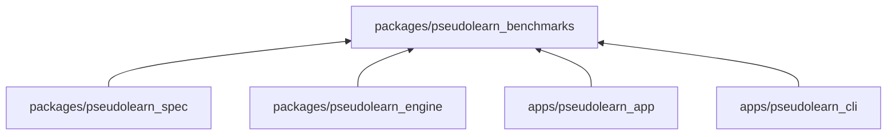
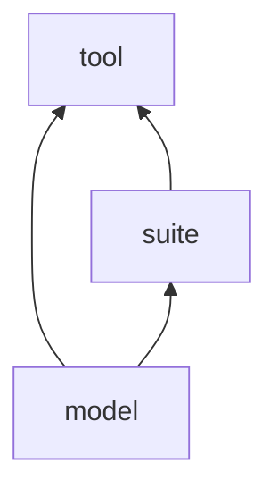
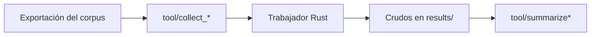

# pseudolearn_benchmarks

Recolectores y resumidores de rendimiento del núcleo Rust: miden con trabajadores del motor y del puente, conservan las
muestras crudas y calculan las estadísticas. Incluye `ceiling/`, un workspace Rust experimental e independiente que fija
el techo semántico de diez algoritmos AWFY-core.

**No hace:** no ejecuta el lenguaje en Dart, no define presupuestos (son de `PERF.*` en el corpus) y no versiona
resultados: `results/` está ignorado por Git.

## Dónde encaja

Lee la exportación del corpus de `spec`, ejecuta el trabajador `pseudolearn_bench_worker` de `engine`, mide la
biblioteca nativa y los ejercicios de `app` y usa la ficha del lenguaje de `cli`. Ningún miembro depende de él.

## Arquitectura

| Capa    | Ruta            | Responsabilidad                                                    |
|---------|-----------------|--------------------------------------------------------------------|
| model   | `lib/src/model` | Cargas, muestras y tareas del benchmark del agente                 |
| suite   | `lib/src/suite` | Cargas AWFY, del corpus y de anexos; tareas del agente             |
| tooling | `tool/`         | Recolectar, verificar y resumir; también `check.dart`              |
| ceiling | `ceiling/`      | Workspace Rust aparte: `kernels`, `statistics`, `runner` y `xtask` |

## Flujo principal

Flujo de ejecución, no de dependencias.

El trabajador prepara el estado antes del reloj, mide las operaciones y verifica después. El recolector captura la
procedencia antes de compilar y nunca descarta muestras.

## Reglas que conviene saber

- Capas: `model` no importa nada; `suite` solo `model`; `tool` importa `model` y `suite`. Sin dependencias externas en
  `lib`.
- Límites: 300 líneas por archivo, 40 por función, 4 parámetros, anidación 3 y 7 métodos públicos por clase.
- Las herramientas reciben rutas de entrada y salida explícitas y no sobrescriben capturas anteriores.
- Un resultado incumplido se conserva tal cual; el umbral no se ajusta desde el arnés.
- `agent_benchmark run` gasta créditos reales: exige `--authorized`, `AGENT_PROXY_URL`, `AGENT_ACCESS_TOKEN` y
  `PSEUDO_BIN`, y sin ellos termina con código 2.

## Comandos útiles

| Para qué                                  | Comando                                                                                                                                  |
|-------------------------------------------|------------------------------------------------------------------------------------------------------------------------------------------|
| Generar la exportación previa             | `(cd ../pseudolearn_spec && cargo run --locked -p see_cli --bin see -- export --root .)`                                                 |
| Instalar dependencias                     | `dart pub get`                                                                                                                           |
| Tests                                     | `dart test`                                                                                                                              |
| Análisis estático                         | `dart analyze --fatal-infos --fatal-warnings`                                                                                            |
| Verificar capas y límites                 | `dart run tool/check.dart`                                                                                                               |
| Medir el análisis                         | `dart run tool/collect_frontend.dart <directorio>`                                                                                       |
| Medir la ejecución                        | `dart run tool/collect_execution.dart <resumen-línea-base.json> [directorio]`                                                            |
| Recalcular estadísticas históricas        | `dart run tool/summarize.dart <directorio>`                                                                                              |
| Preparar y ejecutar la campaña del puente | `dart run tool/create_bridge_campaign.dart <campaña-nueva.json>` y `dart run tool/collect_bridge.dart <campaña.json> <directorio-nuevo>` |
| Resumir el puente                         | `dart run tool/summarize_bridge.dart <raw.json>`                                                                                         |
| Inspeccionar artefactos del puente        | `dart run tool/capture_bridge_artifacts.dart [--output ruta]`                                                                            |
| Planificar el benchmark del agente        | `dart run tool/agent_benchmark.dart plan [ejercicios] [salida.json]`                                                                     |
| Comparar AOT y techo Rust                 | `(cd ../pseudolearn_engine && cargo run --release -p pseudolearn_bench_worker -- paired <directorio-nuevo>)`                             |
| Verificar `ceiling/`                      | `(cd ceiling && cargo xtask verify)`                                                                                                     |
| Recolectar `ceiling/`                     | `(cd ceiling && cargo run --release -p ceiling_runner -- collect <directorio-nuevo>)`                                                    |

Requisitos: Dart de Flutter (el fijado en la app), Node según `node-version` y el Rust fijado en cada miembro.
