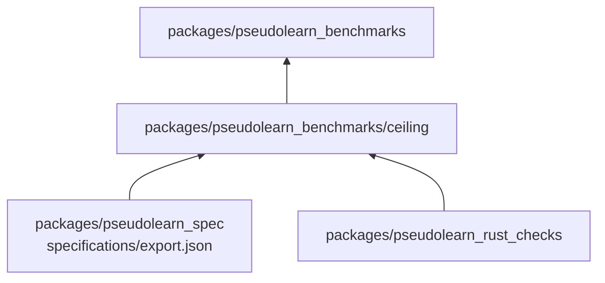
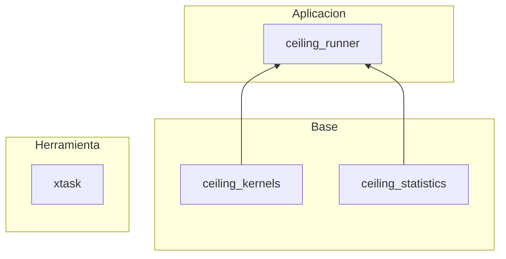
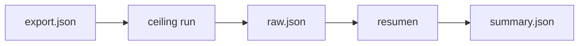

# ceiling

Workspace Rust experimental que mide el techo de rendimiento de diez algoritmos AWFY compilados bajo diez variantes de
representación de memoria (de Rust idiomático a montón plano con puntos de control). Entrega capturas de muestras crudas
y un resumen estadístico por proceso.

**No hace:** no implementa el motor, no mide la VM de PseudoLearn y no es una biblioteca para consumidores; sus miembros
tienen `publish = false`.

## Dónde encaja

`pseudolearn_spec` aporta el corpus exportado que el runner lee en ejecución; `pseudolearn_rust_checks` lo invoca
`xtask` como verificador. Ninguna dependencia es de Cargo: el workspace no depende de otros miembros del monorepo.

## Arquitectura

| Pieza                | Responsabilidad                                                                   |
|----------------------|-----------------------------------------------------------------------------------|
| `ceiling_kernels`    | Los diez algoritmos y las máquinas de memoria que los ejecutan (variantes 0 a 9)  |
| `ceiling_statistics` | Media, media geométrica, intervalo bootstrap, razón emparejada y puntos de cambio |
| `ceiling_runner`     | Binario `ceiling`: carga el corpus, mide por procesos, valida salidas y resume    |
| `xtask`              | `cargo xtask verify`: orquesta formato, Clippy, tests, cargo-deny y verificadores |

`ceiling_statistics` y `xtask` no tienen dependencias; `ceiling_runner` solo añade `serde_json` externo.

## Flujo principal

Flujo de datos de una recolección, no de dependencias:

`collect` escribe antes `capture.json` (procedencia), compila el binario release y lanza diez procesos con
`/usr/bin/time -lp`; cada uno emite 30 iteraciones por carga y variante. Las muestras acumulan repeticiones hasta 5 ms y
la semilla del bootstrap es 42.

## Reglas que conviene saber

- Capas en `architecture.yaml`: `ceiling_kernels` y `ceiling_statistics` no importan nada; `ceiling_runner` solo importa
  esas dos; `xtask` no importa ningún crate del workspace.
- Cero `unsafe` (`unsafe_code = "forbid"`) y Clippy deniega `unwrap`, `expect`, `panic`, indexado, aritmética implícita
  y `as`.
- Límites: 300 líneas por archivo, 40 por función, 4 parámetros posicionales, anidación 3 y 7 métodos públicos.
- Los resultados esperados vienen de `PERF.SUITE.CORE` en el corpus exportado, nunca de una variante; el runner rechaza
  salidas distintas y procesos con muestras incompletas.

## Comandos útiles

| Para qué                               | Comando                                                                                                     |
|----------------------------------------|-------------------------------------------------------------------------------------------------------------|
| Generar la exportación del corpus      | `(cd ../../pseudolearn_spec && cargo run --locked -p see_cli --bin see -- export --root .)`                 |
| Verificar todo (genera la exportación) | `cargo xtask verify`                                                                                        |
| Recolectar variantes 0 a 3             | `cargo run --release -p ceiling_runner -- collect <directorio>`                                             |
| Recolectar variantes 0 a 8             | `cargo run --release -p ceiling_runner -- collect-remanso <directorio>`                                     |
| Comparar recolectores de memoria       | `cargo run --release -p ceiling_runner -- collect-memory <directorio>`                                      |
| Resumir una captura existente          | `cargo run --release -p ceiling_runner -- summarize <directorio>` (`summarize-remanso`, `summarize-memory`) |

Requisitos: Rust 1.99.1 con rustfmt y Clippy (`rust-toolchain.toml`), `cargo-deny`, `git`, y macOS para recolectar
(`/usr/bin/time -lp` y `sysctl`). Sin directorio, los comandos usan `../results/e02`, `../results/e02r` y
`../results/e12` respectivamente.
