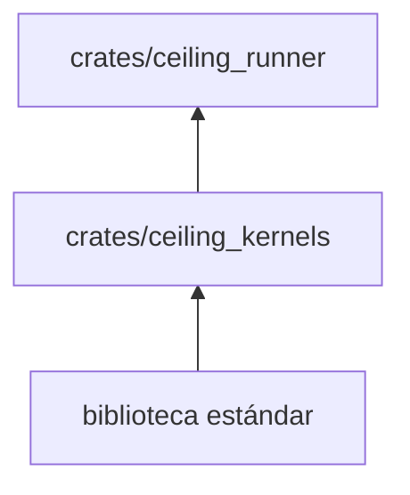
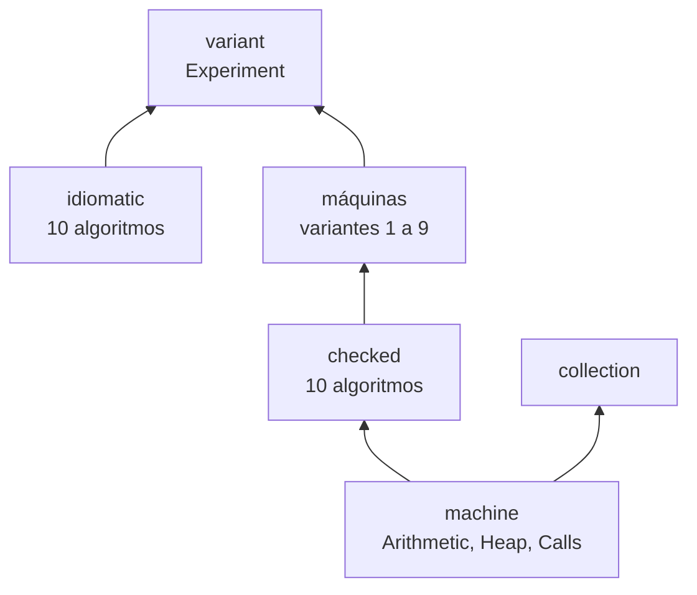
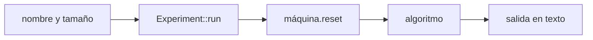

# ceiling_kernels

Los diez algoritmos AWFY (`sieve`, `permute`, `queens`, `towers`, `list`, `storage`, `bounce`, `mandelbrot`, `nbody`,
`richards`) y las máquinas de memoria sobre las que se ejecutan. Cada máquina es una variante numerada del experimento.

**No hace:** no mide tiempos, no lee el corpus ni imprime nada; solo devuelve la salida textual de cada algoritmo.
Tampoco es la memoria del motor.

## Dónde encaja

## Arquitectura

Se omiten las aristas de `machine` hacia cada máquina, que implementa sus tres rasgos. `collection` implementa `Heap` y
`Calls` por su cuenta y se ejecuta con `collection::run`, fuera de `Experiment`.

| Pieza                                                    | Responsabilidad                                                                             |
|----------------------------------------------------------|---------------------------------------------------------------------------------------------|
| `machine`                                                | Rasgos `Arithmetic`, `Heap` y `Calls` (`Machine` los agrupa), asas y `Trap`                 |
| `checked`                                                | Los diez algoritmos genéricos sobre `Machine`, compartidos por las variantes 1 a 9          |
| `idiomatic`                                              | Los diez algoritmos con estructuras propias de Rust (variante 0)                            |
| `direct`                                                 | Variante 1                                                                                  |
| `clepsydra`, `paged_heap`, `timeline`                    | Variantes 2 y 3: montón paginado y puntos de control cada milisegundo                       |
| `framed_direct`                                          | Variante 4                                                                                  |
| `remanso`, `flat_heap`, `differential`, `card_recording` | Variantes 5 a 8: montón plano sin y con índice sin comprobar, sombra diferencial y tarjetas |
| `semantic_memory`                                        | Variante 9                                                                                  |
| `collection`                                             | Tres recolectores (`SizeClasses`, `Lines`, `ReferenceCounts`) con pausas y estadísticas     |
| `variant`                                                | `Experiment`: construye la máquina por número y ejecuta un algoritmo por nombre             |

## Flujo principal

`Experiment::new` rechaza un número fuera de 0 a 9 y `run` rechaza un nombre de algoritmo desconocido, ambos con
`Trap::InvalidHandle`. La variante 9 existe en `Experiment`, pero ningún trabajador del runner la mide.

## Reglas que conviene saber

- No importa nada fuera de la biblioteca estándar: `may_import` y `external_dependencies` están vacíos en
  `architecture.yaml`.
- `#![forbid(unsafe_code)]`; los fallos esperables son `Outcome` con `Trap`, nunca pánico.
- Las variantes 1 a 9 comparten los algoritmos de `checked`, monomorfizados por máquina; la variante 0 es la única con
  algoritmos distintos.
- Los módulos `semantic_frames` y `semantic_heap` son privados; el resto se publica desde `lib.rs`.

## Comandos útiles

| Para qué                    | Comando                         |
|-----------------------------|---------------------------------|
| Probar este crate           | `cargo test -p ceiling_kernels` |
| Verificar todo el workspace | `cargo xtask verify`            |

Requisitos: ejecutar desde la carpeta `ceiling/` con el Rust fijado en `rust-toolchain.toml`.
