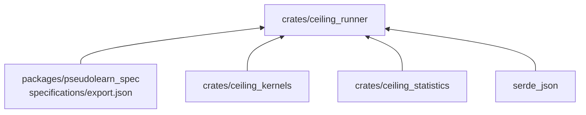
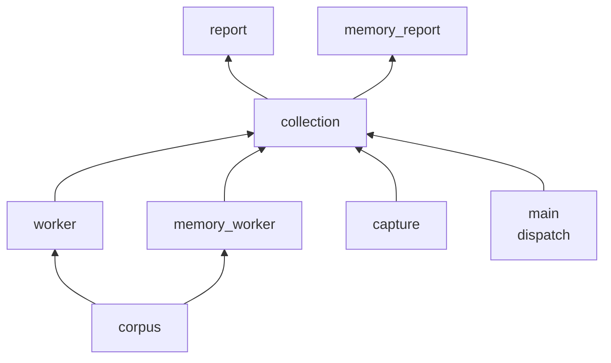
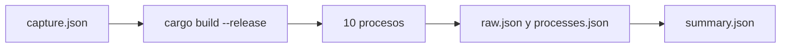

# ceiling_runner

Binario `ceiling` que carga las cargas de trabajo del corpus, las mide por procesos sobre las variantes de
`ceiling_kernels`, valida cada salida y escribe las muestras crudas y su resumen estadístico.

**No hace:** no define algoritmos ni estadística propia, no compara contra ninguna VM y no sube resultados a ninguna
parte; escribe archivos JSON en un directorio local.

## Dónde encaja

## Arquitectura

Las flechas indican quién usa a quién en la recolección; `main` también invoca directamente los trabajadores y los
informes.

| Pieza                     | Responsabilidad                                                                               |
|---------------------------|-----------------------------------------------------------------------------------------------|
| `main`                    | Despacha el primer argumento y fija el directorio por defecto de cada comando                 |
| `corpus`                  | Lee `PERF.SUITE.CORE` del export y exige exactamente diez cargas con la etiqueta pedida       |
| `worker`                  | Mide las variantes 0 a 3 (`run`) o 0 a 8 (`run-remanso`), con 30 iteraciones por carga        |
| `memory_worker`           | Mide los tres recolectores sobre las diez cargas más `storage-deep` y `list-churn`            |
| `capture`                 | Procedencia: commit, hashes de fuentes y corpus, `rustc`, SO, hardware y resolución del reloj |
| `collection`              | Compila en release, lanza diez procesos con `/usr/bin/time -lp` y guarda los archivos         |
| `report`, `memory_report` | Agrupan las muestras, calculan razones con intervalo bootstrap y escriben `summary.json`      |

## Flujo principal

Flujo de datos, no de dependencias:

Cada proceso debe emitir exactamente 1200 filas (`collect`), 2700 (`collect-remanso`) o 1080 (`collect-memory`); de lo
contrario la recolección falla. Dentro de un proceso, el orden de las variantes rota por iteración.

## Reglas que conviene saber

- Solo importa `ceiling_kernels` y `ceiling_statistics`, y como dependencia externa solo `serde_json`
  (`architecture.yaml`).
- Una muestra acumula repeticiones hasta 5 ms; las variantes 3, 7 y 8 exigen al menos un punto de control real y fallan
  si pasa un segundo sin él.
- Toda salida se compara con el valor esperado del corpus y una diferencia aborta la medición; no se descarta ninguna
  muestra.
- Los trabajadores `run*` imprimen una fila JSON por muestra; solo `collect*` las agrega, así que no se invocan a mano
  salvo para depurar.

## Comandos útiles

| Para qué                   | Comando                                                                 |
|----------------------------|-------------------------------------------------------------------------|
| Recolectar variantes 0 a 3 | `cargo run --release -p ceiling_runner -- collect <directorio>`         |
| Recolectar variantes 0 a 8 | `cargo run --release -p ceiling_runner -- collect-remanso <directorio>` |
| Recolectar recolectores    | `cargo run --release -p ceiling_runner -- collect-memory <directorio>`  |
| Resumir una captura        | `cargo run --release -p ceiling_runner -- summarize <directorio>`       |
| Probar este crate          | `cargo test -p ceiling_runner`                                          |

Requisitos: la exportación del corpus generada (`cargo xtask verify` la crea), `git`, y macOS para recolectar. Sin
directorio, `summarize*` y `collect*` usan `../results/e02`, `e02r` o `e12`.
