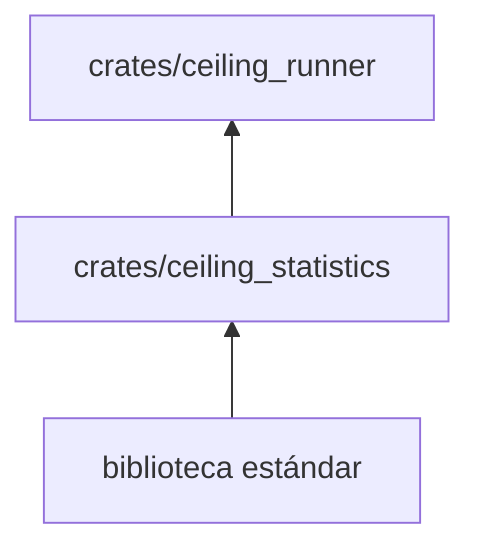

# ceiling_statistics

Funciones estadísticas puras sobre listas de `f64`: media, media geométrica, intervalo bootstrap, razones emparejadas y
detección de puntos de cambio.

**No hace:** no lee archivos, no ejecuta procesos ni conoce las cargas de trabajo; solo recibe números.

## Dónde encaja

## Arquitectura

| Pieza                   | Responsabilidad                                                                                           |
|-------------------------|-----------------------------------------------------------------------------------------------------------|
| `mean`                  | Media; rechaza listas vacías o con valores no finitos                                                     |
| `geometric`             | Media geométrica; rechaza valores no positivos                                                            |
| `confidence`            | Intervalo del 95 %: 1000 remuestreos con semilla fija 42, cuantiles en los puestos 25 y 974               |
| `ratio`                 | Cociente elemento a elemento; rechaza longitudes distintas, vacío o denominadores no positivos            |
| `change_points::detect` | Fronteras (a partir de cinco muestras por lado) donde la diferencia de medias supera el 5 % y 3,3 errores |

## Reglas que conviene saber

- Sin dependencias: `may_import` y `external_dependencies` vacíos en `architecture.yaml`.
- Todo fallo es `Result<_, String>`; ninguna función entra en pánico ni usa conversiones numéricas con pérdida.
- El bootstrap es determinista: la misma lista da siempre el mismo intervalo.

## Comandos útiles

| Para qué                    | Comando                            |
|-----------------------------|------------------------------------|
| Probar este crate           | `cargo test -p ceiling_statistics` |
| Verificar todo el workspace | `cargo xtask verify`               |

Requisitos: ejecutar desde la carpeta `ceiling/` con el Rust fijado en `rust-toolchain.toml`.
