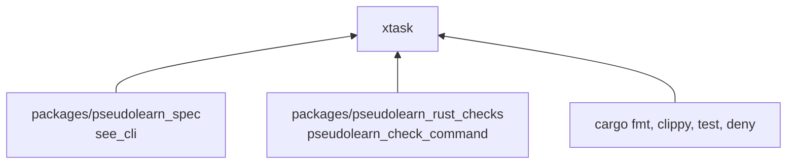
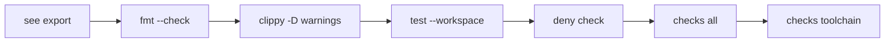

# xtask

Orquestador de verificación del workspace `ceiling`: genera la exportación del corpus y ejecuta en orden los
verificadores. Se invoca con el alias `cargo xtask`.

**No hace:** no recolecta mediciones ni contiene lógica de cargas; ese trabajo es de `ceiling_runner`.

## Dónde encaja

Las dependencias son programas invocados por proceso; `xtask/Cargo.toml` no declara ninguna.

## Flujo principal

Orden de ejecución; el primer paso que falla detiene el resto:

`fmt`, `clippy` y `test` cubren todo el workspace (`clippy` con `--all-targets`). `checks all .` pasa todos los
verificadores de `pseudolearn_rust_checks` a esta carpeta y `checks toolchain ../../..` ejecuta su verificación de
versiones sobre la raíz del monorepo.

## Reglas que conviene saber

- Único argumento aceptado: `verify`; cualquier otro imprime el uso y termina con error.
- Sin dependencias de Cargo: `may_import` y `external_dependencies` vacíos, y la capa está marcada como `tooling: true`
  en `architecture.yaml`.
- Las rutas a `pseudolearn_spec` y `pseudolearn_rust_checks` son relativas, así que solo funciona desde la carpeta
  `ceiling/`.

## Comandos útiles

| Para qué                    | Comando               |
|-----------------------------|-----------------------|
| Verificar todo el workspace | `cargo xtask verify`  |
| Probar este crate           | `cargo test -p xtask` |

Requisitos: Rust 1.99.1 con rustfmt y Clippy, `cargo-deny` y las toolchains de `pseudolearn_spec` y
`pseudolearn_rust_checks`.
