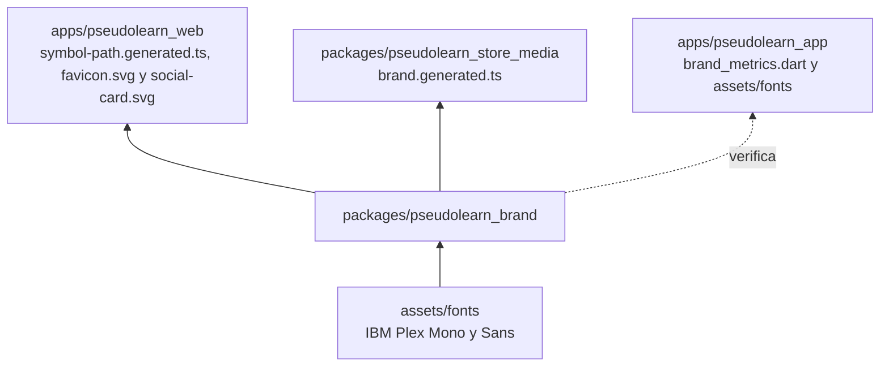
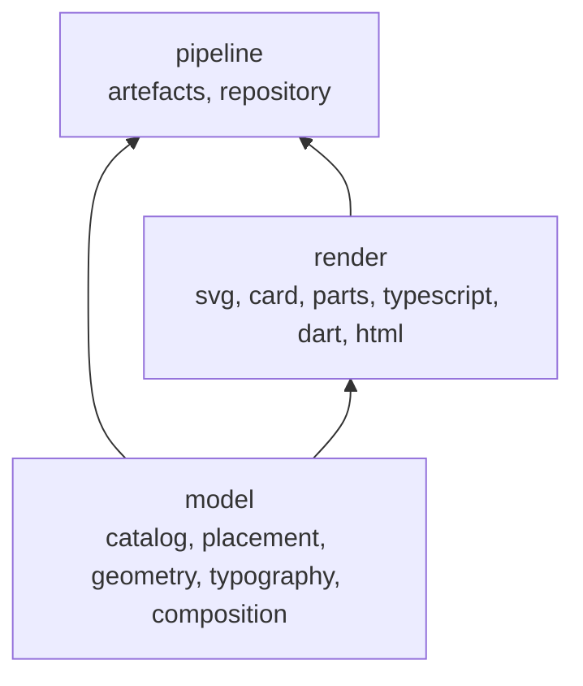
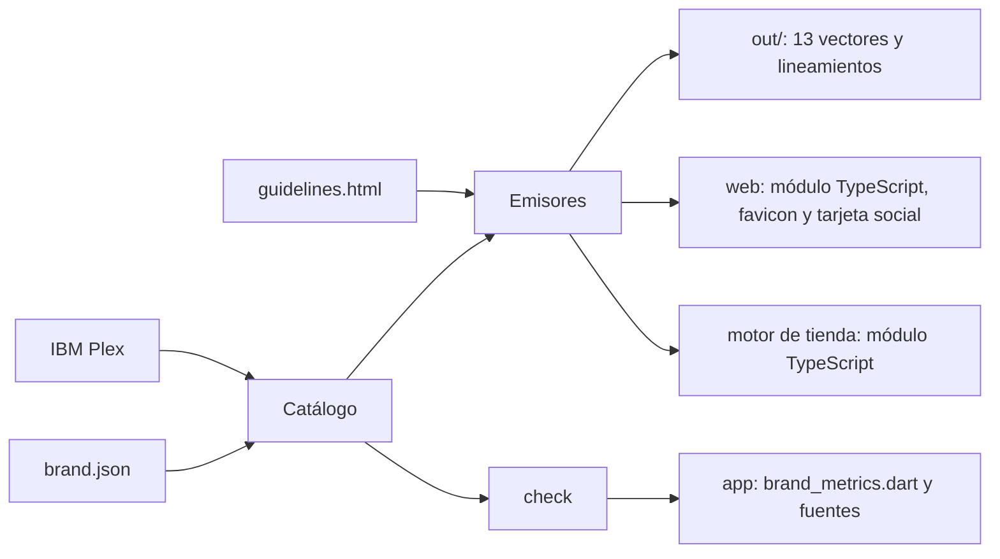

# pseudolearn_brand

Motor paramétrico de la identidad visual de PseudoLearn. Un catálogo declarativo (`brand.json`) y la geometría del
símbolo producen los vectores maestros de la marca, un módulo de TypeScript para la web, otro para el motor de
assets de tienda, la tarjeta social de la web y el documento de lineamientos,
y verifican que la app y la web no guarden copias que el motor ya no produce.

**No hace:** definir tokens de interfaz (color, tipografía y radios salen de la app), rasterizar íconos de plataforma ni
generar código Dart: a la app solo le verifica sus medidas.

## Dónde encaja

La línea punteada es verificación, no emisión. Las salidas de `out/`, el favicon, la tarjeta social y los módulos de
TypeScript no se versionan.

## Arquitectura

| Pieza                       | Responsabilidad                                                                                    |
|-----------------------------|----------------------------------------------------------------------------------------------------|
| `model/`                    | Catálogo tipado, medidas de colocación, geometría del símbolo, contornos de IBM Plex y composición |
| `render/`                   | Un emisor por destino: SVG (con la tarjeta social aparte), TypeScript web y de tienda, Dart y HTML |
| `pipeline/`                 | Plan de artefactos, escritura, comparación y localización de la raíz del monorepo                  |
| `brand.json`                | Variantes, símbolo, tipografía, paleta, colocación, lockups y emisores                             |
| `templates/guidelines.html` | Plantilla con huecos `{{svg:variante}}` y `{{path:pieza}}`                                         |
| `assets/fonts/`             | Las dos caras de las que se contornea el logotipo (ver su README)                                  |
| `tool/check_limits.py`      | Capas, límites de tamaño, comentarios e imports prohibidos                                         |

## Flujo principal

Flujo de datos de `build`, no de dependencias.

## Reglas que conviene saber

- `model/` no importa nada del paquete; `render/` importa `model/`; `pipeline/` importa ambos (`architecture.json`).
- Archivos de 170 líneas, funciones de 40, 6 parámetros posicionales y 3 niveles de anidamiento; sin comentarios en
  `pseudolearn_brand/`.
- Imports prohibidos: `subprocess`, `socket`, `urllib`, `requests` y `shutil`.
- Una variante nueva es una entrada en `brand.json`; el catálogo rechaza claves desconocidas.
- El módulo TypeScript de la web exporta, además del trazado completo, la ruta y el banderín por separado, la línea
  central de la escalera y el grosor del trazo: la web anima el símbolo recorriendo la escalera sin copiar geometría.
- **La tarjeta social es un SVG sin texto.** `social-card` (1200×630, la medida de Open Graph) dibuja el lockup
  horizontal sobre una placa translúcida, encima del fondo de marca y con el símbolo como marca de agua; todas sus
  proporciones viven en la sección `card` de `brand.json`. El logotipo va contorneado como en los demás vectores, así
  que rasterizarla no depende de ninguna fuente instalada. El motor no produce el PNG que LinkedIn y X exigen (rechazan
  SVG): rasterizar no es su papel y añadiría una dependencia; la web lo hace con `sharp` a partir del SVG que recibe
  (`pnpm generate:og-image`).
- **El módulo del motor de tienda** (`typescript_store_media`) repite el del símbolo y añade la paleta y los dos lockups
  horizontales como documentos SVG completos. Ese motor compone vídeos en HTML y necesita la marca entera, no solo la
  geometría; recibirla generada evita que pegue SVG a mano (`GEN-NO-HAND-COPY`). Un desvío se informa como
  `BRAND-TS-STALE`, igual que en la web. La marca no anima ni rasteriza: eso le toca al motor de tienda.
- Los archivos generados no se editan a mano. `check` falla con `BRAND-COPY-STALE`, `BRAND-TS-STALE`,
  `BRAND-DART-DRIFT`, `BRAND-FONT-DRIFT` o `BRAND-TEMPLATE-GEOMETRY` cuando un consumidor diverge.

## Comandos útiles

Desde este directorio:

| Para qué                               | Comando                                                                        |
|----------------------------------------|--------------------------------------------------------------------------------|
| Generar todos los artefactos (18)      | `python3 -m pseudolearn_brand build`                                           |
| Verificar consumidores y catálogo      | `python3 -m pseudolearn_brand check`                                           |
| Verificar capas y límites              | `python3 tool/check_limits.py`                                                 |
| Ejecutar los tests                     | `python3 -m unittest discover -s test -t .`                                    |
| Comprobar que la web no pega geometría | `(cd ../../apps/pseudolearn_web && pnpm check:brand)`                          |
| Rasterizar íconos de iOS y macOS       | `(cd ../../apps/pseudolearn_app && flutter test tool/generate_app_icons.dart)` |

Requisitos: Python 3.9 o superior con `fonttools` (`python3 -m pip install fonttools`).
