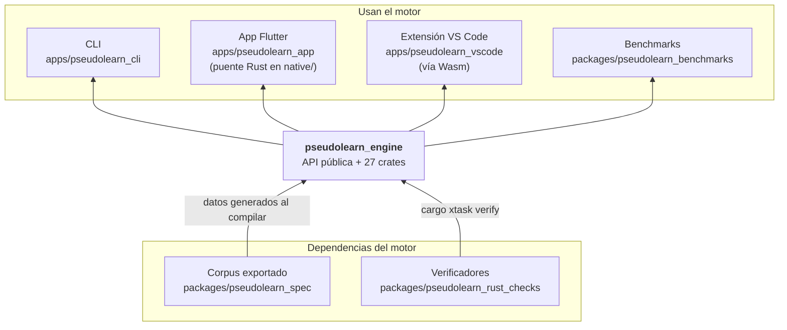
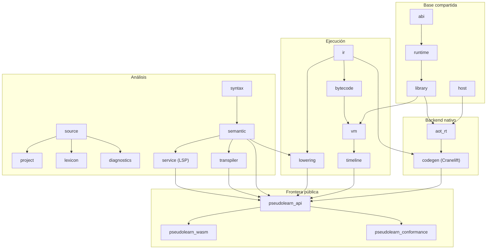
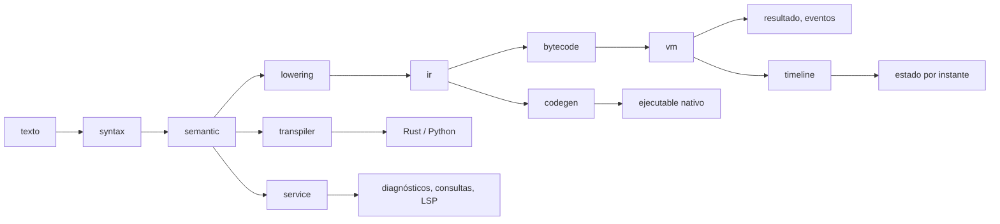

# pseudolearn_engine

Núcleo del lenguaje PseudoLearn: recibe texto fuente y lo analiza, ejecuta, observa paso a paso, traduce a Rust/Python o
compila a código nativo. Es determinista y no tiene interfaz de usuario: lo consumen la CLI, la app, los puentes y el
navegador a través de **una sola API pública** (`pseudolearn_api`).

**No hace:** definir el comportamiento del lenguaje (eso es el corpus de `pseudolearn_spec`), dibujar UI ni conocer a
sus consumidores.

## Dónde encaja

## Arquitectura

Un crate por responsabilidad, agrupados en capas. Cada flecha va de la dependencia a quien la usa y corresponde a una
dependencia real de `Cargo.toml`; las reglas de capas están en `architecture.yaml`.

El diagrama agrupa y omite aristas hacia `source`, `diagnostics` y `abi`, que casi todos los crates importan.

| Capa         | Crates                                                                             | Responsabilidad                                                                                                                |
|--------------|------------------------------------------------------------------------------------|--------------------------------------------------------------------------------------------------------------------------------|
| Base         | `source`, `abi`, `host`, `runtime`, `library`                                      | Texto con posiciones, disposición de valores, anfitrión físico, montón con recolección determinista, intrínsecos               |
| Análisis     | `project`, `lexicon`, `diagnostics`, `syntax`, `semantic`, `service`, `transpiler` | Árbol sintáctico sin pérdida, HIR tipado, análisis incremental y sesión LSP, traducción a Rust y Python                        |
| Ejecución    | `lowering`, `ir`, `bytecode`, `vm`, `timeline`                                     | HIR → representación intermedia verificada → bytecode → VM cooperativa; `timeline` reconstruye el estado en cualquier instante |
| Nativo       | `codegen`, `aot_rt`                                                                | Objeto nativo con Cranelift y la frontera `extern "C"` que lo ejecuta                                                          |
| Frontera     | `api`, `wasm`, `conformance`                                                       | API total sobre recursos del núcleo; módulo para navegador; adaptador del protocolo de conformidad                             |
| Herramientas | `vm_dispatch`, `vm_tracer`, `bench_worker`, `math_probe`, `native_probe`           | Generación del despacho de la VM y mediciones; sin consumidores de producto                                                    |

Los crates `syntax`, `lexicon`, `diagnostics`, `ir`, `bytecode` y `vm` incluyen código generado desde el corpus; no se
edita a mano.

## Flujo principal

Este diagrama es de flujo de datos, no de dependencias. La misma RI alimenta a la VM y al backend nativo, de modo que
comparten disposición de marco y de objetos.

## Reglas que conviene saber

- **Determinismo**: una ejecución queda fijada por programa, configuración, semilla y entradas.
- **`unsafe`** solo en `pseudolearn_wasm`, `pseudolearn_aot_rt` y `pseudolearn_native_probe`.
- **Aislamiento**: `api` y `wasm` compilados para `wasm32` no pueden traer red nativa, `codegen` ni `aot_rt`, ni
  activar la feature `test-host`; `tool/wasm.sh build` rechaza el grafo si aparece alguno, porque la unificación de
  features de Cargo convertiría el anfitrión de memoria en el anfitrión distribuido.
- **Sin capas hacia arriba**: `architecture.yaml` fija qué puede importar cada crate.

## Comandos útiles

| Para qué                                                              | Comando                                                                                  |
|-----------------------------------------------------------------------|------------------------------------------------------------------------------------------|
| Verificación completa (formato, clippy, tests, verificadores, `deny`) | `cargo xtask verify`                                                                     |
| Tests del workspace                                                   | `cargo test --workspace`                                                                 |
| Compilación optimizada                                                | `cargo build --release`                                                                  |
| Exportar el corpus antes de compilar a mano                           | `(cd ../pseudolearn_spec && cargo run --locked -p see_cli --bin see -- export --root .)` |
| Módulo Wasm                                                           | `bash tool/wasm.sh build`                                                                |
| Probar el Wasm en Chrome                                              | `bash tool/wasm.sh test`                                                                 |
| Conformidad desde `pseudolearn_spec`                                  | `cargo run -p see_cli --bin see -- conform --subject engine --operation analyze`         |
| Conformidad del backend nativo                                        | `cargo run -p see_cli --bin see -- conform --subject aot`                                |
| Medir rendimiento nativo                                              | `cargo run --release -p pseudolearn_bench_worker -- paired <directorio-nuevo>`           |

Requisitos: toolchain fijada en `rust-toolchain.toml`; para Wasm, el target `wasm32-unknown-unknown` y
`wasm-bindgen-cli` 0.2.129, y además `pnpm` para `tool/wasm.sh test`.
