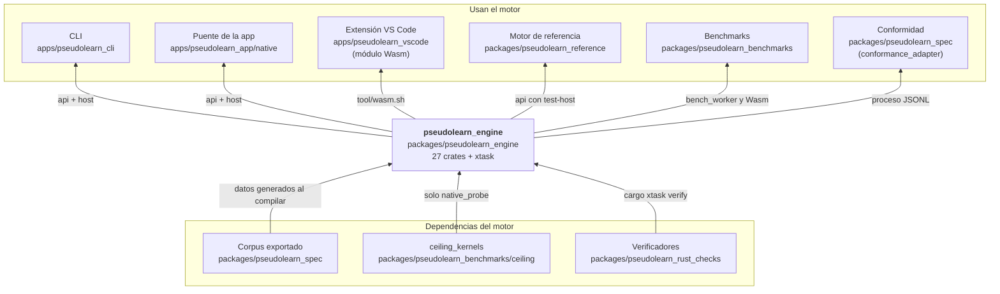
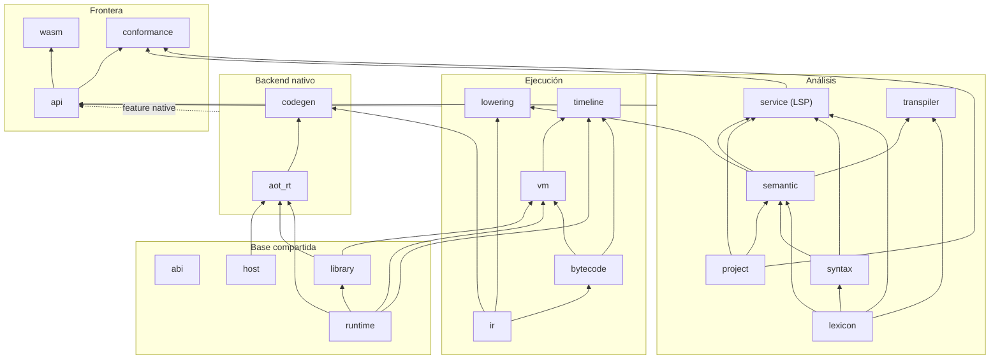
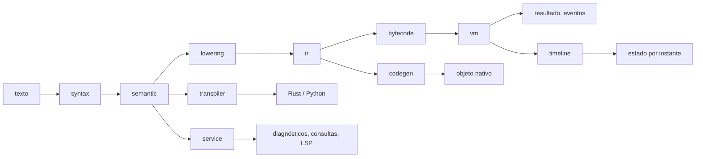

# pseudolearn_engine

Núcleo del lenguaje PseudoLearn: recibe texto fuente y lo analiza, ejecuta, observa paso a paso, traduce a Rust o
Python y compila a código nativo. Es determinista y no tiene interfaz de usuario. Se organiza en 27 crates más `xtask`;
el análisis, la ejecución, la traducción y la compilación se consumen por una sola API pública (`pseudolearn_api`),
y los efectos reales los atiende `pseudolearn_host`.

**No hace:** definir el comportamiento del lenguaje (eso es el corpus de `pseudolearn_spec`), dibujar interfaz ni
conocer a sus consumidores.

## Dónde encaja

## Arquitectura

Un crate por responsabilidad, agrupados en capas. Cada flecha va de la dependencia a quien la usa y corresponde a una
dependencia de `Cargo.toml`. El diagrama omite las aristas hacia `source`, `diagnostics` y `abi`, que casi todos los
crates importan, y deja fuera las herramientas; una flecha desde un grupo indica que `api` importa cada crate de ese
grupo. Las reglas de capas están en `architecture.yaml`.

| Capa         | Crates                                                                            | Responsabilidad                                                                                                             |
|--------------|-----------------------------------------------------------------------------------|-----------------------------------------------------------------------------------------------------------------------------|
| Base         | `source`, `abi`, `diagnostics`, `host`, `runtime`, `library`                      | Texto con posiciones, disposición binaria, catálogo de diagnósticos, anfitrión físico, montón y tareas, biblioteca estándar |
| Análisis     | `project`, `lexicon`, `syntax`, `semantic`, `service`, `transpiler`               | Proyecto y manifiesto, vocabulario, árbol sin pérdida, modelo tipado, servicio de edición y LSP, traducción a Rust y Python |
| Ejecución    | `ir`, `lowering`, `bytecode`, `vm`, `timeline`                                    | Modelo tipado → RI verificada → bytecode → VM cooperativa; `timeline` reconstruye el estado en un instante                  |
| Nativo       | `codegen`, `aot_rt`                                                               | Objeto nativo con Cranelift y el runtime `extern "C"` que lo acompaña                                                       |
| Frontera     | `api`, `wasm`, `conformance`                                                      | API pública sobre recursos del núcleo, módulo para navegador y adaptador del protocolo de conformidad                       |
| Herramientas | `vm_dispatch`, `vm_tracer`, `bench_worker`, `math_probe`, `native_probe`, `xtask` | Despacho de la VM, mediciones y verificación; solo `vm` importa una (`vm_dispatch`, al compilar)                            |

Ocho crates generan código en su `build.rs` a partir de `pseudolearn_spec/specifications/export.json`, en `OUT_DIR`:
`abi`, `diagnostics`, `lexicon`, `syntax`, `ir`, `bytecode`, `vm` y `service`. No se edita a mano ni se copia.

## Flujo principal

Flujo de datos, no de dependencias.

## Reglas que conviene saber

- **Capas sin vuelta atrás**: `architecture.yaml` fija qué puede importar cada crate (`may_import`); el verificador de
  capas rechaza cualquier otro import.
- **`unsafe`** solo en `pseudolearn_wasm`, `pseudolearn_aot_rt` y `pseudolearn_native_probe`; los demás lo prohíben y
  `aot_rt` y `native_probe` documentan cada función en su tabla «Invariantes de `unsafe`».
- **Aislamiento Wasm**: el grafo de `api` y `wasm` para `wasm32` no puede incluir `codegen`, `aot_rt`, `cranelift-*`, la
  característica `test-host` ni bibliotecas de red nativa; `tool/wasm.sh build` rechaza el grafo con `cargo tree`.

## Comandos útiles

| Para qué                                                                      | Comando                                                                                  |
|-------------------------------------------------------------------------------|------------------------------------------------------------------------------------------|
| Verificación completa (corpus, formato, clippy, tests, verificadores, `deny`) | `cargo xtask verify`                                                                     |
| Exportar el corpus antes de compilar a mano                                   | `(cd ../pseudolearn_spec && cargo run --locked -p see_cli --bin see -- export --root .)` |
| Módulo Wasm                                                                   | `bash tool/wasm.sh build`                                                                |
| Probar el Wasm en Chrome                                                      | `bash tool/wasm.sh test`                                                                 |
| Conformidad de análisis (desde `packages/pseudolearn_spec`)                   | `cargo run -p see_cli --bin see -- conform --subject engine --operation analyze`         |
| Conformidad del backend nativo (desde `packages/pseudolearn_spec`)            | `cargo run -p see_cli --bin see -- conform --subject aot`                                |
| Medir rendimiento nativo                                                      | `cargo run --release -p pseudolearn_bench_worker -- paired <directorio-nuevo>`           |

La conformidad compara con evidencia local de `../pseudolearn_spec/results/`, que no se versiona. Tras editar una
especificación, `SEE-STALE` se resuelve regenerando con `see conform --subject engine --operation properties`.
Requisitos: toolchain de `rust-toolchain.toml` y `cargo-deny`; para Wasm, el target `wasm32-unknown-unknown`,
`wasm-bindgen-cli` 0.2.129 y, para `tool/wasm.sh test`, `pnpm`.
