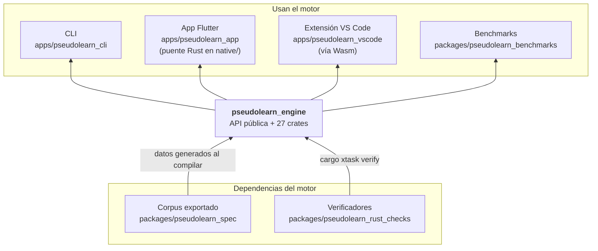
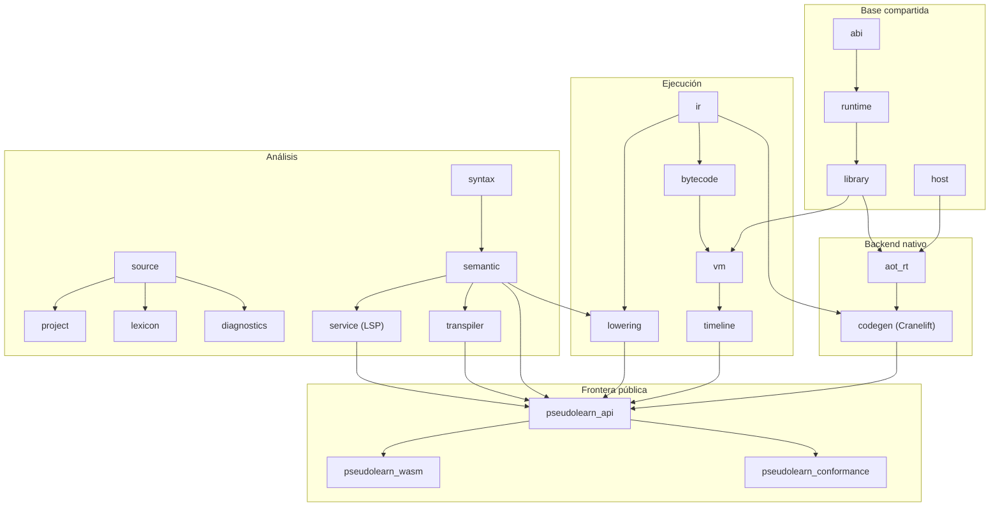
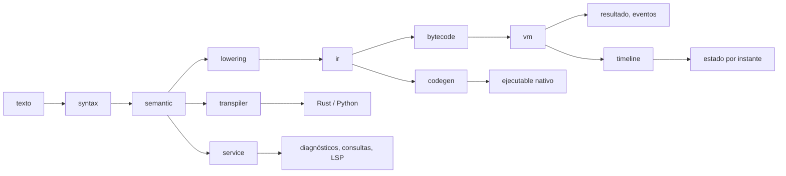

# pseudolearn_engine

Núcleo del lenguaje PseudoLearn: recibe texto fuente y lo analiza, ejecuta, observa paso a paso, traduce a Rust/Python o
compila a código nativo. Es determinista y no tiene interfaz de usuario: lo consumen la CLI, la app, los puentes y el
navegador a través de **una sola API pública** (`pseudolearn_api`).

**No hace:** definir el comportamiento del lenguaje (eso es el corpus de `pseudolearn_spec`), dibujar UI ni conocer a
sus consumidores.

## Dónde encaja

## Arquitectura

Un crate por responsabilidad, agrupados en capas. Cada flecha va de la dependencia a quien la usa y corresponde a una
dependencia real de `Cargo.toml`; las reglas de capas están en `architecture.yaml`.

El diagrama agrupa y omite aristas hacia `source`, `diagnostics` y `abi`, que casi todos los crates importan.

| Capa         | Crates                                                                             | Responsabilidad                                                                                                                |
|--------------|------------------------------------------------------------------------------------|--------------------------------------------------------------------------------------------------------------------------------|
| Base         | `source`, `abi`, `host`, `runtime`, `library`                                      | Texto con posiciones, disposición de valores, anfitrión físico, montón con recolección determinista, intrínsecos               |
| Análisis     | `project`, `lexicon`, `diagnostics`, `syntax`, `semantic`, `service`, `transpiler` | Árbol sintáctico sin pérdida, HIR tipado, análisis incremental y sesión LSP, traducción a Rust y Python                        |
| Ejecución    | `lowering`, `ir`, `bytecode`, `vm`, `timeline`                                     | HIR → representación intermedia verificada → bytecode → VM cooperativa; `timeline` reconstruye el estado en cualquier instante |
| Nativo       | `codegen`, `aot_rt`                                                                | Objeto nativo con Cranelift y la frontera `extern "C"` que lo ejecuta                                                          |
| Frontera     | `api`, `wasm`, `conformance`                                                       | API total sobre recursos del núcleo; módulo para navegador; adaptador del protocolo de conformidad                             |
| Herramientas | `vm_dispatch`, `vm_tracer`, `bench_worker`, `math_probe`, `native_probe`           | Generación del despacho de la VM y mediciones; sin consumidores de producto                                                    |

Los crates `syntax`, `lexicon`, `diagnostics`, `ir`, `bytecode` y `vm` incluyen código generado desde el corpus; no se
edita a mano.

## Flujo principal

Este diagrama es de flujo de datos, no de dependencias. La misma RI alimenta a la VM y al backend nativo, de modo que
comparten disposición de marco y de objetos.

## Reglas que conviene saber

- **Determinismo**: una ejecución queda fijada por programa, configuración, semilla y entradas.
- **`unsafe`** solo en `pseudolearn_wasm`, `pseudolearn_aot_rt` y `pseudolearn_native_probe`.
- **Aislamiento**: `api` y `wasm` compilados para `wasm32` no pueden traer red nativa, `codegen` ni `aot_rt`, ni
  activar la feature `test-host`; `tool/wasm.sh build` rechaza el grafo si aparece alguno, porque la unificación de
  features de Cargo convertiría el anfitrión de memoria en el anfitrión distribuido.
- **Profundidad del análisis**: el parser cuenta un nivel por cada lista de argumentos e índices además de los
  paréntesis, unarios, potencias y bloques, y un nivel por cada eslabón de una cadena (operadores binarios,
  llamadas, índices y accesos a miembro sucesivos, y retornos de tipos función), de modo que la profundidad del
  árbol queda acotada para todos los consumidores y ningún anidamiento agota la pila del anfitrión;
  `catch_unwind` no captura un desbordamiento de pila.
- **Nombres en la traducción**: el lenguaje distingue `fooBar`, `foo_bar` y `FOO_BAR`, pero ambos destinos los
  escriben igual; `transpiler` desambigua con sufijo numérico determinista (`_2`, `_3`) por ámbito de función
  (variables) y por enumerado (miembros), y renombra por sufijo todo nombre que el preludio generado o los
  integrados del destino ya usan. Los textos de Python se escapan con `\xNN`, `\uNNNN` o `\UNNNNNNNN` para NUL,
  controles, separadores y marcas bidireccionales. Los campos se deletrean con una tabla inyectiva para todo el
  módulo y las clases evitan los nombres de cualquier otro tipo declarado, también con sufijo determinista.
- **Historial y consultas de depuración**: el almacén de puntos de control tiene un presupuesto finito de ranuras
  retenidas, derivado de las celdas de memoria de la ejecución; al superarlo se adelgaza el punto de menor densidad
  (distancia entre vecinos por antigüedad, y solo en empate la ranura compuesta mínima) y, en último término, se
  adelanta el horizonte declarado. El presupuesto es de 8 ranuras por celda de memoria configurada, con un mínimo de
  2^20: deja que cada celda aparezca en varios segmentos de deshacer antes de adelgazar, y con las 2^22 celdas por
  omisión acota lo retenido a 2^25 ranuras. El corpus no fija la cifra: `API.STATE.QUERY#R3` solo exige declarar el
  horizonte y que toda consulta dentro de él sea exacta, lo que se cumple con cualquier presupuesto, de modo que es un
  parámetro de recurso del motor como los topes de 4096. `query_array_slice` rechaza longitudes mayores de 4096 como
  error de uso. El estado de depuración identifica sus fuentes sin repetir su texto en cada parada.
- **Consultas de texto**: `Contiene`, `PosicionDe`, `EmpiezaCon`, `TerminaCon` y `Subcadena` leen los textos prestados
  del montón en la VM y en el ejecutable nativo, sin copiarlos por llamada. El presupuesto de sentencias sigue contando
  una unidad por entrada a sentencia, como fija el corpus; la guarda de tiempo acota el trabajo lineal de `Contiene` y
  `PosicionDe`.
- **Memoria de texto**: una cadena creada en ejecución cuesta ⌈puntos/8⌉ + 1 celdas, como fija `ENG.LIMITS`; como un
  punto ocupa hasta 4 bytes, la arena retiene a lo sumo 32 bytes por celda contada antes de que la recolección, que se
  dispara por celdas, la compacte. Los literales no cuentan celdas y por eso se materializan una sola vez por contenido,
  también en el ejecutable nativo.
- **Códec de eventos**: el cuerpo binario no admite un pool no vacío sin eventos. Como `API.WIRE-FORMAT` exige que
  codificar y decodificar devuelva el valor original, un evento con claves fuera de `class`, `line`, `depth`, `data`
  y `source` es un error de uso en vez de perderlas, cada clase ordinaria admite solo las claves de datos de
  `ENG.TRACE.EVENTS` (`rama` entre sus cinco valores e `indice` entero no negativo) y el decodificador binario exige
  que cada registro del pool sea el JSON canónico exacto con `data` y `source`. Conflicto declarado: D1 hace `source`
  opcional y D2 lo escribe siempre en el pool, así que un evento sin `source`, como los que emite `execute_program`,
  vuelve del binario con `source: null`; se mantiene así hasta que el corpus decida.
- **Argumentos del ejecutable nativo**: una opción del runtime repetida, o usada como valor de otra, es una opción
  inválida (salida 5); si ya se leyó `--effects-out`, el documento de efectos se escribe como rechazado con el
  código `options_invalid`. Un argumento que no es UTF-8 termina con salida 5 sin pánico.
- **Sin capas hacia arriba**: `architecture.yaml` fija qué puede importar cada crate.

## Comandos útiles

| Para qué                                                              | Comando                                                                                  |
|-----------------------------------------------------------------------|------------------------------------------------------------------------------------------|
| Verificación completa (formato, clippy, tests, verificadores, `deny`) | `cargo xtask verify`                                                                     |
| Tests del workspace                                                   | `cargo test --workspace`                                                                 |
| Compilación optimizada                                                | `cargo build --release`                                                                  |
| Exportar el corpus antes de compilar a mano                           | `(cd ../pseudolearn_spec && cargo run --locked -p see_cli --bin see -- export --root .)` |
| Módulo Wasm                                                           | `bash tool/wasm.sh build`                                                                |
| Probar el Wasm en Chrome                                              | `bash tool/wasm.sh test`                                                                 |
| Conformidad desde `pseudolearn_spec`                                  | `cargo run -p see_cli --bin see -- conform --subject engine --operation analyze`         |
| Conformidad del backend nativo                                        | `cargo run -p see_cli --bin see -- conform --subject aot`                                |
| Medir rendimiento nativo                                              | `cargo run --release -p pseudolearn_bench_worker -- paired <directorio-nuevo>`           |

La conformidad compara con evidencia local de `../pseudolearn_spec/results/`, que no se versiona. Tras editar una
especificación, la evidencia de propiedades anterior (`results/properties-engine.json`) queda con otro hash y la
conformidad termina con `SEE-STALE`; se regenera con `see conform --subject engine --operation properties` antes de la
de análisis. No indica un defecto del motor.

Requisitos: toolchain fijada en `rust-toolchain.toml`; para Wasm, el target `wasm32-unknown-unknown` y
`wasm-bindgen-cli` 0.2.129, y además `pnpm` para `tool/wasm.sh test`.
