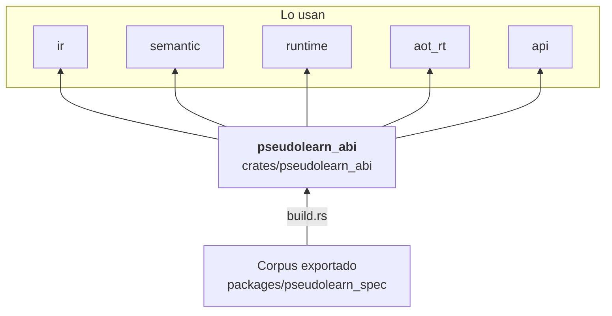

# pseudolearn_abi

Disposición binaria compartida de los valores de ejecución: palabra de 64 bits, asa de 32 bits, cabecera común de dos
palabras, marco de control, centinelas de «ausente» y la forma de cada familia de objetos (cadenas, arreglos, registros,
variantes, diccionarios, cierres, canales, JSON, bytes, capacidades, HTTP, fecha y hora). Todo el motor interpreta la
memoria con estas mismas definiciones. También genera, desde el corpus, la tabla de operaciones de efecto.

**No hace:** reservar ni recolectar memoria, ejecutar instrucciones ni atender efectos del anfitrión: solo declara
formas, desplazamientos y etiquetas.

## Dónde encaja

## Arquitectura

Sin dependencias internas; la única externa es `serde_json`, que usa `build.rs`. `build.rs` lee
`pseudolearn_spec/specifications/export.json` y emite `effect_operations.rs` en `OUT_DIR`, incluido desde
`effect_operation.rs`.

| Grupo            | Módulos                                                                                                                                   | Responsabilidad                                                                     |
|------------------|-------------------------------------------------------------------------------------------------------------------------------------------|-------------------------------------------------------------------------------------|
| Valores base     | `word`, `handle`, `sentinel`                                                                                                              | `Word`, `Handle` (el cero es «ausente») y los bits de ausencia                      |
| Cabecera y marco | `header`, `frame`                                                                                                                         | `CommonHeader`, máscaras de estado y `ControlFrame`                                 |
| Datos            | `string_layout`, `array_layout`, `object_layout`, `record_layout`, `variant_layout`, `dictionary_layout`, `vector_layout`, `bytes_layout` | Forma y desplazamientos de cada familia de objetos del montón                       |
| Control          | `closure_layout`, `continuation_layout`, `task_layout`, `channel_layout`                                                                  | Cierres, continuaciones, tareas y canales                                           |
| Frontera         | `capability_layout`, `io_error_layout`, `http_layout`, `date_time_layout`, `json_layout`, `collection_command`, `effect_operation`        | Capacidades, códigos de error de E/S, prefijos de red, JSON y operaciones de efecto |

## Reglas que conviene saber

- Es base del motor: `may_import` vacío en `architecture.yaml`; nada interno puede ser dependencia suya.
- Sin `unsafe`.
- Lo comparten el runtime, la VM, la línea temporal y el backend nativo; una disposición nueva se declara aquí y los
  consumidores la importan, no la redefinen.
- La tabla de operaciones de efecto sale de `build.rs`; no se edita a mano.

## Comandos útiles

| Para qué              | Comando                         |
|-----------------------|---------------------------------|
| Tests del crate       | `cargo test -p pseudolearn_abi` |
| Verificación completa | `cargo xtask verify`            |

Se ejecutan desde `packages/pseudolearn_engine`. La compilación necesita el corpus exportado en
`packages/pseudolearn_spec/specifications/export.json`, que `cargo xtask verify` regenera.
