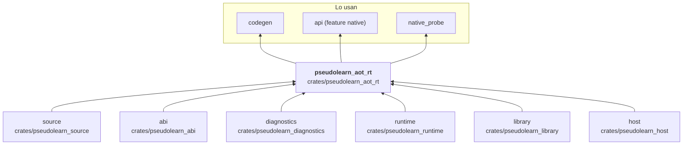

# pseudolearn_aot_rt

Runtime que acompaña al código nativo generado por `codegen`: expone la frontera `extern "C"` con la que el
ejecutable pide memoria, texto, matemática, aleatoriedad, entrada y salida, tareas, canales y efectos, y es dueño del
estado de ejecución (`AotSession`, `AotEngine`, contexto, raíces, fallos). Se enlaza como biblioteca estática en el
ejecutable final, lee sus metadatos incrustados, interpreta los argumentos del proceso y traduce el resultado a un
código de salida.

**No hace:** generar código (eso es `codegen`), analizar el programa ni observar la ejecución paso a paso.

## Dónde encaja

## Arquitectura

Importa `source`, `abi`, `diagnostics`, `runtime`, `library` y `host`; las externas son `serde` y `serde_json`. Los
archivos se agrupan por dominio.

| Grupo           | Archivos                                                                                           | Responsabilidad                                                                                         |
|-----------------|----------------------------------------------------------------------------------------------------|---------------------------------------------------------------------------------------------------------|
| Entrada         | `entry`, `process`, `process_options`, `metadata`, `metadata_codec`                                | `pseudolearn_aot_main`, opciones (`--semilla`, `--effects-in`, `--effects-out`) y metadatos incrustados |
| Estado          | `session`, `engine`, `context`, `config`, `guard`                                                  | `AotSession`, `AotEngine`, `AotConfig` y la conversión de punteros                                      |
| Memoria y datos | `memory`, `access`, `cells`, `cell_frames`, `collections`, `text`, `snapshot`, `inline_allocation` | Asignación, acceso a campos y elementos, celdas, texto y colecciones                                    |
| Numérico        | `math`, `random`, `format`, `quoted_text`, `input`, `output`                                       | Matemática, aleatoriedad sembrada, formato y E/S                                                        |
| Tareas          | `task_*`                                                                                           | Planificador, canales, bloqueo, interbloqueo y aterrizaje                                               |
| Efectos         | `effect*`, `physical_provider`                                                                     | `EffectChannel`, `AotHostProvider` y el proveedor físico sobre `host`                                   |
| Fallos          | `fault`, `trap`                                                                                    | `FaultRecord`, `render_fault` y `rt_aot_fault`                                                          |

### Invariantes de `unsafe`

| Función        | Invariante                                                                                                                                                                                   | Garantía                                                                                                                                     |
|----------------|----------------------------------------------------------------------------------------------------------------------------------------------------------------------------------------------|----------------------------------------------------------------------------------------------------------------------------------------------|
| `open_entry`   | El puntero de contexto es nulo o apunta a un `AotRuntimeContext` vivo creado por `AotSession`, sin otra referencia activa; `engine_state` es nulo o apunta al `AotEngine` de la misma sesión | Convierte ambos en referencias exclusivas solo si no son nulos; si alguno lo es, no se toca memoria y la entrada devuelve el estado de fallo |
| `borrow_slice` | Con `count > 0`, el puntero es nulo o apunta a `count` elementos inicializados que no se modifican durante la llamada                                                                        | Con `count == 0` devuelve el segmento vacío sin leer; con puntero nulo devuelve `None`; en otro caso construye el segmento de solo lectura   |

## Reglas que conviene saber

- Es uno de los tres únicos crates con `unsafe` (`unsafe_allowed`); el `unsafe` vive en `guard.rs` y cada función tiene
  su fila en la tabla de arriba.
- Dos características, ambas desactivadas por omisión: `test-host` y `telemetry`, que reenvían a las de `runtime`.
- `architecture.yaml` prohíbe `aot_rt` en el grafo de `api` y `wasm` para `wasm32`; solo entra por la característica
  `native` de `api`.
- Códigos de salida del proceso: `0` completado, `3` fallo del programa, `4` límite alcanzado, `5` fallo interno u
  opciones inválidas, `6` fallo del canal de efectos (`EXIT_*` en `process.rs`).

## Comandos útiles

| Para qué                       | Comando                                                                                    |
|--------------------------------|--------------------------------------------------------------------------------------------|
| Tests del crate                | `cargo test -p pseudolearn_aot_rt`                                                         |
| Conformidad del backend nativo | `cargo run -p see_cli --bin see -- conform --subject aot` (en `packages/pseudolearn_spec`) |
| Verificación completa          | `cargo xtask verify`                                                                       |

Se ejecutan desde `packages/pseudolearn_engine`, salvo la conformidad.
