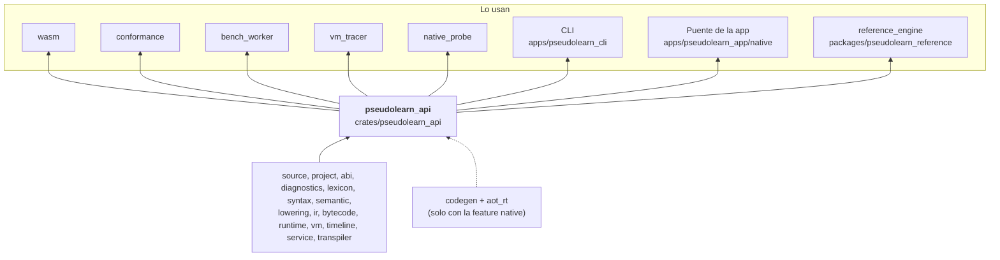
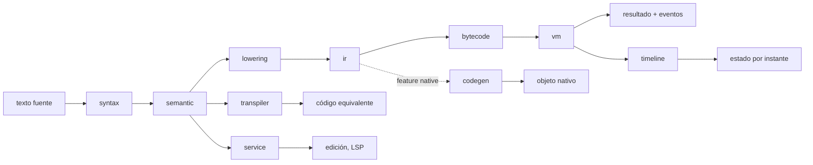

# pseudolearn_api

API pública única del motor. Une análisis, ejecución, observación, edición, traducción y compilación nativa detrás de
operaciones totales sobre recursos del núcleo: `ApiSession::call(operación, argumentos)` recibe y devuelve JSON, y las
funciones de Rust (`execute_analyze`, `execute_program`, `compile_source_to_ir`, `equivalent_code`…) dan acceso
directo. Negocia versión, edición (2027) y capacidades, y define el formato de intercambio y de eventos (JSON y
binario).

**No hace:** definir el comportamiento del lenguaje (eso es del corpus), dibujar interfaz ni conocer a sus consumidores:
la CLI, la app, el módulo Wasm y los verificadores solo ven esta superficie.

## Dónde encaja

## Arquitectura

Importa `source`, `project`, `abi`, `diagnostics`, `lexicon`, `syntax`, `semantic`, `lowering`, `ir`, `bytecode`,
`runtime`, `vm`, `timeline`, `service` y `transpiler`; con `native`, también `codegen` y `aot_rt`. Las externas son
`serde`, `serde_json` y `sha2`.

| Grupo                         | Archivos                                                                           | Responsabilidad                                                           |
|-------------------------------|------------------------------------------------------------------------------------|---------------------------------------------------------------------------|
| Sesión y negociación          | `resources`, `negotiation`, `versioning`, `errors`                                 | `ApiSession`, versión, edición y capacidades; `ApiError`                  |
| Análisis                      | `analyze`, `program_view*`, `inspection_*`                                         | Diagnósticos, tokens y vistas del programa                                |
| Ejecución y depuración        | `execution*`, `stepping`, `history_operations`, `state_*`, `debug_*`, `recording*` | Ejecución con límites, entrada, efectos, paso a paso y consulta de estado |
| Proyecto                      | `project_*`, `manifest_*`, `lock_*`                                                | `analyze_project`, `execute_project`, manifiesto y bloqueo                |
| Edición y traducción          | `service*`, `lsp_operations`, `equivalent_code`, `locale_operations`               | Autocompletado, ayuda, LSP y código equivalente                           |
| Formato de intercambio        | `wire`, `model`, `event_*`, `tape_wire`                                            | Serialización y códec de eventos (JSON y binario)                         |
| Nativo (feature `native`)     | `native_*`                                                                         | `build_native_object`, ejecución nativa de programas y proyectos          |
| Pruebas (feature `test-host`) | `fake_host`                                                                        | `FakeHostProvider`                                                        |

## Flujo principal

Flujo de datos, no dependencias.

## Reglas que conviene saber

- Es la única puerta pública del motor para análisis, ejecución y traducción; la CLI y el puente de la app consumen
  además `host` para atender efectos reales.
- Features: `default` vacío; `native` suma `codegen` y `aot_rt`; `test-host` activa el anfitrión en memoria de
  `runtime`. `architecture.yaml` prohíbe ambos y las dependencias de red nativa en el grafo `wasm32` de `api`.
- `negotiate` declara la edición 2027 y solo anuncia capacidades implementadas (`supported_capabilities`).
- `ApiSession::call` responde `{"value": …}` o un fallo tipado (`ApiError`); un pánico interno se captura y se
  informa como `internalFault`.
- Sin `unsafe`; la salida es determinista.

## Comandos útiles

| Para qué                               | Comando                                                                          |
|----------------------------------------|----------------------------------------------------------------------------------|
| Tests del crate                        | `cargo test -p pseudolearn_api`                                                  |
| Conformidad de análisis (desde `spec`) | `cargo run -p see_cli --bin see -- conform --subject engine --operation analyze` |
| Verificación completa                  | `cargo xtask verify`                                                             |

Se ejecutan desde `packages/pseudolearn_engine`, salvo la conformidad (`packages/pseudolearn_spec`).
