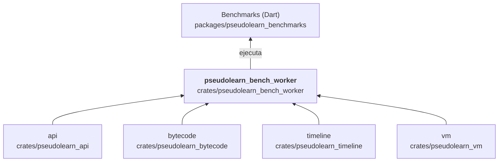

# pseudolearn_bench_worker

Binario de medición del motor: ejecuta cargas de trabajo sobre la API pública, la VM, la línea temporal y el backend
nativo, y escribe muestras crudas y resúmenes en JSON. Lo invocan las herramientas de `pseudolearn_benchmarks` y las
campañas del propio motor. Un mismo binario reúne todas las mediciones y elige la que corresponde por el primer
argumento.

**No hace:** ser una capa del producto ni un sujeto de conformidad; tampoco decide si una medición cumple un umbral:
solo recoge y resume.

## Dónde encaja

Aquí la flecha final es de uso: los scripts `collect_execution.dart`, `collect_frontend.dart` y
`create_bridge_campaign.dart` compilan y lanzan el binario; no hay dependencia de manifiestos.

## Arquitectura

Importa `api`, `bytecode`, `timeline` y `vm`; la externa es `serde_json`. Es un binario con subcomandos, declarados en
`main.rs`.

| Subcomando                                          | Mide                                                       |
|-----------------------------------------------------|------------------------------------------------------------|
| `execute`, `bridge`, `frontend`, `frontend-profile` | Ejecución en proceso, puente y análisis                    |
| `e06`, `e06-rss`                                    | Línea temporal (observador, deltas, retención, memoria)    |
| `robust`, `robust-child`                            | Robustez de las mediciones                                 |
| `aot`, `paired`, `paired-probe`, `paired-summary`   | Backend nativo frente a la referencia, en parejas          |
| `service`                                           | Herramientas de edición (autocompletado, ayuda, proyectos) |
| `pg-collect`, `pg-tape`, `pg-tasks`, `pg-http`      | Campañas por familia de cargas                             |
| `pg-summary`, `pg-http-summary`, `pg-verify`        | Resumen y verificación de campañas                         |

## Reglas que conviene saber

- Es herramienta (`tooling: true`): ningún crate de producto lo importa.
- Un subcomando desconocido o sin argumentos obligatorios termina con código de salida distinto de cero y un mensaje de
  uso.
- `paired` y `paired-probe` rechazan un directorio de salida que ya existe: cada ejecución usa un directorio nuevo.
- Sin `unsafe`.

## Comandos útiles

| Para qué                    | Comando                                                                          |
|-----------------------------|----------------------------------------------------------------------------------|
| Tests del crate             | `cargo test -p pseudolearn_bench_worker`                                         |
| Campaña pareada nativa      | `cargo run --release -p pseudolearn_bench_worker -- paired <directorio-nuevo>`   |
| Resumir una campaña pareada | `cargo run --release -p pseudolearn_bench_worker -- paired-summary <directorio>` |

Se ejecutan desde `packages/pseudolearn_engine`. Las mediciones deben hacerse con `--release`.
