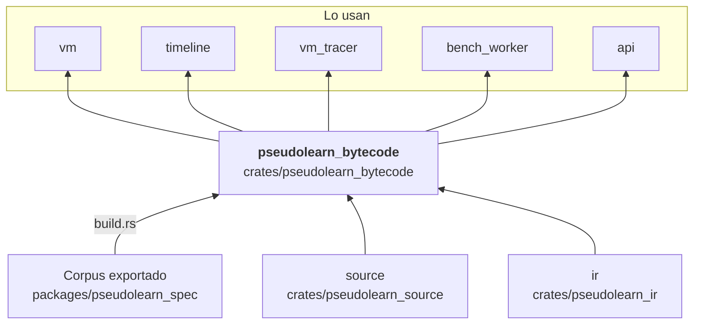

# pseudolearn_bytecode

Compila la representación intermedia verificada a bytecode: asigna registros por clase (escalar y referencia),
construye los depósitos de constantes, calcula los mapas de raíces del recolector, selecciona superinstrucciones
(`CompareBranch`, `FusedArithmetic`) y verifica el resultado antes de entregarlo como `VerifiedBytecode`. El catálogo de
opcodes se genera desde el corpus.

**No hace:** ejecutar bytecode (eso es `vm`) ni construir la RI (`lowering`): su entrada es una RI ya verificada, o su
texto canónico.

## Dónde encaja

## Arquitectura

Importa `ir` y `source`; la externa es `serde_json`. `build.rs` emite `generated_opcodes.rs` en `OUT_DIR`, incluido
desde
`lib.rs`.

| Pieza                                           | Responsabilidad                                                                                                   |
|-------------------------------------------------|-------------------------------------------------------------------------------------------------------------------|
| `compile`, `compile/*`                          | `compile_module`, `compile_text` (y variantes con superinstrucciones); registros, constantes, operandos y relleno |
| `model`                                         | `BytecodeModule`, `BytecodeFunction`, `Instruction`, `Register`, `VerifiedBytecode`                               |
| `verify*`, `class_verification`                 | Verificación de saltos, ventanas de operandos, clases de valor, relleno y mapas de raíces                         |
| `roots`, `root_liveness`, `collection_metadata` | Raíces del recolector y metadatos de colecciones                                                                  |
| `error`                                         | `BytecodeError` y `VerificationRule`                                                                              |

## Reglas que conviene saber

- Solo importa `ir` y `source`; el bytecode no conoce el runtime ni la VM.
- Antes de compilar se verifica la RI (`verify_module`); el bytecode resultante se verifica con las reglas de
  `VerificationRule` (`OperandWindow`, `FunctionJump`, `ValueClass`, `ReturnPoint`, `SuperInstruction`, `Padding`,
  `RootMap`).
- Los opcodes son código generado desde el corpus; no se editan a mano.
- Sin `unsafe`; la salida es determinista.

## Comandos útiles

| Para qué              | Comando                              |
|-----------------------|--------------------------------------|
| Tests del crate       | `cargo test -p pseudolearn_bytecode` |
| Verificación completa | `cargo xtask verify`                 |

Se ejecutan desde `packages/pseudolearn_engine`; la compilación necesita el corpus exportado.
