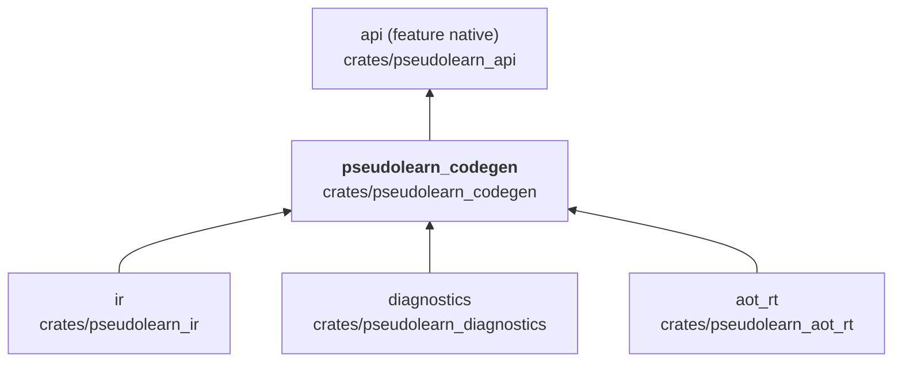
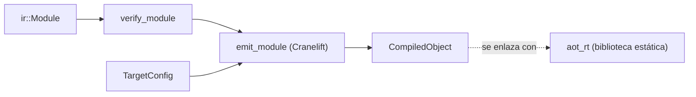

# pseudolearn_codegen

Backend nativo: traduce una RI verificada a un objeto de máquina con Cranelift para el destino elegido (`TargetConfig`),
incluidos los símbolos de entrada, los metadatos incrustados, las tablas de fallos y clases, la pila
sombra de raíces, el desenrollado de tareas y el arranque en Windows. El objeto invoca las funciones `rt_aot_*` de
`pseudolearn_aot_rt`.

**No hace:** enlazar el ejecutable, ejecutarlo ni definir la semántica de las operaciones: lo que cada llamada a runtime
hace está en `aot_rt` y en `runtime`.

## Dónde encaja

## Arquitectura

Importa `ir`, `diagnostics` y `aot_rt`; las externas son `cranelift-codegen`, `cranelift-frontend`,
`cranelift-module`, `cranelift-object`, `target-lexicon` y `object`. Los archivos se agrupan por papel.

| Grupo             | Archivos                                                                                                            | Responsabilidad                                                                                                         |
|-------------------|---------------------------------------------------------------------------------------------------------------------|-------------------------------------------------------------------------------------------------------------------------|
| Puntos de entrada | `lib`, `object_emitter`, `target`, `entry_point`, `error`                                                           | `compile_module_to_object`, `compile_module_to_executable_object`, `compile_module_to_benchmark_object`, `TargetConfig` |
| Bajada a código   | `function_compiler`, `lowering`, `lower_*`, `instruction_dispatch`                                                  | Una pieza por familia de instrucciones de la RI                                                                         |
| Análisis previo   | `liveness`, `dominators`, `dominated_facts`, `block_*`, `defined_producers`                                         | Vida de valores, dominancia y orden de bloques                                                                          |
| Memoria y raíces  | `shadow_stack`, `borrowed_roots`, `lexical_roots`, `memory_regions`, `inline_memory`, `object_*`, `array_fast_path` | Asignación en línea, raíces y accesos                                                                                   |
| Tareas            | `task_dispatch`, `task_unwinding`                                                                                   | Suspensión y desenrollado de tareas                                                                                     |
| ABI y destino     | `abi_signatures`, `context_layout`, `type_mapping`, `windows_startup`                                               | Símbolos, firmas, disposición del contexto y arranque por plataforma                                                    |

## Flujo principal

Flujo de datos, no dependencias.

## Reglas que conviene saber

- Solo importa `ir`, `diagnostics` y `aot_rt`; `architecture.yaml` lo prohíbe en el grafo `wasm32` de `api` y `wasm`
  (junto con `cranelift-*`).
- Rechaza una RI que no pase `verify_module` (`CodegenError::InvalidModule`) antes de emitir.
- `compile_module_to_benchmark_object` emite el objeto sin punto de entrada que `api` usa para las mediciones nativas.
- Sin `unsafe` (`unsafe_allowed: false`); la salida es determinista.

## Comandos útiles

| Para qué                       | Comando                                                                                    |
|--------------------------------|--------------------------------------------------------------------------------------------|
| Tests del crate                | `cargo test -p pseudolearn_codegen`                                                        |
| Conformidad del backend nativo | `cargo run -p see_cli --bin see -- conform --subject aot` (en `packages/pseudolearn_spec`) |
| Verificación completa          | `cargo xtask verify`                                                                       |

Se ejecutan desde `packages/pseudolearn_engine`, salvo la conformidad.
