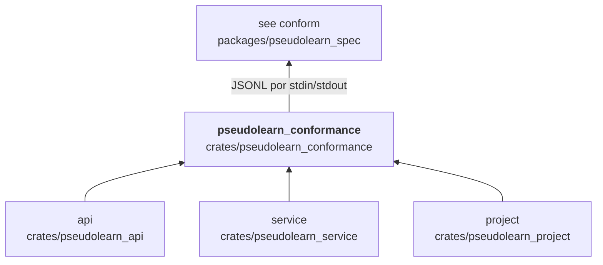
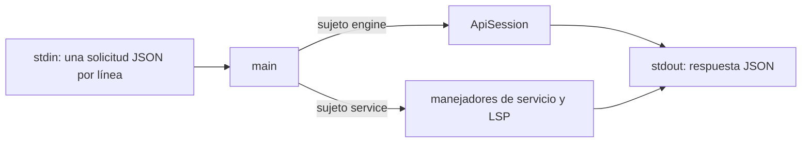

# pseudolearn_conformance

Adaptador del motor al protocolo de conformidad `see-protocol/1`: el binario `conformance_adapter` lee solicitudes
JSON por la entrada estándar, una por línea, las resuelve con la API pública (análisis, RI, ejecución) o con el
servicio de lenguaje (completado, edición, LSP, espacio de trabajo) y responde en JSON por la salida estándar. Anuncia
solo las operaciones que implementa.

**No hace:** decidir qué se espera de cada caso (lo hace el corpus de `pseudolearn_spec`) ni importar internos del
motor: solo usa `pseudolearn_api`, `pseudolearn_service` y `pseudolearn_project`.

## Dónde encaja

La flecha final es de protocolo: `pseudolearn_spec` ejecuta el adaptador como proceso; no es una dependencia de
manifiestos.

## Arquitectura

Importa `api`, `service` y `project`; las externas son `serde` y `serde_json`. Es un binario sin biblioteca.

| Módulo                                                                              | Responsabilidad                                                 |
|-------------------------------------------------------------------------------------|-----------------------------------------------------------------|
| `main`                                                                              | Lee el JSONL, elige el sujeto (`engine` o `service`) y despacha |
| `service_handler`, `service_request`, `service_queries`                             | Consultas del servicio de lenguaje: completado, ayuda, símbolos |
| `service_edits`, `service_edit_request`, `service_completion_edits`, `service_text` | Ediciones y proyecciones de texto                               |
| `service_workspace`                                                                 | Espacio de trabajo de proyecto                                  |
| `lsp_handler`                                                                       | Mensajes LSP                                                    |

## Flujo principal

Flujo de datos, no dependencias.

## Reglas que conviene saber

- Solo puede importar `api`, `service` y `project`; nunca los internos del motor.
- Una línea vacía se ignora y una que no es JSON válido se omite sin respuesta.
- Las respuestas usan `PROTOCOL_VERSION`, `ENGINE_VERSION` y las capacidades de `pseudolearn_api`.
- Sin `unsafe`.

## Comandos útiles

| Para qué                                | Comando                                                                          |
|-----------------------------------------|----------------------------------------------------------------------------------|
| Tests del crate                         | `cargo test -p pseudolearn_conformance`                                          |
| Conformidad de análisis (desde `spec`)  | `cargo run -p see_cli --bin see -- conform --subject engine --operation analyze` |
| Conformidad del servicio (desde `spec`) | `cargo run -p see_cli --bin see -- conform --subject service`                    |

Los tests se ejecutan desde `packages/pseudolearn_engine`; la conformidad, desde `packages/pseudolearn_spec`. La
conformidad compara con evidencia local de `results/`, que no se versiona: si una especificación cambió, la evidencia
de propiedades anterior queda con otro hash y la conformidad termina con `SEE-STALE`; se regenera con
`see conform --subject engine --operation properties`.
