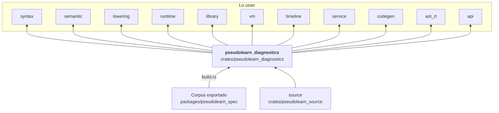

# pseudolearn_diagnostics

Catálogo de diagnósticos del motor: el código estable de cada error o aviso (`DiagnosticCode`), su clase y severidad,
los argumentos tipados que lleva, la validación de esos argumentos, el ordenamiento determinista y la
presentación de un mensaje en un idioma. El catálogo se genera desde el corpus.

**No hace:** detectar errores (los producen el parser, el análisis y la ejecución) ni decidir cuándo se muestran.

## Dónde encaja

## Arquitectura

Solo importa `pseudolearn_source`; la externa es `serde_json`. `build.rs` lee `export.json` y, con los generadores de
`codegen/`, emite `generated_diagnostics.rs` en `OUT_DIR` (incluido desde `code.rs`).

| Módulo       | Pieza                                                      | Responsabilidad                                                                                                                          |
|--------------|------------------------------------------------------------|------------------------------------------------------------------------------------------------------------------------------------------|
| `code`       | `DiagnosticCode` (generado)                                | Códigos, plantillas por idioma y política de cada diagnóstico                                                                            |
| `diagnostic` | `Diagnostic`, `DiagnosticClass`, `DiagnosticSeverity`      | Un diagnóstico con tramo, argumentos y tramos relacionados; clases `Lexical`, `Syntactic`, `Semantic`, `Resource`, `Runtime`, `Internal` |
| `arguments`  | `DiagnosticArgument`, `ArgumentKind`, `validate_arguments` | Tipos de argumento y su forma en el formato de intercambio                                                                               |
| `render`     | `render`, `sort_diagnostics`, `sort_diagnostics_with`      | Texto en un idioma y orden estable por fuente, clase, tramo y código                                                                     |

## Reglas que conviene saber

- Solo puede importar `pseudolearn_source`; casi todos los crates de análisis y ejecución dependen de este.
- El catálogo es código generado en `OUT_DIR`; para cambiarlo se edita el corpus o los generadores de `codegen/`.
- Sin `unsafe`.
- El ordenamiento es determinista: la salida de `diagnostics` es parte del resultado reproducible del motor
  (`deterministic_output_crates` en `architecture.yaml`).

## Comandos útiles

| Para qué              | Comando                                 |
|-----------------------|-----------------------------------------|
| Tests del crate       | `cargo test -p pseudolearn_diagnostics` |
| Verificación completa | `cargo xtask verify`                    |

Se ejecutan desde `packages/pseudolearn_engine`; la compilación necesita el corpus exportado.
