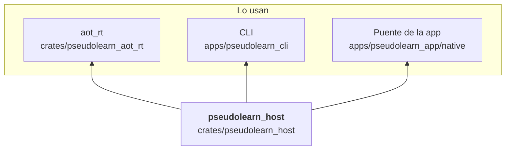
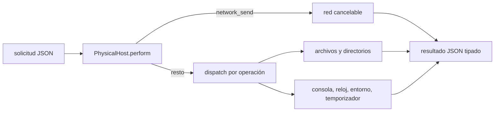

# pseudolearn_host

Anfitrión físico: atiende los efectos reales que un programa pide por el formato JSON de ejecución, es decir consola,
argumentos, reloj, zona horaria, variables de entorno, temporizadores, archivos y directorios (incluidos los
confinados con `cap-std`) y red HTTP/HTTPS con TLS. Cada solicitud devuelve un resultado JSON tipado; los fallos son
valores, no excepciones.

**No hace:** interpretar el lenguaje, validar capacidades ni llevar la agenda o la cinta de efectos (eso es del
runtime): solo ejecuta solicitudes ya identificadas.

## Dónde encaja

## Arquitectura

Sin dependencias internas. Las externas son las de transporte, serialización y sistema declaradas en
`architecture.yaml` (`cap-std`, `hyper`, `tokio`, `rustls`, `rustls-platform-verifier`, `jiff`, `getrandom`, entre
otras).

| Pieza                                                                                | Responsabilidad                                                                                |
|--------------------------------------------------------------------------------------|------------------------------------------------------------------------------------------------|
| `PhysicalHost`                                                                       | `perform` despacha una solicitud por su nombre de operación y cancela con un indicador atómico |
| `HostWorker`                                                                         | Hilo propio con cola acotada a 32 solicitudes; `submit` envía y `poll` recoge respuestas       |
| `physical_files`, `physical_directory_ops`, `physical_file_append`, `physical_paths` | Archivos y directorios, con rutas ambientales o confinadas                                     |
| `physical_network*`, `NetworkPolicy`, `TlsConfiguration`                             | Resolución, transporte HTTP/1, cuerpos y verificación TLS                                      |
| `download_to_file`                                                                   | Descarga a archivo con `DownloadRequest` y `DownloadError`                                     |
| `physical_console`, `physical_environment`, `physical_local_zone`                    | Consola, entorno por nombre y zona horaria del sistema                                         |
| `entropy_seed`                                                                       | Semilla de entropía del sistema                                                                |

## Flujo principal

Flujo de datos de una solicitud, no dependencias.

## Reglas que conviene saber

- Capa hoja: `may_import` vacío; no conoce al motor ni a sus tipos.
- Sin `unsafe`.
- Un error del sistema se convierte en un `HostError` con respuesta JSON tipada; `perform` no propaga fallos.
- Una vez activada la cancelación, toda operación responde `INTERRUPTED` y el temporizador la comprueba cada 5 ms.

## Comandos útiles

| Para qué              | Comando                                                         |
|-----------------------|-----------------------------------------------------------------|
| Tests del crate       | `cargo test -p pseudolearn_host`                                |
| Clippy del crate      | `cargo clippy -p pseudolearn_host --all-targets -- -D warnings` |
| Verificación completa | `cargo xtask verify`                                            |

Se ejecutan desde `packages/pseudolearn_engine`. Las pruebas de red usan loopback y certificados de
`tests/fixtures/tls`;
no necesitan Internet.
