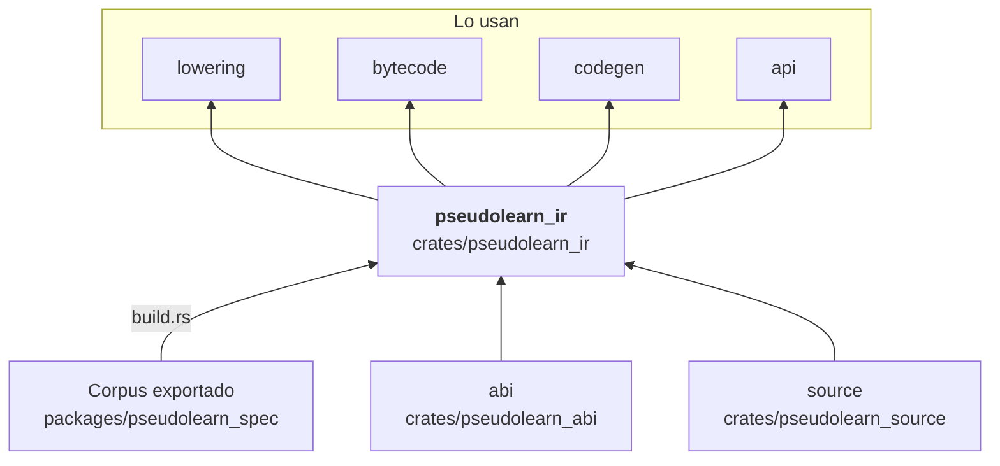

# pseudolearn_ir

Representación intermedia (RI) del motor: módulos de funciones con bloques e instrucciones tipadas, en columnas
indexadas por identificadores numéricos. Incluye el formato de texto canónico (analizador e impresor), el verificador
estructural y de tipos, el árbol de dominancia y la tabla de orígenes que enlaza cada instrucción con su fuente. El
catálogo de instrucciones se genera desde el corpus.

**No hace:** construir la RI desde el programa (eso es `lowering`), ejecutarla (`vm`) ni compilarla a nativo
(`codegen`).

## Dónde encaja

## Arquitectura

Importa `abi` y `source`; la externa es `serde_json`. `build.rs` emite `generated_instructions.rs` (enum
`Operation` y sus propiedades) en `OUT_DIR`, incluido desde `operation.rs`.

| Pieza                                               | Responsabilidad                                                        |
|-----------------------------------------------------|------------------------------------------------------------------------|
| `model`, `columns`, `identities`, `operand`, `span` | `Module`, `Function`, `Block`, `InstructionColumns`, `Operand` e ids   |
| `operation`                                         | `Operation` (generado) con resultado, terminador, trampa y observación |
| `types`                                             | `IrType` y `ValueClass`                                                |
| `lexer`, `parser`, `printer`                        | `parse_module` y `print_canonical`: texto canónico ↔ módulo            |
| `verifier*`, `type_checker*`                        | `verify_module`: operandos, destinos, llamadas, tipos y suspensión     |
| `dominance`                                         | `DominatorTree`                                                        |
| `collection_types`                                  | Reconocimiento de las colecciones sobre clases de la RI                |

## Reglas que conviene saber

- Solo importa `abi` y `source`; la RI no conoce el HIR ni la VM.
- El catálogo de operaciones es código generado desde el corpus; no se edita a mano.
- `bytecode` verifica la RI con `verify_module` antes de compilarla y `api` la verifica al cargar IR textual; el
  verificador devuelve un mensaje (`Result<(), &'static str>`), no lanza excepciones.
- Sin `unsafe`; la salida es determinista (`deterministic_output_crates`).

## Comandos útiles

| Para qué              | Comando                        |
|-----------------------|--------------------------------|
| Tests del crate       | `cargo test -p pseudolearn_ir` |
| Verificación completa | `cargo xtask verify`           |

Se ejecutan desde `packages/pseudolearn_engine`; la compilación necesita el corpus exportado.
