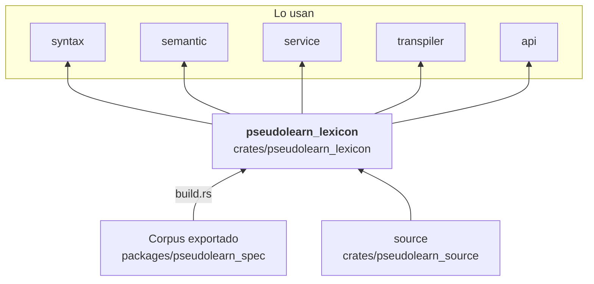

# pseudolearn_lexicon

Vocabulario del lenguaje en sus dos perfiles (`Profile::Spanish` y `Profile::English`): palabras clave, funciones
integradas, palabras reservadas, detección del perfil a partir de la palabra de apertura de un archivo, plegado de
texto para comparar, y la firma de cada integrada. Las tablas se generan desde el corpus con perfect hash.

**No hace:** reconocer sintaxis ni tipos de expresiones: devuelve a qué palabra corresponde un texto en un perfil.

## Dónde encaja

## Arquitectura

Solo importa `pseudolearn_source`; la externa es `serde_json`. `build.rs` y `codegen/` (`perfect_hash`,
`function_metadata`) emiten `generated_lexicon.rs` en `OUT_DIR`, incluido desde `keywords.rs`.

| Módulo       | Pieza                                                                                | Responsabilidad                                                |
|--------------|--------------------------------------------------------------------------------------|----------------------------------------------------------------|
| `keywords`   | `find_keyword`, `find_builtin`, `is_reserved`, `detect_opener`, `is_compound_prefix` | Búsqueda de palabras por perfil (`KeywordKind`, `BuiltinKind`) |
| `profile`    | `Profile`, `detect_opening_profile`, `fold_text`                                     | Perfil `es`/`en`, detección por apertura y plegado de texto    |
| `signatures` | `BuiltinSignature`, `signature_for_builtin`                                          | Aridad y firma de cada integrada                               |

## Reglas que conviene saber

- Solo puede importar `pseudolearn_source`.
- Las tablas son código generado desde el corpus; no se editan a mano.
- Sin `unsafe`.

## Comandos útiles

| Para qué              | Comando                             |
|-----------------------|-------------------------------------|
| Tests del crate       | `cargo test -p pseudolearn_lexicon` |
| Verificación completa | `cargo xtask verify`                |

Se ejecutan desde `packages/pseudolearn_engine`; la compilación necesita el corpus exportado.
