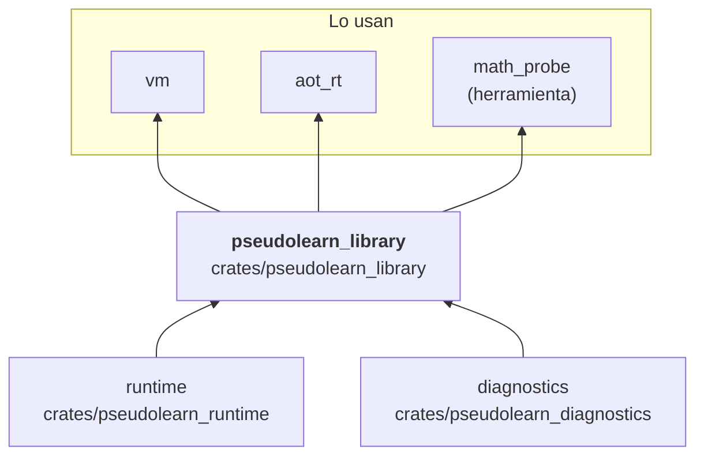

# pseudolearn_library

Operaciones puras de la biblioteca estándar sobre valores del runtime: texto (búsqueda, partición, relleno,
mayúsculas, reemplazo), bytes, JSON (lectura, construcción y consulta), fecha y hora (construcción, formato y lectura),
conversiones, formato decimal, redondeo y matemática (raíz, funciones trascendentes con aritmética de precisión propia).
Cada operación devuelve un `LibraryError` con dominio explícito para que quien la llama atribuya el fallo.

**No hace:** efectos del anfitrión (consola, archivos, red), ejecutar bytecode ni conocer el lenguaje fuente.

## Dónde encaja

## Arquitectura

Importa `runtime` y `diagnostics`; las externas son `serde` y `serde_json`.

| Grupo        | Archivos                                                                         | Responsabilidad                                          |
|--------------|----------------------------------------------------------------------------------|----------------------------------------------------------|
| Texto        | `text_*`, `quoted_text`, `format`, `decimal*`                                    | Consultas, partición, relleno, reemplazo y formato       |
| Bytes y JSON | `bytes_operations`, `json_*`                                                     | Operaciones de bytes y documentos JSON                   |
| Fecha y hora | `civil_calendar`, `date_time_*`                                                  | Construcción, formato y lectura                          |
| Numérico     | `math`, `rounding`, `conversion`, `precision/`, `transcendental/`                | Redondeo, conversiones y funciones trascendentes         |
| Despacho     | `local_operations`, `local_operation_dispatch`, `collections`, `http_operations` | `local_operation` y `collection_operation` por solicitud |

## Reglas que conviene saber

- Solo importa `runtime` y `diagnostics`; no depende de `host`.
- Las operaciones son funciones puras sobre valores del runtime, sin acceso al anfitrión; las funciones trascendentes
  tienen implementación propia en `transcendental/`.
- Sin `unsafe`; la salida es determinista.

## Comandos útiles

| Para qué              | Comando                             |
|-----------------------|-------------------------------------|
| Tests del crate       | `cargo test -p pseudolearn_library` |
| Verificación completa | `cargo xtask verify`                |

Se ejecutan desde `packages/pseudolearn_engine`.
