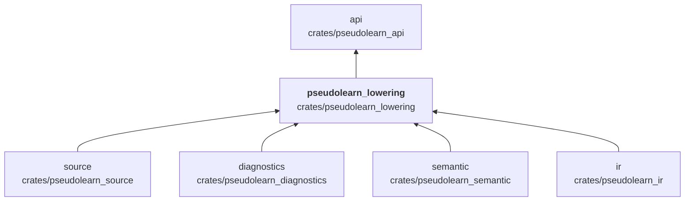
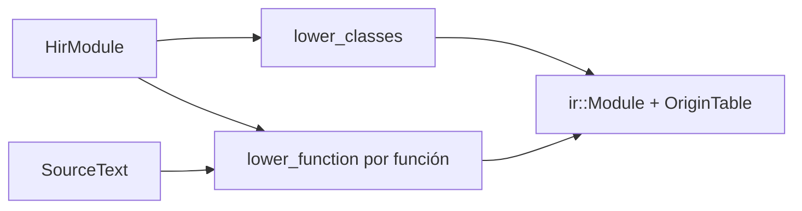

# pseudolearn_lowering

Baja el modelo semántico (`HirModule`) a la representación intermedia: construye las clases y las funciones de la RI
instrucción por instrucción, con sus bloques, sus puntos de suspensión y su tabla de orígenes hacia la fuente. Cubre
sentencias, expresiones, registros, variantes, colecciones, cierres, tareas y canales, efectos y la limpieza al salir
de un ámbito.

**No hace:** analizar ni tipar el programa (eso es `semantic`), verificar la RI resultante (`ir`) ni ejecutarla.

## Dónde encaja

## Arquitectura

Importa `source`, `semantic`, `ir` y `diagnostics`; no tiene dependencias externas. Los archivos se agrupan por
prefijo.

| Familia de archivos                                                 | Responsabilidad                                                                             |
|---------------------------------------------------------------------|---------------------------------------------------------------------------------------------|
| `lib`, `functions`, `classes`, `builder`, `environment`             | `lower_module`, `lower_project`, `lower_function`, `FunctionBuilder` y entorno de variables |
| `statements*`, `loop_exits`, `cleanup_edges`                        | Una pieza por sentencia y la limpieza al salir                                              |
| `expressions*`, `places`, `expression_values`                       | Expresiones, operadores y lugares asignables                                                |
| `records*`, `variant_*`, `collections`, `collection_*`              | Registros, variantes y colecciones                                                          |
| `task_*`, `channel_operations`, `suspension_points`, `yield_points` | Tareas, canales y puntos de suspensión                                                      |
| `effect_*`, `closure_values`, `indirect_calls`                      | Efectos, cierres y llamadas indirectas                                                      |
| `spans`, `lexical_origins`                                          | Tabla de orígenes enlazada con la fuente                                                    |

## Flujo principal

Flujo de datos, no dependencias.

## Reglas que conviene saber

- Solo importa `source`, `semantic`, `ir` y `diagnostics`; no conoce la VM ni el backend nativo.
- Falla con `LoweringError` (descripción en texto) si una función no tiene fuente asociada; no lanza excepciones.
- Sin `unsafe`; la salida es determinista.

## Comandos útiles

| Para qué              | Comando                              |
|-----------------------|--------------------------------------|
| Tests del crate       | `cargo test -p pseudolearn_lowering` |
| Verificación completa | `cargo xtask verify`                 |

Se ejecutan desde `packages/pseudolearn_engine`.
