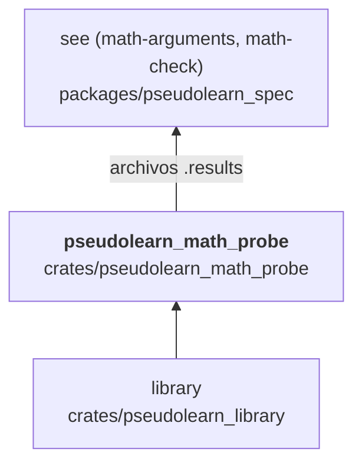

# pseudolearn_math_probe

Herramienta que evalúa la matemática de `pseudolearn_library` sobre los argumentos que genera el sistema de
especificaciones: lee `<función>.arguments` (bits hexadecimales de binario64) y escribe `<función>.results` con los
bits del resultado o `nonFiniteRealResult`. Existe para contrastar la implementación contra un oráculo independiente.

**No hace:** decidir valores esperados, importar el oráculo ni la VM, ni distribuirse con el producto.

## Dónde encaja

Aquí las flechas indican el intercambio de datos con `pseudolearn_spec`, que genera los argumentos y juzga los
resultados; no hay dependencia de crates entre ambos miembros.

## Flujo principal

## Reglas que conviene saber

- Es de la capa `tooling` y solo importa `pseudolearn_library`; ningún crate de producto lo usa.
- Cada función se identifica por el nombre del archivo: `exp`, `ln`, `sin`, `cos`, `atan`, `pow`, `tan`, `asin`, `acos`,
  `atan2`, `log2` y `log10`.
- Sin `unsafe`.

## Comandos útiles

| Para qué                  | Comando                                                                                                             |
|---------------------------|---------------------------------------------------------------------------------------------------------------------|
| Generar argumentos        | `cargo run --release -p see_cli --bin see -- math-arguments --output <directorio>` (en `packages/pseudolearn_spec`) |
| Evaluar con la biblioteca | `cargo run --release -p pseudolearn_math_probe --bin math-probe -- <directorio>` (en `packages/pseudolearn_engine`) |
| Contrastar los resultados | `cargo run --release -p see_cli --bin see -- math-check --input <directorio>` (en `packages/pseudolearn_spec`)      |
| Tests del crate           | `cargo test -p pseudolearn_math_probe`                                                                              |

Usar un directorio de trabajo fuera del repositorio: los archivos son datos regenerables y no se versionan.
