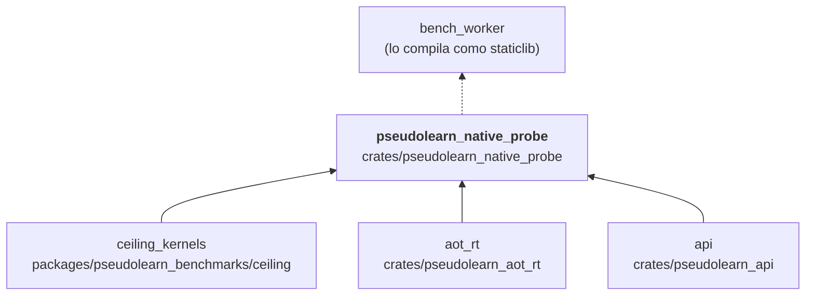

# pseudolearn_native_probe

Sonda de medición que ejecuta, dentro de un mismo proceso, el objeto nativo compilado por `codegen` y el algoritmo de
referencia de `ceiling_kernels`, y devuelve las parejas de muestras como JSON. Expone una única función `extern "C"`
(`pseudolearn_native_pair`) que el lanzador en C enlaza con el objeto.

**No hace:** formar parte del producto, certificar conformidad del lenguaje ni modificar los algoritmos de
`ceiling_kernels`.

## Dónde encaja

La flecha punteada es de uso en tiempo de ejecución: `bench_worker` lo compila con `cargo rustc --crate-type staticlib`
(`src/paired/storage.rs`); no es una dependencia de `Cargo.toml`.

## Arquitectura

Importa `aot_rt`, `api` y `ceiling_kernels` (declarado en `permitted_path_dependencies`), además de `serde` y
`serde_json`.

| Módulo        | Responsabilidad                                                     |
|---------------|---------------------------------------------------------------------|
| `bridge`      | Frontera `extern "C"`; recibe el objeto y la configuración en bytes |
| `measurement` | `Configuration` y `measure`: ejecuta las parejas de cada iteración  |
| `execution`   | Prepara las sesiones de cada variante                               |
| `output`      | Captura la salida en memoria                                        |

### Invariantes de `unsafe`

| Función               | Invariante                                                                                | Garantía                                                         |
|-----------------------|-------------------------------------------------------------------------------------------|------------------------------------------------------------------|
| `configuration_bytes` | El puntero es nulo o apunta a `count` bytes inicializados e inmutables durante la llamada | Rechaza nulo o tamaño cero y construye una vista de solo lectura |

## Reglas que conviene saber

- Es herramienta (`tooling: true`) y una de las tres únicas con `unsafe` permitido (`unsafe_allowed`); el resto del
  crate es Rust seguro.
- Un documento de configuración inválido termina con código distinto de cero y un mensaje en `stderr`.
- La característica `telemetry` (desactivada por omisión) activa `pseudolearn_aot_rt/telemetry`.

## Comandos útiles

| Para qué               | Comando                                                                        |
|------------------------|--------------------------------------------------------------------------------|
| Tests del crate        | `cargo test -p pseudolearn_native_probe`                                       |
| Campaña pareada nativa | `cargo run --release -p pseudolearn_bench_worker -- paired <directorio-nuevo>` |

Se ejecutan desde `packages/pseudolearn_engine`.
