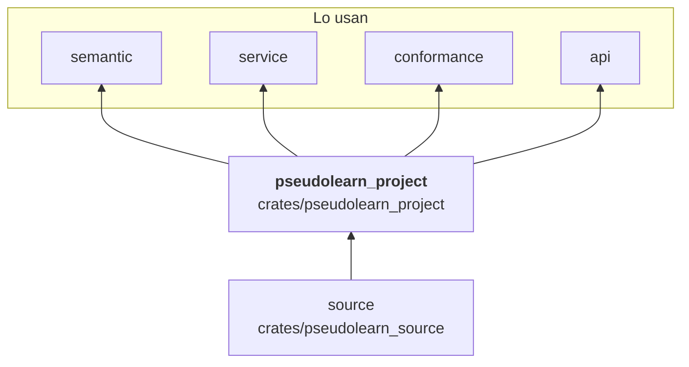
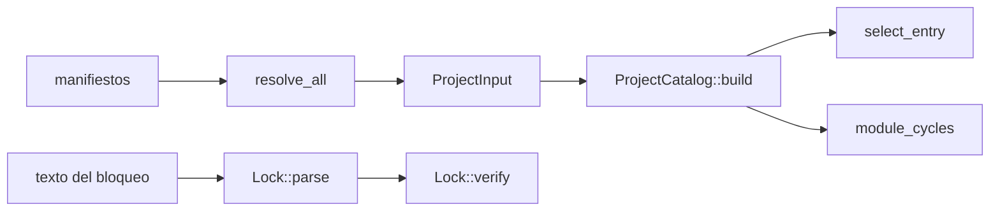

# pseudolearn_project

Modelo de proyecto multi-archivo: lee y valida el manifiesto y el archivo de bloqueo, construye el catálogo de
paquetes y módulos con sus dependencias, detecta ciclos entre módulos y paquetes, elige el punto de entrada, resuelve el
perfil de vocabulario y calcula las autoridades (límites y permisos del anfitrión) y los directorios confinados con
derechos atenuables.

**No hace:** analizar el contenido de los módulos, leer el disco ni ejecutar nada: recibe archivos ya cargados
(`ProjectInput`) y devuelve valores o errores tipados.

## Dónde encaja

## Arquitectura

Solo importa `pseudolearn_source`; no tiene dependencias externas.

| Pieza                                                            | Responsabilidad                                                        |
|------------------------------------------------------------------|------------------------------------------------------------------------|
| `manifest_*` (`parser`, `schema`, `checker`, `resolution`)       | `Manifest`, `resolve_all` y errores localizados (`ManifestError`)      |
| `lock_*`                                                         | `Lock`, análisis, normalización canónica y verificación (`LockError`)  |
| `module_catalog`, `project_model`                                | `ProjectCatalog`, `Package`, `Module` y la entrada `ProjectInput`      |
| `dependency_graph`, `graph_*`, `module_cycles`, `package_cycles` | Ciclos entre módulos y entre paquetes (`find_cycles`, `module_cycles`) |
| `entry_selection`, `module_names`                                | `select_entry`, nombres calificados y entradas declaradas              |
| `profile_resolution`                                             | `resolve_profile` entre manifiesto, excepciones y apertura del archivo |
| `logical_path`                                                   | Rutas lógicas normalizadas (`normalize_logical_path`)                  |
| `authority`                                                      | `LimitAuthority` y `HostGrants`                                        |
| `capability_fs`                                                  | `ConfinedDirectory` y `FileRights` con `attenuate` y `resolve_subpath` |

## Flujo principal

Flujo de datos, no dependencias.

El bloqueo se analiza y se compara con el bloqueo observado de forma independiente al catálogo.

## Reglas que conviene saber

- Solo puede importar `pseudolearn_source`; las demás capas del motor quedan por encima.
- Sin `unsafe` ni dependencias externas.
- El análisis de manifiesto y de bloqueo es total: devuelve listas de errores con ubicación, nunca excepciones.
- Los directorios confinados solo pueden atenuar derechos al derivar un subdirectorio.

## Comandos útiles

| Para qué              | Comando                             |
|-----------------------|-------------------------------------|
| Tests del crate       | `cargo test -p pseudolearn_project` |
| Verificación completa | `cargo xtask verify`                |

Se ejecutan desde `packages/pseudolearn_engine`.
