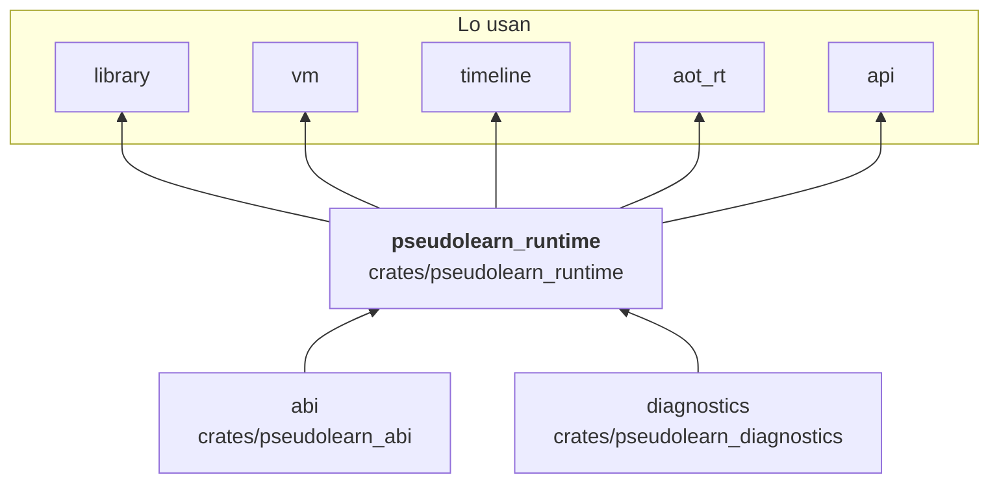

# pseudolearn_runtime

Servicios de ejecución compartidos por la VM, el backend nativo y la línea temporal: el montón de palabras con
recolección (`Heap`, `MemoryOptions`), objetos, arreglos, texto, vectores, diccionarios, bytes, JSON y aritmética
comprobada; la agenda de tareas, canales y alcances; la sesión de efectos de anfitrión con su validación, límites de
red y política de secretos; y la cinta de efectos que permite grabar y reproducir una ejecución.

**No hace:** ejecutar bytecode, conocer el lenguaje fuente ni atender efectos reales: define la interfaz del anfitrión
(`HostEffectProvider`) y quien lo implementa vive fuera (`host`, o el anfitrión en memoria de pruebas).
 
## Dónde encaja

## Arquitectura

Importa `abi` y `diagnostics`; las externas son `serde`, `serde_json`, `sha2` y `hmac`.

| Grupo           | Archivos                                                                  | Responsabilidad                                                              |
|-----------------|---------------------------------------------------------------------------|------------------------------------------------------------------------------|
| Memoria         | `heap/`, `text/`, `array/`, `object`, `cell`, `vector`, `dictionary`, `bytes_buffer`, `snapshot*`, `delta/` | Montón, asignación, recolección, estructuras de datos y diferenciales entre estados |
| Valores         | `value`, `arithmetic`, `json_document`, `date_time_values`, `http_values`, `random` | Tipos de valor, errores de memoria y aritmética, JSON y estado aleatorio |
| Tareas          | `task_*`, `channel_*`, `wait_queue`                                       | Agenda cooperativa, cuántos, cancelación, interbloqueo y canales             |
| Anfitrión       | `host_*`, `effect_*`, `network_*`, `secret_policy`, `environment_*`       | Contrato `HostEffectProvider`, autoridad de efectos, validación y límites    |
| Cinta de efectos | `effect_tape`, `tape_*`                                                  | `EffectTape`, codificación, entrega, reproducción (`TapeReplayProvider`) y privacidad |
| Pruebas         | `memory_host*` (solo con `test-host`)                                     | Anfitrión en memoria para tests y conformidad                                |

## Reglas que conviene saber

- Solo importa `abi` y `diagnostics`; sus propias pruebas activan `test-host` mediante una dependencia de desarrollo
  sobre sí mismo.
- Fallas esperables son valores (`MemoryError`, `ArithmeticError`, `HostFailure`), no excepciones.
- Dos características: `test-host` activa el anfitrión en memoria y `telemetry` expone `HeapStatistics`.
  `architecture.yaml` prohíbe `pseudolearn_runtime/test-host` en el grafo de `api` y `wasm` para `wasm32`.
- Sin `unsafe`; la salida es determinista.

## Comandos útiles

| Para qué              | Comando                                              |
|-----------------------|------------------------------------------------------|
| Tests del crate       | `cargo test -p pseudolearn_runtime`                  |
| Verificación completa | `cargo xtask verify`                                 |

Se ejecutan desde `packages/pseudolearn_engine`.
