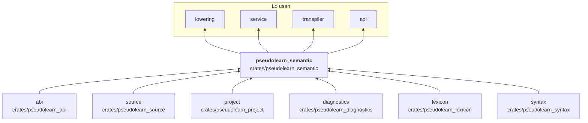
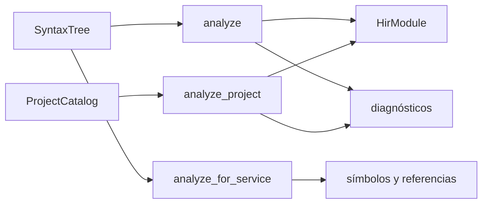

# pseudolearn_semantic

Análisis semántico: sobre el árbol sintáctico resuelve nombres y tipos, comprueba cada construcción (flujo, asignación
definida, genéricos, interfaces, variantes, colecciones, tareas y canales, capacidades y efectos, constantes) y produce
el modelo tipado `HirModule` con sus diagnósticos. Analiza un archivo suelto o un proyecto completo, y ofrece la vista
de símbolos y referencias que consume el servicio de lenguaje.

**No hace:** analizar texto (lo hace `syntax`), generar código ni ejecutar: devuelve un modelo tipado y diagnósticos.

## Dónde encaja

## Arquitectura

Importa `abi`, `source`, `project`, `diagnostics`, `lexicon` y `syntax`; la externa es `serde_json`. Los archivos se
agrupan por prefijo, uno por responsabilidad.

| Familia de archivos                                                      | Responsabilidad                                                               |
|--------------------------------------------------------------------------|-------------------------------------------------------------------------------|
| `checker`, `session`, `project_analysis`, `service_analysis`             | Puntos de entrada: `analyze`, `analyze_project`, `analyze_for_service`        |
| `hir`, `expression_model`, `statement_model`, `types`, `identities`      | `HirModule`, expresiones, sentencias, `Type` y los identificadores del modelo |
| `module_*`, `unit_resolver`, `project_profile`, `name_*`                 | Módulos, importaciones, ciclos, exportaciones y resolución de nombres         |
| `generic_*`, `interface_*`, `class_*`, `record_*`, `variant_*`, `enum_*` | Genéricos, interfaces, clases, registros, variantes y enumerados              |
| `*_checker`, `flow`, `definite_*`, `switch_*`, `control_*`               | Reglas de cada sentencia, flujo y asignación definida                         |
| `constant_*`, `operator_*`, `dimension_*`, `collection_*`                | Constantes evaluadas, operadores, dimensiones y colecciones                   |
| `task_*`, `channel_*`, `capture_*`, `closure_*`, `suspension_checker`    | Tareas, canales, capturas, cierres y suspensión                               |
| `effect_*`, `capability_types`, `http_types`, `json_types`               | Capacidades y efectos tipados                                                 |
| `service_*`                                                              | Símbolos, referencias y plantillas para el servicio de lenguaje               |

## Flujo principal

Flujo de datos, no dependencias.

## Reglas que conviene saber

- Si el árbol trae errores sintácticos (`has_errors`), `analyze` devuelve `None` sin añadir diagnósticos semánticos;
  igual
  `analyze_project_detailed` si cualquier unidad los trae.
- El modelo se construye con identificadores numéricos (`ExpressionId`, `StatementId`, `TypeId`…) y vectores por
  columnas, no con árboles de punteros.
- Solo importa las capas que lista `architecture.yaml`; no depende de `lowering`, `ir` ni de ninguna capa de ejecución.
- Sin `unsafe`; la salida es determinista.

## Comandos útiles

| Para qué              | Comando                              |
|-----------------------|--------------------------------------|
| Tests del crate       | `cargo test -p pseudolearn_semantic` |
| Verificación completa | `cargo xtask verify`                 |

Se ejecutan desde `packages/pseudolearn_engine`.
