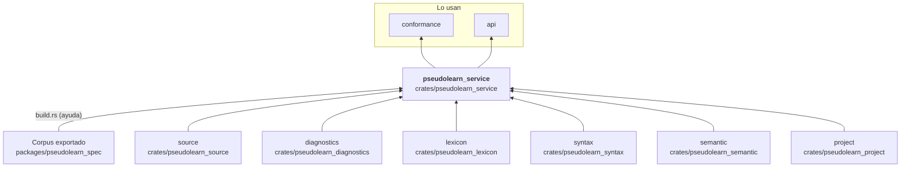
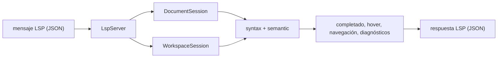

# pseudolearn_service

Herramientas de edición del lenguaje: sesión de documento con edición por rango y análisis incremental, sesión
persistente de proyecto con superposiciones, autocompletado (incluidas plantillas con paradas navegables), hover y ayuda
de firma, navegación (definición, referencias, símbolos, resaltado), renombrado, formateador, escritura asistida,
traducción del código entre los perfiles `es` y `en`, ayuda del lenguaje y un servidor LSP (`LspServer`) que las expone
por mensajes JSON. Todo resultado se deriva de la gramática, el vocabulario y el análisis semántico, sin heurísticas
externas.

**No hace:** ejecutar programas, leer el disco (recibe documentos y manifiestos ya cargados) ni dibujar interfaz.

## Dónde encaja

## Arquitectura

Importa `source`, `diagnostics`, `lexicon`, `syntax`, `semantic` y `project`; las externas son `serde` y `serde_json`.
`build.rs` genera las fichas de ayuda (`generated_help_cards.rs`) desde `helpCatalog` del corpus, incluidas desde
`help_catalog.rs`.

| Grupo                   | Archivos                                                                            | Responsabilidad                                                                                             |
|-------------------------|-------------------------------------------------------------------------------------|-------------------------------------------------------------------------------------------------------------|
| Documento               | `document_session`, `edit_session`, `edit_probe`, `unit_partition`, `node_identity` | `DocumentSession`, edición por rango, huellas por unidad e identidad de nodos                               |
| Proyecto                | `workspace_*`                                                                       | `WorkspaceSession`, snapshot, invalidación e índice del proyecto                                            |
| Completado y plantillas | `completion*`, `template_*`, `insertion`                                            | `complete_at_position`, plantillas con paradas y su inserción                                               |
| Consultas               | `hover`, `navigation`, `symbol_*`, `cursor_context`, `query_context`                | Hover, ayuda de firma, símbolos, resaltado y contexto de cursor                                             |
| Escritura               | `formatter`, `on_type*`, `typing_*`, `block_*`, `translator`                        | `format_source`, `on_type` y `translate_source`                                                             |
| Ayuda                   | `help_*`                                                                            | `help_content`, `resolve_help_at_position` y `render_help`                                                  |
| LSP                     | `lsp_*`, `request_cancellation`                                                     | `LspServer::handle_message`, configuración, renombrado, tokens semánticos y símbolos del espacio de trabajo |

## Flujo principal

Flujo de datos, no dependencias.

## Reglas que conviene saber

- Solo importa las capas de análisis (`source` a `project`); no depende de `lowering`, de la VM ni de `api`.
- No lee el disco: quien la llama entrega el snapshot completo y el contenido de manifiestos y bloqueos.
- Una solicitud LSP puede cancelarse (`handle_cancellable_message`, `RequestCancellation`).
- La traducción entre perfiles falla con `TranslationError::Collision` si un nombre del usuario coincide con una
  palabra reservada o con una producida por la propia traducción, en lugar de renombrarlo.
- Sin `unsafe`; la salida es determinista.

## Comandos útiles

| Para qué                        | Comando                                                                                        |
|---------------------------------|------------------------------------------------------------------------------------------------|
| Tests del crate                 | `cargo test -p pseudolearn_service`                                                            |
| Conformidad de las herramientas | `cargo run -p see_cli --bin see -- conform --subject service` (en `packages/pseudolearn_spec`) |
| Verificación completa           | `cargo xtask verify`                                                                           |

Se ejecutan desde `packages/pseudolearn_engine`, salvo la conformidad.
