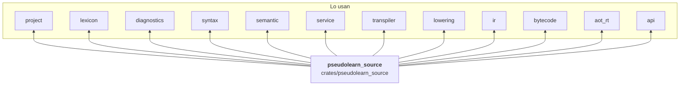

# pseudolearn_source

Texto fuente con posiciones verificadas: guarda el programa tal como llegó, indexa sus líneas, convierte desplazamientos
entre bytes, puntos de código Unicode y unidades UTF-16, y da identidad estable a cada archivo de un proyecto. Es la
base de todo el análisis: casi todos los demás crates la importan.

**No hace:** analizar sintaxis ni tipos, leer archivos del disco ni normalizar el texto almacenado (solo normaliza
nombres para compararlos).

## Dónde encaja

## Arquitectura

Sin dependencias internas. Las externas son `unicode-normalization` y `unicode-ident`.

| Módulo         | Pieza                                                 | Responsabilidad                                                                    |
|----------------|-------------------------------------------------------|------------------------------------------------------------------------------------|
| `source_text`  | `SourceText` y funciones de conversión                | Bytes originales, BOM, validez de tramos y conversión byte ↔ escalar ↔ UTF-16      |
| `line_index`   | `LineIndex`                                           | Inicio de cada línea y paso de desplazamiento a línea y columna                    |
| `span`         | `Span`, `SourceId`                                    | Tramo en bytes dentro de una fuente; `SourceId::STANDALONE` es el documento suelto |
| `identity`     | `ProjectId`, `RevisionId`, `NodeId`, `SourceIdentity` | Identidad compuesta de proyecto, revisión y archivo; `SourceLocation`              |
| `source_table` | `SourceTable`, `SourceFile`                           | Revisión inmutable de fuentes ordenadas por id; resuelve una localización          |
| `normalizer`   | `IdentifierNormalizer`                                | Normaliza (NFC) y valida identificadores para compararlos                          |

## Reglas que conviene saber

- Está en la base de las capas: `may_import` vacío en `architecture.yaml`, por lo que ningún otro crate del motor puede
  ser una dependencia suya.
- Sin `unsafe` (`unsafe_allowed: false`).
- Una `SourceTable` representa una revisión: una localización de otro proyecto o revisión no se resuelve
  (`SourceLookupFailure`).

## Comandos útiles

| Para qué              | Comando                            |
|-----------------------|------------------------------------|
| Tests del crate       | `cargo test -p pseudolearn_source` |
| Verificación completa | `cargo xtask verify`               |

Los comandos se ejecutan desde `packages/pseudolearn_engine`.
