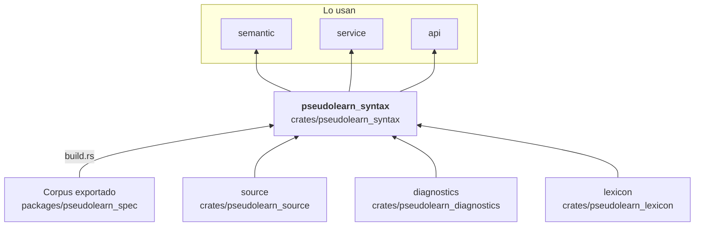
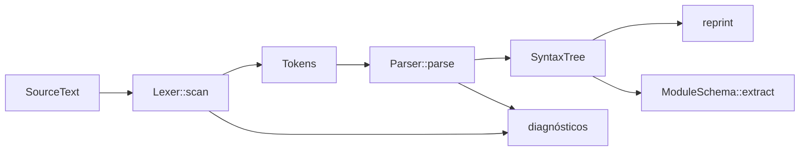

# pseudolearn_syntax

Análisis léxico y sintáctico: convierte un `SourceText` en tokens (`Lexer`) y en un árbol sintáctico sin pérdida
(`Parser`, `SyntaxTree`) que conserva trivia y permite reimprimir el texto original idéntico. Entrega los diagnósticos
léxicos y sintácticos, extrae el esquema de un módulo (`ModuleSchema`) y acota la profundidad de anidamiento para que
ningún programa agote la pila del anfitrión.

**No hace:** resolver nombres ni tipos (eso es `semantic`) ni ejecutar nada.

## Dónde encaja

`transpiler` lo usa solo en pruebas (dependencia de desarrollo).

## Arquitectura

Importa `source`, `diagnostics` y `lexicon`; la externa es `serde_json`. `build.rs` y `codegen/` (`grammar_reader`,
`structural`, `contextual`, `views`) leen el corpus y emiten `generated_syntax.rs` en `OUT_DIR`, incluido desde
`tree.rs`.

| Pieza                                                                | Responsabilidad                                                                              |
|----------------------------------------------------------------------|----------------------------------------------------------------------------------------------|
| `lexer`, `tokens`, `*_scanner`                                       | `Lexer::scan` devuelve `Tokens` y diagnósticos léxicos                                       |
| `parser`, `parser_state`, `*_parser`                                 | `Parser::parse` devuelve `SyntaxTree` y diagnósticos sintácticos; un parser por construcción |
| `tree`                                                               | `SyntaxTree`, `SyntaxNode`, `NodeKind` (vistas generadas)                                    |
| `reprint`                                                            | `reprint_lossless`, `reprint` y `verify_reprint_identity`                                    |
| `schema`                                                             | `ModuleSchema`, `UnitDeclaration`, `UnitKind`, `ParameterSignature`                          |
| `expression_entry`                                                   | `parse_expression_source`, entrada para una sola expresión                                   |
| `subprogram_keywords`, `contextual`, `stray_closings`, `unsupported` | Apertura y cierre de subprogramas, palabras contextuales y recuperación de errores           |

## Flujo principal

Flujo de datos, no dependencias.

## Reglas que conviene saber

- Solo importa `source`, `diagnostics` y `lexicon` según `architecture.yaml`.
- La gramática estructural y las vistas del árbol son código generado desde el corpus; no se editan a mano.
- El parser corta la recursión en `ANALYSIS_NESTING_LIMIT` (generado en `tree.rs`) en vez de agotar la pila.
- Sin `unsafe`; la salida es determinista (`deterministic_output_crates`).

## Comandos útiles

| Para qué              | Comando                            |
|-----------------------|------------------------------------|
| Tests del crate       | `cargo test -p pseudolearn_syntax` |
| Verificación completa | `cargo xtask verify`               |

Se ejecutan desde `packages/pseudolearn_engine`; la compilación necesita el corpus exportado.
