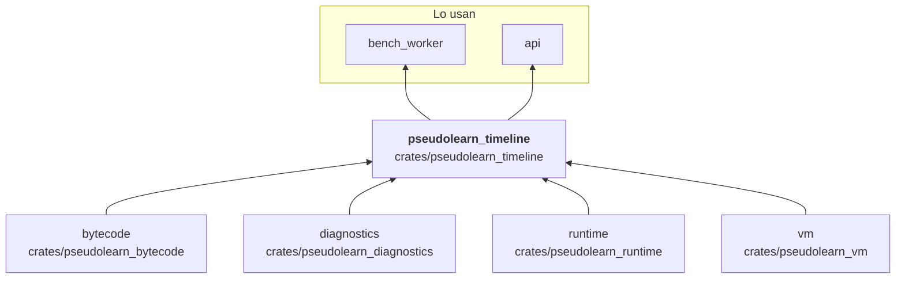
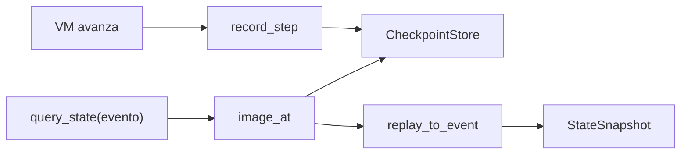

# pseudolearn_timeline

Línea temporal de una ejecución: mientras la VM avanza, registra puntos de control diferenciales con un presupuesto
finito y, cuando se pide el estado en un evento cualquiera, restaura el punto más cercano y repite hasta ese instante.
Entrega vistas inmutables de ese estado (marcos, variables, rebanadas de arreglos) y reproduce efectos de anfitrión a
partir de una cinta grabada.

**No hace:** ejecutar el programa por su cuenta (usa `vm`), ni atender efectos reales: reproduce los de la cinta.

## Dónde encaja

## Arquitectura

Importa `vm`, `runtime`, `bytecode` y `diagnostics`; no tiene dependencias externas.

| Módulo                                                                               | Responsabilidad                                                                                           |
|--------------------------------------------------------------------------------------|-----------------------------------------------------------------------------------------------------------|
| `timeline`                                                                           | `ExecutionTimeline`: `record_step`, `query_state`, `query_frames`, `query_variables`, `query_array_slice` |
| `store`, `checkpoint`, `thinning`                                                    | `CheckpointStore`, `Checkpoint` y adelgazamiento dentro de un `StoreBudget`                               |
| `scheduler`                                                                          | `CostScheduler` decide cuándo capturar según su coste                                                     |
| `replay`                                                                             | `replay_to_event` y `replay_machine_to_event`                                                             |
| `views`, `query_views`, `cell_view`, `array_view`                                    | `StateSnapshot`, `FrameView`, `VariableView` y capturas acotadas                                          |
| `effect_replay`, `effect_reservations`, `effect_tape`, `tape_replay`, `tape_privacy` | Cinta de efectos y reproducción histórica                                                                 |
| `inspect`, `error`                                                                   | Inspección de la imagen y `TimelineError`                                                                 |

## Flujo principal

Flujo de datos, no dependencias.

## Reglas que conviene saber

- Solo importa `vm`, `runtime`, `bytecode` y `diagnostics`.
- Las consultas devuelven `Result<_, TimelineError>`: un evento fuera del horizonte conservado es un error tipado, no
  una excepción.
- El almacén tiene presupuesto finito y adelgaza puntos de control al superarlo; ese presupuesto es parámetro del motor
  (`StoreBudget`), no una cifra del corpus.
- Sin `unsafe`; la salida es determinista.

## Comandos útiles

| Para qué              | Comando                              |
|-----------------------|--------------------------------------|
| Tests del crate       | `cargo test -p pseudolearn_timeline` |
| Verificación completa | `cargo xtask verify`                 |

Se ejecutan desde `packages/pseudolearn_engine`.
